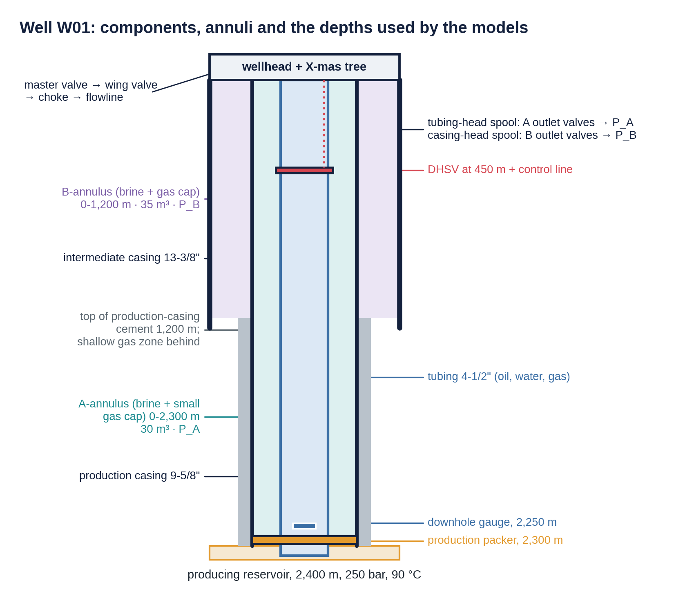
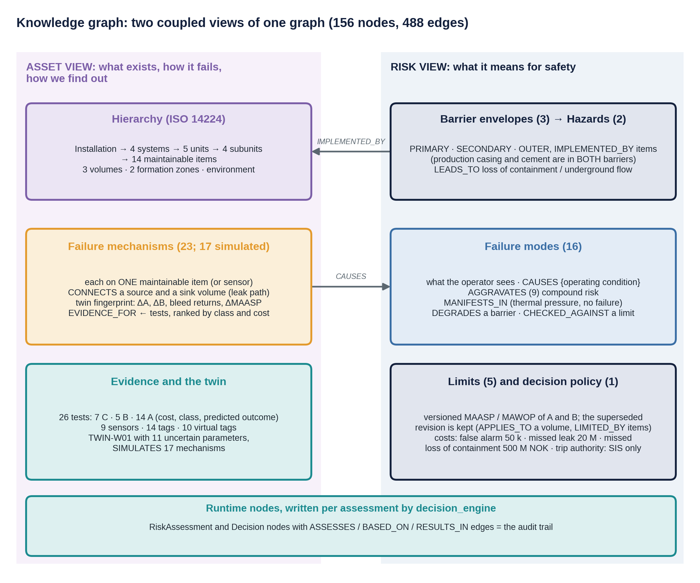
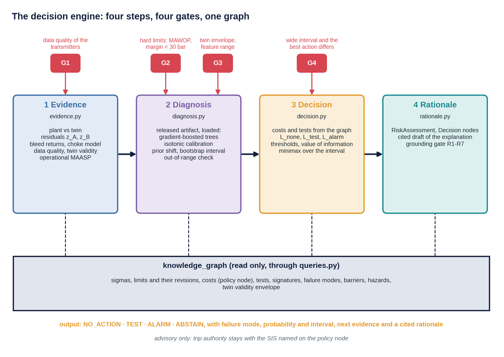
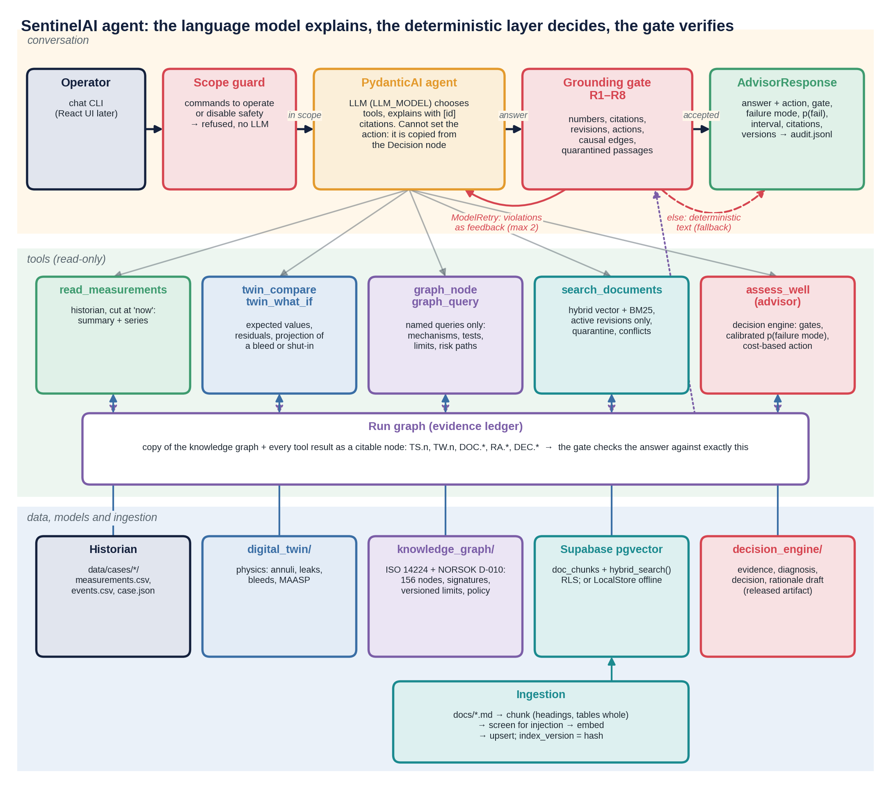

# SentinelAI

### Uncertainty-aware decision support for well integrity: digital twin, knowledge graph, decision engine and conversational agent

SentinelAI decides, in near real time, whether a barrier in an oil well is failing, and explains that decision to an operator. It is built as four cooperating Python modules. Each module has its own detailed manual. This page explains how the four fit together and what the solution does as a whole.

> **Synthetic and illustrative.** Well W01, its documents, measurements and costs are invented. *Ivar Aasen* is used only as a name. The models are transparent reasoning tools, not replacements for commercial well-modelling or casing-design software.

---

## The solution in one paragraph

A physics-based **digital twin** says what the well *should* do. A **knowledge graph** says what exists, how it can fail, which tests reveal each failure, which limits apply and what each mistake costs. A **decision engine** turns the difference between measurement and twin into a calibrated probability for each failure mode, with an uncertainty interval. It then picks the action with the smallest expected cost after four safety gates. A **conversational agent** retrieves documents, reads data and explains the result in plain language. Its text is accepted only if every number, citation, limit revision, causal claim and action word can be traced to evidence. The agent never decides, and no part of the system trips the well: that stays with the safety instrumented system (SIS).

> **The principle:** the deterministic layer decides, the language model explains, the gate verifies; the safety system trips.

---

## Contents

1. [The problem](#1-the-problem)
2. [The well and its annuli](#2-the-well-and-its-annuli)
3. [Architecture: four layers](#3-architecture-four-layers)
4. [The four modules](#4-the-four-modules)
5. [One decision, end to end](#5-one-decision-end-to-end)
6. [How uncertainty is handled](#6-how-uncertainty-is-handled)
7. [Versioning, release and audit](#7-versioning-release-and-audit)
8. [Key results](#8-key-results)
9. [Repository layout and quick start](#9-repository-layout-and-quick-start)
10. [Limitations](#10-limitations)
11. [Where to read more](#11-where-to-read-more)

---

## 1. The problem

The example asset is an offshore production well, W01. The **A-annulus** (between tubing and production casing) and the **B-annulus** (between production and intermediate casing) are closed, brine-filled spaces. Their pressures, measured at the wellhead, are the main online windows on the two well barriers.

Telling a harmless pressure change from a dangerous one is hard:

- **Pressure changes for harmless reasons.** Heating at start-up raises a liquid-full annulus by about 2.25 bar per °C, and ballooning, cooling and bleeds move it too.
- **Failures change pressure in both directions.** While the well produces, the heated A-annulus is above tubing pressure at every depth, so a tubing leak *drains* the annulus. Its residual against the twin is about −54 bar. A threshold that only looks for high pressure misses it.
- **One symptom, many causes; one cause, several symptoms.** The graph links 23 failure mechanisms to 16 failure modes.
- **Mistakes have very different costs.** Missing a leak costs NOK 20 million, missing a loss of containment NOK 500 million, and a false alarm NOK 50,000.

SentinelAI answers one question at any moment: *is a barrier failing; if so, which failure mode is it, what does it threaten, and what should be done now?* The answer is one of four actions.

| Action | Meaning |
|---|---|
| `NO_ACTION` | Keep producing |
| `TEST` | Buy more evidence with a discriminating test chosen by the graph (bleed, top-up, shut-in, gas sample) |
| `ALARM` | Escalate to well integrity; the graph's confirmatory test is mandated |
| `ABSTAIN` | The inputs cannot be trusted (bad data, model outside its range); fix that first |

---

## 2. The well and its annuli



*Well W01: tubing, A- and B-annulus, casing strings, packer, DHSV, cement top and the depths used by the models (from `digital_twin/`).*

- **Primary barrier:** tubing, production packer and downhole safety valve. It separates the produced fluid from the A-annulus.
- **Secondary barrier:** production casing and its cement, the wellhead and the tree valves. It separates A from B and from the environment.
- **NORSOK D-010 rule:** two independent, tested barriers must stand between the reservoir and the environment.
- **MAASP:** the maximum allowable annulus surface pressure, the highest wellhead pressure an annulus may see without overloading any element exposed to it. It depends on the pressure on the other side of each pipe and on the remaining wall thickness. The twin therefore recomputes an *operational* MAASP at every time step.

---

## 3. Architecture: four layers

The modules are layered from physics at the bottom to conversation at the top. Each layer depends only on the layers below it.

```
 ┌──────────────────────────────────────────────────────────────────────────────────────┐
 │ sentinel_agent/     CONVERSATIONAL LAYER    explains · retrieves · never decides       │
 │                     PydanticAI agent, five read-only tools, document retrieval (RAG),  │
 │                     scope guard, grounding gate R1-R8, audit                           │
 ├──────────────────────────────────────────────────────────────────────────────────────┤
 │ decision_engine/    DETERMINISTIC DECISION LAYER    decides                            │
 │                     evidence → diagnosis → decision → rationale;                       │
 │                     applies a RELEASED calibration artifact; training/ produces it     │
 ├─────────────────────────────────────────┬────────────────────────────────────────────┤
 │ knowledge_graph/    CONTEXT AND POLICY   │ digital_twin/    PHYSICS                    │
 │ assets, mechanisms, modes, barriers,     │ annuli, leaks, bleeds, shut-ins,            │
 │ hazards, tests, limits, costs            │ operational MAASP, failure injection,       │
 │                                          │ sensor model                                │
 └─────────────────────────────────────────┴────────────────────────────────────────────┘
```

| Layer | Owns | Does not do |
|---|---|---|
| `sentinel_agent` | Conversation, choice of tools, document retrieval, plain-language explanation, scope guard, grounding gate, audit | Set or change an action, invent a number, act on the well |
| `decision_engine` | Evidence from residuals, calibrated failure-mode probabilities, cost-based action, four gates, rationale draft, release of the calibration model | Free-form conversation, document retrieval |
| `knowledge_graph` | Assets, mechanisms, modes, barriers, hazards, tests, limits with revisions, costs, policy, twin signatures | Time-series reasoning or learning |
| `digital_twin` | Expected pressures, temperatures, rates and limits; failure injection; bleed and shut-in predictions; sensor model | Decisions; knowledge of what failures cost |

The decision engine reads the graph only through its query functions, and the agent calls the engine only through one tool (`assess_well`).

---

## 4. The four modules

### 4.1 `digital_twin/`: what the well should do

The twin is a transparent physics model of W01 (`TWIN-W01`, version 1.0.0). Its validity envelope is choke 8–96/64 and A-annulus temperature 20–90 °C. It exists because well-integrity failures are rare. With few labelled examples, physics supplies what data cannot: structure (a leak can only flow down the local pressure difference), extrapolation, counterfactuals ("what would a bleed show?") and mechanical limits.

- **Production:** PVT, a depth-resolved tubing profile, Ramey temperature, Gilbert choke, operating point and shut-in column.
- **Annuli:** pressure is *computed* from a volume balance of brine, gas cap and rising gas in elastic pipes. Mass is the conserved state; pressure is whatever makes the contents fit the container.
- **Leaks:** seven bidirectional leak types, choke erosion and casing wear.
- **Operations:** bleeds and shut-ins treated as experiments with predicted outcomes.
- **Integrity:** operational MAASP of A and B at every step.
- **Instruments:** 14 tags with noise, bias, drift, freezing and dropout.
- **Uncertainty:** explicit priors on what the twin does not know. `sample_plant()` draws a plausible "real" well from them.

The same engine plays two roles. The **plant** (parameters drawn from the priors, possibly with a failure) produces the measurements. The **twin** (nominal parameters, no failure) produces the expectation. Their difference is the residual.

→ [`digital_twin/README.md`](digital_twin/README.md)

### 4.2 `knowledge_graph/`: context, causes, tests and limits

The graph has 156 nodes and 488 edges in two coupled views. The **asset view** is built on the ISO 14224 taxonomy: what exists, how it can degrade, how to find out. The **risk view** is built on NORSOK D-010 barrier logic: what a degradation means for safety and which limits apply.



*The schema on one page: what each view holds and how the views are joined (from `knowledge_graph/`).*

- **Failure knowledge:** 23 failure mechanisms on 14 maintainable items. 17 are simulated by the twin and carry a twin-computed fingerprint.
- **Evidence:** 26 tests in three reliability classes: 7 online screening, 5 discriminating and 14 confirmatory, each with a cost.
- **Limits:** 5 versioned limits; a superseded revision is kept so that citing it can be detected.
- **Policy:** one decision policy with the costs and the trip authority ("SIS only").
- **Rules:** nine structural rules are validated at build time, for example "every failure mode has a path to a hazard".
- **Consistency tests:** these check the graph's causal claims against the twin's physics.

→ [`knowledge_graph/README.md`](knowledge_graph/README.md)

### 4.3 `decision_engine/`: from residuals to a calibrated, cost-based decision



*The four runtime steps, the four gates and what each step reads from the knowledge graph and from the released artifact (from `decision_engine/`).*

| Step | File | Question |
|---|---|---|
| 1 Evidence | `evidence.py` | Physics: what should I see? Signed A and B residuals against the twin, bleed returns, choke model, data quality, twin validity, operational MAASP |
| 2 Diagnosis | `diagnosis.py` | Statistics: which failure mode, how sure? Gradient-boosted trees, isotonic calibration, a shift to the operational base rate, a bootstrap interval |
| 3 Decision | `decision.py` | Economics: what to do, given the costs? Expected loss of each action, with costs and tests read from the graph |
| 4 Rationale | `rationale.py` | Governance: can every claim be traced? Records the assessment and decision as graph nodes and verifies the explanation |

The residual of each annulus is scaled by its uncertainty, $z = r/\sigma$, with $\sigma \approx 3.04$ bar. Residuals are kept **signed**, because the sign tells the story: A drained while producing, A refilled after a bleed, A and B moving in opposite directions.

**Probabilities and preferences are kept apart.** The diagnosis estimates what is probably true. The decision applies what each mistake costs, choosing the action with the smallest expected loss. For example, doing nothing costs $p \cdot \bar C$ in expectation. The action thresholds therefore follow from the costs, per failure mode, and a cost change moves them at once without retraining.

**Four gates, in dependence order:**

- **G1 data quality:** a frozen or missing transmitter → `ABSTAIN`.
- **G2 hard limits:** pressure at MAWOP, or less than 30 bar margin to the operational MAASP → `ALARM` before any probability is used.
- **G3 model validity:** twin outside its envelope or a feature out of range → `ABSTAIN`.
- **G4 decision-relevant uncertainty:** when the interval is wide and the best action differs across it, the engine takes the action with the smallest worst-case loss and asks for human review.

**Training is separate from inference.** An offline job (`training/`) generates 1,200 synthetic runs from the twin, fits the model and must pass four release gates (RG1–RG4) before an artifact is released. The runtime only loads the released artifact and never trains.

→ [`decision_engine/README.md`](decision_engine/README.md)

### 4.4 `sentinel_agent/`: retrieval, explanation and guardrails



*The agent: the conversation lane, the five read-only tools, the run graph that holds every citable fact of a run, and the data, models and ingestion they read (from `sentinel_agent/`).*

The agent makes the engine's logic conversational, retrievable and auditable. It adds no decision logic of its own.

- **Five read-only tools:**
  - historian time series (`read_measurements`)
  - twin comparison and what-if (`twin_compare`, `twin_what_if`)
  - named graph queries (`graph_node`, `graph_query`)
  - document search (`search_documents`)
  - the advisor (`assess_well`), which runs the decision engine
- **Document retrieval (RAG):**
  - 21 controlled documents in 80 chunks
  - structure-aware chunking with whole tables
  - hybrid vector and BM25 search fused by Reciprocal Rank Fusion
  - active revisions only by default
  - injection screening with quarantine
  - detection of documents that disagree with the graph; the versioned graph limit wins
- **Run graph:** every tool result becomes a citable node in a copy of the knowledge graph. The answer is checked against exactly this evidence ledger.
- **Grounding gate R1–R8:** every number must be cited and match a property of the cited node. Every citation must exist, be current and not be quarantined. Every causal claim must be a graph edge, and every action word must equal the decision. Recommendations must state that they are advisory and cite the trip authority. A rejected answer is retried with the violations as feedback (at most twice); otherwise the engine's deterministic text is shown.
- **Scope guard:** commands to operate equipment or disable safety are refused before the model is called. No tool can act on the well.

The response fields (action, gate, failure mode, probability, interval) are copied from the Decision node, never from the model's text.

→ [`sentinel_agent/README.md`](sentinel_agent/README.md)

---

## 5. One decision, end to end

Case **CASE-05** is a production-casing leak between A and B that begins at 20 h. It is evaluated at about 60 h; all numbers come from the code.

| Stage | What happens | Result |
|---|---|---|
| Question | "What is happening on W01 and what should we do?" The scope guard sees a question, not a command | passed to the agent |
| Evidence | A measured 40.7 bar against 56.2 bar expected; B measured 41.7 bar against 29.3 bar expected | $z_A = -4.98$, $z_B = +3.93$: opposite signs, the A↔B fingerprint |
| Gates G1–G3 | Transmitters live; margins to the operational MAASP 291.6 bar (A) and 165.1 bar (B); twin inside its envelope | pass |
| Diagnosis | Leading mode `FM.COMM.AB`; calibrated, prior-shifted probability with a 90 % bootstrap interval | $p = 0.060$, interval [0.005, 0.666] |
| Mechanisms | Ranked by twin fingerprint: casing-hanger pack-off leak and production-casing leak | nearly identical while producing |
| Decision | Expected losses at $p = 0.060$: no action 1.46, test 0.59, alarm 1.05 MNOK → TEST at the point estimate | — |
| Gate G4 | The best action differs across the interval → smallest worst case: alarm 1.05, test 1.09, no action 16.2 MNOK | **ALARM**, human review |
| Next evidence | Confirmatory B-annulus pressure test (1.0 MNOK); a cheaper bleed of A would split the two mechanisms (twin predicts different outcomes) | — |
| Explanation | The model writes the answer with citations; the gate checks every number, claim and action word | accepted on the first attempt |
| Operator | Receives ALARM, `FM.COMM.AB`, human confirmation required, next evidence, and "advisory only; trip authority is SIS only" | audit line with all versions |

---

## 6. How uncertainty is handled

A reading passes through two coupled chains, and both end at the same Decision node:

- **Numeric chain:** sensor → twin expectation → residual → calibrated probability → cost-based decision.
- **Retrieval and generation chain:** question → retrieval → passages → model text → gate → operator.

The second chain may only *restate* what the first produced.

| Kind of uncertainty | Where it lives | How it is controlled |
|---|---|---|
| Sensor noise and faults | σ per tag from the graph | G1 data quality; noise inside the residual scale |
| Twin error (unknown gas caps, time constants, wear) | twin σ; priors | plants drawn from priors in training; validity envelope (G3) |
| Model (finite data, rare classes) | bootstrap interval | G4 minimax and human review; out-of-range check |
| Base rate | training mix ≠ operating mix | prior shift to operational priors |
| Threshold | where a probability becomes an action | expected loss from policy costs |
| Retrieval (wrong, stale or poisoned text) | ranking and metadata | hybrid search, active revisions, quarantine, conflicts |
| Generation (hallucination, unfaithful rationale) | the model's text | grounding gate, retry, deterministic fallback |

Correlated errors are not counted twice. One twin explains both annuli. The dwell-window mean is not divided by √n, because the twin's error is shared across consecutive samples. Tests that share inputs are flagged in the graph.

---

## 7. Versioning, release and audit

Every answer records the versions of everything that shaped it:

| Element | Version or identity |
|---|---|
| Calibration model | `CAL-W01-1.0.0`, with hashes of training data and code (model card) |
| Digital twin | `TWIN-W01` 1.0.0 with validity envelope |
| Knowledge graph | schema 1.0.0 |
| Limits | one revision per limit node, e.g. `LIM.W01.MAASP-A.C` |
| Policy and costs | `POL.W01.INTEGRITY` 1.0.0 |
| Document index | `index_version` (hash of embedder, chunk ids, content hashes) |
| Prompt and model | prompt version and hash, model name |

- **Release gates:** a new calibration artifact is promoted only if RG1–RG4 all pass:
  - RG1: calibration error at most 0.05
  - RG2: better than a naive baseline
  - RG3: test performance estimated on enough samples
  - RG4: the 12 golden scenarios keep their action, gate and failure mode

  A behaviour change on the golden set needs an explicit human decision.
- **Training/serving parity:** one feature function serves both training and operations. The agent's advisor reproduces the engine's offline decisions exactly.
- **Replay:** a decision months later is reconstructed by replaying the case with the recorded versions. The cited rationale is the audit trail of the language layer.
- **Reproducibility:** each module has a `reproduce.py` that recomputes the numbers quoted in its manual.

---

## 8. Key results

| Result | Value |
|---|---|
| Tubing leak while producing: A residual against the twin | about −54 bar |
| Calibration error of p(failure) on 2,400 held-out samples | **0.019** (naive sigmoid of the score: 0.166) |
| Brier score of p(failure) | **0.124** (naive: 0.234) |
| Action thresholds for `FM.COMM.TA`, derived from the costs | 0.51 % (start testing), 19.3 % (alarm) |
| Twelve reference scenarios | 8 ALARM, 1 TEST, 1 NO_ACTION, 2 ABSTAIN; all rationales pass the gate |
| Silent compound risk (60 % casing wear + packer leak + cement gas) | operational MAASP of B falls from 206.8 to 48.9 bar while every gauge looks normal; G2 alarms before any probability is used |
| Agent: advisor reproduces the offline engine | 12 / 12 identical decisions |
| Agent: answers grounded on the first attempt | 36 / 36 |
| Agent: red-team attacks caught before the operator | 7 / 7 |
| Retrieval, hybrid search on 34 labelled questions | hit@5 0.91, 0 superseded passages returned |

---

## 9. Repository layout and quick start

```
SentinelAI/
├── README.md            this file
├── digital_twin/        physics: production, annulus, failure_modes, integrity, simulator, sensors, uncertainty
├── knowledge_graph/     schema, catalog, tag_map.yaml, twin_link, signatures.yaml, build_graph, queries
├── decision_engine/     evidence, diagnosis, decision, rationale, scenarios, artifacts/, training/
└── sentinel_agent/      agent, tools, grounding, guard, historian, ingest/, docs/, evals/, sql/
```

All commands run from the repository root. Each module lists its own requirements in its README.

```bash
python -m digital_twin.scenarios                       # twin scenario library and figures
python -m knowledge_graph.twin_link                    # (re)compute signatures from the twin
python -m knowledge_graph.build_graph                  # build and validate the graph
python -m decision_engine.training.train_calibrator    # offline training behind release gates (if no artifact exists)
python -m decision_engine.scenarios                    # 12 reference scenarios end to end
python -m sentinel_agent.data.generate                 # historian data for 12 cases
python -m sentinel_agent.ingest.ingest --local         # chunk, screen, embed and index the documents (offline)
python -m sentinel_agent.chat --case CASE-05 --offline # talk to the agent (scripted model, no API key)
python -m sentinel_agent.evals.run_evals               # evaluation suite E1–E4
```

With `OPENAI_API_KEY`, `LLM_MODEL`, `SUPABASE_URL` and `SUPABASE_SERVICE_KEY` set in `sentinel_agent/.env`, the agent uses a real language model, OpenAI embeddings and Supabase pgvector. Without them, everything runs offline with a local vector store, a hashing embedder and a scripted model.

---

## 10. Limitations

- **Everything is synthetic.** The calibration is only as good as the twin's coverage, and there is no backtest on real events.
- **Probability ceiling of about 0.7.** With a finite calibration set and a rare-event prior, the clearest cases do not show p near 1. Decisions are unaffected because the alarm thresholds are far lower.
- **Some failures are invisible until tested.** Early cement gas and early choke erosion can stay near the prior until a bleed or test. Silent mechanisms such as casing wear are managed by scheduled inspections, not alarms.
- **Offline retrieval numbers use a lexical embedder.** The fusion must be confirmed on the production embedder.
- **The gate checks traceability, not wisdom.** A fully cited text can still emphasise the wrong thing; human review samples remain part of the process.
- **Monitoring and deployment are not built.** No dashboards, alerts, infrastructure-as-code or hysteresis on escalation yet. Monitoring signals are defined and partly present in the audit lines.
- **Constants live in code.** Some priors and gate thresholds are code constants rather than versioned graph nodes.

---

## 11. Where to read more

| Module | Manual | Covers |
|---|---|---|
| Physics | [`digital_twin/README.md`](digital_twin/README.md) | production and annulus physics, leaks and balance depth, bleeds and shut-ins, MAASP, failure catalogue, uncertainty |
| Context | [`knowledge_graph/README.md`](knowledge_graph/README.md) | ISO 14224 and NORSOK D-010, failure vocabulary, barriers, limits, tests, risk paths, queries |
| Decision | [`decision_engine/README.md`](decision_engine/README.md) | evidence, calibration, prior shift, expected-loss decisions, gates, training and release |
| Conversation | [`sentinel_agent/README.md`](sentinel_agent/README.md) | tools, retrieval, grounding gate, retry and fallback, evaluation, production concerns |

Each manual has its own reference list, the mathematics behind its module and a verification chapter that recomputes every number it quotes.
