# decision_engine — A Manual on Uncertainty-Aware Well-Integrity Decisions

### From two annulus residuals to a calibrated failure-mode diagnosis, a cost-based decision and a grounded explanation — and how the model behind it is trained, gated and released

> **What this document is.** A self-contained, textbook-style manual for the `decision_engine/` module of
> SentinelAI. It explains *what* each step computes, *why* it is done that way, the *mathematics* behind
> it, *how the calibration model is trained and released*, and *worked examples* with the numbers the code
> produces (`python -m decision_engine.scenarios`, `python -m decision_engine.training.train_calibrator`).
>
> **How it fits.** The decision engine is the deterministic decision layer of SentinelAI. It sits on top of
> `digital_twin/` (physics: what the well should do) and `knowledge_graph/` (context: what exists, how it
> fails, which tests reveal it, which limits apply, what each mistake costs), and below `sentinel_agent/`
> (the conversational layer, which calls the engine as its advisor tool and only explains its result).
> The engine reads the graph only through `knowledge_graph/queries.py`.
>
> **Synthetic and illustrative.** All numbers come from the digital twin, the knowledge graph, or the
> assumptions listed in Chapter 12. No operator or proprietary data is used.
>
> The numbers of this manual are recomputed by `python -m decision_engine.reproduce` (Chapter 16), the equations carry the numbers
> (H.1) to (H.30) they have in Appendix H of the *End-to-End Solution Description*, and the sources are cited as [n] and listed in
> Chapter 17.

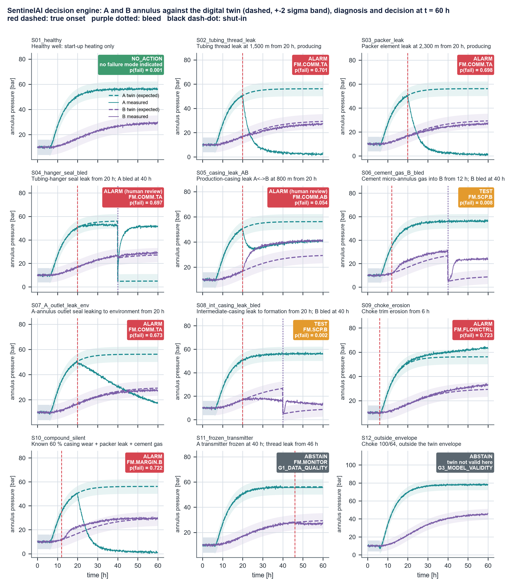

*Figure 1. The twelve reference scenarios at t = 60 h: A and B annulus pressure against the digital twin (dashed, ±2σ band), with the decision of the engine as a badge. Regenerated by `python -m decision_engine.scenarios` in the style of the End-to-End Solution Description (`figures.scenarios_figure`).*

---

## The engine on one page

| | |
|---|---|
| **Question answered** | *Is a barrier failing, which failure mode is it, what does it threaten, and what should be done now?* |
| **Output** | One of `NO_ACTION`, `TEST`, `ALARM`, `ABSTAIN`, with failure mode, calibrated probability and interval, next evidence, expected losses, limits and a cited rationale |
| **Four runtime steps** | `evidence.py` → `diagnosis.py` → `decision.py` → `rationale.py` |
| **Deterministic?** | At inference, yes: same inputs + same released artifact ⇒ same decision. The artifact itself is a *trained statistical model* (gradient-boosted trees + isotonic calibration + bootstrap ensemble) |
| **Training** | `training/` — offline job: 1,200 synthetic runs, split by run, fit, bootstrap, evaluate, **release gates RG1–RG4**, promote or reject |
| **Released artifact** | `artifacts/calibration_W01.joblib` + model card `calibration_W01.json` + `golden_decisions.json` |
| **Quality** | ECE 0.019 (naive 0.166); Brier 0.124 (naive 0.234); 12/12 golden scenarios reproduced |
| **Safety boundary** | Advisory only; trip authority stays with the SIS named on the policy node |

**The one sentence to remember.** Probabilities and preferences are kept apart: the diagnosis says *what is
probably true* (calibrated, with its uncertainty); the decision applies *what each mistake costs* (from the
graph); the gates decide *when neither may be trusted*.

---

## What changed in this revision

**The engine did not change.** `evidence.py`, `diagnosis.py`, `decision.py`, `rationale.py`, `training/dataset.py`, `test_decision_engine.py`, the model card `calibration_W01.json` and the golden set `golden_decisions.json` are byte-for-byte the files you provided. `calibration_W01.joblib` was not part of the upload and is untouched. In two scripts one function each changed, so that a re-run keeps the figure style: `scenarios._plot` and `training/train_calibrator._figures` now call `figures.py`. (The model card records a hash of `train_calibrator.py`; it will differ at the next retraining, which is recorded but not checked.) All fourteen chapters of the earlier manual are kept, in the same order, with their tables and equations. This revision adds:

| Addition | Where |
|---|---|
| Equation numbers **(H.1)** to **(H.30)**, the numbers the equations have in Appendix H of the *End-to-End Solution Description*; derivations that the earlier text stated without proof (the closed form of the test loss and of the action thresholds, the value of a test, the concavity behind the minimax rule, the probability ceiling, the correlated dwell mean, the design effect) | Chapters 2, 4 to 6; new Chapter 15 |
| One figure style for all eleven figures (palette of the Solution Description, 300 dpi). The confusion matrix is redrawn now from the model card; eight figures are new; `decision_scenarios.png` and `reliability.png` take the new style the next time the scenarios or the training job run | Figures 1 to 11 |
| `analysis.py` (the mathematics as functions of numpy only), `figures.py`, `figstyle.py`, `reproduce.py`, `test_analysis.py`, `requirements.txt`, `verification_report.md` | Chapters 3, 15, 16 |
| Numbered citations [n] and a reference list of 53 entries; the further-reading list of the earlier manual is part of it | Chapter 17 |
| What was recomputed and what was clarified while doing so, with the evidence | 16.4 |

**What was run, and what was not.** The mathematics tier of `reproduce.py` (212 checks) and the 14 tests of `test_analysis.py` were run against your actual runtime code: `decision.py`, `diagnosis.py`, `rationale.py` and `train_calibrator.py` are loaded from source with the knowledge graph stubbed out. The *engine* tier (the twelve scenarios end to end, 100 more checks) needs `digital_twin`, `knowledge_graph` and the released artifact, which were not available when this revision was produced; it is written from the numbers printed in Chapters 8 and 9 and has **not been executed yet**. Run `python -m decision_engine.reproduce --engine` once (Section 16.3).

If you prefer the module exactly as you provided it, keep your own `scenarios.py` and `training/train_calibrator.py` and leave out the new files; the engine, the tables and all results are unchanged by that choice, and only the passages that cite the new files and figures need them.

---

## Contents

1. [The big picture](#1-the-big-picture)
2. [Probability toolkit](#2-probability-toolkit)
3. [Quick start, package layout and files](#3-quick-start-package-layout-and-files)
4. [Step 1 — Evidence (`evidence.py`)](#4-step-1--evidence-evidencepy)
5. [Step 2 — Diagnosis (`diagnosis.py`)](#5-step-2--diagnosis-diagnosispy)
6. [Step 3 — Decision (`decision.py`)](#6-step-3--decision-decisionpy)
7. [Step 4 — Grounded rationale (`rationale.py`)](#7-step-4--grounded-rationale-rationalepy)
8. [Results: twelve reference scenarios](#8-results-twelve-reference-scenarios)
9. [Complete worked example: scenario S05](#9-complete-worked-example-scenario-s05)
10. [Training, release and lifecycle of the calibration model](#10-training-release-and-lifecycle-of-the-calibration-model)
11. [Design choices against common failure patterns of AI alarm systems](#11-design-choices-against-common-failure-patterns-of-ai-alarm-systems)
12. [Assumptions and sensitivity](#12-assumptions-and-sensitivity)
13. [Limitations](#13-limitations)
14. [Glossary](#14-glossary)
15. [Formal and mathematical reference](#15-formal-and-mathematical-reference)
16. [Verification: reproducing every number](#16-verification-reproducing-every-number)
17. [References](#17-references)

Each technical chapter follows the same pattern: **the problem → the idea → the mathematics → how the code
does it → a worked example → pitfalls.**

---

## 1. The big picture

### 1.1 The question the engine answers

At any moment, a well-integrity engineer looking at well W01 must decide:

> *Is a barrier failing? If so, which failure mode is it, what does it threaten, and what should be done now?*

The answer is one of four actions:

| Action | Meaning | Typical cost if unnecessary |
|---|---|---|
| `NO_ACTION` | Keep producing | Nothing, unless a failure is missed (very expensive) |
| `TEST` | Buy more evidence with a class-B test chosen by the graph (bleed, top-up, shut-in, gas sample) | Cost of the test |
| `ALARM` | Escalate to well integrity; the graph's confirmatory class-A test is mandated | Test cost plus false-alarm cost |
| `ABSTAIN` | The inputs cannot be trusted (bad data, model out of its range); fix that first | — |

### 1.2 Why simple thresholds fail

1. **Pressure changes for harmless reasons.** Heating at start-up raises a liquid-filled annulus by about
   2.25 bar per °C [1, 2]; ballooning, cooling and bleeds move it too. The digital twin predicts all of these.
2. **Failures change pressure in *both* directions.** While the well produces, the heated A-annulus is above
   tubing pressure at every depth, so a tubing or packer leak *drains* the annulus: the A residual becomes
   about **−54 bar**. A threshold that only looks for high pressure misses it.
3. **One symptom, many causes; one cause, several symptoms.** The graph links 23 failure mechanisms to
   16 failure modes. Two annuli (A and B), bleed returns and the choke model are all needed to tell them apart.
4. **Mistakes have very different costs.** In the policy node, missing a leak costs NOK 20 million, missing a
   loss of containment NOK 500 million, a false alarm NOK 50,000.

### 1.3 The four runtime steps

```
 (1) EVIDENCE             (2) DIAGNOSIS                (3) DECISION                  (4) RATIONALE
 A and B residuals vs  →  calibrated probability   →  action with the smallest  →  explanation in which every
 the twin, bleed returns,  of each failure mode,       expected cost, after         number and every causal claim
 choke model, limits       with an interval            safety gates                 is traced to a graph node
```

| Step | File | Reasoning | Discipline |
|---|---|---|---|
| 1 Evidence | `evidence.py` | Physics: "what should I see?" | Model-based fault detection (analytical redundancy) [3, 4] |
| 2 Diagnosis | `diagnosis.py` | Statistics: "which failure mode, how sure?" | Probabilistic classification, calibration |
| 3 Decision | `decision.py` | Economics: "what to do, given the costs?" | Bayesian decision theory, value of information [5, 6] |
| 4 Rationale | `rationale.py` | Governance: "can every claim be traced?" | Provenance and verification |

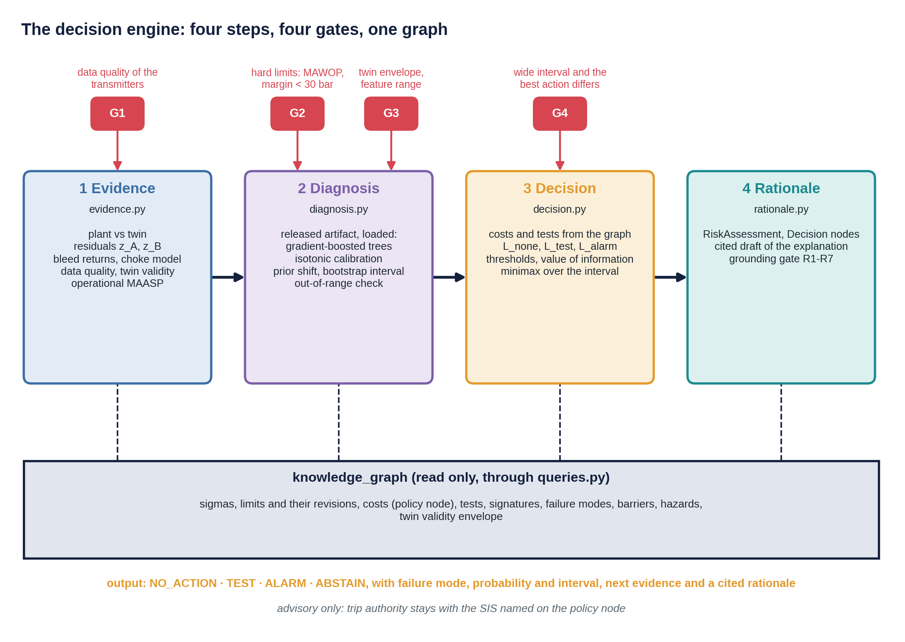

*Figure 2. The four runtime steps, the four gates and what each step reads from the knowledge graph and from the released artifact.*

### 1.4 Design principles

- **Each step does one job and passes its uncertainty on.** Nothing is reduced to yes / no until the end, and a
  human confirms when uncertainty could change the answer.
- **The graph is the single source of context.** Sigmas, limits, costs, tests, failure modes, barriers, hazards
  and the twin's validity range are read from graph nodes.
- **Probabilities and preferences are kept apart.** Step 2 estimates what is true; step 3 applies what each
  mistake costs. Changing a cost never requires retraining.
- **Inference and training are kept apart.** The runtime path only *applies* a released artifact; the training
  job produces artifacts and must pass release gates before one is used (Chapter 10).
- **Advisory only.** Trip authority stays with the certified safety instrumented system (`SIS-W01`).

### 1.5 Where the engine sits in the software stack

```
 sentinel_agent/      conversational layer    LLM chooses tools and explains; grounding gate R1-R8
        │ assess_well()
        ▼
 decision_engine/     deterministic decision layer  (this module)
   runtime:  evidence → diagnosis → decision → rationale        ← imported by the agent
   training/ offline job: dataset → fit → gates → artifacts/    ← run by CI or a retraining trigger
        │ reads                                │ simulates
        ▼                                      ▼
 knowledge_graph/  context and policy     digital_twin/  physics, failures, MAASP
```

**About the name.** The module is called *decision engine* because it is the runtime component that turns
evidence into a decision. The word *pipeline* is reserved, in this project, for its usual software meaning: the
CI/CD pipeline that tests and releases code, and the training pipeline in `training/` that produces the
calibration artifact. The engine is "deterministic" in the precise sense that its *inference* is a pure function
of its inputs and a versioned artifact; it still contains a learned statistical model, and Chapter 10 explains
how that model is trained and controlled.

---

## 2. Probability toolkit

### 2.1 Probability, odds and log-odds

$$\text{odds}(p) = \frac{p}{1-p}, \qquad \text{logit}(p) = \ln\frac{p}{1-p}, \qquad p = \sigma(a) = \frac{1}{1+e^{-a}}$$

| $p$ | odds | logit |
|---|---|---|
| 0.002 | 0.002 (1 : 499) | −6.21 |
| 0.10 | 0.111 | −2.20 |
| 0.50 | 1 | 0 |
| 0.90 | 9 | +2.20 |
| 0.999 | 999 | +6.91 |

Bayes' rule is *addition* on the log-odds scale (2.3), and probabilities near 0 or 1 that look similar can be
far apart in log-odds. The sigmoid makes any score *look* like a probability; it does not make it one (Chapter 5).

### 2.2 Bayes' rule

$$P(H \mid E) = \frac{P(E \mid H)\,P(H)}{P(E)} \qquad (\text{H.1})$$

$P(H)$ is the **prior** (how common the hypothesis is before looking), $P(E\mid H)$ the **likelihood**,
$P(H\mid E)$ the **posterior**.

### 2.3 Odds form and likelihood ratio

$$\frac{P(H\mid E)}{P(\bar H\mid E)} = \underbrace{\frac{P(E\mid H)}{P(E\mid \bar H)}}_{LR} \times \frac{P(H)}{P(\bar H)}
\qquad\Longleftrightarrow\qquad \text{posterior logit} = \ln LR + \text{prior logit} \qquad (\text{H.1, odds form})$$

The likelihood ratio is what the evidence contributes; the prior is what the world contributes.

### 2.4 The base-rate effect, with W01 numbers

The twin estimates the A-annulus bleed test at sensitivity 0.665 and specificity 0.992 (Section 5.10).

- $LR_+ = 0.665 / (1-0.992) \approx 83$
- Prior odds for a failure: $0.002/0.998 \approx 0.002$
- After a positive bleed: odds $\approx 0.002 \times 83 = 0.17$, so **p ≈ 0.14**

A strongly specific test still leaves an 86 % chance that nothing is wrong when failures are rare (base-rate neglect, [7]). A negative
bleed has $LR_- = 0.335/0.992 \approx 0.34$: it only cuts the odds by a factor of three.

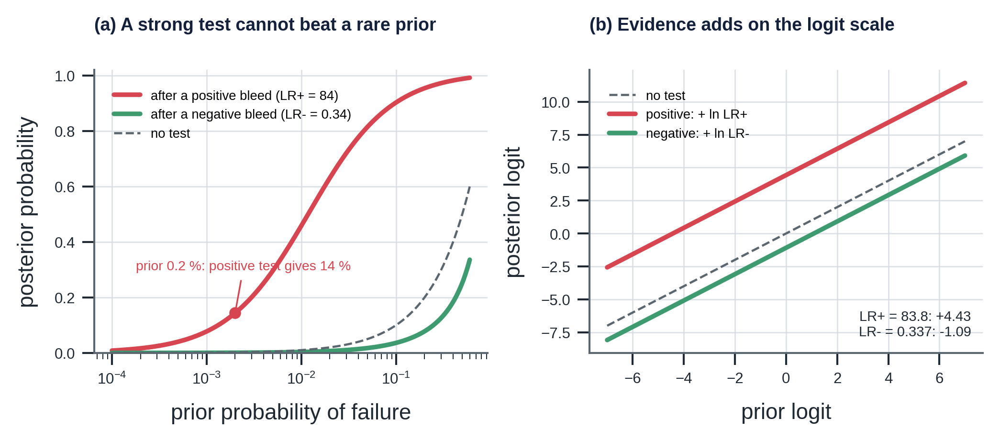

*Figure 3. (a) A positive A-bleed (LR+ = 84) lifts a prior of 0.2 % to only 14 %; a negative one lowers it to 0.07 %. (b) The same on the logit scale, where evidence adds.*

### 2.5 More than two hypotheses

With hypotheses $k = 0 \dots K$ (here: "no failure" and six failure modes),

$$P(k \mid E) = \frac{P(E\mid k)\,\pi_k}{\sum_j P(E\mid j)\,\pi_j} \qquad (\text{H.3})$$

The same structure: evidence (likelihoods) times prior, normalised. Section 5.7 uses it to move from the
training world to operations.

### 2.6 Sensitivity and specificity

| | Failure present | No failure |
|---|---|---|
| Test positive | TP | FP |
| Test negative | FN | TN |

$$\text{sens} = \frac{TP}{TP+FN},\quad \text{spec} = \frac{TN}{TN+FP},\quad LR_+ = \frac{\text{sens}}{1-\text{spec}},\quad LR_- = \frac{1-\text{sens}}{\text{spec}} \qquad (\text{H.2})$$

### 2.7 Aleatoric and epistemic uncertainty

| Type | Meaning | In W01 | Shown as |
|---|---|---|---|
| **Aleatoric** | Randomness of the world | Sensor noise, which failures occur | Inside the probability $p$ |
| **Epistemic** | Lack of knowledge | Unknown gas caps, time constants; finite training data | The interval $[p_{lo}, p_{hi}]$ |

A wide interval means "the model does not know", a different message from "the outcome is random" [8, 9].

---

## 3. Quick start, package layout and files

From the repository root `SentinelAI/` (with `digital_twin/` and `knowledge_graph/` next to `decision_engine/`):

```bash
pip install -r decision_engine/requirements.txt   # numpy scipy matplotlib networkx pydantic pyyaml scikit-learn==1.5.1 joblib

# runtime (uses the released artifact in artifacts/)
python -m decision_engine.evidence                     # evidence for four example wells
python -m decision_engine.decision                     # costs, tests and thresholds implied per failure mode
python -m decision_engine.scenarios                    # 12 reference scenarios -> out/, audit.jsonl, figure
python -m decision_engine.test_decision_engine         # checks (need the artifact)
python -m decision_engine.reproduce                    # recompute every number of this manual: 212 checks, about 3 s
python -m decision_engine.reproduce --engine           # + the twelve scenarios end to end (needs twin, graph, artifact)
python -m decision_engine.test_analysis                # 14 tests of the mathematics and of the runtime code (no artifact needed)
python -m decision_engine.figures                      # the figures that need only the model card
python -m pytest decision_engine/test_escalation.py    # 7 tests of the escalation filter and monitoring helpers (no artifact needed)
python -m decision_engine.monitoring                   # replay the 12 scenarios as a stream: alarm rate, chatter, drift (minutes)

# offline training job (CI / retraining trigger)
python -m decision_engine.training.dataset             # ~8 min: 1,200 synthetic runs (resumable cache)
python -m decision_engine.training.train_calibrator    # ~1.5 min: fit, gates, promote or reject
python -m decision_engine.training.train_calibrator --accept-golden   # accept a reviewed behaviour change
```

`artifacts/calibration_W01.joblib` was built with scikit-learn 1.5.1; pickled models are version-specific. The
model card records the version; re-run the training job if loading fails.

### 3.1 Package layout

```
decision_engine/
├── __init__.py                 public API (Scenario, collect, features_at, FailureModeCalibrator, decide, ...)
├── evidence.py                 Step 1  residuals, features, data quality, twin validity, operational MAASP
├── diagnosis.py                Step 2  classes from the graph; FailureModeCalibrator (load + predict only)
├── decision.py                 Step 3  costs and tests from the graph, expected loss, gates G1-G4
├── rationale.py                Step 4  runtime graph nodes, cited draft, grounding gate R1-R7
├── escalation.py               post-engine dwell and hysteresis on the action stream (operator-facing state)
├── monitoring.py               stream replay of the scenarios: alarm rate, chatter, detection delay, PSI, ECE helper
├── scenarios.py                twelve reference scenarios (the golden set), figure, audit
├── test_escalation.py          7 tests of escalation.py and the monitoring helpers (no artifact needed)
├── test_decision_engine.py     checks that need the artifact, the twin and the graph (9)
├── analysis.py                 the mathematics of Chapters 2, 5, 6, 15 as functions (numpy only)
├── figures.py, figstyle.py     all figures, in the style of the Solution Description
├── reproduce.py                recompute every number of this manual (Chapter 16)
├── test_analysis.py            14 tests that need no twin, no graph and no artifact
├── requirements.txt, verification_report.md
├── artifacts/                  RELEASED model: calibration_W01.joblib, calibration_W01.json (model card),
│                               golden_decisions.json, reliability.png, confusion.png
├── training/                   OFFLINE job (never imported by the runtime)
│   ├── dataset.py              synthetic labelled runs (cache dataset_W01.npz, git-ignored)
│   └── train_calibrator.py     split, fit, bootstrap, evaluate, release gates RG1-RG4, promote
├── decision_scenarios.png
└── out/                        per-scenario rationale + gate verdict, hallucination demo, audit.jsonl
```

### 3.2 Files and chapters

| File | Role | Chapter |
|---|---|---|
| `evidence.py` | Plant vs twin, A/B residuals, bleed returns, choke model, data quality, twin validity, operational MAASP | 4 |
| `diagnosis.py` | Classes from the graph, applying the ensemble, isotonic maps, prior shift, interval, out-of-range check | 5 |
| `decision.py` | Costs and tests from the graph, mechanism ranking, expected loss, value of information, four gates | 6 |
| `rationale.py` | Runtime graph nodes, cited explanation, grounding gate R1–R7 | 7 |
| `escalation.py` | Dwell and hysteresis on the stream of engine actions; changes what is surfaced, never the decision | 6.10 |
| `monitoring.py`, `test_escalation.py` | Replay of the scenarios as a stream; alarm rate, chatter, detection delay, PSI drift, ECE helper; 7 tests | 10.8 |
| `scenarios.py` | Twelve reference scenarios, golden decisions, audit trail, figure | 8 |
| `training/dataset.py`, `training/train_calibrator.py` | Synthetic data, fitting, evaluation, release gates, promotion | 5, 10 |
| `artifacts/` | Released artifact, model card, golden set, validation figures | 5, 10 |
| `analysis.py` | Probability toolkit, label shift, ceiling, metrics, losses, thresholds, value of information, minimax as functions of numpy only | 2, 5, 6, 15 |
| `figures.py`, `figstyle.py` | The eleven figures of this manual, in the style of the *End-to-End Solution Description* | all |
| `reproduce.py`, `test_analysis.py` | Recompute every number; 14 tests without twin, graph or artifact | 16 |
| `verification_report.md` | The checks of the last run, one row each | 16 |

---

## 4. Step 1 — Evidence (`evidence.py`)

### 4.1 The problem

A gauge reading has no meaning without an expectation. 50 bar in the A-annulus is normal after start-up; 3 bar in
the same annulus while producing is a strong sign of a tubing leak; 24 bar in B after a bleed to 5 bar means
something is feeding B.

### 4.2 The idea: analytical redundancy

Classical model-based fault detection works in two stages [3, 10]:

1. **Residual generation:** compare each measurement with what a model of the *healthy* system predicts.
2. **Residual evaluation:** decide what the pattern of residuals means.

The model acts as a second, analytical sensor. Step 1 generates residuals; steps 2 and 3 evaluate them.

### 4.3 Plant and twin

| | Plant ("the real well") | Twin (`TWIN-W01`) |
|---|---|---|
| Physics | `digital_twin.simulate` | the same |
| Parameters | Drawn from the twin's own priors (`sample_plant`): gas caps, wall compliance, time constants, ballooning, heat transfer, productivity | Nominal (`nominal_w01()`) |
| Failures | Possibly a graph mechanism (`make_fault(mechanism_id)`), compound faults | None |
| Knows | Everything | Only what operations know: choke schedule, flowline pressure, bleed log, shut-ins, **inspection findings** |
| Output | Measured tags, noise from the graph's sigmas | Expected signals (virtual tags) |

**Why the twin knows inspection findings.** A caliper log that found 60 % casing wear is a fact. The twin uses it
to compute limits (Section 4.10); it is not a failure to be detected.

**Why perturb the plant.** If plant and twin were identical, every healthy residual would be pure sensor noise and
the problem trivial. Drawing the plant from the twin's priors creates realistic model error, which calibration
must learn to tolerate.

**Caching.** The twin depends only on operations, so its runs are cached; the training set uses a discrete grid
of operations (Section 5.4).

### 4.4 Measurement model from the graph

`sensors_from_graph(g)` builds every tag's measurement model from the graph's `sigma`, `rel_sigma` and
`resolution` properties: A and B transmitters σ = 0.5 bar, multiphase meter 3 %, bleed logs 0.1 Sm³ and 1 L
resolution.

### 4.5 Residuals in both annuli

$$r_X(t) = P_{X,meas}(t) - P_{X,twin}(t), \qquad \sigma_X = \sqrt{\sigma_{tag}^2 + \sigma_{virtual}^2}, \qquad z_X = \frac{r_X}{\sigma_X} \qquad (\text{H.4})$$

Both sigmas come from the graph (`W01-PT-A-ANN` 0.5 bar, `W01-VT-P-A-EXP` 3.0 bar), so
$\sigma_A = \sigma_B = \sqrt{0.25 + 9} \approx 3.04$ bar. The model term dominates: a better twin would help far
more than a better transmitter.

**Signs matter.** $z_A \ll 0$ while producing means A is being drained (tubing / packer leak, A to environment);
$z_A > 0$ after a bleed means something refills A (hanger seal); $z_A < 0$ together with $z_B > 0$ means A and B
communicate. Residuals are therefore kept **signed**; no "larger is worse" assumption is made.

### 4.6 The dwell window

Features are averaged over the policy's dwell window (`min_dwell_min` = 30 min, six samples at 5-minute
resolution). Twin error changes slowly and is almost identical across the six samples, so $\sigma$ is **not**
divided by $\sqrt{6}$: averaging does not remove correlated model error.

### 4.7 The features

| Feature | Definition | Meaning |
|---|---|---|
| `producing`, `hours_in_state` | Choke open?; hours since the last open / shut change | The operating state decides leak direction |
| `zA`, `zB` | Mean of $z$ over the dwell window | Size and sign of unexplained pressure |
| `zA_persist`, `zB_persist` | sign(mean) × min $\lvert z\rvert$ in the window | Persistence: large only if every sample agrees |
| `zA_slope`, `zB_slope` | Least-squares slope of $z$ over the last 2 h, restarted after a bleed or state change | Still rebuilding? |
| `zAzB` | $z_A \cdot z_B$ (clipped) | Negative: opposite signs, the A↔B fingerprint |
| `bledA`, `hours_since_bleed_A` | Bleed done?; hours since (capped 48) | Informative regime |
| `dgasA`, `dliqA` | Bleed returns minus the twin's bleed returns (gas Sm³; brine / 100 L) | Extra gas: gas entering; less brine: fluid lost |
| (same for B) | | |
| `pre_bleed_trend` | Pressure slope in the 3 h before the bleed | Annulus still heating when bled? |
| `thermal_transient_C` | Change of twin A temperature over 6 h | Twin error is largest during transients |
| `zQ` | (measured − twin) liquid rate / σ; σ from the meter's 3 % and the virtual tag's 15 Sm³/d | Choke model mismatch (erosion) |
| `zPWH` | Tubing-head pressure residual | Choke and tubing state |

Least-squares slope: $\hat\beta = \sum_i (t_i-\bar t)(z_i-\bar z) / \sum_i (t_i-\bar t)^2$.

### 4.8 Data quality (`TEST.DQ`)

Over the last 2 h of each annulus transmitter: `MISSING` if any sample is not finite; `FROZEN` if the
peak-to-peak range is below 10⁻⁶ bar (a live transmitter always shows noise of about σ); otherwise `GOOD`. A
frozen gauge reports "stable" while the well may be changing; it must be caught before any statistics.

### 4.9 Twin validity

The twin node carries its validity envelope: `valid_choke_64` = [8, 96] and `valid_T_A_C` = [20, 90] °C. Outside
it, every virtual tag is an extrapolation.

### 4.10 Operational MAASP from measured pressures

The graph holds documented limits (MAASP, MAWOP; [11, 12]). The engine also computes the **operational MAASP** with the
twin's integrity equations, but from **measured** annulus pressures:

- tubing profile: the twin's steady profile at the measured choke (or the shut-in column);
- annulus columns: measured top pressure plus the brine gradient, $P_X(z) = P_{X,top} + \rho g z$;
- wall loss: inspection findings (`known_findings`), burst ∝ $t$, collapse ∝ $t^2$.

For A the bounds are the tubing-head spool, production-casing burst (backed by B or pore pressure), tubing
collapse and the packer differential; for B the casing-head spool, intermediate-casing burst and
production-casing collapse (backed by A). The margin is MAASP minus the measured pressure.

**Healthy W01 while producing:** MAASP_A ≈ 332 bar (packer governs), MAASP_B ≈ 207 bar (casing-head spool governs).

**Pitfall.** The measured column ignores any fluid-level drop (void) in A. If A has lost fluid, the true back-up
for the production casing is lower, so this MAASP_B is slightly optimistic (Section 8.2, S10).

---

## 5. Step 2 — Diagnosis (`diagnosis.py`)

### 5.1 The problem: a score is not a probability

A residual of $z = -5$ is "unusual", but how likely is a failure, and which one? Passing a score through a
sigmoid gives a number between 0 and 1 that is not a probability: it does not answer "of all the times I said
0.3, how often was there really a failure?" Calibration, the agreement of predicted probabilities with observed frequencies, is the subject of [13, 14, 15].

### 5.2 Why diagnose failure modes

The engine predicts **failure modes**, not mechanisms:

- failure modes are what the evidence can separate (mechanisms of one mode often have near-identical signatures);
- they are the graph's link to barriers and hazards (`DEGRADES`, `LEADS_TO`), so the decision can price them;
- mechanisms *within* the leading mode are ranked afterwards by the twin signatures (Section 6.4).

### 5.3 Classes from the graph

Every simulated mechanism that has an online signature (not silent, not an instrument fault) is assigned to the
**first failure mode it `CAUSES`** in this order:

`FM.EXT`, `FM.XFLOW`, `FM.COMM.AB`, `FM.COMM.TA`, `FM.SCP.B`, `FM.FLOWCTRL`

The order puts the most consequential interpretation first. The result, computed from the graph:

| Mechanism | Class | Why first |
|---|---|---|
| `FMech.THSP.SEAL`, `FMech.CHSP.SEAL` | `FM.EXT` | release reaches the environment |
| `FMech.ICSG.LEAK` | `FM.XFLOW` | flow into a formation |
| `FMech.CSG.LEAK`, `FMech.CHS.SEAL` | `FM.COMM.AB` | secondary barrier breached |
| `FMech.TUB.THREAD`, `FMech.TUB.CORR`, `FMech.PKR.ELAST`, `FMech.THS.SEAL` | `FM.COMM.TA` | primary barrier breached |
| `FMech.CEM.MICRO` | `FM.SCP.B` | gas feeding B |
| `FMech.CHK.EROS` | `FM.FLOWCTRL` | choke |

Plus `OK` (no active failure). `FMech.PKR.MOVE` shares the packer leak model and is not trained separately. Silent
mechanisms (wall loss, valve failures on demand) are handled by limits and by scheduled tests, not by the
classifier.

### 5.4 The synthetic world (`training/dataset.py`)

1,200 runs × 8 evaluation times (18, 24, 30, 36, 42, 48, 54, 59.9 h) = **9,600 samples**.

| Randomised | Distribution |
|---|---|
| Failure present | 70 % of runs, mechanism uniform over the 11 trainable ones |
| Leak size | catalogue conductance × 10^U(−0.5, 0.5) |
| Leak depth | thread 300–2,200 m; corrosion 300–1,500 m; casing 100–1,150 m; intermediate casing 200–1,100 m |
| Onset | U(0, 50) h (erosion U(2, 30) h, rate 0.05 × 10^U(−0.3, 0.5) per day) |
| Start-up, choke | 4, 6, 8 or 10 h; 24, 32 or 48 /64" |
| Shut-in | 20 % of runs, at 40 or 50 h |
| Bleed | 60 % of runs, at 24, 32, 40 or 48 h; A (60 %) or B (40 %) |
| Plant parameters | one `sample_plant` draw per run |

**Label:** the mechanism's class if its onset is before the evaluation time, otherwise `OK`. Class counts:
OK 4,243; EXT 997; XFLOW 368; COMM.AB 864; COMM.TA 2,119; SCP.B 502; FLOWCTRL 507.

### 5.5 Splitting by run

The eight samples of a run share the same well, fault and operations. A random split by sample would put
near-copies in training and test (**data leakage** [16]). The split is by run: 720 runs (5,760 samples) to train,
180 (1,440) to calibrate, 300 (2,400) to test.

### 5.6 Score model and calibration

**Score model.** A multiclass gradient-boosted tree ensemble (`HistGradientBoostingClassifier` [17, 18, 19, 20], depth 4,
200 iterations, learning rate 0.08, at least 40 samples per leaf). For each class $k$ it builds $F_k(x)$ as a sum
of small trees and outputs a softmax [21] $s_k = e^{F_k}/\sum_j e^{F_j}$.

No monotone constraints are used: the meaning of a residual depends on its sign *and* the operating state, so
"more residual = more failure" is false here.

**Calibration: one-vs-rest isotonic regression.** For each class, a non-decreasing step function $g_k$ maps the
score $s_k$ to the observed frequency of class $k$ on the calibration runs, fitted with the
pool-adjacent-violators algorithm [22, 23]; the results are renormalised to sum to one:

$$\hat p_k(x) = \frac{g_k(s_k(x))}{\sum_j g_j(s_j(x))} \qquad (\text{H.10})$$

Each $g_k$ is clipped to $[\varepsilon, 1-\varepsilon]$ with $\varepsilon = 1/(n_{calib}+2) = 1/1442$ (Laplace's
rule of succession [24]): a finite set can never prove a probability of exactly 0 or 1.

**Division of labour in code.** `training/train_calibrator.py` *fits* the trees and the isotonic maps;
`diagnosis.py` only *applies* them (`member_proba`, `shift`, `FailureModeCalibrator.predict`). The runtime never
imports the training package; a test enforces this (`test_runtime_does_not_import_training`).

### 5.7 Prior shift: from the training world to operations

The training mix has 56 % failures; in operations a failure is rare. If only the class frequencies change and the
evidence given the class does not (**label shift**), Bayes' rule (2.5) gives (Saerens et al. [25]):

$$p_{op}(k \mid x) = \frac{p_{train}(k\mid x)\,\pi_{op}(k)/\pi_{train}(k)}{\sum_j p_{train}(j\mid x)\,\pi_{op}(j)/\pi_{train}(j)} \qquad (\text{H.12})$$

| Class | $\pi_{train}$ | $\pi_{op}$ (policy input) | weight $\pi_{op}/\pi_{train}$ |
|---|---|---|---|
| OK | 0.440 | 0.998 | 2.27 |
| FM.COMM.TA | 0.219 | 0.0008 | 0.0036 |
| FM.SCP.B | 0.047 | 0.0004 | 0.0086 |
| FM.COMM.AB | 0.097 | 0.0003 | 0.0031 |
| FM.EXT | 0.110 | 0.0002 | 0.0018 |
| FM.FLOWCTRL | 0.049 | 0.0002 | 0.0041 |
| FM.XFLOW | 0.038 | 0.0001 | 0.0026 |

**The ceiling.** The smallest possible calibrated $p(OK)$ is $\varepsilon \approx 0.0007$. After the shift, OK
keeps weight $0.0007 \times 2.27 \approx 0.0016$ against about $0.0036$ for COMM.TA, so the largest operational
$p(\text{failure})$ the model can express for a tubing–A leak is about **0.70–0.72**. That is why the clearest
cases in Chapter 8 (S02, S03) sit at 0.71 rather than near 1. It is a property of rare-event detection with finite
calibration data, not a weakness of the evidence: the decision layer does not need more, because the alarm
threshold is far lower (Section 6.6).

The ceiling is derived in Section 15.3 and shown in Figure 4: it rises quickly with the size of the calibration set.

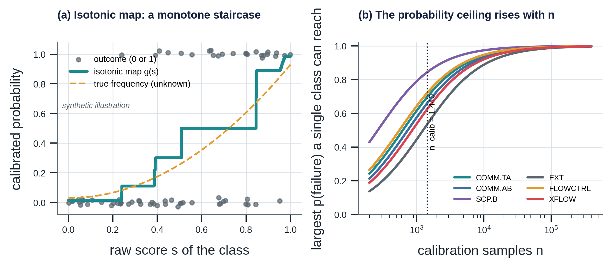

*Figure 4. (a) A synthetic illustration of the isotonic map (pool-adjacent-violators). (b) The largest operational probability a single class can express, against the number of calibration samples; the dotted line is the released artifact (n = 1,440).*

### 5.8 Interval: the bootstrap

Sixteen bootstrap members [26, 27, 28] are fitted, each on training runs resampled with replacement and calibrated on the same
calibration runs. For a new case, the 5th and 95th percentiles of their $p(\text{failure})$ form the interval
(`interval_level` 0.9), widened to include the main model's value. It measures how much the answer depends on the
luck of the training draw (**epistemic** uncertainty of the statistical model). It does not include errors of the
simulator itself.

**Out-of-distribution check.** [29] The training minimum and maximum of every feature are stored in the model card; a
feature outside its range is reported and stops the decision (gate G3).

### 5.9 How good is it?

On 2,400 held-out samples (300 runs), at the training prior (metrics: [30, 31, 32, 33, 34]):

| Measure | Calibrated | Naive $\sigma(\max\lvert z\rvert - 2)$ |
|---|---|---|
| Expected calibration error of $p(\text{failure})$ | **0.019** | 0.166 |
| Brier score of $p(\text{failure})$ | **0.124** | 0.234 |
| Multiclass Brier score | 0.391 | — |
| Accuracy (arg max, all samples) | 0.738 | — |
| Accuracy on failed samples | 0.585 | — |

$$\text{ECE} = \sum_b \frac{n_b}{N}\,\lvert \bar y_b - \bar p_b\rvert, \qquad \text{Brier} = \frac{1}{N}\sum_i (\hat p_i - y_i)^2 \qquad (\text{H.16})$$

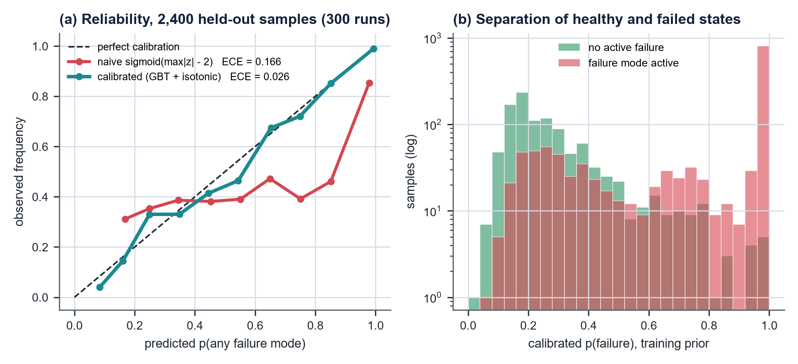

*Figure 5. Reliability of $p(\text{failure})$ on the held-out samples (a) and the separation of healthy and failed states (b). Drawn by the training job; it takes the style of the Solution Description at the next training run.*

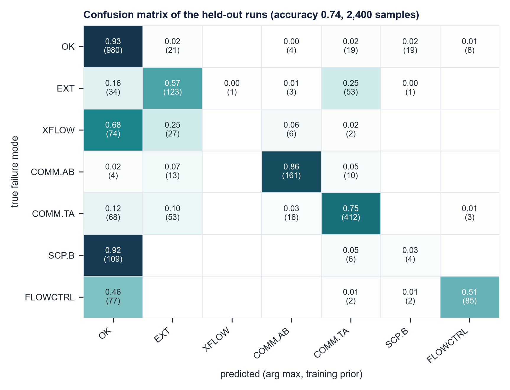

*Figure 6. Confusion matrix of the held-out runs, row-normalised with the counts (redrawn from the model card).*

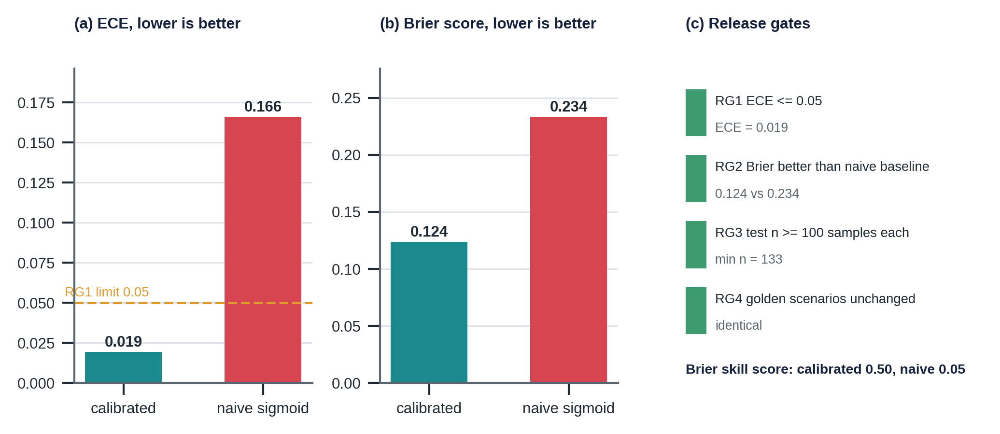

*Figure 7. The release scorecard: ECE and Brier score against the naive baseline, the four release gates, and the Brier skill score.*

**Reading the confusion matrix.** Rows are the truth, columns the arg max at the training prior.

- **COMM.AB (0.82) and COMM.TA (0.76)** are recognised well: their signatures are large.
- **SCP.B is mostly predicted OK (0.92).** Cement gas raises B by only about 3 bar while producing; it becomes
  visible after a B bleed (rebuild, extra gas). Most SCP.B samples have no B bleed: the failure is real but
  **not yet detectable**.
- **XFLOW is confused with OK and EXT.** An intermediate-casing leak drains B like a B-outlet leak; only the bleed
  (gas returned, rebuild) separates them.
- **EXT is confused with COMM.TA (0.25).** An A-outlet leak drains A like a tubing leak, only more slowly.
- **FLOWCTRL vs OK (0.46).** Early erosion changes the rate by less than the meter's noise.

These confusions are physics, not model failure: the evidence does not separate them **yet**. The decision step
responds by choosing a test that does.

### 5.10 The twin predicts the tests' performance

The decision needs each follow-up test's sensitivity and specificity. They are estimated on the held-out samples
taken at least 6 h after the test (a test is "positive" if $p(\text{failure}) > 0.9$ at the training prior), with
Laplace smoothing $(k+1)/(n+2)$:

| Test | Sensitivity | Specificity | Samples |
|---|---|---|---|
| `TEST.BLEED.A` | 0.665 | 0.992 | 382 |
| `TEST.BLEED.B` | 0.732 | 0.944 | 250 |
| `TEST.SHUTIN` | 0.454 | 0.950 | 133 |

Class-B tests without an estimate (top-up, gas sample) use an assumed 0.50 / 0.95, which the rationale states
explicitly.

---

## 6. Step 3 — Decision (`decision.py`)

### 6.1 Bayesian decision theory

For each action $a$ and true state $s$ define a loss $L(a, s)$; choose the action with the smallest expected loss
$\mathbb{E}[L(a)] = \sum_s L(a,s)\,P(s\mid \text{evidence})$. Thresholds are not chosen by hand; they follow from
the costs (Bayes decision theory [5, 6]; cost-sensitive decisions [35]).

### 6.2 What a miss costs: from the risk paths

The policy node `POL.W01.INTEGRITY` holds three costs. Which applies to a failure mode is decided by the graph:

$$C_{miss}(k) = \begin{cases} \text{cost\_missed\_loc\_nok} = 500\text{ M} & \text{if } k \xrightarrow{\text{LEADS\_TO}} \text{hazard directly} \\ \text{cost\_missed\_leak\_nok} = 20\text{ M} & \text{otherwise} \end{cases}$$

`FM.EXT`, `FM.XFLOW` and `FM.FLOWCTRL` lead directly to a hazard (the release has started); the others degrade a
barrier. With several modes possible, the expected cost of a miss *given* that something failed is

$$\bar C = \frac{\sum_k p_k\,C_{miss}(k)}{\sum_k p_k} \qquad (\text{H.18})$$

### 6.3 Which tests: from the evidence edges

| Role | Selection rule (graph queries) |
|---|---|
| **Confirmatory** (mandated by `ALARM`) | Class-A test with `EVIDENCE_FOR` the most mechanisms that cause the leading mode; cheapest among them |
| **Follow-up** (`TEST`) | Class-B test that splits the two best-matching mechanisms on the twin-predicted outcome (`discriminating_tests`); otherwise the cheapest class-B test covering the leading mode. A bleed of an annulus bled less than 24 h ago is excluded |

Resulting choices (`python -m decision_engine.decision`):

| Leading mode | $C_{miss}$ (NOK) | Confirmatory | Cost (NOK) | Default follow-up |
|---|---|---|---|---|
| FM.EXT | 500,000,000 | `TEST.WH.VALVE` | 30,000 | `TEST.TOPUP` |
| FM.XFLOW | 500,000,000 | `TEST.PT.ANN.B` | 1,000,000 | `TEST.TOPUP` |
| FM.COMM.AB | 20,000,000 | `TEST.PT.ANN.B` | 1,000,000 | `TEST.BLEED.A` |
| FM.COMM.TA | 20,000,000 | `TEST.PT.ANN.A` | 1,500,000 | `TEST.BLEED.A` |
| FM.SCP.B | 20,000,000 | `TEST.PT.ANN.B` | 1,000,000 | `TEST.TOPUP` |
| FM.FLOWCTRL | 500,000,000 | `TEST.CHK.INSP` | 40,000 | — |

### 6.4 Which mechanism: twin signatures

Within the leading mode, mechanisms are ranked by distance to their twin signature, using the signature keys that
match the **current operating state**:

| State | Keys compared with the observed residuals |
|---|---|
| producing, no bleed | ΔA_pre, ΔB_pre |
| after a bleed | ΔA_post, ΔB_post (only mechanisms whose signature experiment bled the same annulus) |
| shut in | ΔA_shutin |

$$d(m) = \sqrt{\sum_k \left(\frac{r_k - s_k(m)}{5\text{ bar}}\right)^2} \qquad (\text{G.10})$$

Mechanisms with identical signatures (packer element leak and packer movement) are indistinguishable by pressure
and only the first is listed. The two best are passed to the follow-up selection, which picks a test that would
give different results for them.

### 6.5 Expected losses

$$L_{none}(p) = p\,\bar C \qquad\qquad L_{alarm}(p) = C_A + (1-p)\,C_{FA} \qquad (\text{H.18})$$

$$L_{test}(p) = C_B + P(+)\,L^*(p_+) + P(-)\,L^*(p_-), \qquad L^*(q) = \min\big(q\bar C,\ C_A + (1-q)C_{FA}\big) \qquad (\text{H.19})$$

$$P(+) = \text{se}\,p + (1-\text{sp})(1-p),\qquad p_+ = \frac{\text{se}\,p}{P(+)},\qquad p_- = \frac{(1-\text{se})\,p}{1-P(+)} \qquad (\text{H.19})$$

$L_{test}$ is a **pre-posterior (value-of-information) analysis** [6, 36]: pay for the test, see the result, update by
Bayes, act optimally. A test is worth buying only if its result could change the action.

### 6.6 Thresholds per failure mode

If all failure probability sat on one mode ($\bar C = C_{miss}(k)$), the actions would change at:

| Leading mode | NO_ACTION → TEST | TEST → ALARM |
|---|---|---|
| FM.EXT | 0.014 % | 0.018 % |
| FM.FLOWCTRL | — | 0.018 % (NO_ACTION → ALARM) |
| FM.XFLOW | 0.033 % | 0.39 % |
| FM.COMM.AB | 0.46 % | 13.4 % |
| FM.COMM.TA | 0.51 % | 19.3 % |
| FM.SCP.B | 0.87 % | 9.2 % |

**Reading the table.**
- Modes that already release to the environment are acted on at tiny probabilities: missing them costs 500 M, and
  their confirmatory tests are cheap (valve test 30 k, choke inspection 40 k).
- Barrier-degradation modes alarm only above 10–20 %, because an alarm triggers a 1–1.5 M class-A test.
- Between the two thresholds, buying class-B evidence is cheapest.
- If a cost changes, the thresholds move immediately; **nothing is retrained**.

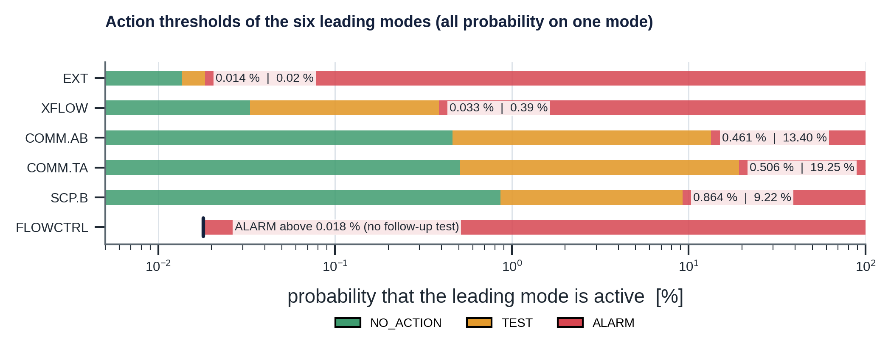

*Figure 8. Where the best action changes, for each leading mode, with all probability on that mode (exact thresholds from Section 15.1).*

### 6.7 The gates: when not to trust the probability

| Gate | Condition | Outcome | Reason |
|---|---|---|---|
| **G1** data quality | A or B transmitter not `GOOD` | `ABSTAIN` on `FM.MONITOR`; next evidence `TEST.SEN.CAL` | Bad data makes $p$ meaningless |
| **G2** hard limits | $P_X \ge$ MAWOP_X (graph limit), or margin to operational MAASP $<$ 30 bar | `ALARM` on `FM.MAASP.X` / `FM.MARGIN.X` | A limit needs no probability |
| **G3** model validity | twin outside its envelope, or a feature out of range | `ABSTAIN` | The calibrator would extrapolate |
| **G4** decision-relevant uncertainty | interval wider than `abstain_interval_width` (0.4) **and** the best action at $p_{lo}$ differs from the best at $p_{hi}$ | Minimax action, `human_review` | See 6.8 |
| **G5** no evidence | the cost rule (or G4) asks for TEST or ALARM, but the evidence ratio odds($p_{hi}$) / odds(prior) is below 3 | NO_ACTION; base-rate risk left to the scheduled test programme | A probability at the prior is not evidence (10.8) |
| — | otherwise | Minimum expected loss | — |

The order follows dependence: first the data, then limits (which need only the data), then the model, then the
model's uncertainty.

### 6.8 G4: minimax over the interval

When the interval spans a threshold, the point estimate cannot pick the action, but the costs still say which
mistake is cheaper. This is the minimax rule of statistical decision theory [37, 38]. For each action the code computes its **worst expected loss over the interval** and picks the
smallest:

$$a_{robust} = \arg\min_a\ \max_{q \in [p_{lo},\,p_{hi}]} \mathbb{E}[L(a)\mid q] \qquad (\text{H.26})$$

$L_{none}$ and $L_{alarm}$ are linear in $q$, but $L_{test}$ is a sum of minima of linear functions, hence
**concave**: its maximum can lie inside the interval. The code therefore evaluates a 41-point grid, not only the
endpoints.

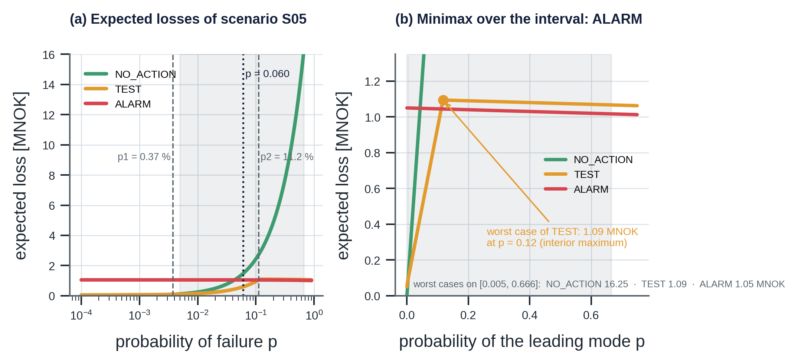

*Figure 9. (a) The expected losses of S05 against $p$ with the thresholds of Section 15.1. (b) Over the bootstrap interval the loss of TEST peaks inside it, at $p$ = 0.118; the smallest worst case is ALARM.*

### 6.9 Safety boundary

Every decision carries `advisory_only = True` and the policy's `trip_authority = "SIS only"`. The engine never acts
on the well. Keeping the output advisory also limits automation bias [39], and the protective function stays with the safety instrumented system [40, 41].

### 6.10 Escalation: dwell and hysteresis (`escalation.py`)

`decide()` judges one evaluation. A stream of evaluations near a threshold can chatter (ALARM, TEST, ALARM, ...),
which is how alarm fatigue starts. `EscalationFilter` sits **after** the engine and **before** the operator. It
does not change the decision, the audit line or the gates; it only changes what is surfaced. Call
`filter.update(action, gate)` once per evaluation, or `filter_stream(list_of_(action, gate))` on a recorded stream.

| Rule | Behaviour | Why |
|---|---|---|
| Dwell (raise) | ALARM is surfaced after `RAISE_N = 3` consecutive raw ALARMs; until then it is surfaced as `TEST` | One noisy evaluation should not escalate, but the operator still sees that something is being looked at |
| Hysteresis (clear) | A surfaced ALARM is cleared only after `CLEAR_N = 6` consecutive non-ALARM evaluations | Prevents flicker around the threshold |
| Hard limits | Gates `G2_LIMIT` and `G2_MARGIN` are surfaced immediately | A limit breach is a measurement, not a probability: dwell would only add delay |
| ABSTAIN | Always surfaced at once and resets the dwell counter | Bad data or an invalid model must never be hidden by a filter |
| TEST, NO_ACTION | Surfaced as is while no alarm is latched | — |

`flips(actions)` counts changes between consecutive actions (the chatter count).

**Trade-off.** Dwell lowers false alarms and adds detection delay of at least `RAISE_N - 1` evaluations. On the
replay of Section 10.8 it removes all alarms on the healthy well, costs about 3 h on the clear leak scenarios, and
delays flickering scenarios much more (S04 and S08 are surfaced 24 h and 23 h later). The constants are code
constants; they belong on the policy node with change control (Chapter 13).

The latched alarm is still advisory: it needs human confirmation, and trip authority stays with the SIS (6.9).

---

## 7. Step 4 — Grounded rationale (`rationale.py`)

### 7.1 The problem

An explanation in words is needed. A language model can write fluent, plausible and wrong text: invented
probabilities, out-of-date limits, statistics from nowhere, a failure mechanism linked to the wrong symptom, or an
action that contradicts the decision. In a safety context a confident wrong explanation is worse than none; such hallucination is a well-documented behaviour of generative models [42].

### 7.2 The idea: separate generation from verification

Whoever writes the text (the template here, a language model in `sentinel_agent`) is not trusted. A deterministic
gate checks every number, citation, causal claim and action word against the graph.

### 7.3 Recording the evidence: runtime nodes

`record()` writes two nodes into a **copy** of the graph:

```
RA.W01.<run>  (RiskAssessment)
   P_A_bar, P_A_exp_bar, r_A_bar, z_A, sigma_A_bar, (same for B), bleed-return differences, z_Q,
   operational MAASP and margins with governing elements, data quality,
   p_fail, p_lo, p_hi, top_mode, p_top, p_<mode> for every class, prior, calibration id
   ├─ASSESSES──► W01.ANN-A, W01.ANN-B, <assessed failure mode>
   ├─BASED_ON──► W01-PT-A-ANN, W01-PT-B-ANN, W01-VT-P-A-EXP, W01-VT-P-B-EXP, TWIN-W01,
   │             TEST.RES.A, TEST.RES.B, TEST.AB.SIGN, TEST.CHOKE, TEST.MARGIN, active MAWOP / MAASP limits
   └─RESULTS_IN► DEC.W01.<run>  (Decision)
                   action, gate, reason, next_evidence, expected and worst-case losses, C_bar,
                   confirmatory and follow-up tests with performance, thresholds,
                   ranked mechanisms with distances, human_review, advisory_only, trip_authority
                   └─BASED_ON──► POL.W01.INTEGRITY
```

The calibration id on the RiskAssessment ties every decision to the released artifact that produced it. Each run is
appended to `out/audit.jsonl` with the ground truth, so decisions can be replayed and scored.

### 7.4 The grounding gate: seven rules

| Rule | Rejects | Example caught |
|---|---|---|
| **R1** | A number with no `[NODE_ID]` in the same sentence | "Similar wells leaked in 3 of 5 cases." |
| **R2** | A citation to a node that does not exist | `[LIM.W01.MAASP-A.D]` |
| **R3** | A citation to a superseded node | `[LIM.W01.MAASP-A.B]` (superseded by rev C) |
| **R4** | A number that matches no property of any cited node, within its displayed precision | "probability 0.99" when the node says 0.7135 |
| **R5** | No advisory statement citing the policy's trip authority | "Shut in the well immediately." |
| **R6** | An action word (`NO_ACTION`, `TEST`, `ALARM`, `ABSTAIN`) different from the Decision node's action | "Decision: NO_ACTION" when the decision is `ALARM` |
| **R7** | A causal claim "[X] can cause / degrades / leads to [Y]" that is not a `CAUSES` / `DEGRADES` / `LEADS_TO` edge | "[FMech.CEM.MICRO] can cause [FM.COMM.TA]" |

**Precision-aware matching (R4).** A number written with $d$ decimals matches a property value $v$ if
$\lvert x - v\rvert \le \tfrac12 10^{-d}$; percentages are compared with $100v$, thousands separators removed,
dates and versions matched as strings; nested properties (e.g. a mechanism's `signature`) are searched too.

**Masking.** Node identifiers contain digits and the word TEST; they are removed before numbers and action words are
extracted.

**What the gate does not do.** It does not judge whether the reasoning is wise or whether words like "likely" are
justified. It guarantees that every number, citation, causal claim and action is traceable to the graph.
`sentinel_agent` extends the same gate with R8 (quarantined passages) and applies it to language-model text.

### 7.5 Hallucination demo (`out/S02_hallucinated_draft.txt`)

| Draft sentence | Rule |
|---|---|
| "Decision: NO_ACTION [DEC…]" | R6 (decision is ALARM) |
| "Leak probability is 0.99 [RA…]" | R4 |
| "MAASP is 345 bar [LIM.W01.MAASP-A.B], so there is ample margin." | R3 |
| "The current limit is 345 bar [LIM.W01.MAASP-A.C]." | R4 (rev C is 330 bar) |
| "[FMech.CEM.MICRO] can cause [FM.COMM.TA]." | R7 |
| "Similar wells leaked in 3 of 5 cases." | R1 (twice) |
| "See also [LIM.W01.MAASP-A.D]." | R2 |
| "Shut in the well immediately." | R5 |

Every rule fires; all twelve generated rationales pass.

---

## 8. Results: twelve reference scenarios

`python -m decision_engine.scenarios`; plant parameters nominal; decisions at t ≈ 60 h. These twelve scenarios are
also the **golden set** of the release gates (Chapter 10).

### 8.1 Summary

| Scenario | Truth | rA / rB (bar) | p(fail) [90 %] | Leading mode | Action (gate) | Next evidence |
|---|---|---|---|---|---|---|
| S01 healthy | — | −0.3 / +0.1 | 0.0010 [0.0008, 0.0020] | — | NO_ACTION | — |
| S02 tubing thread leak | TUB.THREAD | −53.7 / −2.1 | 0.7135 [0.695, 0.728] | COMM.TA | **ALARM** | TEST.PT.ANN.A |
| S03 packer leak | PKR.ELAST | −54.9 / −2.2 | 0.7136 [0.694, 0.727] | COMM.TA | **ALARM** | TEST.PT.ANN.A |
| S04 hanger seal, A bled | THS.SEAL | +46.5 / +2.0 | 0.697 [0.005, 0.722] | COMM.TA | **ALARM** (G4, review) | TEST.PT.ANN.A |
| S05 casing leak A↔B | CSG.LEAK | −15.1 / +11.9 | 0.060 [0.005, 0.666] | COMM.AB | **ALARM** (G4, review) | TEST.PT.ANN.B |
| S06 cement gas, B bled | CEM.MICRO | +0.1 / +15.3 | 0.0105 [0.0007, 0.012] | SCP.B | TEST | TEST.TOPUP |
| S07 A outlet to environment | THSP.SEAL | −38.4 / −1.9 | 0.684 [0.489, 0.721] | COMM.TA | **ALARM** | TEST.PT.ANN.A |
| S08 int.-casing leak, B bled | ICSG.LEAK | −0.2 / +4.4 | 0.0035 [0.0011, 0.471] | SCP.B | **ALARM** (G4, review) | TEST.PT.ANN.B |
| S09 choke erosion | CHK.EROS | +7.5 / +3.5, zQ = +8.8 | 0.723 [0.723, 0.742] | FLOWCTRL | **ALARM** | TEST.CHK.INSP |
| S10 known wear + packer + cement | compound | −55.2 / +0.1 | (0.716) | — | **ALARM** (G2 margin, FM.MARGIN.B) | TEST.LOG.CAL |
| S11 frozen A transmitter | SEN.FROZEN (+ leak at 46 h) | — | not used | FM.MONITOR | ABSTAIN (G1) | TEST.SEN.CAL |
| S12 choke 100/64 | — | — | not used | — | ABSTAIN (G3) | TEST.BLEED.A |

All twelve rationales pass the grounding gate.

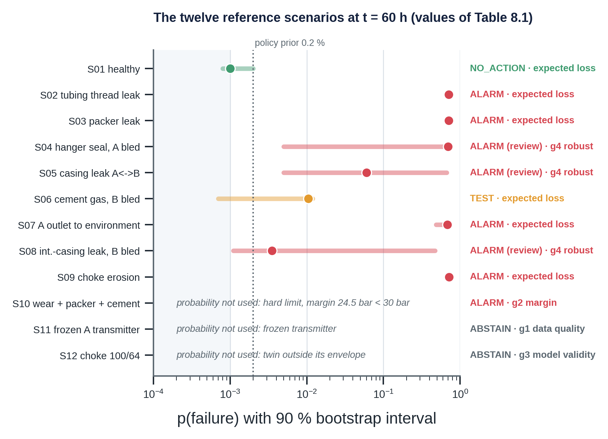

*Figure 10. $p(\text{failure})$ with its 90 % interval and the action of each scenario (values of Table 8.1). The three scenarios decided by a gate carry no probability.*

### 8.2 Reading the scenarios

- **S01.** Nothing unexplained; the twin absorbs start-up heating. $L_{none}$ = NOK 64 k is below
  $L_{test}$ = 94 k. The small probability mass on modes with a direct path to a hazard is what makes the expected
  miss cost $\bar C$ = 66 M even for a healthy well.
- **S02 and S03.** The A-annulus is drained into the tubing (z ≈ −18). The mechanism ranking puts the true cause
  first: thread leak (distance 0.08) in S02, packer leak (0.11) in S03. Expected losses: no action 16.2 M, test
  1.54 M, alarm 1.51 M. The graph's test to split thread from packer is `TEST.TOPUP` (only a packer leak lowers the
  fluid level).
- **S04.** After the bleed, A rebuilds 46.5 bar above the twin towards tubing-head pressure: the textbook sustained
  casing pressure. The interval is wide ([0.005, 0.722]) because some bootstrap members have seen few post-bleed
  hanger cases; G4 chooses ALARM (worst case 1.55 M vs no action 15.5 M).
- **S05.** Opposite-sign residuals. Chapter 9 follows this case step by step.
- **S06.** B rebuilds 15.3 bar and the bleed returned 1.49 Sm³ more gas and 13 L less brine than the twin's. Cement
  gas is ranked first (distance 0.18). $p$ = 0.0105 lies between the SCP.B thresholds: TEST. B was just bled, so
  the bleed is excluded and the cheapest class-B test is the top-up.
- **S07.** An A-outlet leak to the environment drains A like a tubing leak but more slowly. It is diagnosed as
  COMM.TA (ranked corrosion hole), with FM.EXT carrying part of the probability: that part raises $\bar C$ to
  58.6 M. The action is right (ALARM), and the confirmatory A-annulus pressure test also covers the outlet seal
  (`EVIDENCE_FOR` FMech.THSP.SEAL). The fingerprints separate only after a bleed (no gas returned).
- **S08.** An intermediate-casing leak drained B, then let formation gas in after the bleed. $p$ is low (0.0035)
  but the interval reaches 0.47; with $\bar C$ = 195 M (part of the mass is XFLOW, a direct path to underground
  flow), the worst case of doing nothing is 92 M: G4 chooses ALARM with human review.
- **S09.** The liquid rate is 8.8 σ above the choke model at a fixed set position. Missing loss of flow control
  costs 500 M and the inspection costs 40 k: ALARM with a cheap confirmatory step.
- **S10.** Silent compound risk. The caliper finding (60 % production-casing wall loss) is known to the twin. The
  packer leak drains A to about 1 bar, removing the casing's inside support; cement gas keeps B at 29.0 bar.
  Operational MAASP_B falls to **53.5 bar** (production-casing collapse governs), margin **24.5 bar** < 30 bar: G2
  alarms on `FM.MARGIN.B`, before any probability. The twin, which knows the true fluid-level drop in A, would give
  48.9 bar: the measured-column estimate is slightly optimistic (Section 4.10).
- **S11.** The A transmitter froze at 40 h; a thread leak starts at 46 h and is invisible in the frozen signal.
  Without G1 the model would see a healthy well (p = 0.0008). The data-quality gate abstains.
- **S12.** At choke 100/64 the twin is outside its envelope; G3 abstains. The operational MAASP_A (280 bar) is lower
  than at choke 32 because the tubing pressure at the packer is lower at high rate.

### 8.3 What the engine cannot see

- **A failure before its evidence exists.** Cement gas before a B bleed, early erosion, a leak that just started:
  the probability stays near the prior. The answer is scheduled bleeds and tests, not smarter statistics.
- **Silent mechanisms.** Wall loss and valve failures on demand produce no pressure signature
  (`knowledge_graph.queries.silent_mechanisms`). They enter only through inspection and proof tests, which then feed
  the limits (S10).

---

## 9. Complete worked example: scenario S05

**Truth.** A production-casing leak between A and B at 800 m starts at 20 h. No bleed. Evaluation at 60 h.

**Step 1 — Evidence.**

| Quantity | Value | Source |
|---|---|---|
| A measured / expected | 40.7 / 56.2 bar | `W01-PT-A-ANN` / `W01-VT-P-A-EXP` |
| A residual, z | −15.1 bar, −4.98 | σ_A = 3.04 bar |
| B measured / expected | 41.7 / 29.3 bar | `W01-PT-B-ANN` / `W01-VT-P-B-EXP` |
| B residual, z | +11.9 bar, +3.93 | σ_B = 3.04 bar |
| $z_A z_B$ | −19.6 | opposite signs |
| Operational MAASP_B, margin | 206.8 bar, 165.1 bar | casing-head spool governs |

**Step 2 — Diagnosis.**
- The classifier recognises the A↔B pattern: leading mode `FM.COMM.AB`.
- After the prior shift: $p(\text{failure})$ = 0.060, $p(\text{COMM.AB})$ = 0.0575.
- Bootstrap interval [0.005, 0.666]: members disagree strongly about how rare this pattern is in a healthy well
  with an uncertain B gas cap.

**Step 3 — Decision.**
- Gates G1–G3 pass.
- Graph: `FM.COMM.AB` degrades `BE.SECONDARY`; confirmatory test `TEST.PT.ANN.B` (NOK 1.0 M).
- Mechanisms ranked: pack-off leak (0.15) and casing leak (0.21): the producing fingerprints are almost identical.
  The graph's follow-up splitting them is `TEST.BLEED.A`, whose twin-predicted outcomes differ (ΔA_post +20.4 vs
  +14.2 bar; gas 0.49 vs 2.6 Sm³).
- $\bar C$ = 24.4 M (mostly a 20 M barrier miss, with some EXT mass).
- At $p$ = 0.060: no action 1.46 M, **test 0.59 M**, alarm 1.05 M → TEST.
- But the best action at $p_{lo}$ = 0.005 is TEST and at $p_{hi}$ = 0.666 it is ALARM; the width 0.66 exceeds
  0.4 → **G4**.
- Worst cases over the interval: no action **16.2 M**, test **1.09 M**, alarm **1.05 M** → **ALARM**, human review.

**Step 4 — Rationale.** Every number is cited to `RA.W01.S05…`, `DEC.W01.S05…`, the limit nodes, the policy or the
test nodes; the claims "[FMech.CHS.SEAL] can cause [FM.COMM.AB]" and "[FM.COMM.AB] degrades [BE.SECONDARY]" are
graph edges; the text ends with the advisory statement. The gate accepts it.

**In plain words:** *"A is 15 bar low and B 12 bar high: A and B are communicating, probably at the casing or its
pack-off. How likely a real failure is remains uncertain, but doing nothing could cost about fifteen times more
than a pressure test of B. Recommend alarm and a B-annulus pressure test; a bleed of A would tell the two causes
apart. Please confirm. Advisory only; trips remain with the SIS."*

---

## 10. Training, release and lifecycle of the calibration model

### 10.1 Two code paths, one artifact

```
                     OFFLINE (CI job / retraining trigger)                         ONLINE (operator-facing)
 digital_twin ─► training/dataset.py ─► training/train_calibrator.py ─► gates ─► artifacts/ ─► diagnosis.py
 knowledge_graph   1,200 runs, cached     split, fit, bootstrap,          RG1-RG4   joblib +     load + predict
                   (dataset_W01.npz)      evaluate, figures                         model card   (never trains)
                                                                        └─ fail ─► artifacts/candidate/ (not used)
```

| | Runtime path | Training path |
|---|---|---|
| Modules | `evidence`, `diagnosis`, `decision`, `rationale`, `scenarios` | `training/dataset`, `training/train_calibrator` |
| Runs | for every assessment (≈ 0.7 s including the twin) | when a retraining trigger fires (≈ 10 min) |
| Reads | released artifact | twin, graph, dataset cache |
| Writes | runtime graph nodes, audit log | candidate or released artifact, model card, golden set, figures |
| Imports the other? | **never** (tested) | yes: uses `evidence` to compute features (single feature definition) |

The training job computes features with **the same** `evidence.features_at` function that serves operations, so
features cannot drift between training and serving (training/serving skew: [43, 44]). `sentinel_agent` evaluation E2 checks the other half of parity:
the agent, reading the historian, reproduces the engine's offline decision for all 12 cases.

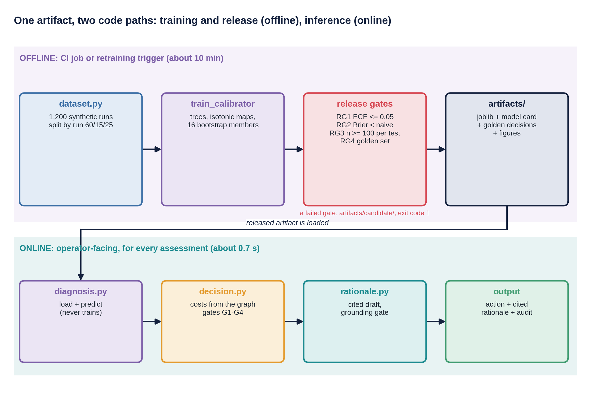

*Figure 11. One artifact, two code paths: the offline job (dataset, fit, release gates RG1 to RG4, artifacts) and the online runtime that only loads it.*

### 10.2 The release gates

| Gate | Requirement | Released artifact | Why |
|---|---|---|---|
| **RG1** | ECE of $p(\text{failure})$ ≤ 0.05 | 0.019 | the decision multiplies probabilities by costs: they must mean what they say |
| **RG2** | Brier of $p(\text{failure})$ better than the naive baseline | 0.124 vs 0.234 | the model must beat "sigmoid of the score" |
| **RG3** | every follow-up test performance estimated on ≥ 100 samples | min 133 (shut-in) | value-of-information needs trustworthy sensitivity / specificity |
| **RG4** | the 12 golden scenarios give the same (action, gate, failure mode) | identical | a statistically better model must not silently change safety behaviour |
| **RG5** | no raw ALARM on three healthy streams with sampled plants, evaluated hourly from 10 h to 60 h | to be run (10.8) | single-evaluation tests cannot see an alarm rate on healthy wells |

If any gate fails, the candidate is written to `artifacts/candidate/` with its model card and figures, the released
artifact is untouched, and the job exits with code 1 (so a CI pipeline stops). A **behaviour change** on the golden
set is not automatically wrong — physics or policy may have changed — but it needs a person: the job accepts it only
with `--accept-golden`, and the model card records the changed decisions.

### 10.3 The model card (`artifacts/calibration_W01.json`)

The card follows the idea of *model cards* [45]: a short, machine-readable record that travels with the artifact.

| Field | Content |
|---|---|
| `id` | `CAL-W01-1.0.0` — cited on every RiskAssessment node |
| `classes`, `class_order`, `mechanisms`, `features` | what the model predicts and from what |
| `prior_train`, `prior_op`, `interval_level`, `n_boot` | inputs of the prior shift and the interval |
| `feature_min`, `feature_max` | the out-of-range envelope used by gate G3 |
| `metrics`, `confusion`, `tests` | held-out evaluation |
| `release.gates` | each gate with its result and detail |
| `release.dataset_sha`, `release.code_hash` | hash of the training data and of the code that defines features and training |
| `release.sklearn_version`, `release.python_version`, `release.seed`, `release.released_at` | reproducibility |

Re-running the job with the same seed, code and dataset reproduces the same metrics and the same golden decisions;
the card makes it possible to prove that.

### 10.4 Versioning the whole decision

A decision depends on more than the calibration artifact. Each element is versioned and recorded:

| Element | Version | Where recorded |
|---|---|---|
| calibration artifact | `CAL-W01-1.0.0` + code hash + dataset hash | model card; `calibration_id` on RiskAssessment |
| digital twin | `TWIN-W01` 1.0.0 | graph node; RiskAssessment `BASED_ON` |
| knowledge graph | schema 1.0.0 | graph |
| limits | revision per limit node (`LIM.W01.MAASP-A.C`) | RiskAssessment `BASED_ON` |
| policy and costs | `POL.W01.INTEGRITY` 1.0.0 | Decision `BASED_ON` |
| engine code | `ENGINE_VERSION` 1.0.0 | package |

The agent additionally records prompt, language model and document-index versions.

### 10.5 Retraining triggers

Retraining is **event-driven**, not calendar-driven:

| Trigger | Signal | Action |
|---|---|---|
| Twin or graph change | new twin version; new mechanism, test or signature in the graph | regenerate dataset, retrain, gates |
| Calibration drift [46] | reliability of $p(\text{failure})$ against confirmed outcomes (class-A test results) degrades beyond the RG1 limit | retrain on updated priors / plant priors, gates |
| Out-of-range rate | gate G3 fires more often (operations moved outside the training envelope) | widen the scenario grid, retrain |
| Alarm-rate drift | alarm or abstain rate per week changes without a matching change in confirmed failures | investigate first (data, twin, operations); retrain only with evidence |
| Label arrival | new confirmed failures with class-A labels | add to an evaluation set; later to training once the twin reproduces them |
| Operational prior change | policy changes `PRIOR_OP` | no refit needed in principle (prior shift), but re-issue the artifact so the card and gates record it |

**Labels come from confirmed tests, not dispositions.** Historical operator decisions are not ground truth: a
disposition can be wrong (the event history contains one). Only class-A results become labels.

### 10.6 Rollback and fail-safe behaviour

- **Rollback** = re-deploy the previous artifact directory (joblib + card + golden set). Because every decision
  records `calibration_id`, decisions made with a withdrawn artifact can be found and reviewed.
- **Missing or unloadable artifact**: `FailureModeCalibrator.load()` raises; the agent cannot produce a
  recommendation and says so. The gates G1–G2 (data quality, hard limits) do not need the calibration and are the
  minimum safe behaviour a degraded deployment should keep.
- **Protective action never depends on this model**: trip authority stays with the SIS.

### 10.7 What a CI/CD pipeline runs

| Stage | Command | Blocks the release if |
|---|---|---|
| unit and consistency tests | `knowledge_graph.test_graph`, `digital_twin.test_twin`, `decision_engine.test_decision_engine`, `sentinel_agent.test_agent` | any test fails |
| model training (on trigger) | `decision_engine.training.train_calibrator` | exit code 1 (a gate failed) |
| agent evaluation | `sentinel_agent.evals.run_evals` | parity < 1, red team not all pass, retrieval below last release |
| deployment | package code + `artifacts/` + document index version | — |

### 10.8 Monitoring and the evidence gate (`monitoring.py`)

`python -m decision_engine.monitoring` replays each of the twelve scenarios as a stream, evaluating every hour from
10 h to the end of the run with the same `features_at → predict → decide` path as production. It passes the raw
actions through `escalation.py` (6.10) and writes `out/monitoring.json`. It takes several minutes. It is a
prototype of the signals, run on synthetic data: it shows the mechanism, not field performance.

| Signal | Function | Meaning | Reading |
|---|---|---|---|
| Alarm rate | `replay()` → `raw_alarm_h`, `surfaced_alarm_h` | ALARM evaluations before and after the filter | On a healthy well the target is 0 |
| Chatter | `raw_flips`, `surfaced_flips` | Action changes between consecutive evaluations | Falling after the filter |
| Detection delay | `first_raw_alarm_h`, `first_surfaced_alarm_h` | First hour with ALARM | Compare with the fault start (20 h in most scenarios) |
| G5 hold-backs | `run()`, per scenario and gate | Evaluations in which G5 held back a TEST or ALARM | High on healthy streams, low on leaks |
| Input and score drift | `psi(ref, cur)` | Population stability index of $\log_{10} p_{fail}$ against a reference stream (the healthy scenario), quantile bins of the reference | $< 0.1$ stable, $0.1$–$0.25$ watch, $> 0.25$ investigate |
| Calibration over time | `ece(p, y)` | Expected calibration error of $p_{fail}$ on a labelled window | Compare with release gate RG1 ($\le 0.05$) |

PSI is the leading signal. `ece()` is **not** computed in the replay: outcomes arrive late in operations (class-A tests,
inspections), so it is a lagging signal, and labels derived from a replay do not match the operational base rate.

#### Gate G5: no escalation without evidence

Every evaluation is priced with the full consequence of a failure, so a probability sitting at the operational prior
could still cross the low `NO_ACTION → ALARM` thresholds of Section 6.6. A probability **at** the prior is base-rate risk,
not evidence. G5 therefore holds back a TEST or ALARM unless the evidence has moved the probability away from the prior,
measured by the evidence ratio (posterior odds over prior odds) at the **upper** end of the bootstrap interval:

$$\text{ER} = \frac{p_{hi}/(1 - p_{hi})}{\pi/(1 - \pi)}, \qquad \pi = 1 - \pi_{op}(\text{OK}) = 0.002$$

If the expected-loss rule (or the minimax rule of G4) asks for TEST or ALARM and $\text{ER} < 3$, the decision is `NO_ACTION` with gate `G5_NO_EVIDENCE`, and the rationale says that the base-rate risk is left to the scheduled test programme (the same treatment as the silent mechanisms of 8.3). For $\pi = 0.002$ the gate holds back only when $p_{hi} < 0.006$.

| Property | Consequence |
|---|---|
| Probabilities, costs and thresholds are unchanged | Sections 5, 6.1 to 6.6 and the reproduction tiers are not affected; no retraining is needed |
| It uses $p_{hi}$, not $p$ | A case is held back only if even the most pessimistic bootstrap member sees no evidence; wide intervals still reach G4 |
| It only blocks escalation | NO_ACTION, the hard gates G1 to G3 and every evidence-driven case are untouched: S06 ($p_{hi}$ = 0.012, ER ≈ 6), S08 ($p_{hi}$ = 0.47) and S05 pass |
| The minimum ratio 3 is a policy value | A policy node attribute `min_evidence_ratio` overrides the code constant `EVIDENCE_RATIO_MIN` |
| It is recorded | The Decision node stores `evidence_ratio` and `min_evidence_ratio`; `decide()` returns `held_back` (the action that was held); the grounding gate checks the G5 sentence like any other |

Code: `decision.evidence_ratio`, `decision.evidence_gate`, the G5 branch of `decide()`; `rationale.record` and `draft` for the G5 node fields and sentence; `analysis.evidence_ratio`; `test_analysis.test_evidence_gate_g5`.

#### Release gate RG5: healthy streams

`monitoring.healthy_stream_alarms(cal, g)` replays three healthy wells whose plant parameters are drawn from the twin's priors (seeds 101 to 103), every hour from 10 h to 60 h, and counts raw ALARM evaluations and the evaluations G5 held back. The training job uses it as **RG5**: a candidate artifact with any raw ALARM on a healthy stream is not promoted (10.2).

#### What still has to be run

G5 is verified on the runtime code (unit tests of the gate; the rationale passes the grounding gate). The full replay needs the twin, the graph and the artifact and has **not** been run yet. Before relying on it, run:

```bash
python -m decision_engine.monitoring                   # expect 0 raw ALARM on S01 and on the three healthy streams
python -m decision_engine.test_decision_engine         # the golden decisions should be unchanged
python -m decision_engine.training.train_calibrator    # RG1 to RG5
```

The golden decisions are expected to be unchanged, because at 59.9 h S01 is already NO_ACTION and every other golden scenario either is decided by G1 to G3 or has $p_{hi}$ well above 0.006. If a golden decision does change, it is a behaviour change and needs `--accept-golden`.

#### Next step, not yet built

A sequential formulation would price the cost of **waiting one interval**, or accumulate the evidence over time (a CUSUM on the log-likelihood ratio, allowing for correlated samples) and alarm when it crosses a threshold set for a target false-alarm rate per well-year.

---

## 11. Design choices against common failure patterns of AI alarm systems

The patterns below are those of safety-relevant machine learning in general [43, 47].

| Failure pattern | Design choice | Chapter |
|---|---|---|
| A raw score treated as a probability | Isotonic calibration, reliability diagram; ECE 0.166 → 0.019 | 5.6, 5.9 |
| A fixed threshold chosen on a classification metric | Thresholds derived from costs per failure mode; value of information | 6.5, 6.6 |
| Channels treated as independent | One twin explains A, B, rate and pressure together; joint A/B features; σ not divided by √n | 4.5–4.7 |
| Only "high" values alarmed | Signed residuals; draining leaks give the strongest evidence | 4.5 |
| Confidence taken at face value | Bootstrap interval, out-of-range check, G4 minimax with human review | 5.8, 6.8 |
| One symptom, one hypothesis | Failure modes and ranked mechanisms from the graph; tests that split them | 5.3, 6.4 |
| Out-of-date limits in explanations | Versioned limit nodes; superseded citations rejected (R3) | 7.4 |
| Invented numbers or causal claims | Grounding gate R1, R4, R7 | 7.4 |
| Explanation contradicting the decision | R6 | 7.4 |
| Automatic trip on alarm | Advisory only; trip authority stays with the SIS (R5) | 6.9 |
| Bad data driving decisions | G1 before any statistics | 6.7 |
| A retrained model silently changing behaviour | Release gates, golden set, model card, rollback | 10 |
| Training/serving skew | One feature function for both; parity evaluation | 10.1 |

---

## 12. Assumptions and sensitivity

| Assumption | Value | Where | Sensitivity |
|---|---|---|---|
| Operational priors of the failure modes | total 0.002 (COMM.TA 0.0008, SCP.B 0.0004, COMM.AB 0.0003, EXT 0.0002, FLOWCTRL 0.0002, XFLOW 0.0001) | `diagnosis.PRIOR_OP` | **High**: they scale every operational probability and set the ceiling (5.7) |
| Class order for mapping mechanisms to modes | EXT, XFLOW, COMM.AB, COMM.TA, SCP.B, FLOWCTRL | `diagnosis.CLASS_ORDER` | Decides which mode a multi-mode mechanism trains as |
| Minimum margin to operational MAASP | 30 bar | `decision.MARGIN_MIN_BAR` | Directly sets the G2 margin alarm |
| Re-bleed adds nothing within | 24 h | `decision.BLEED_REPEAT_H` | Which follow-up tests are available |
| Default class-B performance | sens 0.50, spec 0.95 | `decision.DEFAULT_SE_SP` | Value of top-up and gas-sample tests |
| Test positive cut | p > 0.9 (training prior) | `training.train_calibrator.TEST_POSITIVE_P` | Trade-off of sensitivity and specificity |
| Signature distance scale | 5 bar | `decision.rank_mechanisms` | Ranking within a mode |
| Sensor and twin errors independent | — | `evidence.residual_sigmas` | σ would change if correlated |
| Operations grid in training | start-up, choke, bleed and shut-in times on a grid | `training.dataset.random_scenario` | Runs outside the grid are checked by the OOD gate |
| Release-gate thresholds | ECE ≤ 0.05; ≥ 100 samples per test | `training.train_calibrator.GATES` | What counts as releasable |

These are code constants, not graph nodes. In a governed system they belong on the policy node or a calibration
node in the graph, versioned like the limits.

---

## 13. Limitations

**Modelling scope**
- **Synthetic world.** The calibrator is only as good as the twin's coverage. On a real well, labels come from
  class-A tests and inspections, and twin drift must be monitored.
- **One evaluation time.** No sequential reasoning ("wait 6 h and look again") is modelled as an action.
- **Single fault per run in training.** Compound faults are handled by the limit gate (S10), not by the classifier.

**Statistical**
- **Detectability is not separated from presence.** A failure that has started but left no evidence is labelled as
  present; this lowers accuracy (5.9) and is the honest price of training on the truth.
- **Isotonic staircase and ceiling.** Probabilities come in plateaus; the largest operational value is about 0.7 (5.7).
- **Interval semantics.** Sixteen bootstrap members give a coarse interval of statistical uncertainty only, not
  simulator error.
- **Simple out-of-range check.** A per-feature box misses unusual combinations.

**Decision**
- **Binary reduction for the value of information.** The follow-up test is modelled as "failure / no failure" with
  one sensitivity and specificity; its power to separate *modes* is used for test choice, not in the loss.
- **Measured-column MAASP** ignores a fluid-level drop in the backing annulus (4.10).
- **Per-evaluation pricing.** Every evaluation is priced with the full consequence of a failure. Gate G5 (10.8) stops
  escalation on probabilities at the base rate; a sequential formulation (cost of waiting, accumulated evidence) is
  not built yet.
- **Escalation constants in code.** `RAISE_N`, `CLEAR_N` and the immediate gates are code constants, not versioned
  policy nodes, and the dwell filter delays flickering real alarms (6.10).

**Lifecycle**
- **Golden set of twelve.** It catches gross behaviour changes, not subtle shifts in rarely visited regions; a
  larger backtest set of confirmed historical events belongs next to it. It also checks single evaluations, not
  streams (10.8).
- **Monitoring is a prototype.** `monitoring.py` replays synthetic streams; there are no live dashboards, alerts,
  scheduled calibration checks on arriving outcomes, or PSI thresholds tuned on field data.
- **Pickled artifact.** Tied to the scikit-learn version; a portable format (e.g. exported trees and isotonic
  knots) would remove that coupling.

**Rationale**
- The gate verifies numbers, citations, causal edges and action words, not the quality of reasoning.

---

## 14. Glossary

| Term | Meaning |
|---|---|
| **Analytical redundancy** | Using a model's prediction as a second "sensor" |
| **Artifact** | The released, versioned calibration model (`artifacts/calibration_W01.joblib`) |
| **Base-rate effect** | Rare events stay unlikely even after strong evidence |
| **Bleed returns** | Gas and brine released during a bleed; compared with the twin's |
| **Bootstrap** | Refitting on resampled data to see how much the answer varies |
| **Brier score** | Mean squared error of probability predictions |
| **Calibration** | Agreement between predicted probabilities and observed frequencies |
| **Confirmatory test** | Class-A test that verifies a barrier; mandated by an alarm |
| **ECE** | Expected calibration error |
| **Expected loss** | Average cost of an action over the belief about the truth |
| **Failure mode / mechanism** | What is observed / what physically happens (ISO 14224 [48]) |
| **Follow-up test** | Class-B test bought to reduce uncertainty |
| **Golden set** | The twelve reference scenarios whose decisions a new artifact must reproduce |
| **Isotonic regression** | Best non-decreasing step function; used as the calibration map |
| **Label (prior) shift** | Class frequencies differ between training and operations |
| **MAASP / MAWOP** | Maximum allowable annulus surface pressure / wellhead operating pressure |
| **Minimax** | Choose the action with the smallest worst-case loss |
| **Model card** | Machine-readable description of an artifact: data, metrics, gates, versions |
| **Operational MAASP** | MAASP computed from current pressures and known wall loss |
| **Pre-posterior analysis** | Expected value of a test before it is done |
| **Release gate** | A requirement an artifact must meet before it is used (RG1–RG4) |
| **Residual** | Measured minus twin-expected value |
| **Signature** | Twin-computed difference between faulty and healthy behaviour |
| **Silent mechanism** | Mechanism without online evidence |
| **Training/serving parity** | Training and operations compute features and decisions the same way |
| **z-score** | Residual divided by its standard deviation |
| **Brier skill score** | Skill of a probability forecast against the constant forecast of the base rate (15.4) |
| **Design effect** | Factor by which correlated samples inflate the variance of an estimate; $1 + (m-1)\rho$ (15.5) |
| **EVSI** | Expected value of sample information: what a test result is worth before it is bought (15.1) |
| **Informative test** | A test whose positive result leads to an alarm and whose negative result to no action (15.1) |
| **Probability ceiling** | Largest operational probability one class can express, set by $\varepsilon$ and the prior shift (15.3) |
| **Reproduction check** | One recomputed number compared with the value printed in the manual (Chapter 16) |


---

## 15. Formal and mathematical reference

Chapters 1 to 14 explain what the engine does and why. This chapter derives the formulas that they state, with the exact numbers
of the released artifact, and lists the functions of `analysis.py` that compute them. The equations carry the numbers (H.1) to
(H.30) of Appendix H of the *End-to-End Solution Description*. The theory is standard: Bayesian decision theory [5, 6],
the value of information [36], minimax decisions [37, 38], calibration of probabilities [14, 15] and
isotonic regression [23].

### 15.1 From costs to thresholds

Let $p$ be the probability that some failure mode is active, $\bar C$ the expected cost of a miss given that something failed (6.2),
$C_A$ the cost of the confirmatory (class A) test that an alarm mandates, $C_{FA}$ the cost of a false alarm and $C_B$ the cost of the
follow-up (class B) test with sensitivity $se$ and specificity $sp$. Write $K = C_A + C_{FA}$. The losses of Section 6.5 are

$$L_{none}(p) = p\,\bar C, \qquad L_{alarm}(p) = C_A + (1-p)\,C_{FA}, \qquad L_{test}(p) = C_B + P(+)\,L^{\ast}(p_+) + P(-)\,L^{\ast}(p_-) \qquad (\text{H.18, H.19})$$

**The no-test threshold.** Setting $L_{none} = L_{alarm}$ gives $p\,\bar C = K - p\,C_{FA}$, so

$$p^{\ast} = \frac{C_A + C_{FA}}{\bar C + C_{FA}} \qquad (\text{H.22})$$

Without a follow-up test the best action is NO_ACTION below $p^{\ast}$ and ALARM above it. For FM.FLOWCTRL, with $C_A$ = 40 k, $C_{FA}$ = 50 k and $\bar C$ = 500 M NOK, $p^{\ast} = 90{,}000/500{,}050{,}000 = 0.018$ %.

**The test loss in closed form.** Suppose the test is *informative*: after a positive result the best action is ALARM and after a negative result NO_ACTION. Then, using $P(+)\,p_+ = se\,p$ and $P(+)\,(1-p_+) = (1-sp)(1-p)$,

$$P(+)\,L^{\ast}(p_+) = P(+)\,C_A + (1-sp)(1-p)\,C_{FA}, \qquad P(-)\,L^{\ast}(p_-) = (1-se)\,p\,\bar C$$

and adding the three parts,

$$L_{test}(p) = C_B + (1-sp)(1-p)\,K + p\,\big[\,se\,C_A + (1-se)\,\bar C\,\big] \qquad (\text{H.20})$$

**The two thresholds.** Equating (H.20) with $L_{none}$ and with $L_{alarm}$ and solving for $p$ gives the exact action thresholds:

$$p_1 = \frac{C_B + (1-sp)\,K}{se\,(\bar C - C_A) + (1-sp)\,K}, \qquad p_2 = \frac{sp\,K - C_B}{sp\,K + (1-se)\,(\bar C - C_A)} \qquad (\text{H.21})$$

Below $p_1$ the best action is NO_ACTION, between $p_1$ and $p_2$ it is TEST, above $p_2$ it is ALARM. The assumption behind (H.20) holds when the posteriors straddle $p^{\ast}$,

$$p_-(p) \le p^{\ast} \le p_+(p), \qquad p_+ = \frac{se\,p}{P(+)}, \qquad p_- = \frac{(1-se)\,p}{1-P(+)} \qquad (\text{H.22})$$

For FM.COMM.TA ($\bar C$ = 20 M, $C_A$ = 1.5 M, $C_B$ = 50 k, $se$ = 0.665, $sp$ = 0.992; $p^{\ast}$ = 7.73 %): at $p_1$ = 0.51 % the posteriors are $p_+$ = 0.299 and $p_-$ = 0.002, at $p_2$ = 19.25 % they are $p_+$ = 0.95 and $p_-$ = 0.074, so $p_- \lt p^{\ast} \lt p_+$ at both ends and the condition holds on the whole interval.

**The thresholds of the six leading modes.** With the class-B test of Section 6.3, the sensitivity and specificity of the model card (5.10) and $C_{FA}$ = 50 k:

| Leading mode | $\bar C$ (M NOK) | $C_A$ (k NOK) | Follow-up ($C_B$, k NOK) | $p_1$ exact | $p_2$ exact | Printed in 6.6 |
|---|---|---|---|---|---|---|
| FM.EXT | 500 | 30 | `TEST.TOPUP (30)` | 0.0136 % | 0.0184 % | 0.014 %, 0.018 % |
| FM.XFLOW | 500 | 1,000 | `TEST.TOPUP (30)` | 0.03306 % | 0.3862 % | 0.033 %, 0.39 % |
| FM.COMM.AB | 20 | 1,000 | `TEST.BLEED.A (50)` | 0.4611 % | 13.4 % | 0.46 %, 13.4 % |
| FM.COMM.TA | 20 | 1,500 | `TEST.BLEED.A (50)` | 0.5056 % | 19.25 % | 0.51 %, 19.3 % |
| FM.SCP.B | 20 | 1,000 | `TEST.TOPUP (30)` | 0.8636 % | 9.216 % | 0.87 %, 9.2 % |
| FM.FLOWCTRL | 500 | 40 | none | $p^{\ast}$ = 0.018 % | | 0.018 % |

The printed values of Section 6.6 come from the engine's numerical search (`decision.thresholds`), which reports the first point of a grid above the true crossing; the grid has a relative resolution of 0.4 % below 10 %. The exact values agree with it within that resolution (the only visible difference: SCP.B, 0.864 % exact against 0.87 % from the grid).

**What a test is worth.** The value of the result, before paying for it, is the saving it brings:

$$\text{EVSI}(p) = \min\big(L_{none}, L_{alarm}\big) - \big(L_{test} - C_B\big) \qquad (\text{H.24})$$

and the test is worth buying exactly when $\text{EVSI}(p) \gt C_B$, that is between $p_1$ and $p_2$ (at both thresholds EVSI equals $C_B$). For FM.COMM.TA it is 111 k NOK at $p$ = 1 %, 726 k at 6 % and 764 k at 10 %, against a cost of 50 k; with the costs of scenario S05 ($\bar C$ = 24.4 M, $C_A$ = 1 M) it is 509 k at $p$ = 6 %.

**How the thresholds move with the costs.** For $\bar C \gg C_A$, (H.21) gives $p_1 \approx [C_B + (1-sp)K]/(se\,\bar C)$: the lower threshold is *inversely proportional to the cost of a miss*. The upper threshold depends on the false-alarm cost through $K$ and $C_B$ and hardly on $\bar C$. For FM.COMM.TA:

| Change | $p_1$ | $p_2$ |
|---|---|---|
| baseline: miss 20 M, false alarm 50 k | 0.51 % | 19.3 % |
| miss cost 50 M | 0.19 % | |
| miss cost 100 M | 0.095 % | |
| false-alarm cost 500 k | | 23.6 % |
| false-alarm cost 2 M | | 35.4 % |

Nothing is retrained when a cost changes: the probabilities do not depend on the costs (Section 1.4).

### 15.2 Minimax over an interval, and why a grid is needed

$L_{none}$ and $L_{alarm}$ are linear in $p$, so their worst case over $[p_{lo}, p_{hi}]$ lies at an end. $L_{test}$ is not linear. Each branch is a minimum of two linear functions,

$$P(+)\,L^{\ast}(p_+) = \min\Big\{\,se\,p\,\bar C,\ \ P(+)\,K - se\,p\,C_{FA}\Big\}$$

and $P(+)$ is linear in $p$; a minimum of linear functions is concave, and a sum of concave functions is concave. A concave function can have its maximum *inside* an interval, so the worst case of TEST cannot be found from the two end points alone (H.26). The code therefore evaluates a 41-point grid (`worst_case`).

Scenario S05 is the example. With $p$ = 0.060, interval [0.005, 0.666], $\bar C$ = 24.4 M, $C_A$ = 1.0 M:

| Action | Loss at $p$ = 0.060 | Worst case over the interval | Where |
|---|---|---|---|
| NO_ACTION | 1.46 M | **16.25 M** | at $p_{hi}$ = 0.666 |
| TEST | **0.59 M** | 1.09 M | **inside**, at $p$ = 0.118 |
| ALARM | 1.05 M | **1.05 M** | at $p_{lo}$ = 0.005 |

At the two ends the loss of TEST is only 0.10 M and 1.07 M; the interior maximum of 1.094 M is larger than both. The minimax action is ALARM (1.05 M). G4 fires because the width 0.66 exceeds 0.4 and the best action differs at the ends (TEST at $p_{lo}$, ALARM at $p_{hi}$). Doing nothing would cost about fifteen times what an alarm costs in the worst case.

### 15.3 The probability ceiling

Isotonic maps are clipped to $[\varepsilon, 1-\varepsilon]$ with Laplace's rule [24],

$$\varepsilon = \frac{1}{n_{calib} + 2} = \frac{1}{1442} = 6.93 \times 10^{-4} \qquad (\text{H.11})$$

because a finite calibration set never proves a probability of exactly 0 or 1. After the label-shift correction [25],

$$p_{op}(k \mid x) = \frac{w_k\,p_{train}(k \mid x)}{\sum_j w_j\,p_{train}(j \mid x)}, \qquad w_k = \frac{\pi_{op}(k)}{\pi_{train}(k)} \qquad (\text{H.12})$$

the largest operational $p(\text{failure})$ that a single failure class $k$ can reach is obtained when its calibrated probability is $1-\varepsilon$ and every other class sits at its floor $\varepsilon$:

$$p_{max}(k;\,n) = \frac{(1-\varepsilon)\,w_k}{\varepsilon\,w_{OK} + (1-\varepsilon)\,w_k + \varepsilon \sum_{j \ne OK,\,k} w_j}, \qquad \varepsilon = \frac{1}{n+2} \qquad (\text{H.13})$$

With the unrounded priors of the model card ($w_{OK}$ = 2.27):

| Class | $w_k$ | $n$ = 1,440 | $n$ = 14,400 | $n$ = 144,000 |
|---|---|---|---|---|
| FM.COMM.TA | 0.00365 | **0.697** | 0.958 | 0.996 |
| FM.COMM.AB | 0.00308 | **0.660** | 0.951 | 0.995 |
| FM.SCP.B | 0.00857 | **0.844** | 0.982 | 0.998 |
| FM.EXT | 0.00182 | **0.534** | 0.920 | 0.991 |
| FM.FLOWCTRL | 0.00410 | **0.721** | 0.963 | 0.996 |
| FM.XFLOW | 0.00264 | **0.625** | 0.943 | 0.994 |

The ceiling is a property of rare-event detection with a calibration set of 1,440 samples, not of the evidence. It is the reason why the clearest cases of Chapter 8 sit at 0.71 and not near 1: S02 reaches 0.7135, slightly above the single-class bound of 0.697 for COMM.TA, because the one-vs-rest maps are not forced to be exclusive and some probability remains on a confusable class (an A-outlet leak looks like a tubing leak). The alarm threshold of 19 % is far below the ceiling, so the decision does not need more.

### 15.4 Calibration and the metrics of the release gates

**Pool-adjacent-violators.** The isotonic map $g_k$ of Section 5.6 is the non-decreasing step function closest, in least squares, to the 0/1 outcomes [22, 23]. Sort the calibration samples by score; give each its outcome as a block; whenever a block mean exceeds the mean of the next block, merge the two into one block with the weighted mean; repeat until the block means are non-decreasing. The result is the staircase of Figure 4 (a), and the merging is what makes the map monotone without assuming a shape.

**Metrics.** For $N$ held-out samples with predictions $\hat p_i$, outcomes $y_i$, and ten equal-width bins of mean prediction $\bar p_b$ and observed frequency $\bar y_b$:

$$\text{ECE} = \sum_b \frac{n_b}{N}\,\lvert \bar y_b - \bar p_b\rvert, \qquad \text{Brier} = \frac{1}{N}\sum_i (\hat p_i - y_i)^2, \qquad \text{BSS} = 1 - \frac{\text{Brier}}{\bar y\,(1-\bar y)} \qquad (\text{H.16})$$

The ECE measures calibration [30, 33]; the Brier score is a strictly proper scoring rule [31, 32]; the skill score compares it with the constant forecast of the base rate [34]. The failure rate of the test set is $1349/2400$ = 0.562, so the reference Brier score is 0.246: the calibrated model (0.124) has **BSS = 0.50**, the naive baseline (0.234) only **0.05**. The baseline $\sigma(\max\lvert z\rvert - 2)$ can never fall below $\sigma(-2)$ = 0.119, even for a perfectly healthy residual: that structural offset is part of its ECE of 0.166.

**Per-class performance** (arg max at the training prior, from the confusion matrix; the decision uses the expected loss, not the arg max):

| Class | Samples | Recall | Precision | F1 |
|---|---|---|---|---|
| OK | 1,051 | 0.933 | 0.726 | 0.817 |
| FM.EXT | 215 | 0.572 | 0.539 | 0.555 |
| FM.XFLOW | 109 | 0.000 | 0.000 | 0.000 |
| FM.COMM.AB | 188 | 0.825 | 0.842 | 0.833 |
| FM.COMM.TA | 552 | 0.763 | 0.818 | 0.789 |
| FM.SCP.B | 119 | 0.025 | 0.150 | 0.043 |
| FM.FLOWCTRL | 166 | 0.524 | 0.870 | 0.654 |

Overall accuracy is 0.738 (1,770 of 2,400), macro recall 0.520, macro F1 0.527. XFLOW and SCP.B are almost never the arg max: the evidence for them is absent until a B bleed, which is why the decision step pairs them with a test and not with an alarm (Section 5.9).

**Test performance.** For the value of information, sensitivity and specificity of a follow-up test are estimated on the held-out samples at least 6 h after the test with Laplace smoothing,

$$\widehat{se} = \frac{TP + 1}{P + 2}, \qquad \widehat{sp} = \frac{TN + 1}{N + 2} \qquad (\text{H.17})$$

### 15.5 Correlated errors: the dwell mean and the design effect

**The dwell mean.** The six samples of the dwell window share one twin error but have independent sensor noise. With sensor variance $\sigma_{tag}^2$ and fully shared model error $\sigma_{virtual}^2$,

$$\text{Var}(\bar r) = \frac{\sigma_{tag}^2}{n} + \sigma_{virtual}^2 \quad\Longrightarrow\quad \sigma_{\bar r} = \sqrt{\frac{0.25}{6} + 9.00} = 3.007\ \text{bar} \qquad (\text{H.5})$$

whereas dividing $\sigma_X = 3.04$ bar by $\sqrt 6$ would give 1.24 bar and inflate every z-score by $\sqrt 6 = 2.45$. For a pairwise correlation $\rho$ the variance of a mean of $n$ samples is $\sigma^2\,[1 + (n-1)\rho]/n$, which tends to $\sigma^2 \rho$, not to zero.

**The design effect.** The eight evaluation times of one run share a well, a fault and the operations. With $m$ samples per run and intra-run correlation $\rho$,

$$\text{DEFF} = 1 + (m-1)\,\rho, \qquad n_{eff} = \frac{n}{\text{DEFF}} \qquad (\text{H.29})$$

For an illustrative $\rho$ = 0.5, DEFF = 4.5 and the 2,400 test samples are worth about 530 independent ones. Splitting by sample would put near-copies of a run in training and test (data leakage [16]) and inflate every metric; the split by run (5.5) avoids it. This is also why the reported ECE and Brier score carry the uncertainty of roughly 300 independent runs, not of 2,400 samples [49].

### 15.6 The release gates as predicates

A candidate artifact is promoted only if all four hold, where $\mathcal{D}$ is the golden set of the twelve scenarios and $a(\cdot)$ the (action, gate, mode) triple of a decision:

$$\text{ECE} \le 0.05 \ \ \wedge\ \ \text{Brier} < \text{Brier}_{naive} \ \ \wedge\ \ \min_t n_t \ge 100 \ \ \wedge\ \ a_{new}(s) = a_{golden}(s)\ \ \forall s \in \mathcal{D} \qquad (\text{H.30})$$

The released artifact gives 0.019, 0.124 against 0.234, $\min_t n_t$ = 133 (the shut-in test) and twelve of twelve identical decisions. A change on $\mathcal{D}$ is accepted only with `--accept-golden`, a human decision recorded on the model card (10.2).

### 15.7 The grounding gate as predicates

For every sentence $s$ of a rationale, with $C(s)$ its citations, $N(s)$ its numbers, $A(s)$ its action words and $\text{Cl}(s)$ its causal claims, rules R1 to R7 of Section 7.4 require: a number implies a citation (R1); every citation is a node (R2) and not a superseded one (R3); every number equals a property of a cited node within its displayed precision (R4); the text states that it is advisory and cites the trip authority (R5); every action word equals the action of the Decision node (R6); and every causal claim is an edge of the graph (R7). The precision rule of R4 is

$$\text{match}(x, v) \iff \lvert x - v\rvert \le \tfrac{1}{2}\,10^{-d} \qquad (\text{H.27})$$

for a number written with $d$ decimals; percentages are compared with $100\,v$ as well as $v$. The gate guarantees traceability, not wisdom: a number can match a property by coincidence, and qualitative emphasis is not checked. Generation and verification are separate because generated text is not trusted [42].

### 15.8 The functions of `analysis.py`

| Function | Returns | Equation |
|---|---|---|
| `odds`, `logit`, `sigmoid`, `posterior_from_lr`, `likelihood_ratios`, `base_rate_effect`, `posterior_k` | Probability toolkit and the base-rate effect | (H.1)–(H.3) |
| `residual_sigma`, `zscore`, `dwell_mean_sigma`, `mean_variance_correlated` | Residual scale, z-score, the correlated dwell mean | (H.4), (H.5) |
| `design_effect`, `effective_sample_size` | Design effect of correlated samples | (H.29) |
| `laplace_eps`, `label_shift`, `shift_weights`, `prior_vector`, `probability_ceiling`, `ceiling_vs_n` | Laplace clip, prior shift, ceiling | (H.11)–(H.13) |
| `confusion_stats`, `brier_skill_score`, `naive_probability`, `ece`, `brier`, `test_performance` | Metrics of the release gates | (H.16), (H.17) |
| `miss_cost`, `expected_miss_cost`, `expected_losses`, `best_action`, `posteriors_after_test` | Costs and losses | (H.18), (H.19) |
| `thresholds_closed`, `no_test_threshold`, `thresholds_grid`, `mode_thresholds` | Exact thresholds, $p^{\ast}$, the engine's grid search | (H.21)–(H.23) |
| `evsi` | Value of sample information | (H.24) |
| `worst_case`, `worst_case_argmax`, `minimax_action`, `g4_fires`, `g2_fires` | Minimax and the gates | (H.25), (H.26) |
| `precision_match` | Number match of the grounding gate | (H.27) |
| `s05_case` | Scenario S05 step by step | 9 |

### 15.9 Notation

| Symbol | Meaning |
|---|---|
| $p$, $p_{lo}$, $p_{hi}$, $p_k$ | probability of any failure, ends of its interval, probability of failure mode $k$ |
| $se$, $sp$, $LR_+$, $LR_-$ | sensitivity, specificity and likelihood ratios of a test |
| $\pi_{train}$, $\pi_{op}$, $w_k$ | class priors of the training set and of operations, label-shift weight |
| $\varepsilon$, $n_{calib}$ | Laplace clip, number of calibration samples |
| $\bar C$, $C_A$, $C_B$, $C_{FA}$, $K$ | expected miss cost, confirmatory test, follow-up test, false alarm, $C_A + C_{FA}$ |
| $L_{none}$, $L_{test}$, $L_{alarm}$, $L^{\ast}$ | expected losses and the best-action loss |
| $p_1$, $p_2$, $p^{\ast}$ | thresholds NO_ACTION → TEST, TEST → ALARM, and the no-test threshold |
| $P(+)$, $p_+$, $p_-$ | probability of a positive result, posteriors after a positive and a negative result |
| $\sigma_{tag}$, $\sigma_{virtual}$, $\sigma_X$ | transmitter noise, virtual-tag model scale, residual scale |
| $\text{DEFF}$, $n_{eff}$, $\rho$ | design effect, effective sample size, intra-run correlation |
| ECE, Brier, BSS | calibration error, Brier score, Brier skill score |


---

## 16. Verification: reproducing every number

### 16.1 The command

```bash
python -m decision_engine.reproduce                    # tier 1: 212 checks, about 3 s (no twin, no graph, no artifact needed)
python -m decision_engine.reproduce --engine           # + tier 2: the twelve scenarios end to end (needs twin, graph, artifact)
python -m decision_engine.reproduce --md verification_report.md --json verification_report.json
python -m decision_engine.test_analysis                # 14 tests of the mathematics and of the runtime code
```

Each check recomputes one quoted quantity and compares it with the value printed in this manual or in the *End-to-End Solution
Description*. It passes when $\lvert\text{computed} - \text{expected}\rvert$ is within a tolerance, which is half a unit of the last printed
digit unless stated. The exit code is 1 if any check fails, so the command can run in CI. The tier-1 checks of the last run (all passed)
are in `verification_report.md`.

### 16.2 Tier 1: mathematics and runtime code

| What is checked | Checks |
|---|---|
| Probability toolkit, base-rate effect, residual scale, dwell mean, design effect | 27 |
| Prior shift, Laplace clip, probability ceiling, class priors; label shift against `diagnosis.shift` | 27 |
| Metrics from the model card, confusion matrix, per-class table, test performance, ECE against `train_calibrator` | 53 |
| Costs, expected losses against `decision.expected_losses`, thresholds (exact and grid), informative test, EVSI, cost sensitivity | 34 |
| Scenario S05 step by step, minimax and the interior worst case, gates G2 | 20 |
| Gate constants, class order, the grounding gate R1-R7 on a small graph, number matching | 24 |
| Model card and golden set (12 scenarios, release gates, dataset sizes) | 27 |
| **Total (tier 1)** | **212** |

The point of tier 1 is that it does not only check the mathematics against the manual: it checks the **runtime code**. `decision.py`,
`diagnosis.py` and `rationale.py` are loaded from source with the knowledge graph stubbed out (the modules only *define* functions at import),
and `training/train_calibrator.py` is read with its pure functions extracted. Then, on the same inputs,

- `analysis.expected_losses` and `decision.expected_losses` agree to $10^{-6}$ NOK on 28 combinations of costs and probabilities;
- the closed-form thresholds (H.21) agree with `decision.thresholds` within the grid's resolution;
- `analysis.label_shift` equals `diagnosis.shift`; `analysis.ece` equals `train_calibrator.reliability_curve`; the smoothed sensitivity equals `train_calibrator._test_performance`;
- `analysis.worst_case` equals `decision.worst_case`;
- the grounding gate `rationale.verify` is run on a small hand-built graph: a compliant draft passes, and the hallucinated draft of Section 7.5 breaks all seven rules (R1 twice);
- the model card and the golden set are consistent with the manual: 12 golden scenarios, all four release gates passed, the numbers of Sections 5.4 to 5.10.

### 16.3 Tier 2: the twelve scenarios end to end (not yet executed)

With `--engine` the script runs `scenarios.run()` and compares, for each scenario, $p(\text{fail})$ and its interval (to the printed digits), the
action, the gate, the leading mode, the next evidence, the residuals of Table 8.1, the numbers of the worked example S05 (measured and expected pressures,
$z$, $p(\text{COMM.AB})$ = 0.0575, $\bar C$, the three losses and the three worst cases), the operational MAASP of S10, S12 and of the healthy well, and that all twelve rationales pass the
grounding gate; it then runs seven of the checks of `test_decision_engine.py`. It adds 100 checks.

This tier needs the digital twin, the knowledge graph and `calibration_W01.joblib`. **It was written from the numbers printed in
Chapters 8 and 9 but could not be executed when this revision was produced.** If it reports a failure, the likely causes are a different version of
scikit-learn (the artifact is pickled with 1.5.1), a changed twin or graph, or an error in a transcribed expected value; each failing line names its
source in the manual.

### 16.4 What the recomputation showed

Recomputing the mathematics from the model card gave the printed results of this manual, and four clarifications, none of which changes a decision:

| # | Statement | Clarified | Evidence |
|---|---|---|---|
| 1 | Section 6.6 prints the SCP.B lower threshold as 0.87 % | Exact value 0.864 %; the engine's grid search reports the first grid point above it (0.867 %). The decision does not change | 15.1, `thr.FM.SCP.B.p1` |
| 2 | The *End-to-End Solution Description* (H.4) gave the exact upper threshold of COMM.TA as 19.23 % against 19.3 % printed here | With the model card's unrounded sensitivity and specificity (0.6654, 0.9921) it is 19.25 % (19.26 % from the grid); 19.23 % came from rounding them to 0.665 and 0.992. **The printed 19.3 % is right** | `thr.FM.COMM.TA.p2` |
| 3 | The Solution Description (H.4) gave $p_+$ = 0.297 at $p_1$ and the ceilings of H.3 (0.700 for COMM.TA, 0.538, 0.664, 0.844, 0.722, 0.627) | With unrounded inputs: $p_+$ = 0.299; ceilings 0.697, 0.534, 0.660, 0.844, 0.721, 0.625 (15.3). Section 5.7 ("about 0.70–0.72") is unchanged | `informative.pplus`, `ceiling.*` |
| 4 | Section 9 prints $z_A$ = −4.98 and $z_B$ = +3.93 next to residuals of −15.1 and +11.9 bar | Those z-scores use the unrounded residuals (−4.965 and +3.91 follow from the rounded ones); the check uses a tolerance of 0.02 | `resid.zA`, `resid.zB` |

### 16.5 Software and data

The checks use NumPy [50], SciPy [51], scikit-learn [19], NetworkX [52] and Matplotlib [53]. The released artifact was trained
with scikit-learn 1.5.1 and Python 3.12.15 on a dataset with hash `977244c6ca9942bc` (seed 7); both are recorded on the model card.


---

## 17. References

Numbers in square brackets in the text refer to this list, which is ordered by first appearance. Standards are cited without edition years: use the
current edition for normative requirements. 

- **[1]** Oudeman, P., Kerem, M. (2006). Transient behavior of annular pressure build-up in HP/HT wells. *SPE Drilling & Completion*, 21(4), 234–241. doi:10.2118/88735-PA † *Cited in: 1.2.*
- **[2]** Halal, A. S., Mitchell, R. F. (1994). Casing design for trapped annular pressure buildup. *SPE Drilling & Completion*, 9(2), 107–114. doi:10.2118/25694-PA † *Cited in: 1.2.*
- **[3]** Isermann, R. (2006). *Fault-Diagnosis Systems: An Introduction from Fault Detection to Fault Tolerance.* Berlin: Springer. *Cited in: 1.3, 4.2.*
- **[4]** Venkatasubramanian, V., Rengaswamy, R., Yin, K., Kavuri, S. N. (2003). A review of process fault detection and diagnosis, Part I: Quantitative model-based methods. *Computers & Chemical Engineering*, 27(3), 293–311. *Cited in: 1.3.*
- **[5]** Berger, J. O. (1985). *Statistical Decision Theory and Bayesian Analysis*, 2nd ed. New York: Springer. *Cited in: 1.3, 6.1, 15.*
- **[6]** Raiffa, H., Schlaifer, R. (1961). *Applied Statistical Decision Theory.* Boston: Harvard Business School, Division of Research. *Cited in: 1.3, 6.1, 6.5, 15.*
- **[7]** Kahneman, D., Tversky, A. (1973). On the psychology of prediction. *Psychological Review*, 80(4), 237–251. *Cited in: 2.4.*
- **[8]** Hüllermeier, E., Waegeman, W. (2021). Aleatoric and epistemic uncertainty in machine learning: an introduction to concepts and methods. *Machine Learning*, 110(3), 457–506. doi:10.1007/s10994-021-05946-3 † *Cited in: 2.7.*
- **[9]** Kendall, A., Gal, Y. (2017). What uncertainties do we need in Bayesian deep learning for computer vision? In *Advances in Neural Information Processing Systems 30*, pp. 5574–5584. *Cited in: 2.7.*
- **[10]** Isermann, R. (2005). Model-based fault-detection and diagnosis: status and applications. *Annual Reviews in Control*, 29(1), 71–85. *Cited in: 4.2.*
- **[11]** API RP 90-1. *Annular Casing Pressure Management for Offshore Wells.* American Petroleum Institute. *Cited in: 4.10.*
- **[12]** ISO/TS 16530-2. *Petroleum and natural gas industries — Well integrity — Part 2: Well integrity for the operational phase.* International Organization for Standardization. *Cited in: 4.10.*
- **[13]** Zadrozny, B., Elkan, C. (2002). Transforming classifier scores into accurate multiclass probability estimates. In *Proceedings of the 8th ACM SIGKDD International Conference on Knowledge Discovery and Data Mining*, pp. 694–699. *Cited in: 5.1.*
- **[14]** Niculescu-Mizil, A., Caruana, R. (2005). Predicting good probabilities with supervised learning. In *Proceedings of the 22nd International Conference on Machine Learning (ICML)*, pp. 625–632. *Cited in: 5.1, 15.*
- **[15]** Guo, C., Pleiss, G., Sun, Y., Weinberger, K. Q. (2017). On calibration of modern neural networks. In *Proceedings of the 34th International Conference on Machine Learning*, PMLR 70, 1321–1330. *Cited in: 5.1, 15.*
- **[16]** Kaufman, S., Rosset, S., Perlich, C., Stitelman, O. (2012). Leakage in data mining: formulation, detection, and avoidance. *ACM Transactions on Knowledge Discovery from Data*, 6(4), Article 15. doi:10.1145/2382577.2382579 † *Cited in: 5.5, 15.5.*
- **[17]** Friedman, J. H. (2001). Greedy function approximation: a gradient boosting machine. *Annals of Statistics*, 29(5), 1189–1232. *Cited in: 5.6.*
- **[18]** Hastie, T., Tibshirani, R., Friedman, J. (2009). *The Elements of Statistical Learning*, 2nd ed. New York: Springer. *Cited in: 5.6.*
- **[19]** Pedregosa, F., Varoquaux, G., Gramfort, A., Michel, V., Thirion, B., Grisel, O., et al. (2011). Scikit-learn: machine learning in Python. *Journal of Machine Learning Research*, 12, 2825–2830. *Cited in: 5.6, 16.5.*
- **[20]** Ke, G., Meng, Q., Finley, T., Wang, T., Chen, W., Ma, W., Ye, Q., Liu, T.-Y. (2017). LightGBM: a highly efficient gradient boosting decision tree. In *Advances in Neural Information Processing Systems 30*, pp. 3146–3154. *Cited in: 5.6.*
- **[21]** Bishop, C. M. (2006). *Pattern Recognition and Machine Learning.* New York: Springer. *Cited in: 5.6.*
- **[22]** Ayer, M., Brunk, H. D., Ewing, G. M., Reid, W. T., Silverman, E. (1955). An empirical distribution function for sampling with incomplete information. *Annals of Mathematical Statistics*, 26(4), 641–647. *Cited in: 5.6, 15.4.*
- **[23]** Barlow, R. E., Bartholomew, D. J., Bremner, J. M., Brunk, H. D. (1972). *Statistical Inference under Order Restrictions.* London: Wiley. *Cited in: 5.6, 15, 15.4.*
- **[24]** Laplace, P.-S. (1814). *Essai philosophique sur les probabilités.* Paris: Courcier. *Cited in: 5.6, 15.3.*
- **[25]** Saerens, M., Latinne, P., Decaestecker, C. (2002). Adjusting the outputs of a classifier to new a priori probabilities: a simple procedure. *Neural Computation*, 14(1), 21–41. *Cited in: 5.7, 15.3.*
- **[26]** Efron, B. (1979). Bootstrap methods: another look at the jackknife. *Annals of Statistics*, 7(1), 1–26. *Cited in: 5.8.*
- **[27]** Efron, B., Tibshirani, R. J. (1993). *An Introduction to the Bootstrap.* New York: Chapman & Hall. *Cited in: 5.8.*
- **[28]** Lakshminarayanan, B., Pritzel, A., Blundell, C. (2017). Simple and scalable predictive uncertainty estimation using deep ensembles. In *Advances in Neural Information Processing Systems 30*, pp. 6402–6413. *Cited in: 5.8.*
- **[29]** Ovadia, Y., Fertig, E., Ren, J., Nado, Z., Sculley, D., Nowozin, S., Dillon, J. V., Lakshminarayanan, B., Snoek, J. (2019). Can you trust your model's uncertainty? Evaluating predictive uncertainty under dataset shift. In *Advances in Neural Information Processing Systems 32*. *Cited in: 5.8.*
- **[30]** Naeini, M. P., Cooper, G. F., Hauskrecht, M. (2015). Obtaining well calibrated probabilities using Bayesian binning. In *Proceedings of the 29th AAAI Conference on Artificial Intelligence*, pp. 2901–2907. *Cited in: 5.9, 15.4.*
- **[31]** Brier, G. W. (1950). Verification of forecasts expressed in terms of probability. *Monthly Weather Review*, 78(1), 1–3. *Cited in: 5.9, 15.4.*
- **[32]** Gneiting, T., Raftery, A. E. (2007). Strictly proper scoring rules, prediction, and estimation. *Journal of the American Statistical Association*, 102(477), 359–378. *Cited in: 5.9, 15.4.*
- **[33]** DeGroot, M. H., Fienberg, S. E. (1983). The comparison and evaluation of forecasters. *Journal of the Royal Statistical Society, Series D (The Statistician)*, 32(1/2), 12–22. *Cited in: 5.9, 15.4.*
- **[34]** Murphy, A. H. (1973). A new vector partition of the probability score. *Journal of Applied Meteorology*, 12(4), 595–600. *Cited in: 5.9, 15.4.*
- **[35]** Elkan, C. (2001). The foundations of cost-sensitive learning. In *Proceedings of the 17th International Joint Conference on Artificial Intelligence (IJCAI)*, pp. 973–978. *Cited in: 6.1.*
- **[36]** Howard, R. A. (1966). Information value theory. *IEEE Transactions on Systems Science and Cybernetics*, 2(1), 22–26. *Cited in: 6.5, 15.*
- **[37]** Wald, A. (1950). *Statistical Decision Functions.* New York: Wiley. *Cited in: 6.8, 15.*
- **[38]** Savage, L. J. (1951). The theory of statistical decision. *Journal of the American Statistical Association*, 46(253), 55–67. *Cited in: 6.8, 15.*
- **[39]** Parasuraman, R., Manzey, D. H. (2010). Complacency and bias in human use of automation: an attentional integration. *Human Factors*, 52(3), 381–410. doi:10.1177/0018720810376055 † *Cited in: 6.9.*
- **[40]** IEC 61511 (series). *Functional safety — Safety instrumented systems for the process industry sector.* International Electrotechnical Commission. *Cited in: 6.9.*
- **[41]** IEC 61508 (series). *Functional safety of electrical/electronic/programmable electronic safety-related systems.* International Electrotechnical Commission. *Cited in: 6.9.*
- **[42]** Ji, Z., Lee, N., Frieske, R., Yu, T., Su, D., Xu, Y., Ishii, E., Bang, Y. J., Madotto, A., Fung, P. (2023). Survey of hallucination in natural language generation. *ACM Computing Surveys*, 55(12), Article 248. *Cited in: 7.1, 15.7.*
- **[43]** Sculley, D., Holt, G., Golovin, D., Davydov, E., Phillips, T., Ebner, D., Chaudhary, V., Young, M., Crespo, J.-F., Dennison, D. (2015). Hidden technical debt in machine learning systems. In *Advances in Neural Information Processing Systems 28*, pp. 2503–2511. *Cited in: 10.1, 11.*
- **[44]** Breck, E., Cai, S., Nielsen, E., Salib, M., Sculley, D. (2017). The ML test score: a rubric for ML production readiness and technical debt reduction. In *Proceedings of the IEEE International Conference on Big Data*, pp. 1123–1132. *Cited in: 10.1.*
- **[45]** Mitchell, M., Wu, S., Zaldivar, A., Barnes, P., Vasserman, L., Hutchinson, B., Spitzer, E., Raji, I. D., Gebru, T. (2019). Model cards for model reporting. In *Proceedings of the Conference on Fairness, Accountability, and Transparency (FAT\*)*, pp. 220–229. *Cited in: 10.3.*
- **[46]** Gama, J., Žliobaitė, I., Bifet, A., Pechenizkiy, M., Bouchachia, A. (2014). A survey on concept drift adaptation. *ACM Computing Surveys*, 46(4), Article 44. *Cited in: 10.5.*
- **[47]** Amodei, D., Olah, C., Steinhardt, J., Christiano, P., Schulman, J., Mané, D. (2016). Concrete problems in AI safety. arXiv:1606.06565. *Cited in: 11.*
- **[48]** ISO 14224. *Petroleum, petrochemical and natural gas industries — Collection and exchange of reliability and maintenance data for equipment.* International Organization for Standardization. *Cited in: 14.*
- **[49]** Kish, L. (1965). *Survey Sampling.* New York: Wiley. *Cited in: 15.5.*
- **[50]** Harris, C. R., Millman, K. J., van der Walt, S. J., et al. (2020). Array programming with NumPy. *Nature*, 585, 357–362. *Cited in: 16.5.*
- **[51]** Virtanen, P., Gommers, R., Oliphant, T. E., et al. (2020). SciPy 1.0: fundamental algorithms for scientific computing in Python. *Nature Methods*, 17, 261–272. *Cited in: 16.5.*
- **[52]** Hagberg, A. A., Schult, D. A., Swart, P. J. (2008). Exploring network structure, dynamics, and function using NetworkX. In *Proceedings of the 7th Python in Science Conference (SciPy 2008)*, pp. 11–15. *Cited in: 16.5.*
- **[53]** Hunter, J. D. (2007). Matplotlib: a 2D graphics environment. *Computing in Science & Engineering*, 9(3), 90–95. *Cited in: 16.5.*

† Details checked against a publisher or library record while this manual was produced. The other entries are given as in the standard literature, without DOIs, and should be confirmed against the source before external publication.
