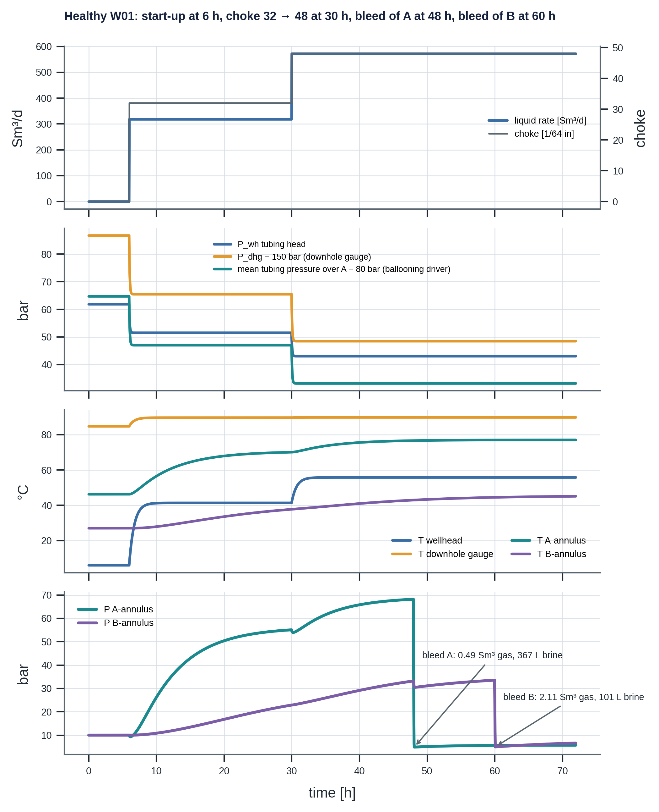
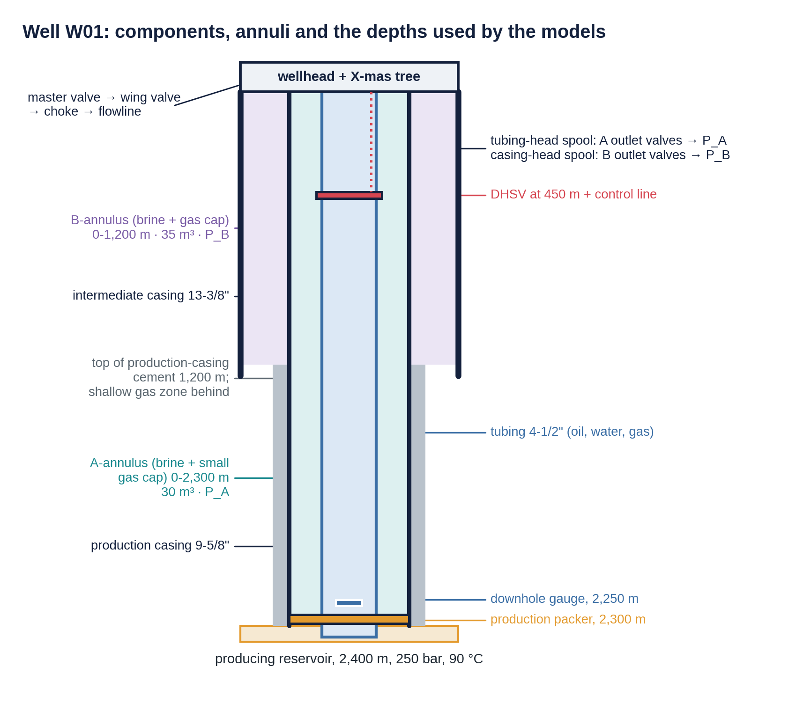
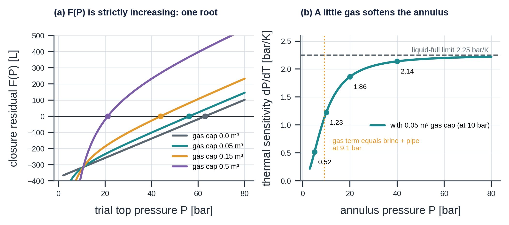
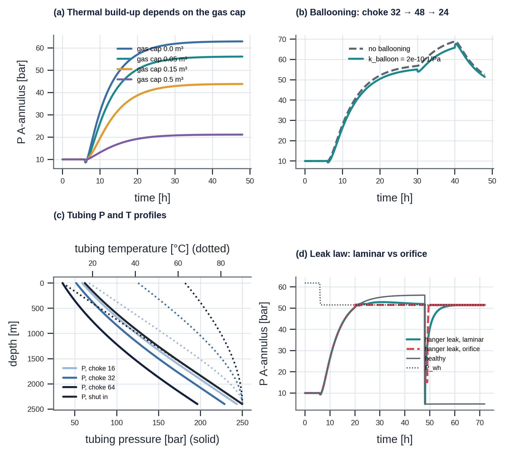
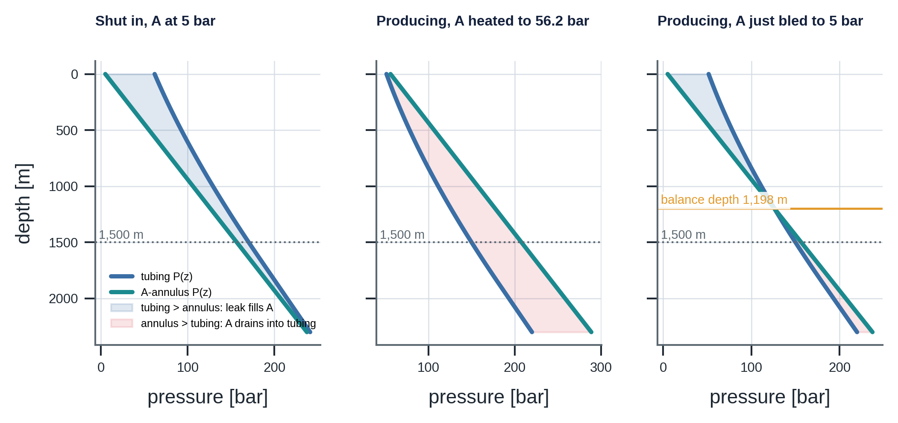
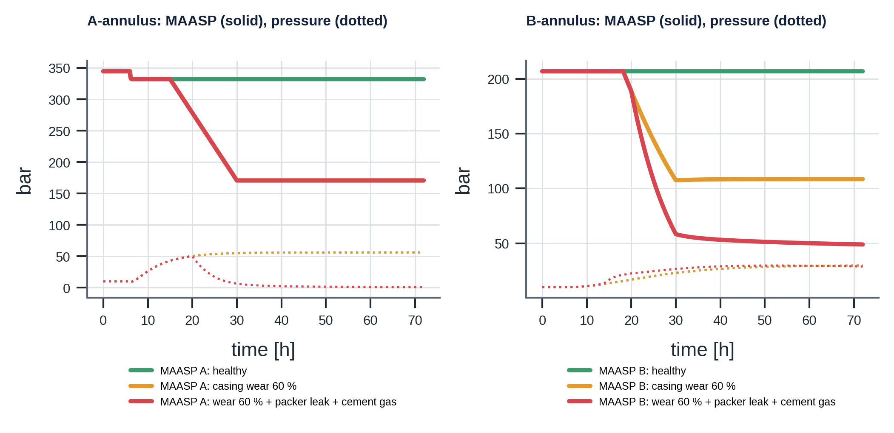
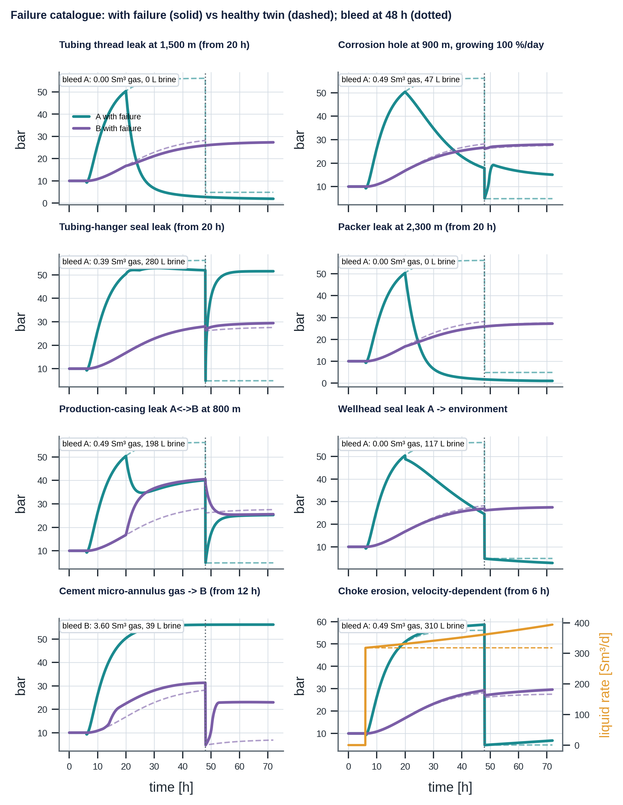
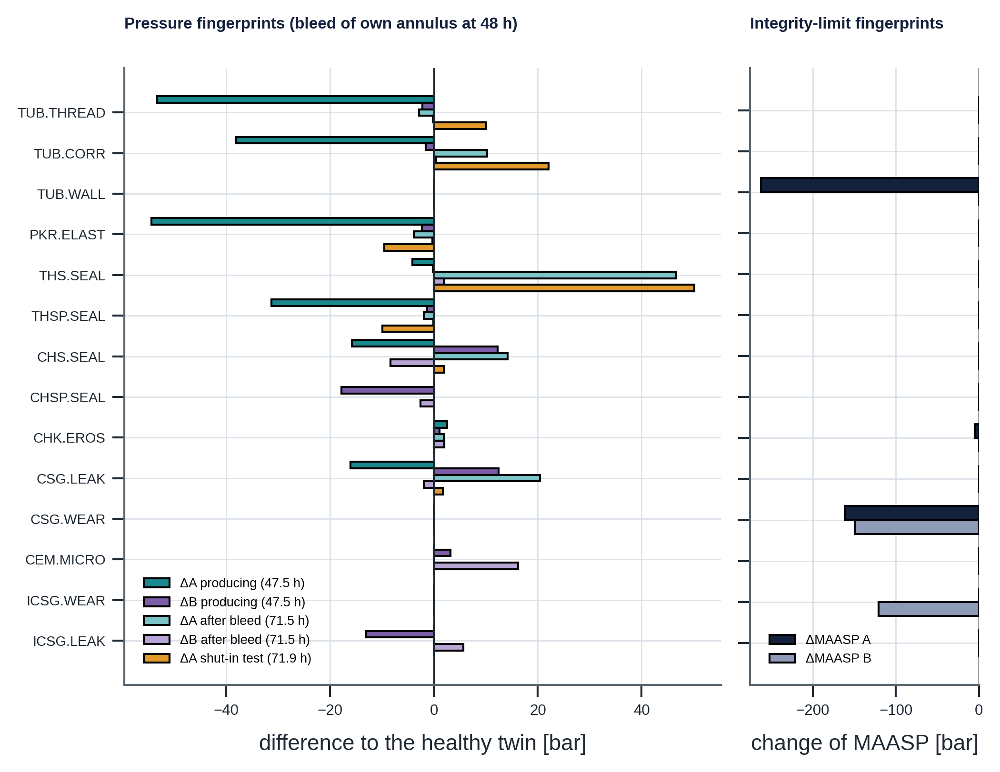
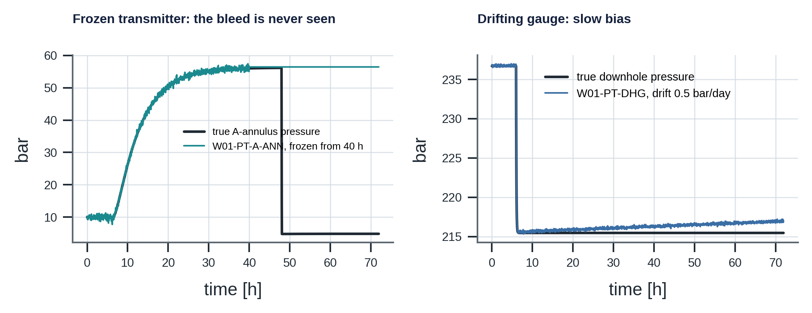
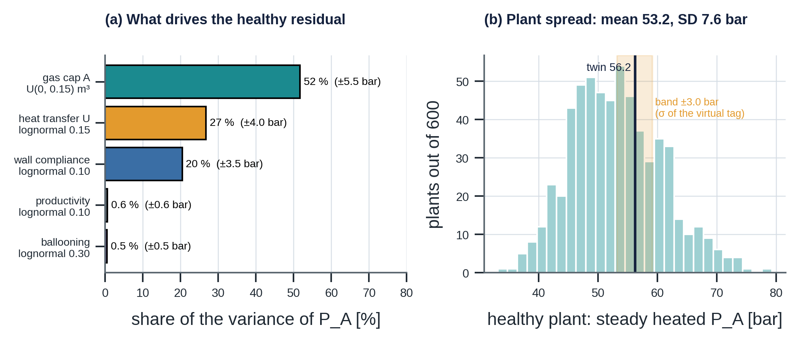

# digital_twin — A Manual for the W01 Well-Integrity Digital Twin (v1.0.0)

### Physics of a producing oil well, its A- and B-annuli, their mechanical limits, and the ways they fail

> **What this document is.** A self-contained, textbook-style manual for the `digital_twin/`
> module of SentinelAI. It explains the physics, the equations, how the code solves them, and what
> each failure looks like. Every number quoted comes from running the code
> (`python -m digital_twin.scenarios`) and is checked against this manual by
> `python -m digital_twin.reproduce` (Chapter 17). Equations carry the numbers (F.1) to (F.43) they
> have in Appendix F of the *End-to-End Solution Description*.
>
> **Synthetic and illustrative.** All parameters are invented. *Ivar Aasen* and *W01* are used only
> as names. This is a transparent reasoning model, not a replacement for commercial well-modelling
> or casing-design software.



*Figure 1. Healthy W01 over 72 hours: start-up at 6 h, a choke step at 30 h, and bleeds of A at 48 h and of B at 60 h, with the gas and brine each bleed returns.*

---

## The twin on one page

| Physics area | What the twin models |
|---|---|
| Fluids | Oil, water and gas with solution gas below the bubble point; local free-gas fraction at every depth |
| Production | Reservoir inflow, depth-resolved tubing pressure and temperature profiles, Gilbert choke (critical / subcritical), solved shut-in column, tubing warm-up lag |
| Annuli | **A and B**, each with brine, a gas cap, rising gas and a possible void, in elastic pipes; pressure solved from a **volume balance** |
| Coupling | Heating (A from the tubing, B from A) and **ballooning** (tubing pressure changes A's volume; A's pressure changes B's) |
| Leaks | Seven leak mechanisms between tubing, A, B, formation and environment; bidirectional; gas/liquid split from local conditions; laminar or orifice flow law; growing holes |
| Erosion | Choke trim erosion driven by flow velocity |
| Mechanical integrity | Burst, collapse, packer and wellhead limits; **operational MAASP** of A and B computed every step; casing wear |
| Operations | Choke schedules, shut-ins, **bleed valve** with gas and brine returns |
| Instruments | 14 tags (incl. downhole gauge, multiphase meter, B-annulus, bleed logs) with noise, bias, drift, freezing and dropout |
| Uncertainty | Explicit priors on what the twin does not know; `sample_plant()` draws a plausible real well |

**The most important physical insight.** While the well produces with a heated annulus, the
A-annulus pressure is **higher than the tubing pressure at every depth**. A tubing leak therefore
*drains* the annulus into the tubing instead of filling it, and shows up as a large **negative**
residual (about −53 bar). Shutting the well in reverses this. The direction of a leak depends on the
operating state, and so does the evidence it leaves (Chapters 6 and 7).

---

## What changed in this revision

**The model did not change.** The eight physics files are byte-for-byte the files of the module you provided: `config.py`, `production.py`, `annulus.py`, `failure_modes.py`, `integrity.py`, `simulator.py`, `sensors.py` and `uncertainty.py`. `TWIN_VERSION` stays `1.0.0`, so the knowledge graph and the decision-engine artifact remain valid. All sixteen chapters of the earlier manual are kept, in the same order, with their tables and equations. This revision adds:

| Addition | Where |
|---|---|
| Equation numbers **(F.1)** to **(F.43)**, the numbers the equations have in Appendix F of the *End-to-End Solution Description*, and derivations that the earlier text stated without proof (uniqueness of the closure root, the gas-cap compressibility, the leak time constant, the closed form of the MAASP of B) | Chapters 3 to 11 |
| One figure style for all ten figures (same palette, 7 in wide, 300 dpi); four new figures: well schematic, closure, fingerprints, uncertainty budget | Figures 1 to 10 |
| `analysis.py` (the derived quantities as functions), `reproduce.py` (recomputes the numbers quoted here), `figstyle.py`; extended `scenarios.py`, `test_twin.py`, `__init__.py` | Chapters 2, 12, 17 |
| Seven corrections of statements in the earlier manual, each with its evidence | 17.3 |
| Notation, a symbol map to Appendix F, default parameters | Chapter 18 |

If you prefer the module exactly as you provided it, keep your own `scenarios.py`, `test_twin.py` and `__init__.py` and leave out the three new files. The physics, the tables and all results in this manual are unchanged by that choice; only the passages that cite `analysis.*`, `reproduce.py` or the new figures need the added files.

---

## Contents

1. [Why a digital twin, and what it is for](#1-why-a-digital-twin-and-what-it-is-for)
2. [Quick start, files and API](#2-quick-start-files-and-api)
3. [The physical system](#3-the-physical-system)
4. [Production physics: from reservoir to choke](#4-production-physics-from-reservoir-to-choke)
5. [Annulus physics: the volume balance](#5-annulus-physics-the-volume-balance)
6. [Leaks, balance depth and gas migration](#6-leaks-balance-depth-and-gas-migration)
7. [Operations as experiments: bleeds and shut-ins](#7-operations-as-experiments-bleeds-and-shut-ins)
8. [Mechanical integrity and MAASP](#8-mechanical-integrity-and-maasp)
9. [Failure catalogue](#9-failure-catalogue)
10. [Instrumentation and measurements](#10-instrumentation-and-measurements)
11. [What the twin does not know: uncertainty](#11-what-the-twin-does-not-know-uncertainty)
12. [Numerical methods and verification](#12-numerical-methods-and-verification)
13. [Consequences for the knowledge graph and the decision engine](#13-consequences-for-the-knowledge-graph-and-the-decision-engine)
14. [Limitations](#14-limitations)
15. [Glossary](#15-glossary)
16. [References](#16-references)
17. [Verification: reproducing every number](#17-verification-reproducing-every-number)
18. [Notation and parameters](#18-notation-and-parameters)

---

## 1. Why a digital twin, and what it is for

### 1.1 Definition used here

A **digital twin** is a simulation model of a specific asset, configured with that asset's
parameters, that predicts how the asset *should* behave under its current operations. Here, it is
a physics model of well W01 (`TWIN-W01`, version `1.0.0`) with a stated validity envelope (choke 8–96/64, annulus temperature
20–90 °C).

### 1.2 Six jobs the twin does in SentinelAI

| Job | Question | Where used |
|---|---|---|
| **Expectation** | What should the annulus pressures be right now if nothing is wrong? | Residual = measured − expected |
| **Virtual sensing** | What is the pressure at 1,500 m, or the annulus temperature, which nobody measures? | Leak-direction reasoning, virtual tags |
| **Limits** | How much pressure can each annulus take right now (MAASP)? | Hard-limit gate, margin to limit |
| **Test prediction** | If we bleed or shut in now, what will we see in a healthy vs a leaking well? | Value of information in decisions |
| **Failure simulation** | What does each failure mechanism look like in the measurements? | Training data and fingerprints (Chapter 9) |
| **Knowing its limits** | Is the current state inside the range where the twin is trustworthy? | Model-validity gate |

### 1.3 Plant and twin: one engine, two roles

| Role | Parameters | Failures | Purpose |
|---|---|---|---|
| **Plant** ("the real well") | Drawn from priors around nominal (`sample_plant`) | Possibly injected | Produces the measurements |
| **Twin** | Nominal (`nominal_w01()`) | None | Produces the expectation |

Both see the same operations (choke schedule, bleeds, shut-ins), because those are logged. Their
difference is the residual. Because plant parameters differ from nominal, a healthy plant still
produces non-zero residuals. That is the realistic **model error** any monitoring layer must learn
to tolerate.

### 1.4 Why physics, not just data

Well-integrity failures are rare, so there are few labelled examples. Physics supplies what data
alone cannot:

- **Structure:** what *can* happen. A leak can only flow in the direction of the pressure difference at its depth.
- **Extrapolation:** reasonable behaviour in operating states never seen before, such as a new choke setting.
- **Counterfactuals:** what *would* happen under a different action, such as "if we shut in now".
- **Limits:** how close the well is to a mechanical limit, which no historical data can tell you before the first failure.

---

## 2. Quick start, files and API

```bash
pip install numpy scipy matplotlib
python -m digital_twin.scenarios      # catalogue tables + 10 figures (about 90 s)
python -m digital_twin.reproduce      # recompute every number quoted here: 221 checks (about 35 s)
python -m digital_twin.reproduce --full   # + fingerprints and uncertainty budget: 335 checks (about 90 s)
python -m digital_twin.test_twin      # 17 physics checks (or: pytest digital_twin)
```

```python
from digital_twin import nominal_w01, Operations, Bleed, startup, simulate, measure
from digital_twin import failure_modes as fm

cfg = nominal_w01()                                              # the twin of W01
ops = Operations(choke=startup(6, 32, changes=[(30, 48)]),       # open at 6 h, step to 48/64 at 30 h
                 bleeds=[Bleed(48, "A"), Bleed(60, "B")])
res = simulate(cfg, ops,
               failures=[fm.tubing_connection_leak(depth_m=1500, start_h=20),
                         fm.CasingWear("prodcsg", wall_loss=0.3, start_h=0, ramp_h=24)],
               hours=72, dt_s=120)
res["P_A"], res["P_B"], res["MAASP_B"], res.events              # true signals, limits, bleed log
tags = measure(res, seed=1, faults={"W01-PT-A-ANN": dict(frozen_at_h=40)})   # measured tags

from digital_twin import analysis                                # closed forms of this manual (added in this revision)
analysis.steady_annulus_pressure(cfg, V_gas0_m3=0.15)            # 43.9 bar: the closure alone, no time loop
analysis.balance_table(cfg)                                      # leak direction in three situations
```

| File | Content | Chapter |
|---|---|---|
| `config.py` | `WellConfig`, `AnnulusConfig`, `PipeRatings`, preset `nominal_w01()` | 3, 8 |
| `production.py` | PVT, inflow, tubing profile, Ramey temperature, Gilbert choke, shut-in column | 4 |
| `annulus.py` | Annulus state, volume closure, gas cap, parcels, void | 5 |
| `failure_modes.py` | `LeakPath`, `ChokeErosion`, `CasingWear`, catalogue of mechanism factories | 6, 9 |
| `integrity.py` | Differential loads and operational MAASP of A and B | 8 |
| `simulator.py` | Time loop, operations, bleeds, signals, snapshots | 7, 12 |
| `sensors.py` | Tag specifications, measurement model, sensor faults | 10 |
| `uncertainty.py` | Priors on unknown parameters, `sample_plant()` | 11 |
| `scenarios.py` | Scenario library, printed tables, all ten figures | 9 |
| `test_twin.py` | Physics checks (17) | 12 |
| `analysis.py` | Closed forms and derived quantities of this manual as functions (no plotting, no I/O) | 4 to 11 |
| `reproduce.py` | Recomputes every number of this manual and compares it with the printed value | 17 |
| `figstyle.py` | Figure style shared with the *End-to-End Solution Description* | |
| `verification_report.md` | The 335 checks of the last full run, one row each | 17 |

---

## 3. The physical system

### 3.1 Well schematic and pressure domains

```
                 choke (Gilbert, erosion) ──► flowline  P_fl
   P_wh, T_wh  ┌──┴──┐
               │ XT  │  hanger seal ─ A-annulus outlet (P_A, bleed valve)  ─ B outlet (P_B, bleed valve)
   ────────────┴─────┴──────────────────────────────────────────────────────────────────
    │ B │ A │ T │ A │ B │         T  = tubing 4-1/2" (produced oil, water, gas)
    │   │   │   │   │   │         A  = A-annulus (brine + small gas cap), 0–2,300 m, 30 m³
    │   │   │   │   │   │         B  = B-annulus (brine + gas cap), 0–1,200 m, 35 m³
    │▓▓▓│   │   │   │▓▓▓│ 1,200 m top of cement, shallow gas zone behind it (formation)
    │▓▓▓│   │   │   │▓▓▓│         production casing 9-5/8", intermediate casing 13-3/8"
    │▓▓▓│   │ ● │   │▓▓▓│ 2,250 m downhole gauge (P_dhg, T_dhg), tubing side
    │▓▓▓│ ══╪═══╪══ │▓▓▓│ 2,300 m production packer
              reservoir 2,400 m: 250 bar, 90 °C
```



*Figure 2. Well W01: tubing, A- and B-annulus, casing strings, packer, DHSV, cement top and the depths used by the models.*

The simulator connects six **pressure domains**:

| Domain | Pressure at depth z comes from | Fluid |
|---|---|---|
| `tubing` | Depth-resolved production profile (Chapter 4) | Oil + water + free gas, split by φ(z) |
| `A` | A-annulus top pressure + brine column below its gas/void column (Chapter 5) | Brine, gas in cap |
| `B` | Same for B | Brine, gas in cap |
| `formation` | Shallow gas zone, gradient 0.115 bar/m (mildly over-pressured) | Gas |
| `atm` | 1.013 bar | — |
| reservoir | 250 bar at 2,400 m, via the inflow relation | — |

### 3.2 Barrier context

The **primary barrier** (tubing, packer, safety valve) separates the produced fluid from the
A-annulus. The **secondary barrier** (production casing, its cement, wellhead) separates A from B
and from the environment. A-annulus pressure is the main online window on the primary barrier,
B-annulus pressure on the secondary. Every failure in Chapter 9 breaches or weakens one of these
elements (see the `knowledge_graph` README for the NORSOK D-010 background).

### 3.3 Constants and derived quantities

Depth $z$ is positive downwards from the wellhead. Pressures are in bar when reported and in Pa inside the volume balance. Two derived constants are used throughout: the standard volume of one mole of gas, and the hydrostatic gradient of the annulus brine:

$$V_{mol} = \frac{R\,T_{sc}}{P_{sc}} = \frac{8.314 \times 288.15}{101325} = 0.023644\ \text{Sm}^3/\text{mol} \qquad (\text{F.1})$$

$$\gamma_b = \frac{\rho_b\,g}{10^{5}} = \frac{1030 \times 9.81}{10^{5}} = 0.10104\ \text{bar/m} \qquad (\text{F.2})$$

with $g = 9.81$ m/s², gas constant $R = 8.314$ J/(mol K), gas compressibility factor $Z = 0.9$ (constant), standard conditions $P_{sc} = 101325$ Pa and $T_{sc} = 288.15$ K, and brine density $\rho_b = 1030$ kg/m³. All parameters are tabulated in Chapter 18.

---

## 4. Production physics: from reservoir to choke

### 4.1 Fluid properties (PVT)

The produced fluid is oil, water (water cut WC = 0.3) and gas (GOR = 100 Sm³/Sm³). Below the bubble
point $P_b = 180$ bar, some gas comes out of solution.

**Solution gas** (linear model): $R_s(P) = GOR \cdot \min(1, P/P_b)$

**Gas formation volume factor** (real gas, $Z = 0.9$): $B_g = \dfrac{P_{sc}}{P}\,\dfrac{T}{T_{sc}}\,Z$

**Free gas volume** per Sm³ liquid: $v_g = (GOR - R_s)(1 - WC)\,B_g$

**Local gas volume fraction** (no slip): $\varphi = \dfrac{v_g}{1 + v_g}$

**Mixture density:** $\rho_m = \dfrac{\rho_l + m_{g,free}}{1 + v_g}$

with $\rho_l = (1 - WC)\,\rho_o + WC\,\rho_w$ the liquid density and $m_{g,free} = (GOR - R_s)(1 - WC)\,\rho_{g,sc}$ the mass of free gas per m³ of liquid; $T$ in $B_g$ is in kelvin. These are equations (F.3) to (F.5) of Appendix F.

*Example at 1,500 m while producing on choke 32 (P ≈ 150 bar, T ≈ 80 °C):* about 8 % of the
volume is free gas. A leak at that depth therefore carries gas into the annulus (Chapter 6).

Worked numbers at that state (`analysis.pvt_point(cfg, 150, 80)` returns them):

| Quantity | Value | Remark |
|---|---|---|
| $R_s$ | 83.3 Sm³/Sm³ | 150/180 of the GOR is dissolved |
| $v_g$ | 0.0869 | free gas per m³ of liquid |
| $\varphi$ | 0.0800 | **8 % of the volume is free gas** |
| $\rho_l$, $m_{g,free}$ | 904.0, 10.5 kg/m³ | |
| $\rho_m$ | 841.4 kg/m³ | gravity gradient $\rho_m g / 10^5 = 0.0825$ bar/m |

### 4.2 Inflow from the reservoir

$$q_L = PI\,(P_{res} - P_{wf}), \qquad PI = 15\ \text{Sm}^3/\text{d/bar} \qquad (\text{F.7})$$

### 4.3 Tubing pressure profile

The pressure gradient has a gravity and a friction part:

$$\frac{dP}{dz} = \rho_m(P, T)\,g + f\,\frac{\rho_m v_m^2}{2D} \qquad (\text{F.6})$$

with the mixture velocity $v_m = q\,(1 + v_g)/(86400\,A_t)$ in m/s ($q$ in Sm³/d) and the tubing cross-section $A_t = \pi D^2/4$.

The code marches this down from the wellhead in 48 segments of 50 m and **stores the whole
profile** $P(z)$, $T(z)$, so any leak depth and any integrity check can read the local tubing
pressure.

**Why the profile is curved.** Near the surface, pressure is low, so more gas is free and expanded.
The mixture is light and the gradient small. Deeper, gas dissolves, the mixture is heavier and the
gradient larger. At 1,500 m on choke 32 the tubing pressure is **150.0 bar**, 12.3 bar below a
straight line drawn between wellhead (51.5 bar) and bottom (228.8 bar). That curvature decides
where leaks flow in or out (Section 6.2). Figure *twin_physics (c)* shows profiles for three chokes
and for shut-in.

### 4.4 Temperature profile (Ramey)

Hot reservoir fluid loses heat to the cooler rock on its way up. With geothermal temperature
$T_{geo}(z) = T_{top} + g_G z$, the steady flowing temperature is (Ramey, 1962):

$$T_f(z) = T_{geo}(z) + g_G\,A\,\big(1 - e^{-(H - z)/A}\big), \qquad A = \frac{\dot m\,c_p}{U\,\pi D} \qquad (\text{F.8, F.9})$$

$A$ is the **relaxation length**: how far the fluid travels before it "forgets" its starting
temperature. Faster flow means a larger $A$ and a hotter well. The A-annulus is heated by the
**mean of this profile over its length** (Section 5.5).

On choke 32: $\dot m = 3.328$ kg/s, $c_p = (1 - WC)\,2100 + WC\,4180 = 2724$ J/(kg K), so $A = 1154$ m and the wellhead temperature is 41.3 °C.

### 4.5 Choke

**Critical flow** (Gilbert, 1954, field units):

$$P_{wh} = \frac{435\,R^{0.546}\,q}{S^{1.89}} \qquad (\text{F.13, field units})$$

with $R$ the gas-liquid ratio [Mscf/stb], $q$ in stb/d and $S$ the bean size [1/64 in]. When
$P_{fl}/P_{wh} \le 0.55$, flow is critical and does not depend on flowline pressure. Above that
ratio it is subcritical, and the rate falls along an elliptic curve:

$$q = q_{crit}\sqrt{1-\left(\frac{r-0.55}{0.45}\right)^2}, \qquad r = P_{fl}/P_{wh} \qquad (\text{F.14})$$

In the units of the code ($q$ in Sm³/d, $P_{wh}$ in bar) the critical relation reads

$$P_{wh,c}(q, S) = \frac{435\,R^{0.546}\,(6.2898\,q)}{14.5038\,S^{1.89}}, \qquad R = GOR\,(1 - WC)\,\frac{5.615}{1000} \qquad (\text{F.13 in code units})$$

so that $R = 0.393$ Mscf/stb and, for choke 32 and $q = 318$ Sm³/d, $P_{wh} = 51.5$ bar. The critical rate at a given wellhead pressure is $q_{crit} = P_{wh}/P_{wh,c}(1, S)$. For a required rate in the subcritical range the code finds $P_{wh}(q)$ by Brent's method.

### 4.6 Choke erosion (velocity-driven)

Sand and droplets erode the choke trim. Erosion rate grows steeply with velocity (typically
$v^2$–$v^3$; cf. API RP 14E and DNV RP O501). The twin tracks an erosion factor $e$ that multiplies
the set bean size:

$$S_{eff} = e\,S_{set}, \qquad \frac{de}{dt} = k\left(\frac{v_{wh}}{v_{ref}}\right)^{n} \qquad (\text{F.15})$$

with $k$ = 0.05 per day, $v_{ref}$ = 1 m/s and $n$ = 2. At choke 32 the wellhead mixture velocity
is 0.92 m/s; at choke 64 it is 3.2 m/s, so erosion there runs about **12 times faster**. As the
choke erodes, rate and velocity rise, which accelerates erosion further: a self-reinforcing
mechanism.

More precisely, the velocity ratio is $(v_{64}/v_{32})^2 = (3.21/0.92)^2 = 12.1$, and for a constant velocity the erosion factor grows linearly, $e(t) = 1 + k\,(v_{wh}/v_{ref})^{n}\,t$.

### 4.7 Operating point (nodal analysis)

Inflow, tubing and choke must agree on one rate. The code solves for $q$ (Brent's method) such that
the bottomhole pressure from the inflow relation equals the bottom of the marched tubing profile,
starting from the $P_{wh}$ the choke requires for that rate.

Written as one equation, the rate is the root of

$$\Phi(q) = P_{res} - \frac{q}{PI} - P_{bh}\big(q;\,P_{wh}(q)\big) = 0 \qquad (\text{F.10})$$

where $P_{bh}$ is the bottom of the marched tubing profile. $\Phi$ is positive at the lower end of the bracket $[1,\ 0.95\,PI\,P_{res}]$ and negative at the upper end, so a root exists; it is unique in practice because a higher rate lowers the available bottomhole pressure and raises friction.


| Choke [1/64 in] | q_L [Sm³/d] | P_wh [bar] | T_wh [°C] | P_wf [bar] | v_wh [m/s] | Regime |
|---|---|---|---|---|---|---|
| 16 | 98 | 58.7 | 18.4 | 243.5 | 0.25 | critical |
| 24 | 199 | 55.4 | 30.3 | 236.8 | 0.54 | critical |
| 32 | 318 | 51.5 | 41.3 | 228.8 | 0.92 | critical |
| 48 | 572 | 43.0 | 55.8 | 211.9 | 1.93 | critical |
| 64 | 805 | 35.2 | 63.3 | 196.3 | 3.21 | subcritical |
| 96 | 1,081 | 25.6 | 68.8 | 177.9 | 5.64 | subcritical |

`analysis.steady_states(cfg)` returns this table (flowline pressure 20 bar); `reproduce.py` checks all 36 entries.

### 4.8 Shut-in: a solved static column

With the well shut in, there is no flow and no friction, and the fluid reaches geothermal
temperature. The code finds the wellhead pressure for which the static column reaches exactly
$P_{res}$ at the bottom: **61.85 bar** (checked in `test_shut_in_static_column_reaches_reservoir_pressure`).

$$P(H;\,P_{wh}) - P_{res} = 0, \qquad T = T_{geo}(z) \qquad (\text{F.11})$$

The shut-in tubing pressure is 170.3 bar at 1,500 m and 241.1 bar at the packer.

### 4.9 Tubing transients

Real wellheads do not change temperature instantly. The tubing profile relaxes toward its new
steady state with first-order lags:

$$\frac{dT(z)}{dt} = \frac{T_{ss}(z) - T(z)}{\tau_T}, \qquad \tau_T = 0.75\ \text{h}; \qquad \tau_P = 0.1\ \text{h} \qquad (\text{F.12, continuous form})$$

Discretised explicitly, with $X$ standing for $T(z)$ or $P(z)$ and $X_{ss}$ for its steady state:

$$X_{n+1} = X_n + (X_{ss} - X_n)\,\min\left(1, \frac{\Delta t}{\tau}\right) \qquad (\text{F.12})$$

The exact solution would use $1 - e^{-\Delta t/\tau}$, so the explicit step has the effective time constant $\tau_{eff} = -\Delta t / \ln(1 - \Delta t/\tau)$. With $\Delta t$ = 120 s it is 296 s instead of 360 s for the pressure lag, 2,640 s instead of 2,700 s for the tubing temperature and 21,540 s instead of 21,600 s for the A-annulus: only the fast, small-amplitude pressure lag is visibly affected.

The rate follows the choke immediately (a simplification; see Chapter 14).

---

## 5. Annulus physics: the volume balance

This is the core of the twin. It is worth understanding one idea first.

### 5.1 Pressure is not a state; mass is

A closed annulus contains a fixed amount of brine and gas, unless something leaks in or out. Its
**pressure** is whatever value makes that brine and gas fit exactly into the container. So the code
stores what is conserved, and **computes** pressure each step:

| State variable | Meaning |
|---|---|
| $T$ | Lumped fluid temperature |
| $V_{ref}$ | Brine volume measured at the initial state, a proxy for brine **mass** |
| $n_{cap}$ | Moles of gas in the gas cap at the top |
| $(n_k, z_k)$ | Gas "parcels" still rising through the brine, with their depths |

### 5.2 The closure equation

At a trial top pressure $P$ (SI units, $P_0$ and $T_0$ the initial state):

$$V_{cont}(P) = V_0\,[\,1 + c_{wall}(P - P_0) - k_b\,(P_{in} - P_{in,0})\,] \qquad (\text{F.16})$$

$$V_{brine}(P) = V_{ref}\,[\,1 + \alpha\,(T - T_0) - c_{liq}\,(P - P_0)\,] \qquad (\text{F.17})$$

$$V_{gas}(P) = \frac{n_{cap} Z R T_K}{P} + \sum_k \frac{n_k Z R T_K}{P + \rho_b g\,(z_k - h_{top})} \qquad (\text{F.18})$$

$$f(P) = V_{cont}(P) - V_{brine}(P) - V_{gas}(P) = 0 \qquad (\text{F.19})$$

| Term | Physics | Value (A) |
|---|---|---|
| $c_{wall}$ | Pipes bulge when pressurised (elastic compliance) | 1.55 × 10⁻⁹ Pa⁻¹ |
| $c_{liq}$ | Brine compresses slightly | 4.5 × 10⁻¹⁰ Pa⁻¹ |
| $\alpha$ | Brine expands when heated | 4.5 × 10⁻⁴ K⁻¹ |
| $k_b$ | Tubing pressure pushes the tubing wall outward (ballooning, 5.6) | 2 × 10⁻¹⁰ Pa⁻¹ |
| gas terms | Ideal gas with $Z = 0.9$, at the local pressure | — |

**Why there is always exactly one solution.** Every term moves the same way: raising $P$ enlarges
the container, shrinks the brine and shrinks the gas. So $f(P)$ increases strictly with $P$, and
Brent's method finds the unique root.

In symbols, the slope of the closure is positive:

$$\frac{df}{dP} = V_0\,c_{wall} + V_{ref}\,c_{liq} + \frac{n_{cap} Z R T_K}{P^2} + \sum_k \frac{n_k Z R T_K}{P_k^2} \gt 0, \qquad P_k = P + \rho_b g \max(z_k - h_{top}, 0)$$

Every term is positive, so $f$ has at most one root; $f(P) \to +\infty$ as $P \to \infty$, so a root exists unless $f(P_{min}) \ge 0$, the void case of Section 5.8. Brent's method on $[P_{min}, P_{hi}]$ finds it in about ten evaluations.



*Figure 3. Left: the closure residual f(P) for four gas caps; each curve is strictly increasing and crosses zero once (dots: the solution). Right: thermal sensitivity of the A-annulus against pressure for a 0.05 m³ gas cap.*

### 5.3 The liquid-full limit: where 2.25 bar/K comes from

With no gas and no ballooning, linearise the closure for a temperature change $\Delta T$:

$$V_0\,c_{wall}\,\Delta P = V_0\,(\alpha\,\Delta T - c_{liq}\,\Delta P)
\;\Rightarrow\; \frac{\Delta P}{\Delta T} = \frac{\alpha}{c_{wall} + c_{liq}} = \frac{4.5\times10^{-4}}{2\times10^{-9}\ \text{Pa}^{-1}} = 2.25\ \text{bar/K} \qquad (\text{F.26})$$

A liquid-full annulus therefore gains about **2.25 bar for every degree** of heating (checked in
`test_thermal_sensitivity_liquid_full`).

With gas and ballooning, differentiating the closure at constant mass and moles gives the response to small changes of temperature and of the inner-pipe pressure:

$$\Delta P\left(V_0\,c_{wall} + V_{ref}\,c_{liq} + \frac{V_g}{P}\right) = V_{ref}\,\alpha\,\Delta T + V_0\,k_b\,\Delta P_{in} \qquad (\text{F.24})$$

and, with $c_{eff}$ the effective compressibility of the whole container (pipe, brine and gas),

$$c_{eff} = c_{wall} + c_{liq} + \frac{V_g}{V_0\,P}, \qquad \frac{\partial P}{\partial T} = \frac{\alpha}{c_{eff}}, \qquad \frac{\partial P}{\partial P_{in}} = \frac{k_b}{c_{eff}} \qquad (\text{F.25})$$

For a liquid-full annulus the ballooning gain $k_b/(c_{wall} + c_{liq})$ is 0.100 for A and 0.061 for B.

### 5.4 The gas cap: why a little gas changes everything

The isothermal compressibility of an ideal gas is $1/P$. At 10 bar that is $10^{-6}$ Pa⁻¹, about
**500 times** more compressible than the brine-plus-pipe system. A gas cap of volume $V_g$
contributes to the effective compressibility:

$$c_{eff}(P) \approx c_{wall} + c_{liq} + \frac{V_g(P)}{V_0}\,\frac{1}{P} \qquad (\text{F.25})$$

Two effects follow:

1. **The annulus is much softer.** 0.05 m³ of gas in 30 m³ (0.17 %) raises $c_{eff}$ by **83 %**
   at 10 bar, and by more than 100 % below 9.1 bar (earlier versions of this manual said "more
   than doubles" at 10 bar; the exact figure is +83 %).
2. **It stiffens as pressure rises.** The gas is compressed ($V_g \propto 1/P$) and its
   compressibility falls ($1/P$), so the contribution falls roughly as $1/P^2$. Thermal pressure
   build-up (APB) is therefore **nonlinear**: steep at first, then flattening.

For a fixed number of moles the cap volume is $V_g = P_0 V_{g0}/P$ (isothermal), so the gas term of $c_{eff}$ falls as $1/P^2$, and it equals the brine-plus-pipe term at the crossover pressure

$$P_2 = \sqrt{\frac{P_0\,V_{g0}}{V_0\,(c_{wall} + c_{liq})}} = 9.13\ \text{bar} \qquad (\text{F.27})$$

For the nominal A-annulus ($V_{g0} = 0.05$ m³ at $P_0 = 10$ bar, $V_0 = 30$ m³):

| $P$ [bar] | $V_g$ [m³] | $c_{eff} / (c_{wall} + c_{liq})$ | $\partial P / \partial T$ [bar/K] | Remark |
|---|---|---|---|---|
| 5 | 0.100 | 4.33 | 0.52 | very soft |
| **10** | **0.050** | **1.83** | **1.23** | **gas adds 83 %** |
| 20 | 0.025 | 1.21 | 1.86 | |
| 40 | 0.013 | 1.05 | 2.14 | |
| 56 | 0.009 | 1.03 | 2.19 | almost liquid-full |

The steady heated pressure of A follows from the closure alone, without the time loop (`analysis.steady_annulus_pressure`): start from the shut-in state ($T_0$ = 46.25 °C, $P_{in,0}$ = 144.7 bar), heat to the mean flowing tubing temperature (70.59 °C), load with the mean flowing tubing pressure (127.0 bar) and solve once.

| Initial gas cap | A-annulus pressure after heating (47 h) | Closure alone (steady) |
|---|---|---|
| 0 m³ (liquid-full) | 62.9 bar | 63.0 bar |
| 0.05 m³ (nominal twin) | 56.1 bar | 56.2 bar |
| 0.15 m³ | 43.8 bar | 43.9 bar |
| 0.5 m³ | 21.1 bar | 21.2 bar |

The constant 0.1 bar difference is the transient: at 47 h the annulus has not quite reached its steady temperature, and the closure agrees with the simulation at 71.5 h to better than 0.05 bar. The liquid-full case also follows from the linearisation alone: $10 + 2.25 \times 24.34 + 0.10 \times (-17.7) = 63.0$ bar, where the last term is the ballooning correction.



*Figure 4. (a) Thermal build-up depends on the gas cap; (b) ballooning when the choke steps 32 → 48 → 24; (c) tubing pressure and temperature profiles; (d) laminar against orifice leak flow after a bleed.*

**Why this matters for monitoring.** The gas cap volume left after completion is rarely known.
It is the single biggest source of twin error for thermal APB (Chapter 11). In HP/HT wells,
operators deliberately leave or inject a gas cushion, or use crushable foam, precisely to soften
trapped annuli.

### 5.5 Annulus temperatures

**A-annulus:** relaxes toward the mean flowing tubing temperature over its length:

$$\frac{dT_A}{dt} = \frac{\bar T_{tub}(0..L_A) - T_A}{\tau_A}, \qquad \tau_A = 6\ \text{h} \qquad (\text{F.23})$$

On choke 32, $T_A$ rises from 46.2 °C (shut in) to about 70.6 °C. At choke 48 the steady mean tubing
temperature over A is 77.0 °C, and $T_A$ reaches 77.0 °C at 72 h (earlier versions said 76.6 °C).

**B-annulus:** outside A and partly cooled by the formation. It feels a fraction $\beta = 0.6$ of
A's temperature rise above geothermal, with a slower time constant $\tau_B = 12$ h:

$$T_{B,drive} = \bar T_{geo}(0..L_B) + \beta\,\big(T_A - \bar T_{geo}(0..L_A)\big) \qquad (\text{F.23})$$

$T_B$ rises from about 27 °C to about 41 °C in 47 h, so B also builds thermal pressure (to about
28 bar).

### 5.6 Ballooning

When the tubing pressure rises, the tubing bulges outward and the annulus volume shrinks. The
model uses the mean tubing pressure over the annulus length, $P_{in}$:

$$\frac{\Delta V_{cont}}{V_0} = -k_b\,\Delta P_{in} \quad\Rightarrow\quad \Delta P_A \approx \frac{k_b}{c_{eff}}\,\Delta P_{in} \qquad (\text{F.25})$$

With $k_b = 2\times10^{-10}$ and $c_{eff} = 2\times10^{-9}$ Pa⁻¹ (liquid-full), about **10 %** of a
tubing pressure change appears in the annulus. *Example:* a choke step from 32 to 48 lowers the mean
tubing pressure by 13.8 bar; the linear estimate is $0.1 \times 13.8 = 1.4$ bar, and the simulation
shows that ballooning alone lowers A by **1.35 bar** (the run with ballooning minus the run without;
figure *twin_physics (b)*). This is a second harmless cause of annulus pressure change, and the twin
explains it. For B, the "inner pipe" is the production casing and $P_{in}$ is the mean A pressure,
so bleeding A lowers B by about 2.0 bar (visible at 48 h in the overview figure).

### 5.7 Pressure at depth inside the annulus

The gas cap and any void sit at the top, with height $h_{top} = (V_{cap} + V_{void})/A_{ann}$.
Below that is brine:

$$P_A(z) = P_{A,top} + \rho_b\,g\,\max(z - h_{top}, 0) \qquad (\text{F.21})$$

*Note:* gas columns in an annulus are tall. 0.3 m³ in an annulus of 0.013 m² cross-section is
about 23 m. The weight of the gas column itself is neglected.

The depth-average pressure, needed as the inner-pipe pressure $P_{in}$ of the next annulus, follows by integrating over the annulus length $L$:

$$\bar P_A = \frac{1}{L}\int_0^{L} P_A(z)\,dz = P_{A,top} + \frac{\rho_b\,g\,(L - h_{top})^2}{2L} \qquad (\text{F.22})$$

for $h_{top} \lt L$, with pressures in Pa. The gas column is short at high pressure and tall at low pressure: 0.05 m³ in A is 3.8 m at 10 bar and 0.73 m at the heated state of 56 bar.

### 5.8 Void: when the fluid level drops

If brine leaves the annulus, for example through a deep leak, the contents may no longer fill the
container even at the minimum pressure $P_{min}$ = 1 bar. Then:

- the pressure stays at $P_{min}$, and
- the missing volume becomes a **void** at the top: the fluid level drops.

In the field this is an annulus that needs topping up with brine: **annulus fluid losses**, a
known leak symptom. It also removes back-up pressure from the casing, with consequences for
collapse (Chapter 8).

In symbols:

$$P = P_{min}, \qquad V_{void} = f(P_{min}) \quad \text{if } f(P_{min}) \ge 0 \qquad (\text{F.20})$$

*Gas column versus void.* At low pressure the gas cap itself expands into a tall column: the 20.9 mol of cap gas of A occupy 0.54 m³ at 1 bar and 70 °C, a column of 41 m. In the compound case of Chapter 8 the gas column of A is $h_{top} = 44.4$ m, made of **0.538 m³ of expanded cap gas plus only 0.041 m³ of true void**. Both lower the brine column, and with it the back-up pressure on the casing, by the same $\gamma_b\,h_{top} = 4.5$ bar.

### 5.9 Initial state

At $t = 0$, each annulus is at its configured pressure (10 bar), at the temperature its driver gives
for the initial (shut-in) state, with its initial gas cap. The closure is exact at $P_0$ by
construction.

---

## 6. Leaks, balance depth and gas migration

### 6.1 Leak laws

A leak is a flow path between two domains at one depth $z$, driven by
$\Delta P = P_{src}(z) - P_{snk}(z)$. Two flow laws are available:

| Law | Equation | When it applies |
|---|---|---|
| `laminar` (default) | $q = C\,\Delta P$ | Tight, long paths: thread leaks, micro-annuli, seal seepage |
| `orifice` | $q = C\,\sqrt{\lvert\Delta P\rvert}\ \text{sign}(\Delta P)$ | Short, open holes: corrosion holes, washed-out seals (turbulent) |

$C$ is the **conductance**, a lumped measure of the hole size. It can grow with time to represent
degradation: $C(t) = C_0\,(1 + \text{growth}\cdot\Delta t_{days})$ (F.29).

**How fast does a laminar leak equalise?** In a liquid-full annulus the pressure difference decays exponentially, $d\Delta P/dt = -C\,\Delta P/C_s$, with the time constant

$$\tau_{leak} = \frac{C_s}{C}, \qquad C_s = \sum V_0\,(c_{wall} + c_{liq}) \qquad (\text{F.32})$$

where $C_s$ is the stiff compliance of the annuli the leak connects, in m³ per bar when $C$ is in m³/(s bar). For A, $C_s = 6.0 \times 10^{-3}$ m³/bar; the catalogue thread leak ($C = 5 \times 10^{-7}$) gives $\tau_{leak}$ = 3.3 h, which is why the draining of A in the failure catalogue takes hours. For the casing leak between A and B the compliances act in series ($6.0 \times 10^{-3}$ and $5.775 \times 10^{-3}$ m³/bar give $2.94 \times 10^{-3}$) and $\tau_{leak}$ = 1.6 h. A gas cap lengthens $\tau_{leak}$ by the factor $c_{eff}/(c_{wall} + c_{liq})$ of Section 5.4 (1.83 at 10 bar).

**What the law changes.** Near equilibrium ($\Delta P \to 0$), an orifice still passes significant
flow, because $\sqrt{\Delta P}$ falls much more slowly than $\Delta P$. An orifice leak therefore
rebuilds an annulus to its final pressure faster. Figure *twin_physics (d)* shows a hanger-seal leak
after a bleed:

| Hanger leak, bled at 48 h | A at 49 h | 52 h | 71.5 h |
|---|---|---|---|
| Laminar | 32.8 bar | 47.1 bar | 51.5 bar |
| Orifice | 15.3 bar | 51.4 bar | 51.6 bar |

In the orifice case the bleed valve **cannot bleed the annulus down**: leak inflow matches valve
outflow at about 15 bar until the valve times out. In the field, "annulus cannot be bled down" is
itself strong evidence of a large leak.

### 6.2 Balance depth: the key concept

A tubing leak at depth $z$ flows **into** the annulus only if $P_{tub}(z) > P_A(z)$. The two
pressures grow with depth at different rates:

| Gradient | Value |
|---|---|
| Tubing (producing, gassy mixture) | about 0.06–0.09 bar/m, curved |
| A-annulus brine | 0.101 bar/m, straight |

The **balance depth** is where they cross. Three situations (figure *twin_balance_depth*):

| Situation | Where tubing > annulus | Consequence for a tubing leak |
|---|---|---|
| **Shut in** (A at 5 bar) | Almost everywhere: +56.9 bar at surface, +13.8 at 1,500 m, +3.7 at the packer | Leak **fills** A: rebuild |
| **Producing, heated** (A at 56 bar) | **Nowhere**: annulus is higher at every depth | Leak **drains** A: brine flows into the tubing |
| **Producing, just bled** (A at 5 bar) | Above **1,198 m** | Shallow leak fills A; deep leak drains it |

In equations, with the annulus brine column $P_A(z) = P_{A,top} + \rho_b\,g\,(z - h_{top})$ below the gas column, the balance depth $z_{bal}$ solves

$$P_{tub}(z_{bal}) = P_{A,top} + \rho_b\,g\,(z_{bal} - h_{top}) \qquad (\text{F.33})$$

with pressures in Pa; in bar the brine gradient is $\gamma_b = 0.101$ bar/m. The differences $P_{tub} - P_A$ for the three situations, with the A top pressure stated (`analysis.balance_table`):

| Situation | A top | at 0 m | at 1,500 m | at the packer | Balance depth |
|---|---|---|---|---|---|
| Shut in | 5 bar | +56.9 | +13.8 | +3.7 | none: tubing is higher everywhere |
| Producing, heated | 56.2 bar | −4.7 | −57.8 | −68.7 | none: annulus is higher everywhere |
| Producing, just bled | 5 bar | +46.5 | −6.6 | −17.5 | **1,198 m** |

All differences in bar. *A note on the shut-in case.* In the simulated shut-in state at 3 h the annulus is still at its initial 10 bar, and the picture is slightly different: +51.9 bar at the surface, +9.1 at 1,500 m, and a balance depth of **2,229 m**, below which the deepest part of A would drain. The lower the annulus pressure, the deeper a tubing leak fills it. The figure uses the stated pressures above; `reproduce.py` checks both versions.



*Figure 5. Tubing and A-annulus pressure against depth in three situations; the shaded area decides the direction of a tubing leak.*

### 6.3 Bidirectional leaks

Real leak paths (threads, pits, seals) usually pass fluid both ways. Each leak flows in the
direction of the pressure difference:

- `tubing → A`: produced fluid enters A (with its free gas).
- `A → tubing`: brine (or cap gas, if the gas column reaches the leak) leaves A.

This is why a tubing leak *relieves* thermal APB while producing: it acts like a pressure-relief
path into the tubing. Some paths act like check valves (e.g. a seal energised from one side, or a
leak to atmosphere); set `bidirectional=False` for those.

### 6.4 Gas or liquid? The fluid split

The upstream side decides what flows:

| Upstream | Gas fraction φ |
|---|---|
| Tubing | Local no-slip free-gas fraction from PVT (about 0.08 at 1,500 m; high near surface) |
| Annulus | 1 if its gas column reaches the leak depth, else 0 |
| Formation (gas zone) | 1 |

$$q_{liq} = (1-\varphi)\,q, \qquad q_{gas} = \varphi\,M\,q \qquad (\text{F.30})$$

$M$ = 10 is the **gas mobility factor**: gas has a much lower viscosity than liquid, so through the
same path it flows more easily. Gas volume is converted to moles at the upstream pressure and
temperature.

Over one time step $\Delta t$ a leak transfers

$$V_{liq} = (1 - \varphi_{up})\,q\,\Delta t, \qquad V_{gas} = \varphi_{up}\,M\,q\,\Delta t, \qquad n_g = \frac{P_{up}\,V_{gas}}{Z\,R\,T_{up}}$$

### 6.5 Gas migration

Gas entering at depth $z$ does not appear at the top instantly. It rises as a **parcel** at
$v_{rise}$ = 0.15 m/s (about 2.8 h from 1,500 m) and joins the cap when it reaches it.

**Why rising gas raises pressure.** A parcel's volume is set by its *local* pressure,
$P_{top} + \rho_b g (z_k - h_{top})$. As it rises, the brine column above it shrinks, so it wants
to expand. In a nearly rigid annulus there is no room, so the top pressure rises instead. This is
the classic *gas migration in a closed well* effect. The closure equation captures it
automatically, because each parcel's volume is evaluated at its own depth.

$$z_k(t + \Delta t) = z_k(t) - v_{rise}\,\Delta t \qquad (\text{F.28})$$

The rise time from depth $z$ is $z/v_{rise}$: 10,000 s, or 2.8 h, from 1,500 m. The volume of a parcel, $n_k Z R T_K/(P + \rho_b g \max(z_k - h_{top}, 0))$, is the corresponding term of the closure (F.18).

### 6.6 Numerical safeguards

- **No overshoot:** one step never moves more than half the volume that would equalise the two
  sides, based on the stiff (liquid-full) compliance.
- **Gas:** the limit is looser, because gas is compressible.

In equations, with $\Delta P$ in Pa and $C_s$ in m³/Pa:

$$q\,\Delta t \le \frac{1}{2}\,\lvert\Delta P\rvert\,C_s, \qquad V_{gas} \le 10\,\lvert\Delta P\rvert\,C_s \qquad (\text{F.31})$$

---

## 7. Operations as experiments: bleeds and shut-ins

Operations are not only disturbances; they are **experiments** that reveal hidden states. The twin
predicts their outcome for a healthy well, so a deviation is evidence.

### 7.1 Bleed valve

When an operator opens the annulus bleed valve, what comes out depends on what is at the top:

$$\text{gas at the valve: } \dot n = K_{gas}\,P_{top} \qquad \text{(choked gas flow, proportional to upstream pressure)} \qquad (\text{F.34})$$

$$\text{brine at the valve: } \dot V = K_{liq}\,\sqrt{P_{top} - P_{atm}} \qquad \text{(orifice)} \qquad (\text{F.34})$$

Gas comes out first, then brine. The valve closes when the target pressure (5 bar) is reached, or
after the maximum duration (60 min). The code uses 5-second substeps while the valve is open.

The recorded returns are

$$G = V_{mol}\,n_{bled}\ [\text{Sm}^3], \qquad L_{brine} = 1000\,V_{bled}\ [\text{L}] \qquad (\text{F.35})$$

with $V_{mol} = 0.023644$ Sm³/mol (F.1).

**Bleed returns are the gas inventory: a conservation law.** In a healthy annulus no gas enters or leaves except through the valve, so the moles returned equal the initial cap inventory

$$n_{cap}(0) = \frac{P_0\,V_{g0}}{Z\,R\,T_{0,K}}$$

For A ($V_{g0} = 0.05$ m³, $T_0 = 46.25$ °C): 20.92 mol = 0.4946 Sm³. For B ($V_{g0} = 0.20$ m³, $T_0 = 27.0$ °C): 89.05 mol = 2.1055 Sm³. The twin returns 0.49 and 2.11 Sm³ (`test_gas_inventory_equals_healthy_bleed_return`). Any excess is gas that has **entered**: the cement-gas case returns 3.60 Sm³, so $3.60 - 2.11 = 1.49$ Sm³, or 63 mol, entered B before the bleed. At 56 bar the cap gas of A leaves in $n/(K_{gas}\,P) \approx 19$ s; brine then flows until the 5 bar target is reached.

**Bleed returns are evidence.** The volumes are recorded in the bleed log:

| Case (bleed at 48 h unless noted) | Gas returned | Brine returned | Interpretation |
|---|---|---|---|
| Healthy A | 0.49 Sm³ | 295 L | Initial gas cap plus thermal expansion |
| Hanger-seal leak | 0.39 Sm³ | 280 L | Similar at first bleed; the *rebuild* is the signal |
| External A leak | 0.00 Sm³ | 117 L | Gas cap already lost to the environment |
| Packer leak | nothing | nothing | A already below 5 bar (fluid lost) |
| Healthy B | 2.11 Sm³ | 61 L | Larger B gas cap |
| Cement gas into B | **3.60 Sm³** | 39 L | **Extra gas**: gas is entering B |

Field practice (API RP 90-1) uses exactly these: volume and type of fluid bled, and whether the
pressure rebuilds.

### 7.2 Shut-in as a communication test

Shutting the well in reverses the pressure situation (Section 6.2): tubing pressure rises above
annulus pressure at almost every depth.

| Shut in at 50 h | A at 49.9 h | 53 h | 60 h | 72 h |
|---|---|---|---|---|
| Healthy | 56.1 | 41.1 | 18.0 | **10.9** (cools) |
| Tubing thread leak 1,500 m | 2.6 | 5.7 | 17.8 | **21.0** (rises) |

A healthy annulus **cools and falls**; a leaking one **rises**. The opposite direction is a
powerful, cheap diagnostic. Its cost is deferred production. The shut-in fingerprints (Section 9.4)
separate a thread leak (+10.1 bar) from a packer leak (−9.6 bar) by 19.7 bar, which the bleed test
cannot do (−2.9 against −3.9 bar).

---

## 8. Mechanical integrity and MAASP

### 8.1 Why the twin computes limits

The **maximum allowable annulus surface pressure (MAASP)** is the highest wellhead pressure an
annulus may see without overloading any element exposed to it (ISO/TS 16530-2, API RP 90-1). It is
usually a number in a document. But it depends on the pressures on the *other* side of each pipe,
which change with operations, and on the pipe's remaining wall thickness, which changes with wear.
The twin therefore computes an **operational MAASP** every time step.

### 8.2 Differential loads

A pipe fails when the pressure difference across it exceeds its capacity:

| Load | Definition | Typical cause |
|---|---|---|
| **Burst** | Inside pressure − outside pressure | High annulus pressure on the outer pipe |
| **Collapse** | Outside pressure − inside pressure | High annulus pressure on the inner pipe, or loss of support inside |

Allowable load = rating × wear derating / design factor (DF burst = 1.10, DF collapse = 1.00).

### 8.3 Ratings used (typical catalogue values)

| Element | Rating | Value |
|---|---|---|
| Tubing 4-1/2" 12.6# L80 | burst / collapse | 581 / 517 bar |
| Production casing 9-5/8" 47# L80 | burst / collapse | 474 / 327 bar |
| Intermediate casing 13-3/8" 68# K55 | burst / collapse | 238 / 134 bar |
| Production packer | differential | 345 bar |
| Tubing-head spool (A outlet) | working pressure | 345 bar |
| Casing-head spool (B outlet) | working pressure | 207 bar |
| Pore pressure (back-up outside cemented sections) | gradient | 0.100 bar/m |

### 8.4 The MAASP equations

For the annulus itself, the pressure at depth is taken as $P_{top} + \rho g z$ (the gas cap is
ignored, which is conservative). Each element gives an upper bound on $P_{top}$; MAASP is the
smallest:

**A-annulus** (F.37)

| Element | Bound on $P_{A,top}$ |
|---|---|
| Tubing-head spool | $R_{whA}$ |
| Production casing, burst | $\min_z \big[ R_{pc,b}\,d_b/DF_b + P_{out}(z) - \rho g z \big]$, $P_{out}$ = B pressure above B's top of cement, pore pressure below |
| Tubing, collapse | $\min_z \big[ R_{tub,c}\,d_c/DF_c + P_{tub}(z) - \rho g z \big]$ |
| Packer | $R_{pkr} + P_{tub}(z_{pkr}) - \rho g z_{pkr}$ |

**B-annulus** (F.38)

| Element | Bound on $P_{B,top}$ |
|---|---|
| Casing-head spool | $R_{whB}$ |
| Intermediate casing, burst | $\min_z \big[ R_{ic,b}\,d_b/DF_b + P_{pore}(z) - \rho g z \big]$ |
| Production casing, collapse | $\min_z \big[ R_{pc,c}\,d_c/DF_c + P_A(z) - \rho g z \big]$ |

$$\text{MAASP}_X = \min_{\text{elements}} \text{bound}, \qquad \text{margin}_X = \text{MAASP}_X - P_X \qquad (\text{F.39})$$

The signals `MAASP_A`, `MAASP_B`, `margin_A`, `margin_B` and the governing element (`gov_A`,
`gov_B`) are recorded every step.

**Closed form of the collapse bound.** Below the gas column, $P_A(z) - \rho g z = P_{A,top} - \rho g\,h_{top}$ is the same at every depth (the brine column has the same slope as the hydrostatic term), so the minimum in the collapse bound of B needs no search:

$$P_{B,top}^{\text{PC collapse}} = R_{pc,c}\,d_c + P_{A,top} - \rho g\,h_{top,A} \qquad (\text{F.40})$$

in bar, with $\rho g/10^5 = 0.101$ bar/m. It reproduces the twin's MAASP of B to better than 0.01 bar in the wear case (108.508 bar) and in the compound case (48.916 bar); see `analysis.collapse_bound_closed_form` and `test_collapse_bound_closed_form_matches_the_twin`.

### 8.5 Healthy W01: which element governs

| Annulus | Shut in (3 h) | Producing (47 h) | Governing |
|---|---|---|---|
| A | 344.7 bar | 332.2 bar | Spool when shut in; **packer** when producing |
| B | 206.8 bar | 206.8 bar | **Casing-head spool** |

All A bounds while producing: spool 344.7, casing burst 429.2, tubing collapse 504.6, packer
**332.2** bar. Producing lowers the tubing pressure at the packer, which raises the differential
across the packer for the same annulus pressure, so MAASP_A falls by 12 bar when the well starts.
That is the operational dependence in action.

The evaluations behind these numbers (bar): casing burst $473.67/1.10 + (231.01 - 232.40) = 429.2$; tubing collapse $517.11 + (219.91 - 232.40) = 504.6$; packer $344.74 + 219.91 - 232.40 = 332.2$, where 231.01 is the pore pressure at 2,300 m, 232.40 the brine column and 219.91 the tubing pressure at the packer. The packer bound depends on the choke because the tubing pressure at the packer does (`analysis.maasp_bounds_a_steady`):

| Choke | $P_{tub}$ at the packer [bar] | Packer bound on $P_{A,top}$ [bar] |
|---|---|---|
| shut in | 241.1 | 353.5 (above the spool rating: the spool governs, 344.7) |
| 16 | 234.6 | 347.0 (spool governs) |
| 32 | 219.9 | **332.2** |
| 48 | 202.9 | 315.3 |
| 64 | 187.3 | 299.7 |
| 96 | 169.0 | 281.3 |

### 8.6 Casing wear and corrosion

`CasingWear(pipe, wall_loss, start_h, ramp_h)` removes a fraction $\ell$ of wall thickness.
Capacities fall as:

$$\text{burst} \propto t \;\Rightarrow\; d_b = 1-\ell \qquad\qquad \text{collapse} \propto t^2 \text{ (approx.)} \;\Rightarrow\; d_c = (1-\ell)^2 \qquad (\text{F.36})$$

Burst follows Barlow's formula ($P = 2\sigma_y t/D$); collapse depends more strongly on $t/D$
(API 5C3), and the square is a simple approximation. Collapse therefore degrades faster than burst.

With 60 % wear, $d_c = (1 - 0.6)^2 = 0.16$ and $R_{pc,c}\,d_c = 327.5 \times 0.16 = 52.4$ bar, so by (F.40) the collapse bound of B is $52.4 + P_{A,top} - \rho g\,h_{top}$: 108.5 bar with A at 56.2 bar, and **57.3 bar if A is bled to 5 bar**, 149.6 bar below the unworn 206.8 bar.

### 8.7 Integrity results



*Figure 6. Operational MAASP (solid) and annulus pressure (dotted) for a healthy well, 60 % casing wear, and wear combined with a packer leak and cement gas.*

| Case (at 71.5 h) | MAASP_A (governing) | MAASP_B (governing) | P_A | P_B | Margin B |
|---|---|---|---|---|---|
| Healthy | 332.2 (packer) | 206.8 (spool) | 56.2 | 29.7 | 177.2 |
| Production-casing wear 60 % | 170.9 (casing burst) | 108.5 (casing collapse) | 56.2 | 29.7 | 78.8 |
| Wear 60 % + packer leak + cement gas into B | 170.9 (casing burst) | **48.9** (casing collapse) | 1.0 | 28.8 | **20.1** |

**Reading the compound case.** This is a chain of three individually tolerable failures:

1. Wear halves the production casing's collapse capacity.
2. A packer leak drains A to about 1 bar, removing the inside support of that same casing. At 1 bar
   the gas cap of A has expanded into a column of 44.4 m (Section 5.8), which lowers the brine
   column by 4.5 bar.
3. Cement gas keeps B pressurised from outside.

MAASP_B falls from 207 to 49 bar and the margin from 177 to 20 bar, **while every pressure gauge
looks unremarkable** (B at 29 bar is normal). The risk is invisible in the raw data and visible
only in the physics. This is exactly the kind of combined-failure risk flow the knowledge graph must
represent. (The decision engine, which sees only the *measured* A pressure of 1.1 bar and ignores
the gas column, computes 53.5 bar and a margin of 24.5 bar for the same case, still below its
30 bar gate.)

---

## 9. Failure catalogue

All leak scenarios: shut in until 6 h, choke 32/64, bleed at 48 h. Each is compared with the healthy
twin under the same operations.



*Figure 7. Eight failure mechanisms (solid) against the healthy twin (dashed) under identical operations; the bleed at 48 h is dotted, with the gas and brine each bleed returns.*

### 9.1 Fingerprint table

Δ = failure minus healthy, before the bleed (47.5 h) and at the end (71.5 h):

| Mechanism (graph id) | Path | ΔA pre | ΔB pre | ΔA post | ΔB post | Bleed returns | Other |
|---|---|---|---|---|---|---|---|
| Tubing thread leak 1,500 m `FMech.TUB.THREAD` | tubing ↔ A | **−53.3** | −2.2 | −2.9 | −0.2 | none (A < 5 bar) | — |
| Corrosion hole 900 m, growing `FMech.TUB.CORR` | tubing ↔ A | −38.1 | −1.6 | **+10.2** | +0.4 | 0.49 Sm³, 47 L | slow, growing |
| Hanger-seal leak `FMech.THS.SEAL` | tubing ↔ A, at surface | −4.2 | −0.2 | **+46.7** | +1.9 | 0.39 Sm³, 280 L | A tracks P_wh |
| Packer leak 2,300 m `FMech.PKR.ELAST` | below packer ↔ A | **−54.4** | −2.3 | −3.9 | −0.3 | none | void (fluid loss) |
| Production-casing leak 800 m `FMech.CSG.LEAK` | A ↔ B | −16.1 | **+12.4** | +20.4 | −2.0 | 0.49 Sm³, 198 L | A and B converge |
| Wellhead seal leak `FMech.WH.SEAL` | A → environment | −31.3 | −1.3 | −2.0 | −0.1 | 0.00 Sm³, 117 L | gas cap lost |
| Cement micro-annulus `FMech.CEM.MICRO` | formation gas → B | 0.0 | +3.2 | 0.0 | **+16.2** | B: **3.60 Sm³**, 39 L | B rebuild |
| Choke erosion `FMech.CHK.EROS` | — | +2.5 | +1.1 | +1.9 | +2.0 | normal | **q +75 Sm³/d, P_wh −2.5 bar** |
| Casing wear `FMech.CSG.WEAR` | — | 0 | 0 | 0 | 0 | normal | **MAASP_B −98 bar** (−150 bar if A is bled; Chapter 8) |

### 9.2 Reading the fingerprints

1. **Tubing thread leak (1,500 m).** While producing, A is higher than tubing at the leak, so
   brine drains into the tubing. A falls from about 50 to about 3 bar within hours: a large
   *negative* residual. After the bleed, the leak is below the post-bleed balance depth (1,198 m),
   so there is no rebuild. A **shut-in** reveals it (Section 7.2).
2. **Corrosion hole (900 m, growing).** Shallower, so after the bleed the tubing is above the
   annulus at 900 m: rebuild to about 15 bar, with gas. The growing hole makes changes faster
   with time.
3. **Hanger-seal leak (surface).** At the top, tubing pressure is the tubing-head pressure
   (51.5 bar). Before the bleed, A is held at about P_wh, slightly below thermal. After the bleed,
   it **rebuilds fast to P_wh**. This is the textbook sustained casing pressure (SCP) case:
   rebuild toward tubing pressure, with gas.
4. **Packer leak (2,300 m).** The deepest leak: the annulus drains into the producing zone and
   a void forms at the top. A sits at about 1 bar, the bleed finds nothing to bleed, and in the
   field the annulus would need topping up.
5. **Production-casing leak (A ↔ B).** A and B exchange brine until their pressures are equal at
   800 m. A falls and B rises: **opposite-sign residuals in two annuli**, the signature of a
   secondary-barrier breach. After A is bled, B pushes back into A.
6. **Wellhead seal leak (A → environment).** A bleeds itself slowly: gas cap first, then brine.
   A *loss of containment to the environment*, the hazard itself, not just a degraded barrier.
7. **Cement gas into B.** Formation gas at 1,200 m enters B. B rises above its thermal
   expectation, the bleed returns **more gas** than a healthy B, and B **rebuilds** after the
   bleed. A is unaffected.
8. **Choke erosion.** Not a leak: at a constant set position, the rate rises and tubing-head
   pressure falls. The well also runs hotter, so A gains a little thermal pressure. Detectable
   by comparing the measured rate with the choke model.
9. **Casing wear.** **No pressure signature at all.** It changes only the limits. It can be
   found only by inspection (caliper, thickness logs) and handled by updating MAASP. This is the
   strongest argument that monitoring pressures alone is not enough.

### 9.3 Three lessons

- **No single tag identifies a mechanism.** The fingerprint uses A, B, bleed returns, rate,
  tubing-head pressure, the response to operations, and computed limits. That is the case for a
  knowledge graph that links each mechanism to all of its evidence.
- **Operations change visibility.** The same leak drains A while producing and fills A when shut
  in. Evidence must always be interpreted together with the operating state.
- **Some risks have no signal.** Wear and compound failures change the margin, not the
  measurement.

### 9.4 Fingerprints of the 14 simulated mechanisms

The knowledge graph stores the twin's fingerprint of each simulated mechanism; `analysis.fingerprints(cfg)` produces the table. Experiment E1: shut in to 6 h, choke 32/64, bleed of the mechanism's own annulus at 48 h. Experiment E2: shut in at 50 h. Values in bar, failure minus healthy; "shut-in" is ΔA at 71.9 h:



*Figure 8. Twin-computed fingerprints: pressure differences (left) and change of operational MAASP (right).*

| Mechanism | ΔA pre | ΔB pre | ΔA post | ΔB post | ΔA shut-in | ΔMAASP A | ΔMAASP B |
|---|---|---|---|---|---|---|---|
| `TUB.THREAD` | −53.3 | −2.2 | −2.9 | −0.2 | +10.1 | 0.0 | 0.0 |
| `TUB.CORR` | −38.1 | −1.6 | +10.2 | +0.4 | +22.1 | 0.0 | 0.0 |
| `TUB.WALL` | 0.0 | 0.0 | 0.0 | 0.0 | 0.0 | −262.0 | 0.0 |
| `PKR.ELAST` | −54.4 | −2.3 | −3.9 | −0.3 | −9.6 | 0.0 | 0.0 |
| `THS.SEAL` | −4.2 | −0.2 | +46.7 | +1.9 | +50.1 | 0.0 | 0.0 |
| `THSP.SEAL` | −31.3 | −1.3 | −2.0 | −0.1 | −9.9 | 0.0 | 0.0 |
| `CHS.SEAL` | −15.8 | +12.3 | +14.2 | −8.4 | +1.9 | 0.0 | 0.0 |
| `CHSP.SEAL` | 0.0 | −17.8 | 0.0 | −2.6 | 0.0 | 0.0 | 0.0 |
| `CHK.EROS` | +2.5 | +1.1 | +1.9 | +2.0 | +0.1 | −5.0 | 0.0 |
| `CSG.LEAK` | −16.1 | +12.4 | +20.4 | −2.0 | +1.7 | 0.0 | 0.0 |
| `CSG.WEAR` | 0.0 | 0.0 | 0.0 | 0.0 | 0.0 | −161.4 | −149.6 |
| `CEM.MICRO` | 0.0 | +3.2 | 0.0 | +16.2 | 0.0 | 0.0 | 0.0 |
| `ICSG.WEAR` | 0.0 | 0.0 | 0.0 | 0.0 | 0.0 | 0.0 | −120.6 |
| `ICSG.LEAK` | 0.0 | −13.1 | 0.0 | +5.7 | 0.0 | 0.0 | 0.0 |

The shut-in column separates the mechanisms that the pressure columns cannot: a tubing thread leak (+10.1 bar) from a packer leak (−9.6 bar) by 19.7 bar, where the bleed test gives −2.9 against −3.9 bar.
---

## 10. Instrumentation and measurements

### 10.1 Tags (`sensors.py`)

| Tag | Signal | σ | Kind | What it adds |
|---|---|---|---|---|
| `W01-PT-WH` | Tubing-head pressure | 0.5 bar | measured | Choke model, ballooning, hanger-leak level |
| `W01-TT-WH` | Wellhead temperature | 0.3 °C | measured | Thermal state |
| `W01-ZT-CHK` | Choke position | 0.2 /64 in | measured | Operating state |
| `W01-FL-PT` | Flowline pressure | 0.5 bar | measured | Critical / subcritical choke flow |
| `W01-PT-DHG` | Downhole gauge pressure, 2,250 m | 0.1 bar | measured | Tubing pressure near the packer: anchors the profile and the packer limit |
| `W01-TT-DHG` | Downhole gauge temperature | 0.1 °C | measured | Bottom of the temperature profile |
| `W01-FT-LIQ` | Multiphase meter, liquid | 3 % | measured | Choke erosion, productivity |
| `W01-FT-GAS` | Multiphase meter, gas | 5 % | measured | GOR, gas availability for leaks |
| `W01-PT-A-ANN` | A-annulus pressure | 0.5 bar | measured | Primary-barrier window |
| `W01-PT-B-ANN` | B-annulus pressure | 0.5 bar | measured | Secondary-barrier window |
| `W01-A-BLEED-GAS` | Gas bled from A | 0.1 Sm³ | manual | Bleed composition |
| `W01-A-BLEED-LIQ` | Brine bled from A | 1 L | manual | Bleed volume |
| `W01-B-BLEED-GAS`, `-LIQ` | Same for B | — | manual | B diagnostics |

Computed signals (`MAASP_A`, `MAASP_B`, `margin_*`, annulus temperatures, pressure at depth) are
**virtual tags**: they come from the twin, not from an instrument, and carry model uncertainty.

### 10.2 Measurement model

$$y(t) = Q\big(x(t) + b + d\cdot t_{days} + e(t)\big), \qquad e \sim N\big(0,\ \sigma^2 + (\sigma_{rel}\,x)^2\big) \qquad (\text{F.41})$$

| Term | Meaning |
|---|---|
| $x$ | True value from the simulator |
| $b$ | Fixed bias |
| $d$ | Drift per day (downhole gauges are known to drift) |
| $\sigma$, $\sigma_{rel}$ | Absolute and relative noise |
| $Q$ | Rounding to the instrument or reading resolution |

**Faults** are injected per tag (`measure(..., faults={...})`):
- `frozen_at_h`: the value sticks, so a live signal becomes a flat line.
- `drift_per_day`: a slow bias.
- `dropout`: missing samples.

Formally, a frozen transmitter repeats its value from the freezing sample $k_f$ onwards, $y_k = y_{k_f}$ for $k \ge k_f$, and a dropout replaces a sample by NaN with a given probability.

**Manual readings** (bleed logs) exist only at the end of a bleed and are NaN otherwise. They are
a different kind of evidence: sparse, human-recorded, and with their own reliability.



*Figure 9. A frozen annulus transmitter (left) and a drifting downhole gauge (right).*

The frozen annulus transmitter (left) misses the bleed entirely. The drifting downhole gauge (right)
develops a 1.5 bar bias over 3 days, which could be mistaken for reservoir depletion. Both must be
caught by data-quality checks before any integrity reasoning.

---

## 11. What the twin does not know: uncertainty

The twin uses nominal parameters. The real well differs, and the residual of a healthy well
reflects that difference. `uncertainty.py` makes this explicit:

| Parameter | Prior around nominal | Why it is uncertain |
|---|---|---|
| A gas cap volume | uniform 0 – 0.15 m³ | Gas left after completion is rarely measured; **largest effect on thermal APB** (5.4) |
| A wall compliance $c_{wall}$ | × exp(N(0, 0.10)) | Pipe elasticity, cement support |
| A thermal time constant $\tau_A$ | × exp(N(0, 0.20)) | Convection in the annulus |
| Ballooning $k_b$ | × exp(N(0, 0.30)) | Tubing size and wall thickness |
| B gas cap | uniform 0.05 – 0.40 m³ | Unknown |
| B time constant $\tau_B$ | × exp(N(0, 0.25)) | Heat path through A and cement |
| Heat transfer $U$ | × exp(N(0, 0.15)) | Drives all temperatures |
| Productivity $PI$ | × exp(N(0, 0.10)) | Skin, depletion |

`sample_plant(cfg, rng, scale)` draws a plausible real well. Multiplicative (log-normal) priors are
used for positive quantities; uniform priors for quantities that can be near zero.

For a log-normal prior with scale $s$ the draw is

$$\theta = \theta_{nom}\,e^{sZ}, \qquad Z \sim N(0, 1) \qquad (\text{F.42})$$

so the median is $\theta_{nom}$, the mean is $\theta_{nom}\,e^{s^2/2}$ and the 90 % interval is $\theta_{nom}\,e^{\pm 1.645\,s}$: for $s = 0.30$ a factor 0.61 to 1.64 around nominal.

**Remaining wall thickness** is a further, slow uncertainty: it is known only at the last
inspection. MAASP is therefore uncertain too, and that uncertainty grows with time since the last
caliper log.

**Interview point.** Calibrating the twin per well, for example estimating the gas cap from the
pressure-volume response of a bleed, removes the largest error source. The bleed log (gas and
brine returned) is exactly the data needed, and the returned gas is the cap inventory itself
(Section 7.1).

### 11.1 What the priors do to a healthy residual

To first order (delta method), the variance of a healthy annulus pressure caused by the parameter uncertainty is the sum of the squared sensitivities times the prior variances:

$$\text{Var}(P_A) \approx \sum_j \left(\frac{\partial P_A}{\partial \theta_j}\right)^2 \text{Var}(\theta_j) \qquad (\text{F.43})$$

Only five priors matter at a steady state (the time constants do not). `analysis.uncertainty_budget` evaluates the sensitivities with the closure and the production model at the steady heated state (choke 32), varying each parameter by ±1 prior standard deviation around the nominal twin; the gas-cap term, whose uniform prior is *not* centred on the nominal value (its mean is 0.075 m³, the nominal 0.05 m³), is varied around its prior mean. A Monte Carlo draw of 600 plants (seed 11) checks the result:

| Parameter (prior) | ±1 SD effect on $P_A$ | Variance share | Note |
|---|---|---|---|
| A gas cap, uniform 0 – 0.15 m³ | ±5.5 bar | 52 % | $\partial P_A/\partial V_{g0}$ = −136 to −123 bar/m³ (−65 between 0.15 and 0.5 m³) |
| heat transfer $U$, log-normal 0.15 | ±4.0 bar | 27 % | |
| wall compliance $c_{wall}$, log-normal 0.10 | ±3.5 bar | 20 % | |
| productivity $PI$, log-normal 0.10 | ±0.6 bar | 0.6 % | |
| ballooning $k_b$, log-normal 0.30 | ±0.5 bar | 0.5 % | |
| **total** | delta method 7.7 bar; **Monte Carlo SD 7.65 bar** | 100 % | mean shift **−3.0 bar** |



*Figure 10. What drives the healthy residual: variance shares of the five priors (left) and the Monte Carlo spread of the steady heated A-annulus pressure of 600 plants (right), against the ±3.0 bar used as the graph's virtual-tag σ.*

**What this means for the monitoring layer.** The knowledge graph sets the model term of the residual to $\sigma_{virt}$ = 3.0 bar, which with the 0.5 bar transmitter noise gives a residual scale $\sigma_A = \sqrt{0.5^2 + 3.0^2} = 3.04$ bar. Propagating the twin's own priors gives a **larger and biased** healthy spread at the steady heated state: SD 7.65 bar, and a mean 3.0 bar *below* the nominal twin, because the prior mean of the gas cap (0.075 m³) lies above the nominal 0.05 m³ ($0.025 \times (-125) \approx -3.1$ bar). The z-score of a healthy plant therefore has SD ≈ 2.5 and mean ≈ −1.0 at this operating point. It is a **feature** that a calibrated classifier learns to interpret on perturbed plants, not a standard-normal test statistic (the figures are for the steady heated state; early transients and other states differ).

---

## 12. Numerical methods and verification

**Time loop.** Each step `dt` does, in order: operations and erosion → tubing transients →
annulus temperatures → leaks (using last step's pressures) → gas parcels → pressure closure for A
and B → bleed valve → integrity → record.

**Pressure closure.** Brent's method on $f(P)$ (monotone, so it always converges). If
$f(P_{min}) \ge 0$, a void is declared.

**Steady states** of the tubing are cached by (effective choke, flowline pressure), so a 72-hour
run at `dt = 120 s` takes about 1.6 s.

**Explicit leak transfer** with the half-equalisation limit (6.6). **Bleed substeps** of 5 s.

**Known numerical artefacts:**
- The bleed may undershoot its 5 bar target by about 0.1–0.2 bar, because of the substep size.
- Leak flow uses the previous step's pressure (explicit).

**Verification (`test_twin.py`, 17 tests):**

| Test | Checks |
|---|---|
| `test_thermal_sensitivity_liquid_full` | Closure reproduces the analytical 2.25 bar/K |
| `test_gas_cap_softens_annulus` | A 0.3 m³ gas cap cuts the thermal rise by more than 3× |
| `test_shut_in_static_column_reaches_reservoir_pressure` | Shut-in column ends exactly at $P_{res}$ |
| `test_brine_conserved_between_annuli` | A casing leak conserves total brine and changes B |
| `test_bleed_returns_and_rebuild` | Healthy A stays low after a bleed; hanger leak rebuilds above 40 bar |
| `test_tubing_leak_drains_heated_annulus` | A tubing leak lowers a heated A by more than 30 bar |
| `test_maasp_packer_bound_and_wear` | Packer bound equals its formula; 60 % wear lowers MAASP_B by more than 50 bar |
| `test_closure_alone_reproduces_the_simulated_heated_pressure` | The closure solved outside the simulator gives the simulated steady A pressure (< 0.05 bar) and the four gas-cap values |
| `test_effective_compressibility_and_crossover` | Gas adds 83 % at 10 bar; crossover 9.13 bar; 2.25 bar/K; gas about 500 times more compressible |
| `test_gas_inventory_equals_healthy_bleed_return` | Conservation of moles: bleed return = initial cap inventory, for A and B |
| `test_balance_depth_table` | Leak fills / drains / switches at 1,198 m in the three situations |
| `test_collapse_bound_closed_form_matches_the_twin` | The closed-form collapse bound reproduces the twin's MAASP of B, also with a 44 m gas column |
| `test_lag_effective_time_constant` | 296 s and 21,540 s |
| `test_pvt_worked_example_and_gilbert_choke` | 8 % free gas, 841.4 kg/m³, choke 32 operating point, curvature 12.3 bar, shut-in 61.85 bar |
| `test_leak_time_constants_and_choke_table` | 3.3 h, 1.6 h, critical / subcritical regimes, erosion ratio 12 |
| `test_packer_bound_falls_with_choke` | 347.0 > 332.2 > 299.7 bar |
| `test_reproduce_quick_all_pass` | All 119 analytic checks of `reproduce.py` pass |

---

## 13. Consequences for the knowledge graph and the decision engine

### 13.1 For the knowledge graph

| Add | Examples |
|---|---|
| **Containment volume** | `W01.ANN-B` with `BOUNDED_BY` production casing, intermediate casing, cement |
| **Maintainable items** | Intermediate casing, casing-head spool, tubing-head spool / annulus valves |
| **Failure mechanisms** | `FMech.WH.SEAL` (seal to environment); `FMech.CSG.LEAK` (hole, A↔B) distinct from `FMech.CSG.WEAR` (capacity loss); each linked to its simulated path |
| **Failure modes** | Annulus fluid loss (void); A–B communication; external leak (direct to `HZ.LOC`); annulus cannot be bled down; casing collapse / burst margin low |
| **Limits** | MAASP of A and B as **twin-computed, versioned** limits, with governing element and inputs (ratings, wall thickness, back-up) |
| **Tests** | Shut-in communication test (class B, Section 7.2); bleed-return volume and composition; B-annulus bleed; choke performance check against the twin; caliper / thickness log (class A, for wear); downhole-gauge drift check |
| **Tags** | 14 measured and manual tags (Section 10.1) plus virtual tags for MAASP and margins |
| **Twin node** | `TWIN-W01` 1.0.0 with validity envelope and its `PRIORS` as uncertain parameters |
| **Risk flows** | Secondary-barrier path (casing leak → B → `BE.SECONDARY`); external-leak path direct to hazard; choke erosion → loss of flow control; **compound path** wear + A fluid loss + B pressure → collapse margin |

### 13.2 For the decision engine

- **Residuals in both directions.** Negative residuals (A below expectation) are strong
  evidence of a tubing leak while producing. Any "larger residual means more leak" constraint must
  become direction-aware.
- **Multivariate evidence.** A and B residuals together (the casing leak gives opposite signs),
  bleed returns, rate versus choke model.
- **Operating-state awareness.** The same leak gives opposite signs when producing versus shut in.
  The operating state must be a feature.
- **Margin, not only probability.** The hard-limit gate should use the computed margin to MAASP,
  not a fixed document value.
- **Calibration on this twin.** Leak probabilities must be calibrated on `sample_plant()` worlds
  generated by this simulator. The healthy residual is not $N(0, \sigma^2)$ (Section 11.1).
- **New actions.** "Shut in for a communication test" and "run a caliper log" become candidate
  actions with their own costs and twin-predicted informativeness.

---

## 14. Limitations

**Thermal**
- Lumped (single-temperature) annuli. In reality the gas cap sits at the cooler top and the
  temperature varies with depth.
- B is driven by a fixed fraction of A's heating, not by a heat-transfer calculation.

**Flow**
- No-slip tubing flow, linear solution gas, constant Z, linear inflow (no Vogel curve below the
  bubble point).
- The rate follows the choke instantly; no reservoir pressure build-up after shut-in.

**Leaks**
- Constant gas mobility factor; gas through very small paths can be choked.
- Gas dissolution in the annulus brine is ignored.
- Liquid entering from below the packer is treated as liquid; in reality it would release gas.

**Mechanics**
- Linear elastic compliance; ratings are uniaxial catalogue values (no combined-load / von Mises
  check, no temperature derating of yield strength).
- Wear derating uses simple power laws, not API 5C3 collapse regimes.
- Outer annuli beyond B and other wells are not modelled.

**Instruments**
- Bleed-log readings are perfect apart from resolution; in reality they are estimated by an
  operator.

These are deliberate. Every effect included can be explained at a whiteboard and changed live.

---

## 15. Glossary

| Term | Meaning |
|---|---|
| **A-annulus / B-annulus** | Space between tubing and production casing / between production and intermediate casing |
| **APB** | Annular pressure build-up, usually from heating |
| **Balance depth** | Depth where tubing and annulus pressures are equal; decides leak direction |
| **Ballooning** | Change in annulus volume caused by pressure inside the inner pipe |
| **Bleed returns** | Gas and brine volumes released during a bleed |
| **Burst / collapse** | Failure of a pipe from higher pressure inside / outside |
| **Closure equation** | Volume balance whose solution is the annulus pressure |
| **Conductance** | Leak flow per unit pressure difference (laminar) or per √ pressure difference (orifice) |
| **Design factor** | Safety factor dividing a rating to give the allowable load |
| **Gas cap** | Gas at the top of an annulus; makes it far more compressible |
| **Gas migration** | Gas rising through brine; raises the top pressure in a closed annulus |
| **Gilbert correlation** | Empirical critical-flow choke equation |
| **MAASP** | Maximum allowable annulus surface pressure; here computed from the current loads |
| **Margin** | MAASP minus current annulus pressure |
| **Plant / twin** | The (simulated) real well with true parameters / the nominal model |
| **Ramey relaxation length** | Distance over which flowing fluid approaches geothermal temperature |
| **SCP** | Sustained casing pressure: pressure that rebuilds after bleed-down |
| **Void** | Empty space at the annulus top when brine is lost (fluid level drop) |

---

## 16. References

- Gilbert, W. E. (1954). *Flowing and Gas-Lift Well Performance.* API Drilling and Production Practice.
- Ramey, H. J. (1962). *Wellbore Heat Transmission.* Journal of Petroleum Technology.
- Hasan, A. R., Kabir, C. S. (2002). *Fluid Flow and Heat Transfer in Wellbores.* SPE.
- Oudeman, P., Kerem, M. (2006). *Transient Behavior of Annular Pressure Build-up in HP/HT Wells.* SPE Drilling & Completion.
- API RP 90-1, *Annular Casing Pressure Management for Offshore Wells.*
- API TR 5C3 / ISO 10400, *Calculation of performance properties of casing and tubing.*
- API RP 14E, *Design and Installation of Offshore Production Platform Piping Systems* (erosional velocity).
- DNV RP O501, *Managing sand production and erosion.*
- NORSOK D-010, *Well integrity in drilling and well operations.*
- ISO 16530-1 and ISO/TS 16530-2, *Well integrity.*
- ISO 14224, *Collection and exchange of reliability and maintenance data for equipment.*
- Brent, R. P. (1973). *Algorithms for Minimization without Derivatives.* Prentice-Hall.


---

## 17. Verification: reproducing every number

### 17.1 The command

```bash
python -m digital_twin.reproduce            # standard: 221 checks, about 35 s
python -m digital_twin.reproduce --quick    # analytic only: 119 checks, about 5 s
python -m digital_twin.reproduce --full     # + fingerprints and budget: 335 checks, about 90 s
python -m digital_twin.reproduce --md verification_report.md --json verification_report.json
```

Each check recomputes one quoted quantity from the code and compares it with the value printed in this manual. It passes when the absolute difference is within a tolerance, which is half a unit of the last printed digit unless stated. The exit code is 1 if any check fails, so the command can run in CI. The 335 checks of the last full run (all passed) are in `verification_report.md`.

| Chapter | What is checked | Checks |
|---|---|---|
| 4 Production | PVT worked example, choke 32 example, the 6 × 6 choke table, erosion ratio, lag time constants | 56 |
| 5 Annulus | 2.25 bar/K, ballooning, the compressibility table, closure for four gas caps (and the simulation), temperatures, gas-cap heights | 38 |
| 6 Leaks | rise time, equalisation time constants, balance-depth table (analytic and simulated), hanger-leak laws | 25 |
| 7 Operations | gas inventories, healthy and faulty bleed returns, shut-in test | 17 |
| 8 Integrity | packer bounds by choke, element bounds, closed-form collapse bound, three integrity cases, compound-case gas column | 34 |
| 9 Catalogue | 8 scenarios × 6 values, 14 mechanisms × 7 fingerprints | 150 |
| 11 Uncertainty | budget: nominal, SDs, variance shares, slopes, z-statistics | 14 |
| 12 Speed | a 72 h run takes less than 4 s | 1 |

### 17.2 How `analysis.py` relates to the simulator

The simulator integrates over time; `analysis.py` evaluates the same equations directly, and the tests keep the two consistent: the closure alone gives the simulated steady pressure to 0.05 bar; the gas inventory equals the simulated bleed return to 0.01 Sm³; the closed-form collapse bound equals the simulated MAASP of B to 0.01 bar; the packer bound equals the simulator's `bounds_A["PKR"]` to $10^{-9}$ bar. Nothing in `analysis.py` is a second model.

### 17.3 Corrections made while reproducing the numbers

Recomputing every quoted number from the code showed that the code is right and that seven statements of the earlier manual needed a correction:

| # | Earlier statement | Corrected | Evidence |
|---|---|---|---|
| 1 | 0.05 m³ of gas "more than doubles" the effective compressibility at 10 bar | **+83 %** at 10 bar; more than +100 % only below 9.1 bar | ratio 1.83 (Section 5.4) |
| 2 | T_A "reaches about 76.6 °C" on choke 48 | **77.0 °C** (steady mean tubing temperature over A, also T_A at 72 h) | `analysis.steady_states`, simulation |
| 3 | Shut-in balance-depth row "A at 5 bar" under a figure that showed the 3 h snapshot | The snapshot has **A at 10 bar** (+51.9, +9.1 bar; balance depth 2,229 m). The table now states the A pressure of each row and the figure is drawn from the same function | Section 6.2 |
| 4 | "A drops by about 1.4 bar with no temperature change" at the choke step | 1.4 bar is the linear estimate 0.1 × 13.8; the simulated ballooning effect is **1.35 bar** | `analysis.ballooning_step` |
| 5 | A 72 h run "takes about 1 s" | about **1.6 s** | timing in `reproduce.py` |
| 6 | Twin node `TWIN-W01-SURR` | `TWIN-W01`, as in the knowledge graph | `knowledge_graph` |
| 7 | "Consequences for the pipeline" | **decision engine** (the module was renamed; "pipeline" is reserved for training and CI/CD) | Solution Description, Section 3.6 |

Five further points concern the *End-to-End Solution Description*, not this README, and are listed for its next revision: the closed-form check in its F.9 used the initial gas column (3.8 m) instead of the heated one (0.73 m); the compound case has a **44.4 m gas column** (0.538 m³ of cap gas plus 0.041 m³ of void), not a "0.59 m³ void"; the "12.2" in its F.4 squares rounded velocities (the ratio is 12.1); its Figure 6 draws the 3 h snapshot (A at 10 bar) while its text says 5 bar; and the linearisation point of the gas-cap term in its F.10 differs from the others (explained in Section 11.1 of this manual).

---

## 18. Notation and parameters

### 18.1 Symbols

| Quantity | Symbol | Unit |
|---|---|---|
| depth (positive down), well depth, annulus length | $z$, $H$, $L$ | m |
| pressure, temperature, absolute temperature | $P$, $T$, $T_K$ | bar or Pa, °C, K |
| tubing pressure and temperature profiles | $P_{tub}(z)$, $T_f(z)$ | bar, °C |
| wellhead, bottomhole, flowline, reservoir pressure | $P_{wh}$, $P_{wf}$, $P_{fl}$, $P_{res}$ | bar |
| liquid rate, productivity index | $q$, $PI$ | Sm³/d, Sm³/(d bar) |
| water cut, gas-oil ratio, bubble point | $WC$, $GOR$, $P_b$ | –, Sm³/Sm³, bar |
| solution gas, free gas per m³ liquid, gas fraction | $R_s$, $v_g$, $\varphi$ | Sm³/Sm³, –, – |
| oil, water, liquid, mixture, brine density | $\rho_o$, $\rho_w$, $\rho_l$, $\rho_m$, $\rho_b$ | kg/m³ |
| Ramey relaxation length, heat transfer coefficient | $A$, $U$ | m, W/(m² K) |
| bean size, erosion factor | $S$, $e$ | 1/64 in, – |
| container, reference brine, brine, gas volume | $V_0$, $V_{ref}$, $V_{brine}$, $V_{gas}$ | m³ |
| wall compliance, brine compressibility, brine expansion, ballooning | $c_{wall}$, $c_{liq}$, $\alpha$, $k_b$ | 1/Pa, 1/Pa, 1/K, 1/Pa |
| moles in the cap, moles and depth of parcel $k$ | $n_{cap}$, $n_k$, $z_k$ | mol, m |
| gas and void column height, annulus area | $h_{top}$, $A_{ann}$ | m, m² |
| effective compressibility, stiff compliance | $c_{eff}$, $C_s$ | 1/Pa, m³/Pa |
| leak conductance, gas mobility, parcel rise speed | $C$, $M$, $v_{rise}$ | m³/(s bar), –, m/s |
| burst and collapse ratings, wear derating, design factor | $R_b$, $R_c$, $d_b$, $d_c$, $DF$ | bar, –, – |
| wall loss, MAASP, margin | $\ell$, $\text{MAASP}_X$, $\text{margin}_X$ | –, bar, bar |

### 18.2 Map to Appendix F of the *End-to-End Solution Description*

Appendix F uses a few different letters, chosen to avoid clashes inside one long derivation. The equations are the same.

| This manual | Appendix F | Meaning |
|---|---|---|
| $c_{wall}$, $c_{liq}$ | $c_w$, $c_\ell$ | wall compliance, brine compressibility |
| $V_{cont}$, $V_{brine}$, $V_{gas}$ | $V_c$, $V_\ell$, $V_g$ | container, brine and gas volume |
| $f(P)$ | $F(P)$ | closure residual |
| $P_{in}$ | $\bar P_{in}$ | mean pressure of the inner pipe |
| $A$, $g_G$ | $A_R$, $g_{geo}$ | Ramey relaxation length, geothermal gradient |
| $e$, $k$ | $E$, $k_e$ | erosion factor, erosion rate |
| $\beta$ | $f_B$ | drive fraction of B |
| $M$, $v_{rise}$ | $\mu_g$, $v_r$ | gas mobility, parcel rise speed |
| $K_{gas}$, $K_{liq}$ | $K_g$, $K_\ell$ | bleed-valve coefficients |
| $\ell$ | $l$ | wall loss |
| $\rho_l$, $m_{g,free}$ | $\rho_L$, $\rho_{gm}$ | liquid density, free-gas mass per m³ of liquid |
| $V_{mol}$ | $v_m$ | standard volume per mole |
| $v_m$ | $v$ | mixture velocity in the tubing |
| $R$ | $R$ or $R_g$ | gas constant (F.1, closure) or gas-liquid ratio in Mscf/stb (choke, Section 4.5) |

### 18.3 Default parameters (`config.py`)

| Well and fluids | Value | Well and fluids | Value |
|---|---|---|---|
| depth $H$ | 2,400 m | tubing diameter $D$ | 0.1 m |
| reservoir pressure, temperature | 250 bar, 90 °C | surface temperature | 6 °C |
| productivity index | 15 Sm³/(d bar) | GOR, water cut, bubble point | 100, 0.3, 180 bar |
| oil, water, gas density | 850, 1,030, 0.9 kg/m³ | friction factor | 0.02 |
| heat transfer $U$ | 25 W/(m² K) | tubing segments | 48 of 50 m |
| packer depth, gauge depth | 2,300 m, 2,250 m | $\tau_T$, $\tau_P$ | 0.75 h, 0.10 h |
| formation gradient | 0.115 bar/m | pore gradient | 0.100 bar/m |

| Annuli | A-annulus | B-annulus |
|---|---|---|
| length, volume | 2,300 m, 30 m³ | 1,200 m, 35 m³ |
| wall compliance | 1.55 × 10⁻⁹ 1/Pa | 1.2 × 10⁻⁹ 1/Pa |
| brine compressibility, expansion | 4.5 × 10⁻¹⁰ 1/Pa, 4.5 × 10⁻⁴ 1/K | same |
| ballooning | 2 × 10⁻¹⁰ 1/Pa | 1 × 10⁻¹⁰ 1/Pa |
| initial gas cap | 0.05 m³ | 0.20 m³ |
| initial pressure | 10 bar | 10 bar |
| thermal time constant, drive fraction | 6 h, 1.0 | 12 h, 0.6 |
| rise speed, minimum pressure | 0.15 m/s, 1 bar | same |
| bleed valve, gas and brine coefficients | 0.02 mol/(s bar), 2 × 10⁻⁴ | same |

| Ratings (psi converted at 0.0689476 bar/psi) | Value | Ratings | Value |
|---|---|---|---|
| tubing burst / collapse | 581.2 / 517.1 bar | production casing burst / collapse | 473.7 / 327.5 bar |
| intermediate casing burst / collapse | 237.9 / 134.4 bar | packer differential | 344.7 bar |
| tubing-head spool (A) | 344.7 bar | casing-head spool (B) | 206.8 bar |
| design factors burst / collapse | 1.10 / 1.00 | | |

### 18.4 Equation index

(F.1)–(F.2) constants (3.3); (F.3)–(F.5) PVT (4.1); (F.6) tubing gradient (4.3); (F.7) inflow (4.2); (F.8)–(F.9) Ramey (4.4); (F.10) operating point (4.7); (F.11) shut-in (4.8); (F.12) lag (4.9); (F.13)–(F.14) choke (4.5); (F.15) erosion (4.6); (F.16)–(F.19) closure (5.2); (F.20) void (5.8); (F.21)–(F.22) column and mean pressure (5.7); (F.23) temperatures (5.5); (F.24)–(F.27) linearisation and gas term (5.3, 5.4); (F.28) gas parcels (6.5); (F.29)–(F.32) leaks (6.1, 6.4, 6.6); (F.33) balance depth (6.2); (F.34)–(F.35) bleed (7.1); (F.36)–(F.40) integrity and MAASP (8.4, 8.6); (F.41) measurement (10.2); (F.42)–(F.43) priors and delta method (11). The numbers are those of Appendix F of the *End-to-End Solution Description*, where each equation is derived and discussed.
