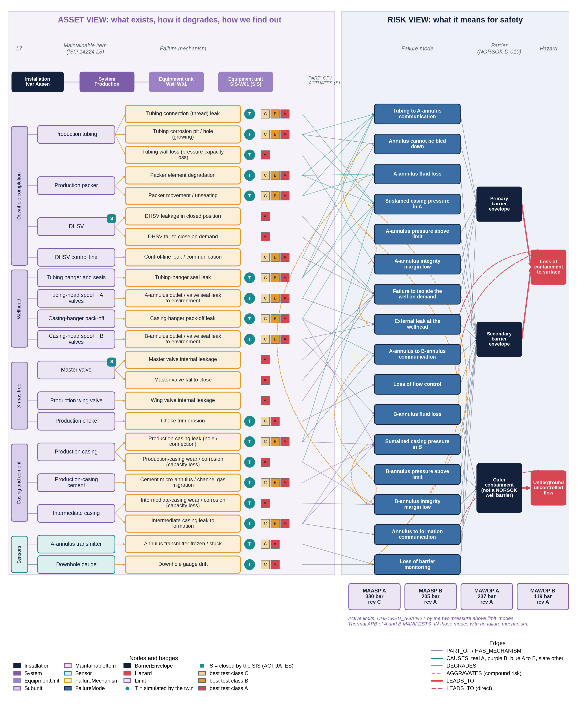
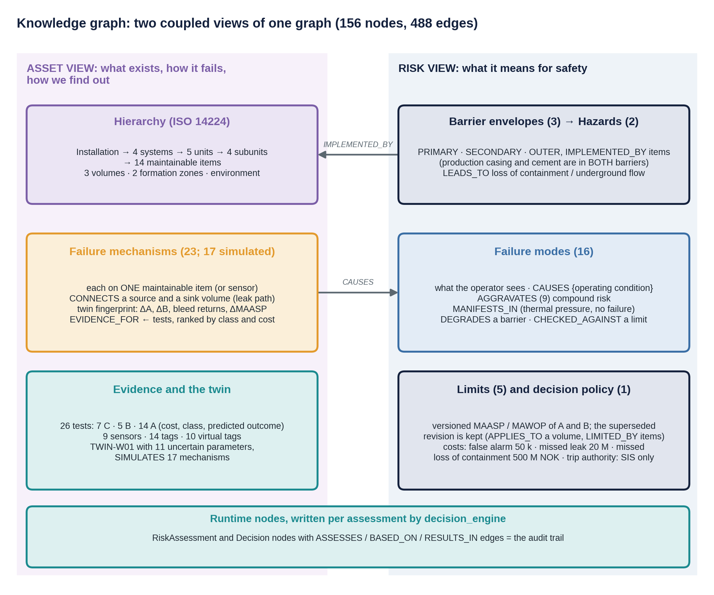
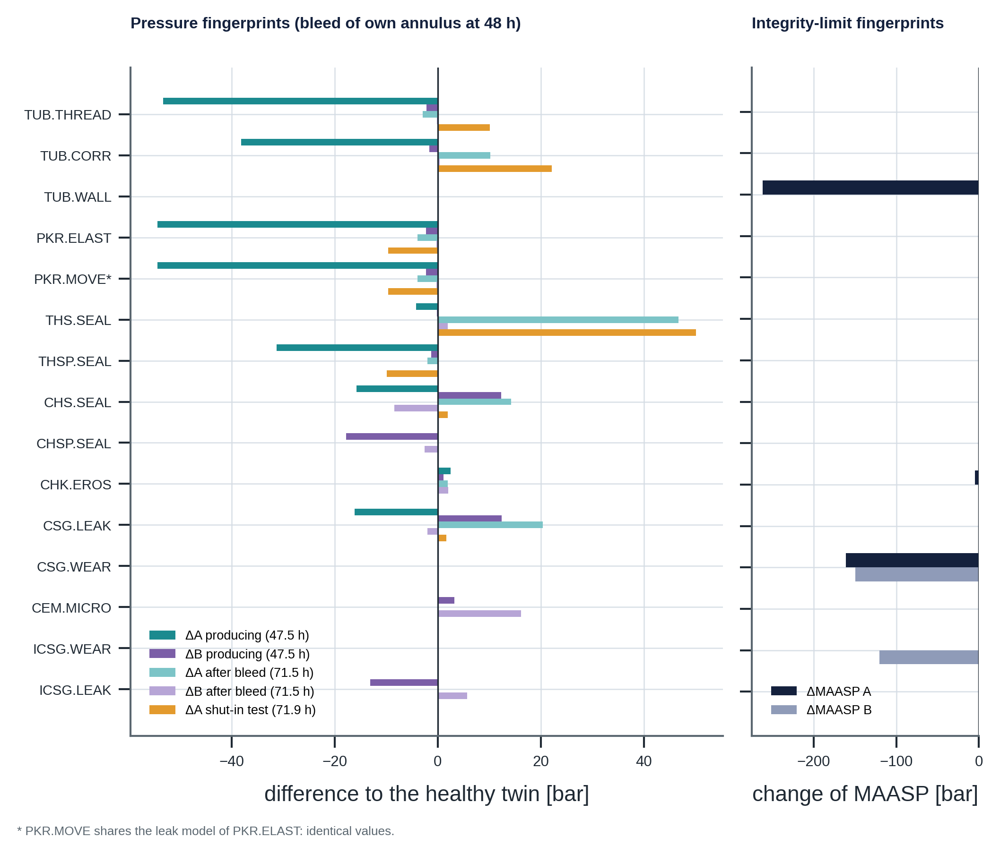
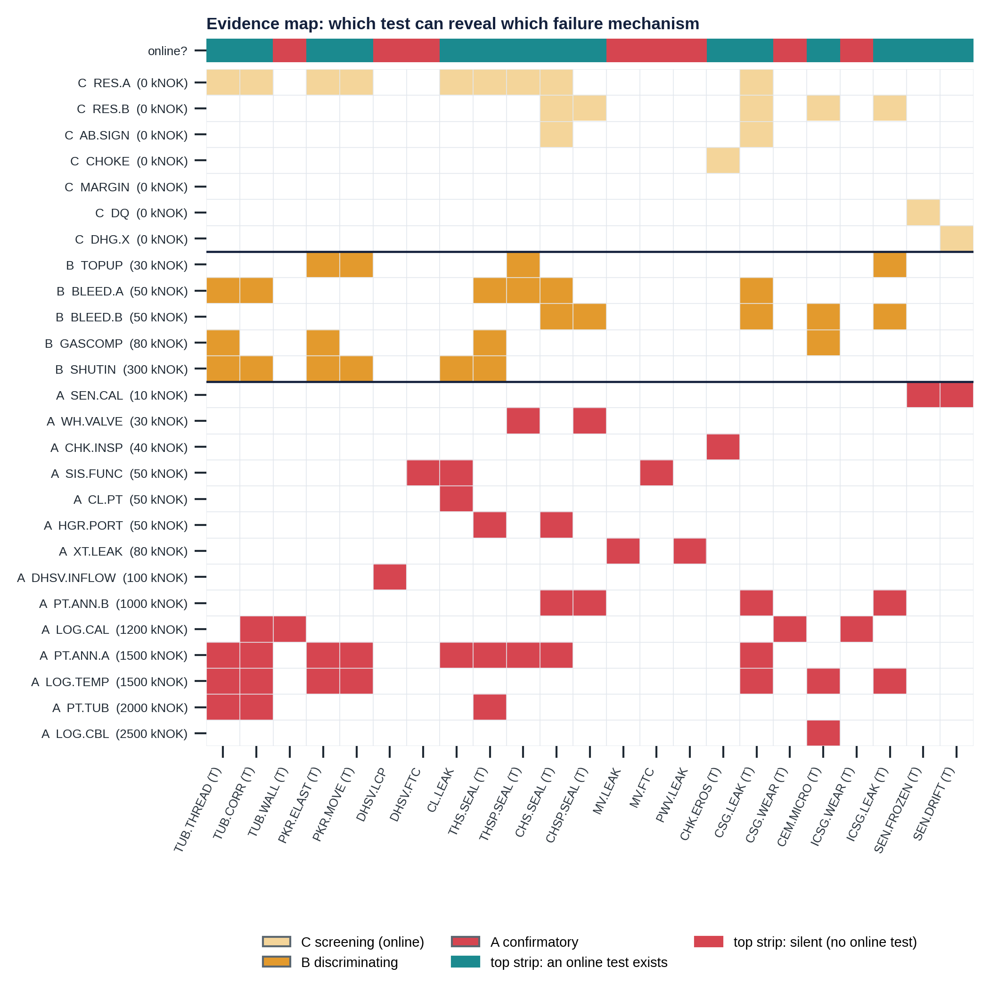
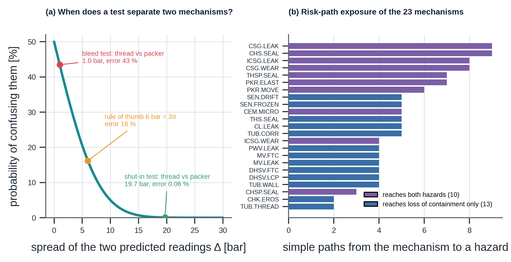

# knowledge_graph — A Manual on Well-Integrity Knowledge Modelling

### From ISO 14224 taxonomy and NORSOK D-010 barriers to twin-verified risk flows for well W01

> **What this document is.** A self-contained, textbook-style manual for the `knowledge_graph/`
> module of SentinelAI. It teaches the engineering background (well construction, well barriers,
> annulus pressure management, failure taxonomy, testing) and shows how each idea becomes nodes and
> edges in a graph that can be queried. Every number quoted is produced by the code
> (`python -m knowledge_graph.demo_queries`, `python -m knowledge_graph.twin_link`) and is checked against
> this manual by `python -m knowledge_graph.reproduce` (Chapter 23). The equations carry the numbers (G.1) to
> (G.14) they have in Appendix G of the *End-to-End Solution Description*.
>
> **Synthetic and illustrative.** *Ivar Aasen* and *W01* are used only as names. All tags, ratings,
> limits, costs and parameters are invented but physically consistent with the `digital_twin`
> module. Standards are summarised in my own words for learning; always use the current editions
> of the cited documents for normative requirements.



*Figure 1. The whole graph as two coupled views, drawn from the graph itself: the Asset view (hierarchy, items, mechanisms with their best test class and the twin badge) and the Risk view (failure modes, barrier envelopes, hazards, the active limits). Cross-view `CAUSES` edges are coloured by the annulus of the failure mode.*

---

## The graph on one page

| | Content |
|---|---|
| **Size** | 156 nodes, 488 edges, schema 1.0.0; passes 9 structural rules and 7 consistency tests |
| **Asset view** | Installation → 4 systems → 5 equipment units → 4 subunits → **14 maintainable items**; 3 containment volumes, 2 formation zones, the environment |
| **Failure knowledge** | **23 failure mechanisms** (17 simulated by the digital twin, each with a twin-computed fingerprint) |
| **Evidence** | **26 tests** (7 online screening, 5 discriminating, 14 confirmatory), 9 sensors, 14 measured / manual tags, 10 virtual tags |
| **Digital twin** | `TWIN-W01` (version 1.0.0) with 11 uncertain parameters and a `SIMULATES` link to every mechanism it can inject |
| **Risk view** | **16 failure modes**, 3 barrier envelopes, 2 hazards, 9 compound-risk links, 5 versioned limits, 1 decision policy |
| **Key queries** | candidate mechanisms for a symptom, signature matching, tests that split candidates, risk paths to hazards, silent mechanisms, common-cause barrier elements |

**The central idea.** A pressure gauge tells you *that* something changed. The graph tells you
*what could explain it* (mechanisms on physical items), *how to find out* (tests ranked by cost and
reliability, with twin-predicted outcomes), and *what it means* (which barrier is degraded, which
hazard comes closer, which limit applies). Every one of those statements is a node or an edge
that can be inspected, versioned and cited.

---

## What changed in this revision

**The graph did not change.** `catalog.py`, `build_graph.py`, `twin_link.py`, `demo_queries.py`, `tag_map.yaml`, `signatures.yaml` and `kg.json` are byte-for-byte the files of the module you provided (`kg.json` is regenerated identically by `build_graph.py`). `schema.py` and `queries.py` differ only in comments, where `pipeline/` now reads `decision_engine/`. `__init__.py` additionally exports `analysis`. The graph still has 156 nodes and 488 edges, passes 9 structural rules and the 7 original consistency tests, and `SCHEMA_VERSION` stays `1.0.0`. All 21 chapters of the earlier manual are kept, in the same order, with their tables and equations. This revision adds:

| Addition | Where |
|---|---|
| Equation numbers **(G.1)** to **(G.14)**, the numbers the equations have in Appendix G of the *End-to-End Solution Description*: the graph as a typed multigraph, the rules as formulas, risk paths, the evidence matrix and its minimum-cost cover, likelihood ratios and the error probability of a test | Chapter 22; 14.4 |
| One figure style for all figures (the palette of the Solution Description, 300 dpi). Your three figures are redrawn from the graph; two are new: `kg_schema.png` and `kg_math.png` | Figures 1 to 5 |
| `analysis.py` (the quantities of the manual as functions), `reproduce.py` (recomputes 330 quoted numbers, 565 with `--twin`), `figstyle.py`, `requirements.txt`, `verification_report.md`; `visualize.py` rewritten, `test_graph.py` extended from 7 to 17 tests | Chapters 18, 22, 23 |
| Clarifications, each with its evidence: one wording change of this README, five points for the Solution Description | 23.4 |
| Notation of the maths chapter | 22.10 |

If you prefer the module exactly as you provided it, keep your own `visualize.py`, `test_graph.py` and `__init__.py` and leave out `analysis.py`, `reproduce.py` and `figstyle.py`. The graph, the tables and all results in this manual are unchanged by that choice; only the passages that cite those files, the new figures and Chapters 22 and 23 need them.

---

## Contents

1. [Why a knowledge graph for well integrity](#1-why-a-knowledge-graph-for-well-integrity)
2. [How a production well is built](#2-how-a-production-well-is-built)
3. [The standards landscape](#3-the-standards-landscape)
4. [ISO 14224: the taxonomy behind the Asset view](#4-iso-14224-the-taxonomy-behind-the-asset-view)
5. [Failure vocabulary: mode, mechanism, cause](#5-failure-vocabulary-mode-mechanism-cause)
6. [Well barriers: NORSOK D-010 and ISO 16530](#6-well-barriers-norsok-d-010-and-iso-16530)
7. [Annulus pressure management and limits](#7-annulus-pressure-management-and-limits)
8. [Catalogue of maintainable items](#8-catalogue-of-maintainable-items)
9. [Catalogue of failure mechanisms](#9-catalogue-of-failure-mechanisms)
10. [Catalogue of failure modes](#10-catalogue-of-failure-modes)
11. [Hazards and risk flows](#11-hazards-and-risk-flows)
12. [Tests and the evidence hierarchy](#12-tests-and-the-evidence-hierarchy)
13. [Instrumentation: sensors, tags and virtual tags](#13-instrumentation-sensors-tags-and-virtual-tags)
14. [The digital twin inside the graph](#14-the-digital-twin-inside-the-graph)
15. [Decision policy](#15-decision-policy)
16. [Graph model reference](#16-graph-model-reference)
17. [Worked examples](#17-worked-examples)
18. [Using the code](#18-using-the-code)
19. [Limitations](#19-limitations)
20. [Glossary](#20-glossary)
21. [References](#21-references)
22. [Formal and mathematical reference](#22-formal-and-mathematical-reference)
23. [Verification: reproducing every number](#23-verification-reproducing-every-number)

---

## 1. Why a knowledge graph for well integrity

### 1.1 Five questions an integrity system must answer

| # | Question | Without structure | With the graph |
|---|---|---|---|
| 1 | What is measured, and how well? | Tag names in a historian | `Tag` → `Sensor`, σ, kind (measured / manual / virtual) |
| 2 | What did we expect to see? | Fixed alarm limits | Digital twin → virtual tags with σ |
| 3 | Which physical part could explain the difference? | Expert memory | Volume ← `CONNECTS` ← mechanism → owning item |
| 4 | What does it mean for safety? | Free-text procedures | Mechanism → failure mode → barrier → hazard; versioned limits |
| 5 | What should be done, at what cost? | Habit | Tests ranked by class and cost, with twin-predicted outcomes; decision policy |

A flat list of time series answers only question 1. A rule engine usually jumps from 1 to 5 with a
fixed threshold. A knowledge graph stores the **structure that connects** the questions, so that a
reasoning layer (statistical or human) can walk from a symptom to an explanation to an action,
and show its work.

### 1.2 Two coupled views

| View | Built on | Answers |
|---|---|---|
| **Asset view** | ISO 14224 equipment taxonomy | What exists, how it can degrade, how we can find out |
| **Risk view** | NORSOK D-010 / ISO 16530 barrier logic | What a degradation means for safety, and which limits apply |

They are two perspectives on **one** graph, joined by explicit cross-view edges: `CAUSES`
(mechanism → failure mode), `IMPLEMENTED_BY` (barrier → item), `APPLIES_TO` and `LIMITED_BY`
(limit → volume, item), `MANIFESTS_IN` (volume → failure mode).



*Figure 2. The schema on one page: what each view holds and how the views are joined. Every count is read from the graph.*

### 1.3 Why a graph and not tables

Well integrity knowledge is **many-to-many** and **multi-hop**:

- One failure mode (B pressure rising) has seven candidate mechanisms; one mechanism (a casing
  leak) produces four failure modes.
- One item (the production casing) belongs to two barrier envelopes at different depths.
- The question "can a worn casing lead to an underground blowout?" is a *path* question:
  wear → B-margin low → outer containment → underground flow.

Relational tables can store these, but path questions, consistency rules and "what is connected
to this?" exploration are native operations on a graph.

---

## 2. How a production well is built

### 2.1 Schematic of W01

```
                                   ┌── production choke ──► flowline (P_fl)
                       wing valve ─┤
              X-mas tree   master valve (SIS final element)
      ─────────────────────┬──────────────────────────────────────────────────────────
      tubing-head spool    │  tubing hanger + seals       A-annulus outlet valves (P_A)
      casing-hanger pack-off  (seals A from B at surface)
      casing-head spool                                   B-annulus outlet valves (P_B)
      ─────────────────────┴──────────────────────────────────────────────────────────
        │ICSG│ B │CSG│ A │TUB│ A │CSG│ B │ICSG│
        │    │   │   │   │ ↑ │   │   │   │    │      DHSV in the tubing, ~450 m
        │    │   │   │   │   │   │   │   │    │      B = brine + gas cap, 0–1,200 m, 35 m³
        │▓▓▓▓│▓▓▓│   │   │   │   │   │▓▓▓│▓▓▓▓│ 1,200 m top of production-casing cement;
        │▓▓▓▓│▓▓▓│   │   │   │   │   │▓▓▓│▓▓▓▓│         shallow gas zone behind it
        │    │▓▓▓│   │   │ ● │   │   │▓▓▓│    │ 2,250 m downhole gauge (tubing side)
        │    │▓▓▓│   │═══╪═══╪═══│   │▓▓▓│    │ 2,300 m production packer (bottom of A)
                            reservoir 2,400 m, 250 bar, 90 °C
```

### 2.2 Components and their functions

| Component | Function |
|---|---|
| **Production tubing** | Conduit that carries oil, water and gas to surface; can be pulled and replaced |
| **Production packer** | Seals the tubing to the casing near the bottom; forms the floor of the A-annulus |
| **DHSV** (downhole safety valve, SCSSV) | Fail-safe-closed flapper valve in the tubing, held open by hydraulic pressure in a **control line**; closes on loss of pressure |
| **Tubing hanger and seals** | Suspends the tubing in the tubing-head spool and seals the top of the A-annulus |
| **Tubing-head spool** | Wellhead section that holds the tubing hanger; carries the **A-annulus outlet valves** |
| **Production-casing hanger pack-off** | Seal between the production casing and the casing-head spool; separates A from B at surface |
| **Casing-head spool** | Lower wellhead section; carries the **B-annulus outlet valves** |
| **X-mas tree** | Valve assembly on top of the wellhead: **master valve** (actuated, closed by the safety system), **wing valve**, and the **production choke** |
| **Production casing** | Steel pipe outside the tubing, cemented at the bottom; walls of A (inside) and B (outside) |
| **Production-casing cement** | Seals and supports the production casing from the shoe up to the top of cement (1,200 m) |
| **Intermediate casing** | Outer pipe that forms the outer wall of the B-annulus |
| **A-annulus / B-annulus** | Closed spaces between pipes, filled with brine, monitored by pressure gauges at the wellhead |

### 2.3 What "well integrity" means

ISO 16530-1 describes well integrity as containment and prevention of escape of fluids to
subterranean formations or to surface, achieved by technical, operational and organisational
means over the whole life of the well. NORSOK D-010 turns this into a concrete rule: there shall be
**two independent, tested well barriers** between the reservoir and the environment (Chapter 6).

### 2.4 Why the annuli are the windows on integrity

- The **A-annulus** sits between the primary and the secondary barrier. Any leak of a primary
  element (tubing, packer, hanger seal) or a secondary element (casing, pack-off, A valves) changes
  its pressure or its fluid content.
- The **B-annulus** sits outside the production casing. It reacts to production-casing leaks,
  pack-off leaks, cement gas migration and intermediate-casing leaks.
- Both also change for **harmless** reasons: heating, cooling and ballooning. The digital twin
  predicts these, so the graph's tests compare measurements with the twin, not with fixed numbers.

---

## 3. The standards landscape

### 3.1 Map of the standards used

| Standard | Subject (summarised) | Where it appears in the graph |
|---|---|---|
| **ISO 14224** | Collection and exchange of reliability and maintenance data: equipment taxonomy, boundaries, failure modes, mechanisms and causes | Asset-view hierarchy, `MaintainableItem`, `FailureMechanism` classes, failure-mode vocabulary (Ch. 4–5) |
| **OREDA** handbook | Reliability data collected in the ISO 14224 format | Source of priors for mechanism frequencies (extension) |
| **NORSOK D-010** | Well integrity in drilling and well operations: well barriers, barrier elements, acceptance criteria, barrier schematics | `BarrierEnvelope`, `IMPLEMENTED_BY`, the two-barrier rule (Ch. 6) |
| **ISO 16530-1** | Well integrity over the life cycle: governance, roles, documentation | Overall framing; limits as versioned, governed documents |
| **ISO/TS 16530-2** | Well integrity in the operational phase: annulus pressure management, MAASP, well operating limits, integrity categorisation | `Limit` nodes, MAASP, annulus monitoring tests (Ch. 7) |
| **API RP 90-1** (offshore), **API RP 90-2** (onshore) | Annular casing pressure management: sustained casing pressure, diagnostic bleed-down / build-up, MAWOP | `FM.SCP.*`, `TEST.BLEED.*`, MAWOP limits (Ch. 7, 12) |
| **Offshore Norge Guideline 117** | Recommended guidelines for well integrity on the Norwegian shelf, including well categorisation | Integrity categories (extension), test practice |
| **API Spec 6A / ISO 10423** | Wellhead and X-mas tree equipment: pressure ratings, design, testing | Spool and valve ratings (`working_pressure_bar`) |
| **API Spec 14A / ISO 10432**, **API RP 14B** | Subsurface safety valve equipment and systems: design, testing, inflow-test acceptance | DHSV mechanisms and `TEST.DHSV.INFLOW` |
| **ISO 14310 / API Spec 11D1** | Packers and bridge plugs: design validation grades (V0 gas-tight to V6) | `W01.PKR.qualification` |
| **API Spec 5CT / ISO 11960**, **API TR 5C3 / ISO/TR 10400** | Casing and tubing specification; performance (burst, collapse) calculation | Pipe ratings, wear derating (Ch. 7–8) |
| **IEC 61508 / IEC 61511**, **Offshore Norge Guideline 070** | Functional safety of safety instrumented systems | `SIS-W01`, `ACTUATES`, "trip authority SIS only" (Ch. 15) |
| **ISO 17776**, **ISO 31000** | Hazard identification and risk assessment offshore; risk management principles (bow-tie thinking) | Hazard nodes and risk flows (Ch. 11) |

### 3.2 How the standards fit together

```
   ISO 14224  ──── "what is it, how does it fail?"  ─────────────►  Asset view
   API 5CT/5C3, API 6A, ISO 14310, API 14A  ── ratings of items ──►  item properties, limits
   NORSOK D-010 ── "which items form a barrier?" ─────────────────►  BarrierEnvelope + IMPLEMENTED_BY
   ISO 16530-2, API RP 90 ── "how much pressure is allowed, how do we test?" ─► Limit, Test
   IEC 61511 ── "who may shut the well in?" ──────────────────────►  SIS-W01, policy
   ISO 17776 / bow-tie ── "where does it lead?" ──────────────────►  failure mode → barrier → hazard
```

The graph is the place where these separate documents meet. In practice they live in different
systems (maintenance system, well-integrity management system, safety documentation); the graph
links them by stable identifiers.

---

## 4. ISO 14224: the taxonomy behind the Asset view

### 4.1 Purpose of ISO 14224

ISO 14224 standardises *how equipment, failures and maintenance are described* so that data from
different fields and companies can be compared and pooled (this is how OREDA reliability data is
built). It gives three things this module uses:

1. A **taxonomy**: nine levels from industry down to part.
2. **Equipment boundaries**: what belongs to an equipment unit and what does not.
3. **Failure vocabulary**: failure mode, failure mechanism and failure cause, with standard classes.

### 4.2 The nine levels and their use here

| Level | ISO 14224 name | Meaning | In this graph |
|---|---|---|---|
| 1 | Industry | Petroleum, natural gas, petrochemical | implicit |
| 2 | Business category | Upstream, midstream, … | implicit |
| 3 | Installation | A facility | `IA` Ivar Aasen |
| 4 | Plant / unit | Major process area | merged into `System` |
| 5 | Section / system | Functional system | `IA.PROD`, `IA.GC`, `IA.WI`, `IA.SAS` |
| 6 | Equipment unit | Unit with a defined boundary | `W01`, `FL-W01`, `MAN-P1`, `SEP-1`, `SIS-W01` |
| 7 | Subunit | Functional subdivision | `W01.DH` downhole completion, `W01.WH` wellhead, `W01.XT` X-mas tree, `W01.CC` casing and cement |
| 8 | Component / maintainable item | Level at which maintenance is done | 14 items (Chapter 8) |
| 9 | Part | Pieces of an item | not modelled |

**Design rule.** Failure mechanisms attach at level 8. That is where a repair happens: you replace
the hanger seals, not "the wellhead". Instrument mechanisms attach to the `Sensor` itself, which
is a maintainable instrument in the ISO 14224 sense.

### 4.3 Equipment boundary of W01

The boundary of `W01` runs from the production packer up to and including the production choke.
The flowline downstream of the choke is a separate equipment unit (`FL-W01`), connected by
`FLOWS_TO`. The safety system that closes the well (`SIS-W01`) belongs to the safety and
automation system (`IA.SAS`), not to the well, and is connected by `ACTUATES` edges to the master
valve and the DHSV. Clear boundaries prevent double counting: a leaking master-valve actuator is
a SIS failure, a leaking master-valve gate is a well failure.

### 4.4 What a pure taxonomy cannot express, and the extensions used

A taxonomy is a **tree**. Well integrity needs more structure:

| Need | Why a tree fails | Extension in this graph |
|---|---|---|
| **Spaces** | An annulus is a *volume* bounded by items in different subunits | `ContainmentVolume` (`W01.BORE`, `W01.ANN-A`, `W01.ANN-B`) with `BOUNDED_BY` edges to its walls |
| **Pressure sources outside the well** | Formations and the atmosphere are not equipment | `FormationZone` (`W01.RES`, `W01.SGZ`), `ExternalDomain` (`ENV`) |
| **Leak paths** | A leak joins two spaces, not a parent and a child | `CONNECTS` edges from each mechanism to its source and sink (`role` = src / snk) |
| **Process flow** | Flow crosses equipment units | `FLOWS_TO`: reservoir → bore → choke → flowline → manifold → separator |
| **Safety actuation** | The SIS closes valves in another unit | `ACTUATES` |
| **Barriers** | A barrier is a *functional set* of items from several subunits | `BarrierEnvelope` in the Risk view with `IMPLEMENTED_BY` edges (Chapter 6) |

The `CONNECTS` edge turns a physical principle into a query: **fluid can only enter a closed
volume through a path that connects to it**. `candidate_mechanisms("W01.ANN-B")` therefore returns
exactly the seven mechanisms that could change B (Section 17.2).

---

## 5. Failure vocabulary: mode, mechanism, cause

### 5.1 Three concepts that are often confused

| Concept | Meaning (paraphrased from ISO 14224) | Question | W01 example |
|---|---|---|---|
| **Failure mode** | The effect by which a failure is observed | *What do we see?* | Sustained casing pressure in B |
| **Failure mechanism** | The physical, chemical or other process that leads to failure | *What is physically happening?* | Gas migrating through a micro-annulus in the cement |
| **Failure cause** | Circumstances during design, manufacture, use or maintenance that led to failure | *Why did it happen?* | Cement slurry not designed for gas-tight setting |

### 5.2 ISO 14224 mechanism classes

| Class | Examples | Used in W01 |
|---|---|---|
| Mechanical failure | Leakage, vibration, deformation, looseness, sticking | thread leak, seal leaks, valve fail to close, packer movement |
| Material failure | Corrosion, erosion, wear, breakage, fatigue, degradation | tubing corrosion, choke erosion, casing wear, elastomer degradation, cement degradation |
| Instrument failure | Faulty signal, out of adjustment, control failure | frozen transmitter, drifting gauge |
| Electrical failure | Short circuit, open circuit, earth fault | not modelled |
| External influence | Contamination, external impact | not modelled |
| Miscellaneous | Unknown or combined | not modelled |

The class is stored on every mechanism (`iso14224_class`), so the graph can be aggregated the
same way reliability databases are.

### 5.3 How the vocabulary maps onto the two views

```
 Asset view                                                Risk view
 Maintainable item ─HAS_MECHANISM→ Failure mechanism ─CAUSES {condition}→ Failure mode
                                         │
                                  CONNECTS (src, snk)
                                         ▼
                                 volumes / formation / environment
```

- **Mechanisms live in the Asset view.** Each belongs to exactly one item or sensor (rule R1).
- **Failure modes live in the Risk view.** They describe what an operator observes and what it
  threatens.
- **The link is many-to-many and conditional.** The `CAUSES` edge carries the *operating condition*
  under which the mode appears. A tubing thread leak causes "tubing to A-annulus communication"
  **while producing** (A drains) and "sustained casing pressure in A" **when shut in** (A refills).
  This conditionality is learned from the digital twin (Chapter 14).

Failure causes are not modelled; they belong to root-cause analysis after a confirmed failure.

---

## 6. Well barriers: NORSOK D-010 and ISO 16530

### 6.1 Definitions

| Term | Meaning (summarised) |
|---|---|
| **Well barrier** | An envelope of one or more elements that together prevent unintentional flow of formation fluid |
| **Well barrier element (WBE)** | A physical element that, alone or with others, forms a barrier: tubing, packer, DHSV, casing, cement, wellhead, valves |
| **Primary well barrier** | The first envelope that stops flow from the source |
| **Secondary well barrier** | The back-up envelope that stops flow if the primary fails |
| **Acceptance criteria** | Requirements each WBE must meet: design, construction, initial verification, monitoring |
| **Well barrier schematic (WBS)** | Drawing of both envelopes and their elements for the current well state |

**Two-barrier principle.** During production, two independent, tested envelopes shall be in place.
NORSOK D-010 provides, for each element type, an acceptance table that states its function,
design requirements, how it is verified initially, and how it is **monitored** in operation. That
last column is exactly what the graph's tests represent.

**Independence.** The two envelopes should not share an element whose failure removes both. Where
sharing is unavoidable, it shall be identified and its risk assessed.

### 6.2 Barrier envelopes in W01

| Envelope | Elements (`IMPLEMENTED_BY`, with section) | NORSOK barrier? |
|---|---|---|
| `BE.PRIMARY` | tubing; production packer; DHSV; DHSV control line (part of the DHSV system); production casing *below the packer*; production-casing cement *below the packer* | yes |
| `BE.SECONDARY` | production casing *above the packer*; production-casing cement *cap above the reservoir*; tubing hanger and seals; tubing-head spool incl. A valves; casing-hanger pack-off; master valve; wing valve | yes |
| `BE.OUTER` | intermediate casing; casing-head spool incl. B valves | **no**: outer annulus containment, protects against underground flow |

This allocation follows the typical well barrier schematic of a producing well with a
tubing-retrievable DHSV. A real well's allocation comes from its own schematic.

### 6.3 Common well barrier elements, found by query

`common_cause_items(g)` returns:

```
W01.CSG [('BE.PRIMARY', 'section below the packer'), ('BE.SECONDARY', 'section above the packer')]
W01.CEM [('BE.PRIMARY', 'section below the packer'), ('BE.SECONDARY', 'cap above reservoir')]
```

This is not an error; it is a well-known feature of production-well barrier design. The production
casing and its cement contribute to the primary barrier below the packer and to the secondary barrier
above it. The `section` property records *which part* belongs where. The query makes the shared
dependency explicit, so that one finding (for example 60 % casing wear) is immediately recognised as
affecting **both** envelopes (Section 11.4).

### 6.4 Why barriers are not part of the tree

A barrier is defined by **function** ("stop flow along this path"), not by location. It takes the
packer from the downhole completion, the hanger from the wellhead and the master valve from the
X-mas tree. That is why `BarrierEnvelope` lives in the Risk view and points back into the Asset
view.

---

## 7. Annulus pressure management and limits

### 7.1 Where annulus pressure comes from

ISO/TS 16530-2 and API RP 90-1 classify annulus pressure by origin:

| Category | Origin | Integrity concern? | In the graph |
|---|---|---|---|
| **Thermally induced** | Trapped fluid heats, expands, and pressurises the closed space | No, but must stay below limits | `MANIFESTS_IN` from the volume to `FM.MAASP.*` |
| **Operator imposed** | Pressure applied deliberately (testing, gas lift) | Planned | not modelled |
| **Sustained casing pressure (SCP)** | Pressure that **rebuilds after bleed-down** because fluid enters through a leak | **Yes** | `FM.SCP.A`, `FM.SCP.B` |

The digital twin adds two further harmless causes: **ballooning** (tubing pressure changes the
annulus volume) and **cooling** after shut-in. All are predicted, so the tests compare measurements
with the twin.

### 7.2 Three kinds of limit

| Limit | Definition | Status in W01 |
|---|---|---|
| **MAASP** (maximum allowable annulus surface pressure) | Highest wellhead pressure an annulus may see without overloading any element exposed to it: casing burst, inner-string collapse, packer, wellhead, formation strength | **Documented and versioned** (`Limit`, kind MAASP) |
| **MAWOP** (maximum allowable wellhead operating pressure) | A conservative operating screen. A common rule (used in API RP 90-1 practice and in US offshore regulation) takes the lesser of 50 % of the burst rating of the casing being evaluated and 80 % of the collapse rating of the next inner string | **Documented** (`Limit`, kind MAWOP) |
| **Operational MAASP** | MAASP recomputed every time step from the *current* pressures on the other side of each pipe and the *current* wall thickness | **Computed by the twin** (virtual tags `W01-VT-MAASP-A/B`) |

### 7.3 Values for W01

| Annulus | MAWOP | Documented MAASP | Operational MAASP (twin, healthy) |
|---|---|---|---|
| A | **236.8 bar** = 50 % × 473.7 (production-casing burst); 80 % × 517.1 (tubing collapse) = 413.7 | **330 bar**, rev C, from 2026-03-01 (packer differential while producing) | 332.2 bar, governed by the packer |
| B | **118.9 bar** = 50 % × 237.9 (intermediate-casing burst); 80 % × 327.5 (production-casing collapse) = 262.0 | **205 bar**, rev A, from 2025-01-15 (casing-head spool) | 206.8 bar, governed by the casing-head spool |

A superseded documented limit, `LIM.W01.MAASP-A.B` (345 bar, based on the spool rating only), is
kept in the graph. It is the value that applied before the packer was included in the calculation.
Keeping it makes a classic error detectable: citing an out-of-date limit.

### 7.4 Why the operational MAASP matters

The documented MAASP is computed once, for assumed conditions. The real allowable pressure moves:

- **Producing vs shut in.** Producing lowers tubing pressure at the packer, which raises the packer
  differential for the same annulus pressure; MAASP_A falls from 344.7 to 332.2 bar at start-up.
- **Bleeding A changes B's limit.** The production casing's collapse capacity is backed up by the
  pressure in A. In the twin, with 60 % casing wear, bleeding A to 5 bar lowers MAASP_B by
  **149.6 bar** (to 57.2 bar), because the casing loses its internal support.
- **Wear.** Wall loss lowers burst in proportion and collapse roughly with its square (Section 9.6).

The graph models this with three tiers checked by the same failure mode:
`FM.MAASP.A -CHECKED_AGAINST→ MAWOP-A` (alert tier) and `→ MAASP-A` (action tier), and the
twin's operational MAASP is monitored by `TEST.MARGIN`.

---

## 8. Catalogue of maintainable items

| Item | Subunit | Function | Barrier | Rating / design | Governing standard |
|---|---|---|---|---|---|
| `W01.TUB` Production tubing | Downhole | Production conduit | Primary | 4-1/2" 12.6 lb/ft L80; burst 581.2, collapse 517.1 bar | API 5CT / ISO 11960; API TR 5C3 |
| `W01.PKR` Production packer | Downhole | Seals tubing to casing at 2,300 m | Primary | differential 344.7 bar; V0 gas-tight | ISO 14310 / API 11D1 |
| `W01.DHSV` Downhole safety valve | Downhole | Fail-safe-closed isolation below surface (450 m) | Primary | tubing-retrievable flapper | API 14A / ISO 10432; API RP 14B |
| `W01.CL` DHSV control line | Downhole | Holds the DHSV open hydraulically | Primary | hydraulic oil | (part of the SSSV system) |
| `W01.THS` Tubing hanger and seals | Wellhead | Suspends tubing; seals top of A | Secondary | — | API 6A / ISO 10423 |
| `W01.THSP` Tubing-head spool + A valves | Wellhead | Pressure containment; A-annulus access | Secondary | 5,000 psi = 344.7 bar | API 6A / ISO 10423 |
| `W01.CHS` Casing-hanger pack-off | Wellhead | Seals A from B at surface | Secondary | — | API 6A / ISO 10423 |
| `W01.CHSP` Casing-head spool + B valves | Wellhead | Pressure containment; B-annulus access | Outer | 3,000 psi = 206.8 bar | API 6A / ISO 10423 |
| `W01.MV` Master valve | X-mas tree | Isolation; SIS final element | Secondary | actuated, fail-safe closed | API 6A / ISO 10423 |
| `W01.PWV` Production wing valve | X-mas tree | Isolation of the production line | Secondary | — | API 6A / ISO 10423 |
| `W01.CHK` Production choke | X-mas tree | Controls rate | — | adjustable, 1/64 in bean | API 6A / ISO 10423 |
| `W01.CSG` Production casing | Casing & cement | Wall of A and B; part of both envelopes | Primary + Secondary | 9-5/8" 47 lb/ft L80; burst 473.7, collapse 327.5 bar | API 5CT; API TR 5C3 |
| `W01.CEM` Production-casing cement | Casing & cement | Seals and supports casing from shoe to 1,200 m | Primary + Secondary | top of cement 1,200 m | NORSOK D-010 acceptance tables |
| `W01.ICSG` Intermediate casing | Casing & cement | Outer wall of B | Outer | 13-3/8" 68 lb/ft K55; burst 237.9, collapse 134.4 bar | API 5CT; API TR 5C3 |

Two sensors are also failure-capable maintainable instruments: the **A-annulus pressure
transmitter** (`SEN-W01-PT-A-ANN`) and the **downhole gauge** (`SEN-W01-PT-DHG`).

Rule R4 requires every item to have at least one failure mechanism; the graph passes it.

---

## 9. Catalogue of failure mechanisms

### 9.1 How to read each entry

- **Item, ISO class, leak path** (`CONNECTS`).
- **Physics:** what happens.
- **Failure modes** (`CAUSES`) with the condition under which each appears.
- **Twin fingerprint** (from `signatures.yaml`, Chapter 14): differences to the healthy twin, in bar.
  `ΔA_pre`, `ΔB_pre` while producing (47.5 h); `ΔA_post`, `ΔB_post` 23 h after a bleed of the
  mechanism's own annulus; `ΔA_shutin` after a 22 h shut-in; bleed returns; change of MAASP.
- **Tests** that reveal it (`EVIDENCE_FOR`), cheapest class first.

Healthy reference (twin): A 56.1 bar and B 28.1 bar while producing; A bleed returns 0.49 Sm³ gas
and 295 L brine; B bleed returns 2.11 Sm³ gas and 60.9 L brine; A after the shut-in test 10.9 bar.



*Figure 3. Twin-computed fingerprint of every simulated mechanism: pressure differences to the healthy twin (left) and change of the twin-computed MAASP (right). `PKR.MOVE` shares the leak model of `PKR.ELAST`, so its bars are identical.*

### 9.2 Production tubing

**`FMech.TUB.THREAD` Tubing connection (thread) leak** — *Mechanical, leakage*; bore ↔ A at 1,500 m.
- **Physics.** Premium connections seal metal to metal. Make-up errors, thermal cycling, bending or
  corrosion of the seal area open a micro-path.
- **Modes.** `FM.COMM.TA` while producing; `FM.SCP.A` when shut in or above the balance depth.
- **Fingerprint.** ΔA_pre **−53.3**, ΔB_pre −2.2, ΔA_post −2.9, ΔA_shutin **+10.1**; bleed returns
  nothing (A is already below 5 bar).
- **Why the sign flips.** While producing, the heated A-annulus is above tubing pressure at every
  depth, so brine **drains into the tubing**. After shut-in, tubing pressure rises above A and the
  leak **refills** A (see the `digital_twin` manual, balance depth).
- **Tests.** C: `TEST.RES.A`; B: `TEST.BLEED.A`, `TEST.SHUTIN`, `TEST.GASCOMP`; A: `TEST.PT.TUB`,
  `TEST.PT.ANN.A`, `TEST.LOG.TEMP` (locates depth).

**`FMech.TUB.CORR` Tubing corrosion pit / hole (growing)** — *Material, corrosion*; bore ↔ A at 900 m.
- **Physics.** CO₂ or H₂S corrosion penetrates the wall; the hole grows (conductance doubles per day).
- **Modes.** `FM.COMM.TA`; `FM.SCP.A` after bleed; `FM.NOBLEED` when large.
- **Fingerprint.** ΔA_pre −38.1, ΔA_post **+10.2**, ΔA_shutin +22.1; bleed 0.49 Sm³, 46.8 L.
  Shallower than the thread leak, so after a bleed it is *above* the balance depth and refills A.
- **Tests.** C: `TEST.RES.A`; B: `TEST.BLEED.A`, `TEST.SHUTIN`; A: `TEST.LOG.CAL`, `TEST.PT.TUB`,
  `TEST.PT.ANN.A`, `TEST.LOG.TEMP`.

**`FMech.TUB.WALL` Tubing wall loss (pressure-capacity loss)** — *Material, corrosion / erosion*; no leak path.
- **Physics.** General thinning lowers collapse capacity roughly with the square of the remaining wall.
- **Modes.** `FM.MARGIN.A`.
- **Fingerprint.** No pressure change at all; **ΔMAASP_A −262.0** bar (60 % wall loss): the tubing
  collapse bound becomes the governing limit of A.
- **Tests.** A only: `TEST.LOG.CAL`. A **silent** mechanism (Section 12.6).

### 9.3 Production packer

**`FMech.PKR.ELAST` Packer element degradation** — *Material, degradation*; bore ↔ A at 2,300 m.
- **Physics.** Elastomer ageing (compression set), chemical attack, explosive decompression after
  gas soak, or extrusion under differential pressure. ISO 14310 grades describe what a packer was
  qualified to hold (V0 = gas-tight).
- **Modes.** `FM.COMM.TA` and `FM.FLUIDLOSS.A` while producing; `FM.SCP.A` when shut in.
- **Fingerprint.** ΔA_pre **−54.4**, ΔA_post −3.9, ΔA_shutin **−9.6**; **void 0.045 m³** (fluid
  level drop); bleed returns nothing.
- **Tests.** C: `TEST.RES.A`; B: `TEST.TOPUP`, `TEST.SHUTIN`, `TEST.GASCOMP`; A: `TEST.PT.ANN.A`,
  `TEST.LOG.TEMP`.

**`FMech.PKR.MOVE` Packer movement / unseating** — *Mechanical, displacement*; same path.
- **Physics.** Thermal expansion and ballooning change the axial load on the tubing; a packer that
  is not anchored for these loads can move or unseat.
- **Modes, fingerprint, tests.** Identical to element degradation (same leak model). The two can be
  separated only by mechanical evidence (tubing-movement analysis, retrieval).

### 9.4 DHSV and control line

**`FMech.DHSV.LCP` DHSV leakage in closed position** — *Mechanical, leakage*; reservoir → bore.
- **Physics.** Erosion, scale or debris on flapper and seat.
- **Modes.** `FM.ISOLATION`. Not simulated: the twin does not close the DHSV.
- **Tests.** A: `TEST.DHSV.INFLOW`. Acceptance is a maximum leak rate measured by pressure build-up
  above the closed valve; API RP 14B gives a widely used criterion (verify the current edition).

**`FMech.DHSV.FTC` DHSV fail to close on demand** — *Mechanical, sticking*.
- **Modes.** `FM.ISOLATION`. **Tests.** A: `TEST.SIS.FUNC`.

**`FMech.CL.LEAK` Control-line leak / communication** — *Mechanical, leakage*; bore ↔ A.
- **Physics.** Loss of hydraulic pressure closes the DHSV (spurious shut-in); tubing fluid entering
  the line creates a path to surface.
- **Modes.** `FM.ISOLATION`, `FM.COMM.TA`. **Tests.** C: `TEST.RES.A`; B: `TEST.SHUTIN`;
  A: `TEST.CL.PT`, `TEST.SIS.FUNC`, `TEST.PT.ANN.A`.

### 9.5 Wellhead and X-mas tree

**`FMech.THS.SEAL` Tubing-hanger seal leak** — *Mechanical, leakage*; bore ↔ A at surface.
- **Physics.** Hanger seals degrade; tubing-head pressure reaches the top of A.
- **Modes.** `FM.SCP.A` after bleed, `FM.COMM.TA`, `FM.NOBLEED` (orifice-type leak).
- **Fingerprint.** ΔA_pre −4.2, ΔA_post **+46.7** (A rebuilds to tubing-head pressure),
  ΔA_shutin **+50.1**; bleed 0.39 Sm³, 280.1 L. The textbook SCP case.
- **Tests.** C: `TEST.RES.A`; B: `TEST.BLEED.A`, `TEST.SHUTIN`, `TEST.GASCOMP`; A: `TEST.HGR.PORT`,
  `TEST.PT.TUB`, `TEST.PT.ANN.A`.

**`FMech.THSP.SEAL` A-annulus outlet / valve seal leak to environment** — *Mechanical, external leakage*; A → environment.
- **Modes.** `FM.EXT`, `FM.FLUIDLOSS.A`.
- **Fingerprint.** ΔA_pre −31.3, ΔA_shutin −9.9; bleed **0.00 Sm³** gas (the gas cap has already
  escaped), 116.8 L brine.
- **Tests.** C: `TEST.RES.A`; B: `TEST.BLEED.A`, `TEST.TOPUP`; A: `TEST.WH.VALVE`, `TEST.PT.ANN.A`.

**`FMech.CHS.SEAL` Casing-hanger pack-off leak** — *Mechanical, leakage*; A ↔ B at surface.
- **Modes.** `FM.COMM.AB`; `FM.SCP.B` after a B bleed; `FM.SCP.A` after an A bleed (B pushes back).
- **Fingerprint.** ΔA_pre **−15.8**, ΔB_pre **+12.3** (opposite signs); after an A bleed ΔA_post
  +14.2, ΔB_post −8.4; the A bleed returns **2.6 Sm³** gas, which is B's gas that crossed into A.
- **Tests.** C: `TEST.RES.A`, `TEST.RES.B`, `TEST.AB.SIGN`; B: `TEST.BLEED.A`, `TEST.BLEED.B`;
  A: `TEST.HGR.PORT`, `TEST.PT.ANN.A`, `TEST.PT.ANN.B`.

**`FMech.CHSP.SEAL` B-annulus outlet / valve seal leak to environment** — B → environment.
- **Modes.** `FM.EXT`, `FM.FLUIDLOSS.B`. **Fingerprint.** ΔB_pre **−17.8**, ΔB_post −2.6; bleed 0 Sm³, 30.6 L.
- **Tests.** C: `TEST.RES.B`; B: `TEST.BLEED.B`; A: `TEST.WH.VALVE`, `TEST.PT.ANN.B`.

**`FMech.MV.LEAK`, `FMech.MV.FTC`, `FMech.PWV.LEAK` Tree valve leakage / fail to close.**
- **Modes.** `FM.ISOLATION`. Not simulated.
- **Tests.** A: `TEST.XT.LEAK` (pressure build-up between closed valves), `TEST.SIS.FUNC`.
- These are **demand failures**: they matter only when the valve is asked to close, so they are
  found by periodic proof testing, never by online monitoring. IEC 61511 calls the time between
  such tests the proof-test interval.

**`FMech.CHK.EROS` Choke trim erosion** — *Material, erosion*.
- **Physics.** Sand and droplets erode the trim at a rate that grows with velocity (about v² here).
  The effective opening grows at a fixed set position, and erosion accelerates itself.
- **Modes.** `FM.FLOWCTRL`.
- **Fingerprint.** Δq_liq **+75.2 Sm³/d**, ΔP_wh **−2.5 bar**; ΔA +1.9 to +2.5 (hotter well); ΔMAASP_A −5.0.
- **Tests.** C: `TEST.CHOKE`; A: `TEST.CHK.INSP`.

### 9.6 Casing and cement

**`FMech.CSG.LEAK` Production-casing leak (hole / connection)** — *Mechanical, leakage*; A ↔ B at 800 m.
- **Modes.** `FM.COMM.AB`; `FM.SCP.B` after a B bleed; `FM.SCP.A` after an A bleed.
- **Fingerprint.** ΔA_pre **−16.1**, ΔB_pre **+12.4**; after an A bleed ΔA_post +20.4, ΔB_post −2.0;
  bleed 0.49 Sm³, 198.4 L.
- **Compared with the pack-off leak.** Producing fingerprints are almost identical (−16.1/+12.4 vs
  −15.8/+12.3). They separate after an A bleed (+20.4/−2.0 vs +14.2/−8.4) and by bleed gas
  (0.49 vs 2.6 Sm³). Section 17.2 uses this.
- **Tests.** C: `TEST.RES.A`, `TEST.RES.B`, `TEST.AB.SIGN`; B: `TEST.BLEED.A`, `TEST.BLEED.B`;
  A: `TEST.PT.ANN.A`, `TEST.PT.ANN.B`, `TEST.LOG.TEMP`.

**`FMech.CSG.WEAR` Production-casing wear / corrosion (capacity loss)** — *Material*; no leak path.
- **Physics.** Drill-string wear during construction and later corrosion thin the wall.
  Burst capacity scales with wall thickness (Barlow: $P_b = 2\sigma_y t/D$); collapse capacity
  depends more strongly on $t/D$ (API TR 5C3) and is approximated by $t^2$.
- **Modes.** `FM.MARGIN.A`, `FM.MARGIN.B`.
- **Fingerprint.** No pressure change; **ΔMAASP_A −161.4**, **ΔMAASP_B −149.6** bar (60 % loss,
  A bled). The casing appears in both barrier envelopes (Section 6.3), so one finding weakens both.
- **Tests.** A only: `TEST.LOG.CAL` (electromagnetic thickness tools can measure through the tubing).

**`FMech.CEM.MICRO` Cement micro-annulus / channel gas migration** — *Material, degradation*; shallow gas zone → B at 1,200 m.
- **Physics.** Cement debonds from casing or rock (pressure / temperature cycling, shrinkage) or
  channels were left during placement; gas from a shallow zone migrates up into B.
- **Modes.** `FM.SCP.B`.
- **Fingerprint.** ΔA 0; ΔB_pre +3.2, ΔB_post **+16.2**; B bleed returns **3.60 Sm³** gas
  (healthy 2.11).
- **Tests.** C: `TEST.RES.B`; B: `TEST.BLEED.B`, `TEST.GASCOMP` (formation gas differs from
  produced gas); A: `TEST.LOG.CBL`, `TEST.LOG.TEMP`.

**`FMech.ICSG.WEAR` Intermediate-casing wear / corrosion** — capacity loss.
- **Modes.** `FM.MARGIN.B`. **Fingerprint.** **ΔMAASP_B −120.6** bar; no pressure change.
- **Tests.** A only: `TEST.LOG.CAL`.

**`FMech.ICSG.LEAK` Intermediate-casing leak to formation** — *Mechanical, leakage*; B ↔ shallow zone at 600 m.
- **Physics.** While B is above the formation pressure at the hole, brine drains out (underground
  loss); after B is bled below it, formation gas flows in.
- **Modes.** `FM.FLUIDLOSS.B`, `FM.XFLOW`, `FM.SCP.B` (after a B bleed).
- **Fingerprint.** ΔB_pre **−13.1**, ΔB_post **+5.7**; B bleed 1.71 Sm³ gas, **0 L** brine.
- **Tests.** C: `TEST.RES.B`; B: `TEST.BLEED.B`, `TEST.TOPUP`; A: `TEST.PT.ANN.B`, `TEST.LOG.TEMP`.

### 9.7 Instruments

**`FMech.SEN.FROZEN` Annulus transmitter frozen / stuck** (on `SEN-W01-PT-A-ANN`) — *Instrument, faulty signal*.
- **Physics.** The output stops changing. A healthy transmitter always shows noise of about its σ;
  a flat line is the signature.
- **Modes.** `FM.MONITOR`, which `AGGRAVATES` `FM.SCP.A` and `FM.MAASP.A` (it masks them).
- **Tests.** C: `TEST.DQ`; A: `TEST.SEN.CAL`.

**`FMech.SEN.DRIFT` Downhole-gauge drift** (on `SEN-W01-PT-DHG`) — *Instrument, out of adjustment*.
- **Physics.** Slow bias, here 0.5 bar per day; looks like reservoir depletion.
- **Tests.** C: `TEST.DHG.X` (compare with the twin's predicted pressure at 2,250 m); A: `TEST.SEN.CAL`.

### 9.8 Summary matrix

| Mechanism | Item | Path | Main modes | ΔA_pre | ΔB_pre | ΔA_post | ΔB_post | Best online test |
|---|---|---|---|---|---|---|---|---|
| TUB.THREAD | tubing | bore↔A 1,500 m | COMM.TA, SCP.A | −53.3 | −2.2 | −2.9 | −0.2 | RES.A |
| TUB.CORR | tubing | bore↔A 900 m | COMM.TA, SCP.A, NOBLEED | −38.1 | −1.6 | +10.2 | +0.4 | RES.A |
| TUB.WALL | tubing | — | MARGIN.A | 0 | 0 | 0 | 0 | none (silent) |
| PKR.ELAST / MOVE | packer | bore↔A 2,300 m | COMM.TA, FLUIDLOSS.A, SCP.A | −54.4 | −2.3 | −3.9 | −0.3 | RES.A |
| DHSV.LCP / FTC | DHSV | reservoir→bore | ISOLATION | n/s | | | | none (demand) |
| CL.LEAK | control line | bore↔A | ISOLATION, COMM.TA | n/s | | | | RES.A |
| THS.SEAL | hanger seals | bore↔A surface | SCP.A, COMM.TA, NOBLEED | −4.2 | −0.2 | +46.7 | +1.9 | RES.A |
| THSP.SEAL | A valves | A→env | EXT, FLUIDLOSS.A | −31.3 | −1.3 | −2.0 | −0.1 | RES.A |
| CHS.SEAL | pack-off | A↔B surface | COMM.AB, SCP.B, SCP.A | −15.8 | +12.3 | +14.2 | −8.4 | AB.SIGN |
| CHSP.SEAL | B valves | B→env | EXT, FLUIDLOSS.B | 0 | −17.8 | 0 | −2.6 | RES.B |
| MV / PWV | tree valves | bore→env | ISOLATION | n/s | | | | none (demand) |
| CHK.EROS | choke | — | FLOWCTRL | +2.5 | +1.1 | +1.9 | +2.0 | CHOKE |
| CSG.LEAK | prod. casing | A↔B 800 m | COMM.AB, SCP.B, SCP.A | −16.1 | +12.4 | +20.4 | −2.0 | AB.SIGN |
| CSG.WEAR | prod. casing | — | MARGIN.A, MARGIN.B | 0 | 0 | 0 | 0 | none (silent) |
| CEM.MICRO | cement | gas zone→B | SCP.B | 0 | +3.2 | 0 | +16.2 | RES.B |
| ICSG.WEAR | int. casing | — | MARGIN.B | 0 | 0 | 0 | 0 | none (silent) |
| ICSG.LEAK | int. casing | B↔gas zone 600 m | FLUIDLOSS.B, XFLOW, SCP.B | 0 | −13.1 | 0 | +5.7 | RES.B |
| SEN.FROZEN / DRIFT | sensors | — | MONITOR | (instrument) | | | | DQ / DHG.X |

n/s = not simulated by the twin.

---

## 10. Catalogue of failure modes

| Failure mode | Observed as | Caused by | Degrades | Also leads to / aggravates |
|---|---|---|---|---|
| `FM.SCP.A` Sustained casing pressure in A | A rebuilds after bleed at stable temperature | thread, corrosion, packer, hanger seal, pack-off, casing leak | Primary | — |
| `FM.SCP.B` Sustained casing pressure in B | B rebuilds after bleed; extra gas | cement, casing leak, pack-off, int.-casing leak | Secondary | aggravates MARGIN.B |
| `FM.COMM.TA` Tubing ↔ A communication | A below twin while producing; A rises when shut in | thread, corrosion, packer, hanger seal, control line | Primary | — |
| `FM.COMM.AB` A ↔ B communication | Opposite-sign residuals; pressures converge | casing leak, pack-off | Secondary | aggravates MAASP.B (A's pressure reaches B, whose wellhead is rated lower) |
| `FM.FLUIDLOSS.A` A fluid loss | Void; needs top-up | packer, A valves | Secondary | aggravates MARGIN.B (casing loses internal support) |
| `FM.FLUIDLOSS.B` B fluid loss | B drains below twin | B valves, int.-casing leak | Outer | — |
| `FM.XFLOW` Annulus ↔ formation | Annulus fluid to formation | int.-casing leak | Outer | **leads directly to HZ.UGB** |
| `FM.EXT` External leak | Pressure decay; fluid at outlet | A valves, B valves | Secondary | **leads directly to HZ.LOC** |
| `FM.NOBLEED` Cannot bleed down | Bleed cannot reach target | corrosion hole, hanger seal (orifice) | Primary | aggravates MAASP.A |
| `FM.MAASP.A` / `FM.MAASP.B` Pressure above limit | Above MAWOP / MAASP | thermal APB (no mechanism), aggravation | Primary + Secondary / Secondary + Outer | checked against limits |
| `FM.MARGIN.A` / `FM.MARGIN.B` Margin low | Twin MAASP approaching pressure | wall loss, casing wear, int.-casing wear | Primary + Secondary / Secondary + Outer | aggravate MAASP.A / MAASP.B |
| `FM.ISOLATION` Cannot isolate on demand | Failed valve test or closure | DHSV, control line, tree valves | Primary + Secondary | aggravates EXT |
| `FM.FLOWCTRL` Loss of flow control | Rate and P_wh drift at fixed choke | choke erosion | Secondary | **leads directly to HZ.LOC** (body wash-out) |
| `FM.MONITOR` Loss of monitoring | Frozen / drifting data | sensor faults | Primary + Secondary (verification) | aggravates SCP.A, MAASP.A (masking) |

Rule R5 checks that **every failure mode has a path to a hazard**, and R6 that something causes it.

---

## 11. Hazards and risk flows

### 11.1 Two hazards

| Hazard | Meaning |
|---|---|
| `HZ.LOC` Loss of containment to surface | Hydrocarbon release at the wellhead; in the worst case a blowout |
| `HZ.UGB` Underground uncontrolled flow | Flow between formations or into shallow zones; can broach to surface |

### 11.2 Bow-tie thinking

A bow-tie places a hazardous **top event** in the middle, **threats** on the left, **consequences**
on the right, and **barriers** on both sides. The graph is the left half of a well-integrity
bow-tie made precise:

```
 threats (mechanisms) ──CAUSES──► symptoms (failure modes) ──DEGRADES──► barriers ──LEADS_TO──► hazard
```

Barriers do not *cause* hazards. The `LEADS_TO` edge from an envelope means "if this envelope is
lost, the path to this hazard is open". Three failure modes have **direct** `LEADS_TO` edges because
they already *are* the start of the hazard: an external leak (`FM.EXT`), cross-flow (`FM.XFLOW`)
and loss of flow control (`FM.FLOWCTRL`, choke body wash-out).

### 11.3 Risk paths

`risk_paths(g, mechanism)` enumerates every simple path to a hazard along `CAUSES`, `AGGRAVATES`,
`DEGRADES` and `LEADS_TO`. For production-casing wear:

```
FMech.CSG.WEAR -> FM.MARGIN.A -> BE.PRIMARY   -> HZ.LOC
FMech.CSG.WEAR -> FM.MARGIN.A -> BE.SECONDARY -> HZ.LOC
FMech.CSG.WEAR -> FM.MARGIN.B -> BE.SECONDARY -> HZ.LOC
FMech.CSG.WEAR -> FM.MARGIN.B -> BE.OUTER     -> HZ.UGB
FMech.CSG.WEAR -> FM.MARGIN.A -> FM.MAASP.A   -> BE.PRIMARY -> HZ.LOC
...
```

One silent mechanism reaches **both hazards** through **all three envelopes**.

### 11.4 Compound risk: `AGGRAVATES`

Single failures are usually tolerable; combinations are not. `AGGRAVATES` (failure mode → failure
mode) records that one condition makes another worse. `compound_paths(g)` returns the chains:

```
FM.SCP.B       -> FM.MARGIN.B -> FM.MAASP.B
FM.FLUIDLOSS.A -> FM.MARGIN.B -> FM.MAASP.B
```

**The twin confirms the chain.** In the `digital_twin` manual (integrity chapter), production-casing
wear (60 %) plus a packer leak (A drains to about 1 bar) plus cement gas into B lowers MAASP_B from
206.8 to **48.9 bar** and the margin from 177 to **20 bar**, while every gauge looks normal (B at
29 bar). Each element is in the graph: wear → `FM.MARGIN.B`; packer → `FM.FLUIDLOSS.A` → aggravates
`FM.MARGIN.B`; cement → `FM.SCP.B` → aggravates `FM.MARGIN.B` → aggravates `FM.MAASP.B`.

---

## 12. Tests and the evidence hierarchy

### 12.1 Why tests are first-class nodes

A test is a **source of evidence with a reliability, a cost and a prediction**. NORSOK D-010
acceptance tables specify, for each barrier element, how it is verified and monitored; ISO/TS 16530-2
and API RP 90 describe diagnostic tests for annulus pressure. Modelling tests explicitly lets a
decision layer ask *which evidence to buy next*.

### 12.2 Reliability classes

| Class | Meaning | Typical properties | Count in W01 |
|---|---|---|---|
| **C** screening | Detects *that* something may be wrong | Online, continuous, no cost, lower specificity | 7 |
| **B** discriminating | Separates competing explanations | Operator action, moderate cost, hours | 5 |
| **A** confirmatory | Verifies barrier status or locates the defect | Planned intervention or logging, costly | 14 |

### 12.3 Test catalogue

| Test | Class | Cost (kNOK) | What it does | Evidence for (mechanisms) / monitors (modes) |
|---|---|---|---|---|
| `TEST.RES.A` | C | 0 | A pressure minus twin expectation, **both directions** | 9 A-side mechanisms; MAASP.A |
| `TEST.RES.B` | C | 0 | B pressure minus twin expectation | casing leak, pack-off, cement, B valves, int.-casing leak; MAASP.B |
| `TEST.AB.SIGN` | C | 0 | Opposite-sign A/B residuals | casing leak, pack-off |
| `TEST.CHOKE` | C | 0 | Measured rate vs choke model at the set position | choke erosion; FLOWCTRL |
| `TEST.MARGIN` | C | 0 | Pressure vs twin-computed operational MAASP | MAASP.A/B, MARGIN.A/B |
| `TEST.DQ` | C | 0 | Flat line, range, gaps | frozen transmitter; MONITOR |
| `TEST.DHG.X` | C | 0 | Downhole gauge vs twin profile | gauge drift; MONITOR |
| `TEST.TOPUP` | B | 30 | Volume needed to refill an annulus | packer, A valves, int.-casing leak; FLUIDLOSS |
| `TEST.BLEED.A` | B | 50 | Bleed A, record gas / brine, watch build-up 12 h | 6 mechanisms; SCP.A, NOBLEED |
| `TEST.BLEED.B` | B | 50 | Same for B | 5 mechanisms; SCP.B |
| `TEST.GASCOMP` | B | 80 | Composition of bled gas vs produced gas | cement (formation gas), tubing / packer / hanger (produced gas) |
| `TEST.SHUTIN` | B | 300 (deferred production) | Shut in 22 h; leak path reverses | 6 tubing-side mechanisms; COMM.TA |
| `TEST.SEN.CAL` | A | 10 | Instrument calibration / function check | sensor faults |
| `TEST.WH.VALVE` | A | 30 | Annulus valve and seal leak test | A and B valve seals; EXT |
| `TEST.CHK.INSP` | A | 40 | Choke inspection | choke erosion |
| `TEST.SIS.FUNC` | A | 50 | DHSV and master-valve closure test | fail-to-close, control line; ISOLATION |
| `TEST.CL.PT` | A | 50 | Control-line pressure test | control line |
| `TEST.HGR.PORT` | A | 50 | Test ports between hanger / pack-off seals | hanger seals, pack-off |
| `TEST.XT.LEAK` | A | 80 | Build-up between closed tree valves | master and wing valve leakage |
| `TEST.DHSV.INFLOW` | A | 100 | Build-up above the closed DHSV | DHSV leakage |
| `TEST.PT.ANN.B` | A | 1,000 | B-annulus pressure test | casing leak, pack-off, int.-casing leak, B valves |
| `TEST.LOG.CAL` | A | 1,200 | Caliper / electromagnetic thickness log | tubing wall, corrosion, both casing wears; MARGIN |
| `TEST.PT.ANN.A` | A | 1,500 | A-annulus pressure test (MIT-A) | 9 mechanisms |
| `TEST.LOG.TEMP` | A | 1,500 | Temperature / noise log; **locates** leaks | 7 leak mechanisms |
| `TEST.PT.TUB` | A | 2,000 | Tubing test against a plug | thread, corrosion, hanger seal |
| `TEST.LOG.CBL` | A | 2,500 | Cement bond / ultrasonic log | cement |



*Figure 4. Evidence map: which of the 26 tests can reveal which of the 23 mechanisms, by reliability class. The top strip shows the silent mechanisms (red): no online test can reveal them.*

### 12.4 Twin-predicted outcomes

Some tests read exactly a quantity the twin computes. Their **predicted outcome** for each
mechanism is in the graph (`predicts` on the test, `signature` on the mechanism):

| Test | Reads | Valid when |
|---|---|---|
| `TEST.RES.A` / `RES.B` | ΔA_pre / ΔB_pre | producing |
| `TEST.AB.SIGN` | ΔA_pre and ΔB_pre | producing |
| `TEST.BLEED.A` | ΔA_post, ΔB_post | mechanism's experiment bled A |
| `TEST.BLEED.B` | ΔB_post | mechanism's experiment bled B |
| `TEST.SHUTIN` | ΔA_shutin | shut in |
| `TEST.MARGIN` | ΔMAASP_A, ΔMAASP_B | any |
| `TEST.CHOKE` | Δq_liq, ΔP_wh | producing |

This turns a recommendation into a **falsifiable prediction**: "if it is the thread leak, a shut-in
will raise A by about 10 bar; if it is the packer, A will stay about 10 bar lower".

### 12.5 Which test splits the candidates?

`discriminating_tests(g, candidates)` uses two rules:

1. **Outcome-based** (preferred): if the twin predicts the test for every candidate, the test
   splits them when the predicted readings differ by more than 6 bar (about two residual σ).
2. **Coverage-based** (fallback): the test can reveal some candidates but not others.

For {thread leak, packer leak} the result is `TEST.TOPUP` (coverage: only the packer drains the
fluid level), `TEST.SHUTIN` (outcome: **+10.1 vs −9.6 bar**), and `TEST.PT.TUB` (coverage). Note
that `TEST.BLEED.A` is *not* listed: both predict almost the same post-bleed reading (−2.9 vs
−3.9). Coverage alone would wrongly suggest the bleed helps.

The 6 bar threshold has a decision-theoretic reading (Section 22.5). For two equally likely mechanisms whose predicted readings differ by $\Delta$, with residual scale $\sigma_r = 3.04$ bar, the probability of choosing the wrong one is $\Phi(-\Delta/2\sigma_r)$: **0.06 %** for the shut-in test ($\Delta = 19.7$ bar), 16 % at the threshold, and **43 %** for the bleed test ($\Delta = 1.0$ bar), hardly better than a coin.

### 12.6 Silent mechanisms

`silent_mechanisms(g)` returns mechanisms no online test can reveal:

```
CSG.WEAR, ICSG.WEAR, TUB.WALL           capacity loss: no pressure signature at all
DHSV.LCP, DHSV.FTC, MV.LEAK, MV.FTC,    demand failures: visible only when the valve is asked
PWV.LEAK                                to close
```

The consistency test `test_silent_mechanisms_have_no_pressure_signature` checks against the twin
that the simulated ones really leave no trace (all residuals below 1 bar). These mechanisms are
managed by **schedules**, not alarms: periodic inspection logs, valve proof tests (IEC 61511
proof-test intervals), and MAASP updates after each inspection.

### 12.7 Tests are not independent votes

`shared_inputs(g, "TEST.RES.A", "TEST.AB.SIGN")` returns `W01-PT-A-ANN` and `W01-VT-P-A-EXP`. Two
tests built on the same tags and the same twin prediction share their errors: a wrong gas-cap
assumption in the twin biases both. A reasoning layer must not count them as two independent pieces
of evidence. The `USES` edges make this checkable.

---

## 13. Instrumentation: sensors, tags and virtual tags

### 13.1 Four kinds of data

| Kind | Node | Produced by | Example |
|---|---|---|---|
| **Measured** | `Tag` (kind measured) | a `Sensor` | `W01-PT-A-ANN` |
| **Manual** | `Tag` (kind manual) | a `Test` (recorded during it) | `W01-A-BLEED-GAS` |
| **Virtual** | `VirtualTag` | the digital twin | `W01-VT-P-A-EXP`, `W01-VT-MAASP-B` |
| **Document** | `Limit` | an engineering document | `LIM.W01.MAASP-A.C` |

### 13.2 Tags of W01 (`tag_map.yaml`)

| Tag | Kind | Measures / estimates | σ | Sensor installed on |
|---|---|---|---|---|
| `W01-PT-WH` | measured | bore pressure at wellhead | 0.5 bar | X-mas tree |
| `W01-TT-WH` | measured | bore temperature at wellhead | 0.3 °C | X-mas tree |
| `W01-ZT-CHK` | measured | choke position | 0.2 /64 in | choke |
| `W01-FL-PT` | measured | flowline pressure | 0.5 bar | flowline |
| `W01-PT-DHG` / `TT-DHG` | measured | bore pressure / temperature at 2,250 m | 0.1 | tubing |
| `W01-FT-LIQ` / `FT-GAS` | measured | liquid / gas rate (multiphase meter) | 3 % / 5 % | flowline |
| `W01-PT-A-ANN` | measured | A pressure at wellhead | 0.5 bar | tubing-head spool |
| `W01-PT-B-ANN` | measured | B pressure at wellhead | 0.5 bar | casing-head spool |
| `W01-A-BLEED-GAS` / `-LIQ` | manual | gas / brine returned from A | 0.1 Sm³ / 1 L | recorded by `TEST.BLEED.A` |
| `W01-B-BLEED-GAS` / `-LIQ` | manual | same for B | 0.1 Sm³ / 1 L | recorded by `TEST.BLEED.B` |
| `W01-VT-P-A-EXP` / `P-B-EXP` | virtual | expected A / B pressure | 3.0 bar | twin |
| `W01-VT-T-A` / `T-B` | virtual | annulus temperatures | 2.0 / 3.0 °C | twin |
| `W01-VT-Q-LIQ-EXP` | virtual | expected rate from the choke model | 15 Sm³/d | twin |
| `W01-VT-P-DHG-EXP` | virtual | expected pressure at the gauge depth | 2.0 bar | twin |
| `W01-VT-MAASP-A` / `-B` | virtual | operational MAASP | 10 bar | twin |
| `W01-VT-MARGIN-A` / `-B` | virtual | margin to MAASP | 10 bar | twin |

### 13.3 Why the distinctions matter

- **Sensor vs tag.** When a transmitter is replaced, the tag history continues but accuracy and
  calibration change. The graph keeps both.
- **Manual vs measured.** Bleed logs are sparse, human-recorded and only exist when a test is run.
  Their `PRODUCED_BY` edge points to the test, so the graph knows that no bleed means no reading.
- **Virtual tags carry larger σ.** They inherit model uncertainty. A residual combines both:
  $\sigma_r = \sqrt{\sigma_{tag}^2 + \sigma_{virtual}^2} \approx 3.04$ bar for the A-annulus.
- **Data quality is evidence about the instrument, not the well.** `TEST.DQ` and `TEST.DHG.X`
  produce evidence for sensor mechanisms. A frozen gauge must be ruled out before any integrity
  conclusion is drawn from it.

---

## 14. The digital twin inside the graph

### 14.1 The twin node and its edges

```
TWIN-W01 (version 1.0.0, code digital_twin/, valid choke 8–96/64, valid T_A 20–90 °C)
  ├─CONSUMES→  W01-ZT-CHK, W01-FL-PT, W01-PT-WH, W01-TT-WH        (operations it needs)
  ├─PRODUCES→  10 virtual tags                                      (expectations, limits)
  ├─HAS_PARAMETER→ 11 uncertain parameters ─DESCRIBES→ volume / item
  └─SIMULATES→ 17 failure mechanisms (with the exact fault injection)
```

A second model node, `TWIN-PROD-OLGA`, stands for the operator's production-network multiphase
model; it estimates the flowline and is an adapter stub here.

### 14.2 What the twin does not know: parameters

| Parameter | Describes | Prior | Why uncertain |
|---|---|---|---|
| `PAR.A.GASCAP` | A-annulus | U(0, 0.15) m³ | Gas left after completion is rarely measured; largest effect on thermal APB |
| `PAR.A.CWALL` | A-annulus | nominal × exp(N(0, 0.10)) | Pipe elasticity, cement support |
| `PAR.A.TAU` | A-annulus | nominal × exp(N(0, 0.20)) | Convection in the annulus |
| `PAR.A.BALLOON` | A-annulus | nominal × exp(N(0, 0.30)) | Tubing geometry |
| `PAR.B.GASCAP` | B-annulus | U(0.05, 0.40) m³ | Unknown |
| `PAR.B.TAU` | B-annulus | nominal × exp(N(0, 0.25)) | Heat path through A and cement |
| `PAR.U` | well | nominal × exp(N(0, 0.15)) | Heat transfer drives all temperatures |
| `PAR.PI` | reservoir | nominal × exp(N(0, 0.10)) | Skin, depletion |
| `PAR.TUB.WALL`, `PAR.CSG.WALL`, `PAR.ICSG.WALL` | pipes | known only at the last inspection | Drive MAASP; uncertainty grows with time since the last log |

These are the same priors the twin uses to draw plausible "real wells" (`sample_plant`). In the
graph they answer a different question: *which unknowns could explain a residual without any
failure?* A B residual of +3 bar can be a slightly smaller gas cap rather than cement gas.

### 14.3 Signatures: how the graph learns from the twin

`twin_link.py` runs, for each simulated mechanism, the twin with that fault and without it under
identical operations, and stores the differences in `signatures.yaml`:

| Experiment | Operations | Stored |
|---|---|---|
| E1 production and bleed | shut in to 6 h, choke 32/64, bleed the relevant annulus at 48 h | ΔA_pre, ΔB_pre, ΔA_post, ΔB_post, bleed returns, ΔMAASP_A/B, Δq, ΔP_wh, void |
| E2 shut-in test | produce to 50 h, shut in, read A at 71.9 h | ΔA_shutin |

`build_graph.py` attaches each signature to its mechanism node. The consistency test
`test_signatures_agree_with_causes` then checks the **graph's claims against the physics**: every
mechanism said to cause tubing–A communication must drain A while producing or raise it when shut
in; every mechanism said to cause A–B communication must give opposite-sign residuals; every
capacity-loss mechanism must lower MAASP by more than 50 bar. If the twin changes, the test shows
which graph statements no longer hold.

The signatures are reproducible. `python -m knowledge_graph.reproduce --twin` reruns `twin_link.py` against `digital_twin` and compares every stored value (234 numbers for the 15 mechanisms and the healthy reference) with `signatures.yaml`; the attachment of the signatures to the graph nodes is checked by `test_signatures_in_the_graph_equal_the_yaml`.

### 14.4 Signature matching

`match_signature(g, observed)` ranks mechanisms by the distance between an observation and each
signature, in units of a tolerance τ (default 5 bar):

$$d(m) = \sqrt{\sum_k \left(\frac{x_k^{obs} - s_k(m)}{\tau}\right)^2} \qquad (\text{G.10})$$

A pseudo-mechanism "(healthy)" with all signatures zero is ranked too, so "nothing is wrong" is
always a candidate. This is a transparent first-pass diagnosis; a calibrated probability needs the
statistical layer (`decision_engine/`), which can use the same signatures as features.

For the first observation of Section 17.1, $(-50, -2)$ bar, the distances are 0.66 (thread leak), 0.88 (packer), 2.38 (corrosion hole), 3.74 (A outlet seal) and 10.01 for the healthy pseudo-mechanism. Section 22.5 turns two distances into a likelihood ratio and a posterior.

### 14.5 Validity

The twin is trusted only inside its envelope (`valid_choke_64`, `valid_T_A_C`). Outside it, the
virtual tags and all twin-predicted test outcomes lose their meaning. A reasoning layer should read
these properties before using any `predicted_outcome`.

---

## 15. Decision policy

`POL.W01.INTEGRITY` (version 1.0.0) governs all 16 failure modes and holds the economic and
authority settings a decision layer needs:

| Property | Value | Meaning |
|---|---|---|
| `cost_false_alarm_nok` | 50,000 | Cost of acting on a non-existent problem |
| `cost_missed_leak_nok` | 20,000,000 | Cost of missing a barrier leak |
| `cost_missed_loc_nok` | 500,000,000 | Cost of missing a path to loss of containment |
| `abstain_interval_width` | 0.4 | Above this probability-interval width, a human decides |
| `min_dwell_min` | 30 | Minimum persistence before acting |
| `trip_authority` | SIS only | Only `SIS-W01` (IEC 61511) may close the well automatically |

Test costs live on the test nodes; the policy refers to them. Changing a cost changes decisions
without touching the graph's engineering content.

---

## 16. Graph model reference

### 16.1 Node types

| View | Type | Count | Example |
|---|---|---|---|
| Asset | `Installation` | 1 | `IA` |
| Asset | `System` | 4 | `IA.PROD`, `IA.SAS` |
| Asset | `EquipmentUnit` | 5 | `W01`, `SIS-W01` |
| Asset | `Subunit` | 4 | `W01.WH` |
| Asset | `MaintainableItem` | 14 | `W01.CHS` |
| Asset | `ContainmentVolume` | 3 | `W01.ANN-B` |
| Asset | `FormationZone` / `ExternalDomain` | 2 / 1 | `W01.SGZ`, `ENV` |
| Asset | `FailureMechanism` | 23 | `FMech.CEM.MICRO` |
| Asset | `Sensor` / `Tag` / `VirtualTag` | 9 / 14 / 10 | `W01-PT-B-ANN` |
| Asset | `SimulationModel` / `ModelParameter` | 2 / 11 | `TWIN-W01`, `PAR.A.GASCAP` |
| Asset | `Test` | 26 | `TEST.SHUTIN` |
| Risk | `FailureMode` | 16 | `FM.COMM.AB` |
| Risk | `BarrierEnvelope` / `Hazard` | 3 / 2 | `BE.OUTER`, `HZ.UGB` |
| Risk | `Limit` / `DecisionPolicy` | 5 / 1 | `LIM.W01.MAWOP-B.A` |
| Risk | `RiskAssessment` / `Decision` | runtime | written by `decision_engine/` |

### 16.2 Edge types (count)

| Edge | From → to | Count | Meaning |
|---|---|---|---|
| `PART_OF` | child → parent | 30 | ISO 14224 hierarchy |
| `BOUNDED_BY` | volume → item | 17 | Item forms a wall of the volume |
| `CONNECTS` | mechanism → volume / zone / env | 30 | Leak path (role src / snk) |
| `HAS_MECHANISM` | item / sensor → mechanism | 23 | How it can fail |
| `FLOWS_TO` | node → node | 5 | Process flow |
| `ACTUATES` | SIS → valve | 2 | Safety function |
| `INSTALLED_ON`, `PRODUCED_BY`, `MEASURES` | sensor / tag | 9, 14, 14 | Data lineage and meaning |
| `ESTIMATES`, `CONSUMES`, `PRODUCES` | twin / virtual tag | 11, 4, 10 | Model inputs and outputs |
| `HAS_PARAMETER`, `DESCRIBES` | twin → parameter → node | 11, 11 | Model uncertainty |
| `SIMULATES` | twin → mechanism | 17 | Fault injection available |
| `USES`, `EVIDENCE_FOR`, `MONITORS` | test → tag / mechanism / mode | 39, 86, 23 | Evidence |
| `CAUSES` | mechanism → mode | 41 | Cross-view, with condition |
| `MANIFESTS_IN` | volume → mode | 2 | Thermal APB without failure |
| `IMPLEMENTED_BY` | envelope → item | 15 | Barrier composition, with section |
| `APPLIES_TO`, `LIMITED_BY` | limit → volume / item | 5, 12 | Where a limit applies and what sets it |
| `CHECKED_AGAINST` | mode → limit | 4 | Acceptance tiers |
| `DEGRADES` | mode → envelope | 22 | Risk propagation |
| `AGGRAVATES` | mode → mode | 9 | Compound risk |
| `LEADS_TO` | envelope / mode → hazard | 6 | Path to hazard |
| `GOVERNS` | policy → mode | 16 | Decision scope |

### 16.3 Structural rules (`validate()`)

| Rule | Requirement |
|---|---|
| R1 | Every mechanism belongs to exactly one maintainable item or sensor |
| R2 | Every mechanism causes at least one failure mode |
| R3 | Every mechanism can be revealed by at least one test |
| R4 | Every maintainable item has at least one mechanism |
| R5 | Every failure mode has a path to a hazard |
| R6 | Every failure mode is caused by a mechanism or manifests in a volume |
| R7 | Every measured or manual tag measures something |
| R8 | Every test gives evidence or monitors a mode |
| R9 | Every annulus has exactly one active MAASP |

### 16.4 Consistency tests (`test_graph.py`)

Structure valid; every simulated mechanism has a signature; `CAUSES` claims agree with the twin;
silent mechanisms truly leave no pressure trace; the common-cause elements are exactly the
production casing and its cement; MAWOP is below MAASP for both annuli; the shut-in test separates
the thread leak from the packer leak.

The module has 17 tests in `test_graph.py`: these 7, plus 10 that check the quantities of Chapter 22 (census, each rule separately, candidates and splitting tests, risk paths, the evidence matrix and its cover, likelihood ratio and error probability, miss costs, signatures against the YAML, the consistency predicates) and the full reproduction of Chapter 23. Section 22.7 lists the predicates.

---

## 17. Worked examples

All outputs below are produced by `python -m knowledge_graph.demo_queries`, and every number is checked by `python -m knowledge_graph.reproduce` (Chapter 23).

### 17.1 A drops 50 bar below the twin while producing

1. **Symptom.** `TEST.RES.A` shows a residual of about −50 bar; B is about −2 bar.
2. **Candidates.** `candidate_mechanisms("W01.ANN-A")` gives 11 mechanisms.
3. **Ranking by signature** (`match_signature({"dA_pre": -50, "dB_pre": -2})`):

   | Mechanism | Distance |
   |---|---|
   | TUB.THREAD | 0.66 |
   | PKR.ELAST | 0.88 |
   | PKR.MOVE | 0.88 |
   | TUB.CORR | 2.38 |
   | THSP.SEAL | 3.74 |
   | (healthy) | 10.01 |

4. **What the ranking says.** A tubing or packer leak is draining A. These are primary-barrier
   failures (`risk_paths` → `BE.PRIMARY` → `HZ.LOC`).
5. **Next evidence.** `discriminating_tests([thread, packer])`:
   `TEST.TOPUP` (30 kNOK, coverage), `TEST.SHUTIN` (300 kNOK, **+10.1 vs −9.6 bar**),
   `TEST.PT.TUB` (2,000 kNOK). The bleed test is not proposed: it would not separate them.
6. **Consequence check.** The active limits of A (MAWOP 236.8, MAASP 330 bar) are far away: this
   is a barrier problem, not a pressure problem.

### 17.2 B rises while A falls

1. **Symptom.** `TEST.AB.SIGN`: A about −16 bar, B about +12 bar.
2. **Ranking.** CHS.SEAL 0.07, CSG.LEAK 0.08, THS.SEAL 3.39, CEM.MICRO 3.65: an A–B communication.
3. **Splitting the two.** `discriminating_tests([CSG.LEAK, CHS.SEAL])`:
   `TEST.BLEED.A` (predicted ΔA_post +20.4 / ΔB_post −2.0 for the casing leak vs +14.2 / −8.4 for
   the pack-off; and 0.49 vs 2.6 Sm³ of bled gas), `TEST.HGR.PORT` (coverage: pack-off only),
   `TEST.LOG.TEMP` (coverage: casing leak; locates depth).
4. **Consequence.** `FM.COMM.AB` degrades the secondary barrier and **aggravates** `FM.MAASP.B`:
   A's pressure can now reach B, whose wellhead is rated 207 bar against A's 345 bar.

### 17.3 The silent compound

1. **Inspection finding.** A caliper log (`TEST.LOG.CAL`) shows 60 % production-casing wall loss.
2. **Graph.** `FMech.CSG.WEAR` → `FM.MARGIN.A` and `FM.MARGIN.B`; the casing is a **common** element
   of both envelopes (Section 6.3); risk paths reach **both** hazards.
3. **Twin.** MAASP_A falls by 161.4 bar and MAASP_B by 149.6 bar after A is bled.
4. **Compound.** If the packer also leaks (`FM.FLUIDLOSS.A`) and cement gas pressurises B
   (`FM.SCP.B`), both aggravate `FM.MARGIN.B`. The twin gives MAASP_B **48.9 bar** with B at about
   29 bar: a margin of 20 bar with no alarm on any gauge.
5. **Lesson.** Some of the most important risks are found by **reasoning over structure and limits**,
   not by watching signals.

### 17.4 Is the DHSV still a barrier?

- `tests_for("FMech.DHSV.LCP")` returns only `TEST.DHSV.INFLOW` (class A).
- `silent_mechanisms` lists both DHSV mechanisms.
- **Consequence.** The DHSV's status is known only as of its last inflow test. Its reliability as a
  barrier is a function of the test interval, not of any online data. That is the proof-testing
  logic of IEC 61511 applied to a well barrier element.

---

## 18. Using the code

### 18.1 Files

| File | Purpose |
|---|---|
| `schema.py` | Node and edge types, views, `TestSpec`, `LimitSpec` |
| `catalog.py` | All engineering content: hierarchy, items, volumes, mechanisms, modes, barriers, hazards, tests, limits, policy, parameters |
| `tag_map.yaml` | Twin signal → tag → graph node |
| `twin_link.py` | Runs the digital twin and writes `signatures.yaml` |
| `signatures.yaml` | Twin-computed fingerprints (generated, version-controlled) |
| `build_graph.py` | Builds and validates the graph; exports `kg.json` |
| `queries.py` | Read-only queries (table below) |
| `demo_queries.py` | Prints the worked examples |
| `visualize.py` | Draws the five figures: `kg_two_views.png`, `kg_schema.png`, `kg_test_matrix.png`, `kg_signatures.png`, `kg_math.png` |
| `test_graph.py` | Consistency tests (17) |
| `analysis.py` | The quantities of Chapter 22 as functions over the graph (no plotting, no file output) |
| `reproduce.py` | Recomputes every number of this manual and compares it with the printed value (Chapter 23) |
| `figstyle.py` | Figure style shared with the *End-to-End Solution Description* |
| `verification_report.md` | The 330 checks of the last run, one row each |
| `requirements.txt` | Packages |
| `kg.json` | Node-link snapshot for Neo4j or industrial data-model import |

### 18.2 Commands (from the repository root)

```bash
pip install -r knowledge_graph/requirements.txt
python -m knowledge_graph.twin_link        # (re)compute signatures from digital_twin (~1 min)
python -m knowledge_graph.build_graph      # build, validate, write kg.json
python -m knowledge_graph.demo_queries     # worked examples
python -m knowledge_graph.visualize        # the five figures (~15 s)
python -m knowledge_graph.reproduce        # recompute every number of this manual: 330 checks (~5 s)
python -m knowledge_graph.reproduce --twin # + rerun twin_link.py and compare with signatures.yaml: 565 checks (~40 s)
python -m knowledge_graph.test_graph       # 17 consistency tests (or pytest)
```

### 18.3 Queries

| Function | Returns | Chapter |
|---|---|---|
| `tags_for(g, node)` | Tags on a node with kind, unit, σ | 13 |
| `candidate_mechanisms(g, volume)` | Mechanisms connected to or bounding a volume | 4.4, 17 |
| `mechanisms_for_mode(g, fm)` / `modes_for_mechanism(g, m)` | `CAUSES` with conditions | 5, 10 |
| `signature(g, m)` / `match_signature(g, observed)` | Twin fingerprint; ranked diagnosis | 14 |
| `tests_for(g, m)` | Tests, class C → B → A, cheapest first | 12 |
| `predicted_outcome(g, test, m)` | Twin-predicted reading of a test | 12.4 |
| `discriminating_tests(g, candidates)` | Tests that split candidates | 12.5 |
| `silent_mechanisms(g)` | Mechanisms with no online evidence | 12.6 |
| `shared_inputs(g, t1, t2)` | Common tags of two tests | 12.7 |
| `risk_paths(g, m)` / `hazards_reachable(g, m)` | Paths to hazards | 11.3 |
| `compound_paths(g)` | `AGGRAVATES` chains | 11.4 |
| `common_cause_items(g)` / `barriers_of(g, item)` | Barrier independence | 6.3 |
| `active_limits(g, volume)` / `active_limit(g, volume, kind)` | Non-superseded limits | 7 |
| `policy_for(g, fm)` | Governing policy | 15 |
| `twin_coverage(g)` / `parameters_for(g, node)` | Twin reach and uncertainty | 14 |
| `grounding_index(g)` | Every numeric fact by node, incl. signatures | — |

---

## 19. Limitations

**Content**
- One well, two annuli. A C-annulus, the conductor and other wells are not modelled.
- Barrier allocation follows a typical schematic, not a real well's barrier schematic.
- ISO 14224 levels 4 and 5 are merged; level 9 (parts) and failure causes are not modelled.
- Costs, ratings and limits are synthetic, although ratings are typical catalogue values.

**Physics links**
- Signatures come from one operating scenario (choke 32/64, bleed at 48 h, shut-in at 50 h) and one
  fault size per mechanism. Different depths, sizes or operations give different numbers; the
  graph stores the scenario with the signatures.
- Six mechanisms (DHSV, control line, tree valves) are not simulated; their links rest on
  engineering knowledge alone.
- Packer movement and packer element leak share a leak model and cannot be separated by pressure.

**Reasoning**
- Signature matching is a distance ranking, not a calibrated probability; it ignores parameter
  uncertainty and mechanism frequencies.
- `CAUSES` conditions are text; a reasoning layer still has to interpret the operating state.
- `AGGRAVATES` is qualitative; the size of the effect comes from the twin.
- The risk-path counts and the minimum-cost test cover of Chapter 22 are **structural** measures:
  they say how connected a mechanism is to a hazard and which tests can reveal what, not how likely
  a failure is or how often a test is run.

These choices keep every statement inspectable. Each can be refined without changing the schema.

---

## 20. Glossary

| Term | Meaning |
|---|---|
| **A-annulus / B-annulus** | Space between tubing and production casing / between production and intermediate casing |
| **APB** | Annular pressure build-up, usually from heating |
| **Balance depth** | Depth where tubing and annulus pressures are equal; sets leak direction |
| **Barrier envelope** | Set of barrier elements that together prevent unintended flow |
| **Bow-tie** | Risk diagram with threats, top event, consequences and barriers |
| **Common well barrier element** | Element shared by two barrier envelopes |
| **DHSV / SCSSV** | Downhole (surface-controlled subsurface) safety valve |
| **Failure mechanism / mode / cause** | Physical process / observed effect / originating circumstance (ISO 14224) |
| **MAASP** | Maximum allowable annulus surface pressure |
| **MAWOP** | Maximum allowable wellhead operating pressure (conservative operating screen) |
| **Maintainable item** | Lowest level at which maintenance is done (ISO 14224 level 8) |
| **MIT-A** | Mechanical integrity test (pressure test) of the A-annulus |
| **Operational MAASP** | MAASP recomputed from current loads and wall thickness |
| **Pack-off** | Seal between a casing hanger and the wellhead spool |
| **Proof test** | Periodic test that reveals failures only visible on demand |
| **SCP** | Sustained casing pressure: rebuilds after bleed-down |
| **Signature** | Twin-computed difference between faulty and healthy behaviour |
| **Silent mechanism** | Mechanism with no online evidence |
| **SIS** | Safety instrumented system, which holds trip authority |
| **Virtual tag** | Model-computed data stream with its own uncertainty |
| **WBE / WBS** | Well barrier element / well barrier schematic |
| **Bayes error** | Probability of choosing the wrong one of two equally likely hypotheses; for Gaussian noise it depends only on the spread of the predicted readings relative to the residual scale (Section 22.5) |
| **Incidence matrix** | Test × mechanism matrix of the `EVIDENCE_FOR` edges (Section 22.4) |
| **Likelihood ratio** | Ratio of the likelihoods of two mechanisms for one observation (Section 22.5) |
| **Minimum-cost cover** | Cheapest set of tests that can reveal every mechanism at least once (Section 22.4) |
| **Risk path** | Simple path from a mechanism to a hazard along `CAUSES`, `AGGRAVATES`, `DEGRADES`, `LEADS_TO` (Section 22.3) |

---

## 21. References

- ISO 14224, *Petroleum, petrochemical and natural gas industries — Collection and exchange of reliability and maintenance data for equipment.*
- OREDA, *Offshore and Onshore Reliability Data Handbook.*
- NORSOK D-010, *Well integrity in drilling and well operations.*
- ISO 16530-1, *Petroleum and natural gas industries — Well integrity — Part 1: Life cycle governance.*
- ISO/TS 16530-2, *Well integrity — Part 2: Well integrity for the operational phase.*
- Offshore Norge Guideline 117, *Recommended guidelines for well integrity.*
- API RP 90-1, *Annular Casing Pressure Management for Offshore Wells*; API RP 90-2, *Annular Casing Pressure Management for Onshore Wells.*
- API Spec 6A / ISO 10423, *Wellhead and tree equipment.*
- API Spec 14A / ISO 10432, *Subsurface safety valve equipment*; API RP 14B, *Design, Installation, Operation, Test, and Redress of Subsurface Safety Valve Systems.*
- ISO 14310 / API Spec 11D1, *Packers and bridge plugs.*
- API Spec 5CT / ISO 11960, *Casing and tubing*; API TR 5C3 / ISO/TR 10400, *Calculation of performance properties of casing and tubing.*
- IEC 61508 and IEC 61511, *Functional safety*; Offshore Norge Guideline 070, *Application of IEC 61508 and IEC 61511 in the Norwegian petroleum industry.*
- ISO 17776, *Offshore production installations — Major accident hazard management.*
- ISO 31000, *Risk management — Guidelines.*
- Karp, R. M. (1972). *Reducibility among combinatorial problems.* (The set-cover problem of Section 22.4.)
- Van Trees, H. L. (1968). *Detection, Estimation, and Modulation Theory.* Wiley. (Likelihood ratios and the error probability of two Gaussian hypotheses, Section 22.5.)
- Hagberg, A. A., Schult, D. A., Swart, P. J. (2008). *Exploring network structure, dynamics, and function using NetworkX.* Proceedings of the 7th Python in Science Conference. (The graph library.)


---

## 22. Formal and mathematical reference

Chapters 1 to 21 describe what the graph contains. This chapter states what it **is**, formally, and the quantitative results that follow from its structure. The equations carry the numbers (G.1) to (G.14) they have in Appendix G of the *End-to-End Solution Description*. Every number is recomputed from the code by `analysis.py` and checked by `reproduce.py` (Chapter 23).

### 22.1 The graph as a typed, attributed multigraph

**Definition.** The knowledge graph is $G = (V, E, \tau, \nu, \pi)$. $V$ is the set of nodes, $\tau$ assigns every node one of 22 node types (20 static, 2 written at run time), $\nu$ assigns every node type to one of the two views, $E$ is a set of labelled edges (a multigraph: two nodes may be joined by several edge types) of 31 edge types (28 static, 3 at run time), and $\pi$ holds the attributes. An edge $(u, v, \rho)$ is admissible only if $(\tau(u), \tau(v))$ belongs to the **signature** of its edge type $\rho$, the "From → to" column of Section 16.2. The size of the static graph is

$$\lvert V\rvert = 156, \qquad \lvert E\rvert = 488, \qquad \text{density} = \frac{\lvert E\rvert}{\lvert V\rvert\,(\lvert V\rvert - 1)} = 0.0202, \qquad \text{mean degree} = \frac{2\lvert E\rvert}{\lvert V\rvert} = 6.26 \qquad (\text{G.1})$$

The 156 nodes are 1 installation, 4 systems, 5 equipment units, 4 subunits, 14 maintainable items, 3 containment volumes, 3 formation zones or external domains, 23 failure mechanisms, 9 sensors, 14 tags, 10 virtual tags, 2 simulation models, 11 parameters, 26 tests, 16 failure modes, 3 barrier envelopes, 2 hazards, 5 limits and 1 policy; 129 of them belong to the Asset view and 27 to the Risk view. The edge counts add up to 488 (Section 16.2).

### 22.2 The structural rules as formulas

For an edge type $\rho$ write $\rho(u, v)$ for $(u, v, \rho) \in E$, and $\text{Reach}(f)$ for the set of nodes reachable from $f$ by directed edges. The nine rules of Section 16.3 are universally quantified statements over $G$. Rules R1 to R4 are equation (G.2) and R5 to R9 equation (G.3) of Appendix G.

| Rule | Formula | In words |
|---|---|---|
| R1 | $\forall m \in \text{Mech}\ \exists!\,u:\ \text{HAS\_MECHANISM}(u, m)$, with $u$ an item or a sensor | every mechanism has exactly one owner |
| R2 | $\forall m\ \exists f:\ \text{CAUSES}(m, f)$ | every mechanism causes a failure mode |
| R3 | $\forall m\ \exists t:\ \text{EVIDENCE\_FOR}(t, m)$ | every mechanism can be revealed by a test |
| R4 | $\forall i \in \text{Item}\ \exists m:\ \text{HAS\_MECHANISM}(i, m)$ | every item can fail in some way |
| R5 | $\forall f \in \text{Mode}:\ \text{Reach}(f) \cap \text{Hazard} \ne \emptyset$ | every failure mode has a path to a hazard |
| R6 | $\forall f:\ \text{in-degree}_{\text{CAUSES}}(f) + \text{in-degree}_{\text{MANIFESTS\_IN}}(f) \ge 1$ | every failure mode is caused by something |
| R7 | $\forall t \in \text{Tag}:\ \text{out-degree}_{\text{MEASURES}}(t) \ge 1$ | every measured or manual tag measures something |
| R8 | $\forall t \in \text{Test}:\ \text{out-degree}_{\text{EVIDENCE\_FOR}}(t) + \text{out-degree}_{\text{MONITORS}}(t) \ge 1$ | every test gives evidence |
| R9 | for each annulus $v$: $\lvert\{l : \text{APPLIES\_TO}(l, v),\ \text{kind}(l) = \text{MAASP},\ \text{superseded}(l) = \text{none}\}\rvert = 1$ | exactly one active MAASP |

R1 to R4 make the Asset view complete (nothing fails without an owner, a consequence or a test); R5 and R6 make the Risk view complete; R9 states that the **current** limit is unique, which is what makes "the versioned graph wins" well defined. `analysis.rule_violations(g)` evaluates the nine rules separately; all nine have no violation.

### 22.3 Queries as set expressions, and the risk paths

The **candidate mechanisms** of a volume $v$ are those whose leak path connects to it, plus those of the items that form its walls:

$$\text{Cand}(v) = \{m : \text{CONNECTS}(m, v)\} \cup \{m : \exists\, i,\ \text{BOUNDED\_BY}(v, i) \wedge \text{HAS\_MECHANISM}(i, m)\} \qquad (\text{G.4})$$

so $\lvert\text{Cand}(\text{ANN-A})\rvert = 11$ and $\lvert\text{Cand}(\text{ANN-B})\rvert = 7$. The other queries have the same set-theoretic form:

| Query | Definition |
|---|---|
| `tests_for(m)` | $\{t : \text{EVIDENCE\_FOR}(t, m)\}$, ordered by class (C, B, A) and then cost |
| `active_limits(v)` | $\{l : \text{APPLIES\_TO}(l, v),\ \text{superseded}(l) = \text{none}\}$ |
| `silent_mechanisms` | $\{m : \nexists\, t,\ \text{online}(t) \wedge \text{EVIDENCE\_FOR}(t, m)\}$: 8 mechanisms |
| `shared_inputs(t1, t2)` | $\{x : \text{USES}(t_1, x)\} \cap \{x : \text{USES}(t_2, x)\}$ |
| `common_cause_items` | items that `IMPLEMENT` two barrier envelopes: the production casing and its cement |
| `risk_paths(m)` | simple paths from $m$ to a hazard in the risk subgraph (below) |
| `compound_paths` | all simple `AGGRAVATES` paths with at least three nodes (here: two) |

**Miss cost.** The cost of missing a failure mode is read from the policy node, never hard-coded:

$$C_{miss}(f) = C_{LOC}\ \text{if}\ f\ \text{leads directly to a hazard}, \qquad C_{miss}(f) = C_{leak}\ \text{otherwise}, \qquad C_{LOC} = 500\ \text{MNOK},\ C_{leak} = 20\ \text{MNOK} \qquad (\text{G.5})$$

Only three modes lead to a hazard directly: `FM.EXT`, `FM.XFLOW` and `FM.FLOWCTRL` (`analysis.miss_cost_nok`).

**Risk paths.** The risk subgraph has the edges of type `CAUSES`, `AGGRAVATES`, `DEGRADES` and `LEADS_TO` (78 edges). It is a **directed acyclic graph** (checked), so the set $\Pi(m)$ of simple paths from a mechanism to a hazard is finite; the longest path has 6 nodes, so the cutoff of six edges in `risk_paths` never binds. The number of paths is a crude measure of the exposure of a mechanism through the structure:

$$N_\pi(m) = \lvert\Pi(m)\rvert = \left\lvert\{\text{simple paths}\ m \leadsto h,\ h \in \text{Hazard}\}\right\rvert \qquad (\text{G.6})$$

All 23 mechanisms reach a hazard. 10 reach **both** hazards, 13 reach loss of containment only, and none reaches underground flow alone (right panel of Figure 5):

| Reaches both hazards | $N_\pi$ | Reaches loss of containment only | $N_\pi$ |
|---|---|---|---|
| `CHS.SEAL` | 9 | `CL.LEAK` | 5 |
| `CSG.LEAK` | 9 | `SEN.DRIFT` | 5 |
| `CSG.WEAR` | 8 | `SEN.FROZEN` | 5 |
| `ICSG.LEAK` | 8 | `THS.SEAL` | 5 |
| `PKR.ELAST` | 7 | `TUB.CORR` | 5 |
| `THSP.SEAL` | 7 | `DHSV.FTC` | 4 |
| `PKR.MOVE` | 6 | `DHSV.LCP` | 4 |
| `CEM.MICRO` | 5 | `MV.FTC` | 4 |
| `ICSG.WEAR` | 4 | `MV.LEAK` | 4 |
| `CHSP.SEAL` | 3 | `PWV.LEAK` | 4 |
|  |  | `TUB.WALL` | 4 |
|  |  | `CHK.EROS` | 2 |
|  |  | `TUB.THREAD` | 2 |

The eight paths of production-casing wear, the silent mechanism of Section 17.3, run through all three barrier envelopes:

| # | Path |
|---|---|
| 1 | wear → `MARGIN.A` → primary barrier → `HZ.LOC` |
| 2 | wear → `MARGIN.A` → secondary barrier → `HZ.LOC` |
| 3 | wear → `MARGIN.B` → secondary barrier → `HZ.LOC` |
| 4 | wear → `MARGIN.B` → outer containment → `HZ.UGB` |
| 5, 6 | wear → `MARGIN.A` → `MAASP.A` → primary or secondary barrier → `HZ.LOC` |
| 7, 8 | wear → `MARGIN.B` → `MAASP.B` → secondary barrier → `HZ.LOC`, or outer containment → `HZ.UGB` |

The `AGGRAVATES` subgraph (9 edges) has exactly two chains of three modes: `SCP.B` → `MARGIN.B` → `MAASP.B` and `FLUIDLOSS.A` → `MARGIN.B` → `MAASP.B`. Both end at the B limit, which is why Section 11.4 shows the silent compound as a collapse-margin story.

### 22.4 Evidence as a bipartite graph: coverage and the minimum-cost cover

The evidence structure is a bipartite graph between the 26 tests and the 23 mechanisms. Its incidence matrix $\mathbf{E}$ has $E_{tm} = 1$ exactly when $\text{EVIDENCE\_FOR}(t, m)$:

$$\sum_{t, m} E_{tm} = 86, \qquad \bar d_{test} = \frac{86}{26} = 3.31\ (\max 9), \qquad \bar d_{mech} = \frac{86}{23} = 3.74\ (\min 1,\ \max 8) \qquad (\text{G.7})$$

| | Class C (screening) | Class B (discriminating) | Class A (confirmatory) |
|---|---|---|---|
| tests | 7 | 5 | 14 |
| `EVIDENCE_FOR` edges | 19 | 25 | 42 |

The seven online (class C) tests cover only **15 of the 23** mechanisms; the other 8 are the silent ones: wall loss of the tubing, the production casing and the intermediate casing, and leakage and fail-to-close of the DHSV and the tree valves.

**Minimum-cost cover.** Which tests must be run to be able to reveal every mechanism at least once, and what is the cheapest such set? With test costs $c_t$ this is the set-cover integer program

$$\min_{x \in \{0, 1\}^{26}}\ \mathbf{c}^{T} x \qquad \text{subject to} \qquad \mathbf{E}^{T} x \ge \mathbf{1} \qquad (\text{G.8})$$

solved exactly (`analysis.min_cost_cover`, `scipy.optimize.milp`). The optimum is **1,430 kNOK** with ten tests: the six free online tests (`RES.A`, `RES.B`, `AB.SIGN`, `CHOKE`, `DQ`, `DHG.X`) plus `SIS.FUNC` (50), `XT.LEAK` (80), `DHSV.INFLOW` (100) and `LOG.CAL` (1,200). The whole cost is the price of covering the eight silent mechanisms, and 84 % of it is one caliper log. The cover ignores reliability, timing and interactions between tests; it shows the **structural** fact behind Section 12.6: silent mechanisms can only be covered by scheduled class A tests, and the schedule, not an alarm, is their control.

### 22.5 Signatures: matching, likelihood ratio and when a test separates

**Signature.** For a simulated mechanism $m$ the twin is run with and without the fault under identical operations; the signature is the vector of differences of the observable quantities (Section 14.3):

$$\mathbf{s}_m = \mathbf{y}(m, \text{ops}) - \mathbf{y}(\text{healthy}, \text{ops}) \qquad (\text{G.9})$$

with components $\Delta A_{pre}$, $\Delta B_{pre}$, $\Delta A_{post}$, $\Delta B_{post}$, $\Delta A_{shutin}$, $\Delta\text{MAASP}_A$, $\Delta\text{MAASP}_B$, $\Delta q$, $\Delta P_{wh}$ and the bleed returns. **Matching** ranks an observation against all signatures plus the all-zero "healthy" pseudo-mechanism by the scaled distance (G.10) of Section 14.4, over the components the caller passes.

| Observation $(\Delta A_{pre}, \Delta B_{pre})$ | Nearest | Next | Next | Healthy |
|---|---|---|---|---|
| $(-50, -2)$ bar | thread leak **0.66** | packer 0.88 | corrosion hole 2.38 | 10.01 |
| $(-16, +12)$ bar | pack-off leak **0.07** | casing leak 0.08 | hanger seal 3.39 | 4.00 |

**From distance to probability.** If the residual noise is isotropic Gaussian with standard deviation $\sigma_r = \sqrt{\sigma_{tag}^2 + \sigma_{virtual}^2} = 3.04$ bar (Section 13.3), then $-2 \ln \mathcal{L}_m = (\tau/\sigma_r)^2 d^2$, so the likelihood ratio of two mechanisms with distances $d_1$ and $d_2$ is

$$\mathrm{LR}_{12} = \exp\left[\frac{1}{2}\left(\frac{\tau}{\sigma_r}\right)^2 \left(d_2^2 - d_1^2\right)\right], \qquad \left(\frac{\tau}{\sigma_r}\right)^2 = 2.70 \qquad (\text{G.11})$$

For the first observation, $d_1^2 = 0.437$ (thread) and $d_2^2 = 0.778$ (packer), so $\mathrm{LR} = \exp(0.5 \times 2.70 \times 0.341) = 1.585$: with equal priors the posterior is **61 % thread, 39 % packer**. For the second, $\mathrm{LR} = 1.002$: the pack-off leak and the casing leak are **indistinguishable** from producing data. The distance is a transparent first-pass ranking, not a probability; the calibrated probability of a *mode* comes from the decision engine.

**Which test separates two candidates?** A test with a twin-predicted reading $s_{m,k}$ for each candidate separates the set $M_c$ if the spread of the predictions exceeds a threshold $\delta$ of about two residual standard deviations:

$$\text{spread}_k(M_c) = \max_{m \in M_c} s_{m,k} - \min_{m \in M_c} s_{m,k}, \qquad \text{separates} \iff \max_k\, \text{spread}_k \gt \delta = 6\ \text{bar} \qquad (\text{G.12})$$

The threshold has a decision-theoretic reading. For two equally likely hypotheses whose predicted readings differ by $\Delta$, with isotropic Gaussian noise, the Bayes error probability of choosing between them is

$$P_e = \Phi\left(-\frac{\Delta}{2\sigma_r}\right) \qquad (\text{G.13})$$

where $\Phi$ is the standard normal distribution function (`analysis.bayes_error`).

| Test and pair | Spread $\Delta$ | $P_e$ | Consequence |
|---|---|---|---|
| shut-in test: thread vs packer ($+10.1$ vs $-9.6$ bar) | 19.7 bar | **0.06 %** | separates; proposed |
| the threshold $\delta = 2\sigma_r$ | 6 bar | 16 % | |
| bleed test: thread vs packer ($-2.9$ vs $-3.9$ bar) | 1.0 bar | **43 %** | hardly better than a coin; not proposed |

This is why the graph proposes the shut-in test and not the bleed test for this pair, although both "cover" both mechanisms.



*Figure 5. Left: probability of confusing two mechanisms as a function of the spread of their predicted readings, with the three tests of the table. Right: number of risk paths from each of the 23 mechanisms to a hazard.*

### 22.6 Limits as functions of the ratings

The operating screen is the lesser of half the burst rating of the casing evaluated and 80 % of the collapse rating of the next inner string:

$$\text{MAWOP}_X = \min\left(0.5\,R_b^{ev},\ 0.8\,R_c^{inner}\right) \qquad (\text{G.14})$$

| Annulus | $0.5\,R_b$ (casing evaluated) | $0.8\,R_c$ (inner string) | MAWOP |
|---|---|---|---|
| A | $0.5 \times 473.7 = 236.85$ (production casing) | $0.8 \times 517.1 = 413.7$ (tubing) | **236.8 bar** |
| B | $0.5 \times 237.9 = 118.95$ (intermediate casing) | $0.8 \times 327.5 = 262.0$ (production casing) | **118.9 bar** |

For both annuli MAWOP is below MAASP (236.8 against 330 bar, 118.9 against 205 bar), which is one of the consistency tests. The policy node holds the three costs, the abstention width and the dwell; because $C_{miss}$ is derived from the graph by (G.5), the decision thresholds are a function of the graph and change when a node changes.

### 22.7 Consistency between graph and twin

Each consistency test is a predicate on the signatures and the limits (`analysis.consistency_predicates` evaluates them by name):

| Predicate | In `test_graph.py` |
|---|---|
| structure valid: the nine rules hold | `test_structure_valid` |
| every simulated mechanism has a signature | `test_every_simulated_mechanism_has_a_signature` |
| mechanisms that cause tubing–A communication drain A while producing ($\Delta A_{pre} \lt -6$) or raise it when shut in ($\Delta A_{shutin} \gt 6$); those that cause A–B communication give opposite-sign residuals; those that cause SCP in B and are bled in B rebuild B by more than 3 bar; capacity-loss mechanisms lower MAASP by more than 50 bar; flow-control mechanisms change the rate by more than 20 Sm³/d | `test_signatures_agree_with_causes` |
| silent simulated mechanisms leave less than 1 bar on every pressure | `test_silent_mechanisms_have_no_pressure_signature` |
| the common-cause elements are exactly the production casing and its cement | `test_common_cause_is_detected` |
| MAWOP is below MAASP for both annuli | `test_mawop_below_maasp` |
| the shut-in test separates thread and packer leaks ($19.7 \gt 6$ bar) | `test_shutin_discriminates_thread_from_packer` |

If the twin changes, the predicates that fail show exactly which statements of the graph are no longer true.

### 22.8 Computational remarks

The queries are cheap: `candidate_mechanisms` is $O(\deg)$, `discriminating_tests` is $O(\lvert T\rvert \cdot \lvert M_c\rvert)$ with 26 tests, and `risk_paths` enumerates at most nine paths per mechanism because the risk subgraph is acyclic. The set cover is a small integer program solved once. Building the graph, validating the nine rules and running the 17 tests takes a few seconds, so a change to the catalogue cannot enter the system unchecked.

### 22.9 The functions of `analysis.py`

| Function | Returns | Equation |
|---|---|---|
| `census(g)` | node and edge counts by type, density, mean degree, views | (G.1) |
| `rule_violations(g)` | violations of each rule R1 to R9 | (G.2), (G.3) |
| `risk_subgraph(g)`, `risk_exposure(g)` | the risk DAG; paths, hazards and length per mechanism | (G.6) |
| `miss_cost_nok(g, mode)` | cost of missing a failure mode, from the policy | (G.5) |
| `evidence_matrix(g)`, `evidence_summary(g)` | the incidence matrix; degrees, class split, online coverage, silent set | (G.7) |
| `min_cost_cover(g)` | cheapest test set that covers every mechanism | (G.8) |
| `signature_distance(g, observed, m)` | scaled distance to a mechanism or to "healthy" | (G.10) |
| `likelihood_ratio(d1, d2, sigma_r)`, `posterior_equal_priors(lr)` | likelihood ratio and posterior | (G.11) |
| `spread(g, test, mechanisms)` | spread of the twin-predicted readings of a test | (G.12) |
| `bayes_error(delta, sigma_r)` | error probability of two equally likely hypotheses | (G.13) |
| `mawop_bar(burst, collapse)` | MAWOP and its two terms | (G.14) |
| `consistency_predicates(g)` | the consistency checks as named predicates | 22.7 |

### 22.10 Notation

| Symbol | Meaning |
|---|---|
| $G$, $V$, $E$, $\tau$, $\nu$, $\pi$ | the graph, its nodes, labelled edges, node-type map, view map and attributes |
| $\rho(u, v)$, $\Sigma_\rho$ | the edge $(u, v, \rho)$; the signature (admissible type pairs) of the edge type $\rho$ |
| $\text{Cand}(v)$, $\text{Reach}(f)$, $\Pi(m)$, $N_\pi(m)$ | candidate mechanisms of a volume, reachable set, set and number of risk paths |
| $\mathbf{E}$, $\mathbf{c}$, $x$ | evidence incidence matrix (26 × 23), test costs, cover indicator |
| $\mathbf{s}_m$, $s_{m,k}$ | signature of mechanism $m$ and its component $k$ |
| $d$, $\tau$ | signature distance and its tolerance (5 bar) |
| $\sigma_{tag}$, $\sigma_{virtual}$, $\sigma_r$ | transmitter noise (0.5), virtual-tag model scale (3.0), residual scale (3.04 bar) |
| $\mathrm{LR}_{12}$, $\delta$, $\Delta$, $P_e$, $\Phi$ | likelihood ratio, discrimination threshold (6 bar), spread of predicted readings, Bayes error, normal distribution function |
| $C_{miss}$, $C_{LOC}$, $C_{leak}$ | miss cost of a failure mode and the two policy values |
| $R_b$, $R_c$ | burst and collapse ratings (bar) |


---

## 23. Verification: reproducing every number

### 23.1 The command

```bash
python -m knowledge_graph.reproduce              # 330 checks, about 5 s
python -m knowledge_graph.reproduce --twin       # + rerun twin_link.py against digital_twin: 565 checks, about 40 s
python -m knowledge_graph.reproduce --md verification_report.md --json verification_report.json
```

Each check recomputes one quoted quantity from the code and compares it with the value printed in this manual or in the *End-to-End Solution Description*. It passes when the absolute difference is within a tolerance, which is half a unit of the last printed digit unless stated. The exit code is 1 if any check fails, so the command can run in CI. The 330 checks of the last run (all passed) are in `verification_report.md`.

| What is checked | Checks |
|---|---|
| Size, node and edge counts by type, views | 57 |
| The nine structural rules, one by one | 10 |
| Candidates, signature matching, tests that split candidates, silent set, common cause, risk paths, compound chains | 50 |
| Twin reach, limits and MAWOP, policy, miss costs, tag scales | 37 |
| Evidence matrix and the minimum-cost cover | 23 |
| The 15 fingerprints, bleed returns and the healthy reference | 137 |
| Likelihood ratio, error probability, consistency predicates | 16 |
| **Total** | **330** |

With `--twin` the script also reruns `twin_link.py` (which needs `digital_twin` v1.0.0) and compares all 234 stored values (225 for the 15 mechanisms, 9 for the healthy reference) with `signatures.yaml`; with the twin version this adds 235 checks. `twin_link.py` and `signatures.yaml` are unchanged.

### 23.2 How the pieces relate

`build_graph.py` turns the catalogue into the graph and `validate()` checks the nine rules. `queries.py` answers questions about it. `analysis.py` computes the quantities that Chapter 22 states; it never changes the graph. `test_graph.py` keeps the graph consistent with the twin's signatures, and `reproduce.py` keeps this manual consistent with the code: when a number in a table changes, one of the two fails. Nothing in `analysis.py` is a second model of the well; the physics is in `digital_twin/`.

### 23.3 What the check found

Recomputing every quoted number from the code showed that **the graph agrees with the manual**: all counts, distances, paths, costs and limits match, `kg.json` regenerates identically, and `twin_link.py` reproduces the stored signatures. The points below are clarifications, not corrections of the graph.

### 23.4 Clarifications made while reproducing the numbers

| # | Earlier statement | Clarified | Evidence |
|---|---|---|---|
| 1 | The statistical layer is called `pipeline/` (Section 14.4, the node-type table 16.1, `schema.py`, `queries.py`) | `decision_engine/`; "pipeline" is reserved for training and CI/CD | Solution Description, Section 3.6 |

Five further points concern the *End-to-End Solution Description*, not this README, and are listed for its next revision:

- **Likelihood ratio.** Its G.5 prints the thread / packer ratio as 1.59. The exact value is 1.585 and rounds to **1.58** (posterior 61 % either way).
- **Figure of the fingerprints.** Its Figure 11 draws 14 mechanisms; the graph stores 15 signatures, the extra one being `PKR.MOVE` with the same values as `PKR.ELAST` (Figure 3 here marks it).
- **Consistency tests.** Its G.7 lists seven predicates, which group the checks of one test (`test_signatures_agree_with_causes`) into three rows and omit the two structural tests (structure valid, every simulated mechanism has a signature). Section 22.7 gives the one-to-one list.
- **`compound_paths`.** Its G.3 calls them "maximal" chains; the function returns all simple `AGGRAVATES` paths with at least three nodes. The result is the same here (two chains).
- **Which components are matched.** Its G.5 says the observation is restricted to the components valid for the operating state; `match_signature` uses the components the caller passes. Choosing them by operating state (a bleed experiment needs the post-bleed components) is done by the decision engine.
