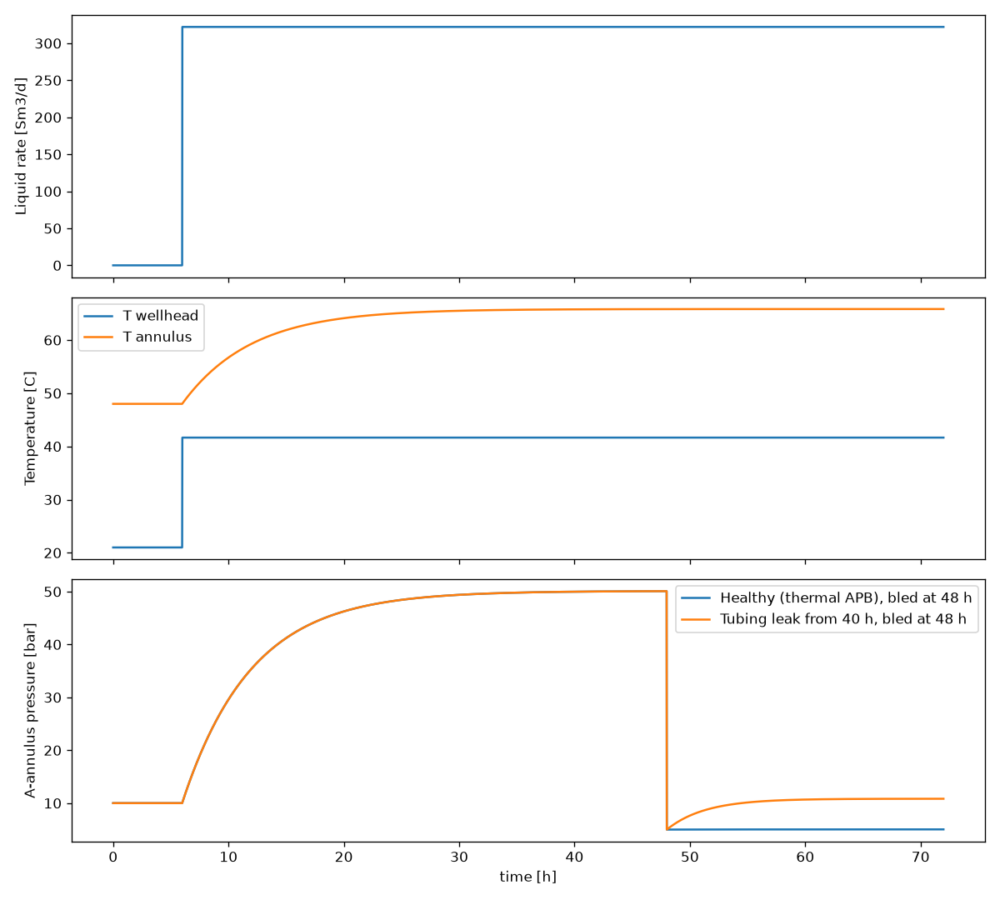

# Well Integrity – Physics-Based A-Annulus Model

A small, self-contained, **physics-based simulator** of a producing oil well and its A-annulus.
It links the choke setting to flow rate, wellhead temperature, annulus temperature and
annulus pressure, and shows why **thermal annulus pressure build-up (APB)** and a **tubing leak**
look the same on a pressure gauge until a **bleed test** separates them.

> All parameters are **synthetic and illustrative**. No proprietary, operator or field data is used.
> The model is a reasoning scaffold for decision-making under uncertainty, not an engineering tool.

---

## Why this exists

A fixed alarm limit on annulus pressure fails in both directions:

- **False alarms**: pressure rises at every start-up or rate increase purely because trapped fluid heats up.
- **Missed alarms**: a real leak can be **hidden** under thermal pressure and stays invisible until the annulus is bled.

A physics model gives the *expected* annulus pressure for the current thermal state. The
**residual** (measured minus expected) is a far better anomaly signal than raw pressure, and it
explicitly handles the correlation between temperature and pressure channels instead of treating
them as independent.

> A good-enough physics model is worth a billion data points.

---

## Repository contents

| File | Purpose |
|---|---|
| `well_integrity_model.py` | Model: inflow, tubing, choke, heat transfer, annulus pressure, time-domain simulator, demo |
| `well_integrity_demo.png` | Output of the demo scenarios (generated by running the script) |
| `README.md` | This document |

---

## Quick start

```bash
pip install numpy scipy matplotlib
python well_integrity_model.py
```

The script prints a choke sweep and writes `well_integrity_demo.png`.

---

## Physical system

```
 Reservoir ──IPR──► Bottomhole ──tubing (hydrostatic + friction)──► Wellhead
                                                                       │
                                               choke (Gilbert, critical/subcritical)
                                                                       ▼
                                                               Flowline / manifold

 Hot tubing fluid ──heat──► A-annulus temperature (lag) ──► A-annulus pressure
                                                            ▲            │
                                     tubing leak (at leak depth)    bleed (operator)
```

**Barrier context.** The A-annulus sits between the **primary barrier** (tubing, packer, downhole
safety valve) and the **secondary barrier** (production casing, wellhead, Christmas tree). Pressure
building there for the wrong reason means the primary barrier may have failed. If it exceeds the
maximum allowable annulus pressure, the two envelopes are no longer independent.

### Three ways the A-annulus gains pressure

| Mechanism | Integrity failure? | Signature |
|---|---|---|
| Thermal APB | No | Pressure follows annulus temperature; **does not rebuild** after a bleed |
| Tubing / packer leak | Yes (primary barrier) | Pressure **rebuilds** after a bleed with no temperature change |
| Gas migration through cement | Yes | Slow, steady rebuild, often in outer annuli |

This model covers the first two.

---

## Model equations

**1. Reservoir inflow (linear productivity index)**

$$q_L = PI\,(P_{res} - P_{wf})$$

**2. Tubing pressure (marched over 20 segments from wellhead to bottomhole)**

$$\frac{dP}{dz} = \rho_m g + f\,\frac{\rho_m v_m^2}{2D}$$

- Solution gas: $R_s = GOR \cdot \min(1, P/P_b)$
- Free gas per Sm³ liquid: $(GOR - R_s)(1-WC)\,B_g$ with $B_g = \frac{P_{sc}}{P}\frac{T}{T_{sc}}\,z$, $z \approx 0.9$
- No-slip mixture density $\rho_m$ and velocity $v_m$

More free gas makes the column lighter, so for the same bottomhole pressure the wellhead pressure is higher.

**3. Wellhead choke – Gilbert (1954), field units**

$$P_{wh}\,[\text{psi}] = \frac{435\,R^{0.546}\,q\,[\text{stb/d}]}{S^{1.89}}$$

- $R$: gas-liquid ratio [Mscf/stb]; $S$: bean size [1/64 in]
- **Critical flow** when $P_{fl}/P_{wh} \le 0.55$: rate does not depend on flowline pressure
- **Subcritical**: rate reduced along an elliptic curve $q = q_{crit}\sqrt{1-\left(\frac{r-0.55}{0.45}\right)^2}$

**4. Operating point**

The liquid rate $q$ is solved (Brent's method) so that IPR, tubing and choke give the same
bottomhole pressure.

**5. Wellhead temperature – Ramey relaxation length**

$$T_{wh} = T_{geo,top} + g_G\,A\,(1 - e^{-H/A}), \qquad A = \frac{\dot m\,c_p}{U\,\pi D}$$

Higher rate means a longer relaxation length and a hotter wellhead.

**6. Annulus temperature – first-order lag**

$$\frac{dT_{ann}}{dt} = \frac{\bar T_{tub} - T_{ann}}{\tau}$$

**7. Annulus pressure – the integrity equation**

$$\frac{dP_{ann}}{dt} = \underbrace{\frac{\alpha_f}{c_{eff}}\frac{dT_{ann}}{dt}}_{\text{thermal APB}} + \underbrace{\frac{q_{leak} - q_{bleed}}{V_{ann}\,c_{eff}}}_{\text{mass in/out}}$$

**8. Leak flow (linearised orifice at the leak depth $z_L$)**

$$q_{leak} = C_{leak}\,\max\!\big(P_{tub}(z_L) - [P_{ann,top} + \rho_{ann} g z_L],\ 0\big)$$

Pressures are compared **at the leak depth**, each with its own fluid column. A leak only flows
when tubing pressure exceeds annulus pressure at that point.

---

## Default parameters (synthetic)

| Parameter | Value | Meaning |
|---|---|---|
| `H` | 2400 m | Vertical depth to reservoir |
| `D` | 0.10 m | Tubing inner diameter |
| `P_res`, `T_res` | 250 bar, 90 °C | Reservoir pressure, temperature |
| `T_top_geo` | 6 °C | Geothermal temperature at wellhead level |
| `PI` | 15 Sm³/d/bar | Productivity index |
| `GOR` | 100 Sm³/Sm³ | Gas-oil ratio at standard conditions |
| `WC` | 0.3 | Water cut |
| `Pb` | 180 bar | Bubble-point pressure |
| `choke_64` | 32 | Choke bean size [1/64 in] |
| `U` | 25 W/m²/K | Tubing-to-formation heat transfer coefficient |
| `V_ann` | 30 m³ | A-annulus volume |
| `alpha_f` | 4.5e-4 1/K | Annulus fluid thermal expansion |
| `c_eff` | 2.0e-9 1/Pa | Effective compressibility (fluid + casing + small gas cap) |
| `leak_depth` | 1500 m | Depth of leak path |
| Flowline pressure | 20 bar | Downstream of choke |

With these values $\alpha_f / c_{eff} \approx 2.25$ bar/°C.

---

## Results

### Steady-state choke sweep (printed)

| Choke [1/64"] | Liquid rate [Sm³/d] | P_wh [bar] | T_wh [°C] | P_wf [bar] | Flow regime |
|---|---|---|---|---|---|
| 16 | 99 | 59.5 | 18.6 | 243.4 | Critical |
| 24 | 201 | 56.1 | 30.6 | 236.6 | Critical |
| 32 | 322 | 52.2 | 41.7 | 228.5 | Critical |
| 48 | 579 | 43.6 | 56.1 | 211.4 | Critical |
| 64 | 817 | 35.7 | 63.6 | 195.5 | Subcritical |
| 96 | 1101 | 25.8 | 69.1 | 176.6 | Subcritical |

Opening the choke increases rate and wellhead temperature and lowers wellhead pressure. Above
roughly 64/64" the flow becomes subcritical, so flowline pressure starts to affect the well.

### Dynamic scenarios – `well_integrity_demo.png`



All runs last 72 h with a 60 s time step. The well is shut in until **6 h**, then opened on a 32/64" choke.

| Scenario | Leak | Bleed | Purpose |
|---|---|---|---|
| **Healthy** (blue) | None | 48 h, to 5 bar | Thermal APB only |
| **Tubing leak** (magenta) | $C_{leak}=5\times10^{-7}$ m³/s/bar from **40 h** | 48 h, to 5 bar | Hidden leak revealed by bleed |

**Top panel – liquid rate.** Step from 0 to about 322 Sm³/d at start-up. The rate is identical in
both scenarios: **production data alone cannot detect the leak**.

**Middle panel – temperatures.** Wellhead temperature jumps to about 42 °C with flow. Annulus
temperature lags (τ = 6 h), rising from about 48 °C to 66 °C over roughly 20 h. Temperature is
the same in both scenarios.

**Bottom panel – A-annulus pressure (the key panel).**

1. **6–30 h, thermal APB:** pressure rises from 10 to about 50 bar with **no leak at all**, roughly
   18 °C × 2.25 bar/°C. A fixed threshold at, say, 40 bar would raise a false alarm.
2. **40 h, leak starts:** the curves stay on top of each other. The annulus is already pressurised by
   heating, so at the leak depth tubing pressure does not exceed annulus pressure and nothing flows.
   **The leak is masked by thermal pressure.**
3. **48 h, bleed to 5 bar:**
   - Healthy well: stays at about **5 bar**, because temperature is stable and nothing flows in.
   - Leaking well: **rebuilds to about 11 bar** within a few hours and stops where tubing and annulus
     pressures balance at the leak depth.

**Conclusion:** the post-bleed rebuild at constant temperature is the decisive evidence of a
primary-barrier failure. With a gas leak, gas would collect at the top of the annulus and the
rebuild would be much higher, approaching tubing pressure.

---

## Implications for an alarm and decision system

| Weak practice | Physics-informed alternative |
|---|---|
| Fixed threshold on raw annulus pressure | Alarm on residual $P_{meas} - P_{thermal\,model}$ with an uncertainty band |
| Treat P and T channels as independent | Model the shared cause (temperature drives pressure) explicitly |
| Trust a single snapshot | Use events (start-up, shut-in, bleed) as natural experiments |
| Model is certain or silent | When the residual is ambiguous, **recommend a bleed-and-monitor test** to resolve the uncertainty |
| No history means no model | Physics gives a prior for "normal" on a new well |
| Model acts directly | Advisory only; certified safety systems keep trip authority |

**Parameter uncertainty.** `c_eff`, `C_leak`, `leak_depth` and `tau` are not known precisely. Fit
them per well from start-up, shut-in and bleed history, and propagate their uncertainty into the
residual's confidence interval. This is model (epistemic) uncertainty, not sensor noise.

---

## Simplifications and limitations

- No-slip homogeneous multiphase flow (no flow-pattern or holdup correlation)
- Linear solution-gas model, constant z-factor
- Gilbert choke correlation is empirical; critical-ratio threshold fixed at 0.55
- Linear pressure profile used to estimate tubing pressure at the leak depth
- Single lumped liquid-filled annulus; no casing ballooning, no gas-cap dynamics
- First-order thermal lag instead of a transient wellbore heat model
- Simplified shut-in state
- Only A-annulus; no B/C annuli or cement-sheath gas migration

These are deliberate. The goal is a transparent model whose behaviour can be reasoned about and
changed live, not a replacement for commercial well-modelling tools.

---

## Possible extensions

- Residual-based detector with calibrated probability of leak and an abstain/escalate path
- Bayesian estimation of `c_eff` and `C_leak` from bleed/rebuild events
- Gas-leak scenario with a gas cap and nonlinear compressibility
- Cost-based alarm threshold: alarm if $p_{cal} > \frac{C_{FA}}{C_{FA} + C_{miss}}$
- Sensor faults (drift, frozen value, noise) to test robustness
- Knowledge-graph mapping (well → annulus → sensor → barrier → limit) for provenance and audit

---

## References

- Gilbert, W. E. (1954). *Flowing and Gas-Lift Well Performance*. API Drilling and Production Practice.
- Ramey, H. J. (1962). *Wellbore Heat Transmission*. Journal of Petroleum Technology.
- NORSOK D-010, *Well integrity in drilling and well operations*.
- API RP 90, *Annular Casing Pressure Management for Offshore Wells*.
