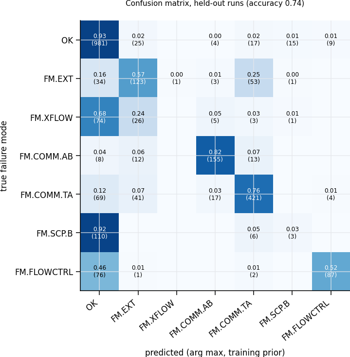

# pipeline — A Manual on Uncertainty-Aware Well-Integrity Decisions

### From two annulus residuals to a calibrated failure-mode diagnosis, a cost-based decision and a grounded explanation

> **What this document is.** A self-contained, textbook-style manual for the `pipeline/` module of
> SentinelAI. It explains *what* each step computes, *why* it is done that way, the *mathematics*
> behind it, and *worked examples* with the numbers the code actually produces
> (`python -m pipeline.run_pipeline`).
>
> **How it fits.** The pipeline is the reasoning layer on top of two other modules:
> `digital_twin/` (physics: what the well should do) and `knowledge_graph/` (context: what exists,
> how it fails, which tests reveal it, which limits apply, what each mistake costs).
> The pipeline reads the graph only through `knowledge_graph/queries.py`.
>
> **Synthetic and illustrative.** All numbers come from the digital twin, the knowledge graph, or the
> assumptions listed in Chapter 11. No operator or proprietary data is used.


---

## How to read this manual

| If you want to… | Read |
|---|---|
| Understand the whole idea quickly | Chapter 1 and Chapter 9 (worked example S05) |
| Refresh probability, odds and Bayes' rule | Chapter 2 |
| Understand each code file | Chapters 4–7, in pipeline order |
| See what the pipeline does in twelve situations | Chapter 8 |
| Know what the numbers depend on, and what the method cannot do | Chapters 11 and 12 |
| Look up a term | Chapter 13 |

Each technical chapter follows the same pattern: **the problem → the idea → the mathematics → how
the code does it → a worked example → pitfalls.**

---

## Contents

1. [The big picture](#1-the-big-picture)
2. [Probability toolkit](#2-probability-toolkit)
3. [Quick start and files](#3-quick-start-and-files)
4. [Step 1 — Evidence (`residual.py`)](#4-step-1--evidence-residualpy)
5. [Step 2 — Diagnosis (`calibrate.py`)](#5-step-2--diagnosis-calibratepy)
6. [Step 3 — Decision (`decide.py`)](#6-step-3--decision-decidepy)
7. [Step 4 — Grounded rationale (`rationale.py`)](#7-step-4--grounded-rationale-rationalepy)
8. [Results: twelve scenarios](#8-results-twelve-scenarios)
9. [Complete worked example: scenario S05](#9-complete-worked-example-scenario-s05)
10. [Design choices against common failure patterns of AI alarm systems](#10-design-choices-against-common-failure-patterns-of-ai-alarm-systems)
11. [Assumptions and sensitivity](#11-assumptions-and-sensitivity)
12. [Limitations](#12-limitations)
13. [Glossary](#13-glossary)
14. [Further reading](#14-further-reading)

---

## 1. The big picture

### 1.1 The question the pipeline answers

At any moment, a well-integrity engineer looking at well W01 must decide:

> *Is a barrier failing? If so, which failure mode is it, what does it threaten, and what should be done now?*

The answer is one of four actions:

| Action | Meaning | Typical cost if unnecessary |
|---|---|---|
| `NO_ACTION` | Keep producing | Nothing, unless a failure is missed (very expensive) |
| `TEST` | Buy more evidence with a class-B test chosen by the graph (bleed, top-up, shut-in, gas sample) | Cost of the test |
| `ALARM` | Escalate to well integrity; the graph's confirmatory class-A test is mandated | Test cost plus false-alarm cost |
| `ABSTAIN` | The inputs cannot be trusted (bad data, model out of its range); fix that first | — |

### 1.2 Why simple thresholds fail

1. **Pressure changes for harmless reasons.** Heating at start-up raises a liquid-filled annulus by
   about 2.25 bar per °C; ballooning, cooling and bleeds move it too. The digital twin predicts all
   of these.
2. **Failures change pressure in *both* directions.** While the well produces, the heated A-annulus
   is above tubing pressure at every depth, so a tubing or packer leak *drains* the annulus: the
   A residual becomes about **−54 bar**. A threshold that only looks for high pressure misses it.
3. **One symptom, many causes; one cause, several symptoms.** The graph links 23 failure mechanisms
   to 16 failure modes. Two annuli (A and B), bleed returns and the choke model are all needed to
   tell them apart.
4. **Mistakes have very different costs.** In the policy node, missing a leak costs NOK 20 million,
   missing a loss of containment NOK 500 million, a false alarm NOK 50,000.

### 1.3 The four steps

```
 (1) EVIDENCE             (2) DIAGNOSIS                (3) DECISION                  (4) RATIONALE
 A and B residuals vs  →  calibrated probability   →  action with the smallest  →  explanation in which every
 the twin, bleed returns,  of each failure mode,       expected cost, after         number and every causal claim
 choke model, limits       with an interval            safety gates                 is traced to a graph node
```

| Step | File | Reasoning | Discipline |
|---|---|---|---|
| 1 Evidence | `residual.py` | Physics: "what should I see?" | Model-based fault detection (analytical redundancy) |
| 2 Diagnosis | `calibrate.py` | Statistics: "which failure mode, how sure?" | Probabilistic classification, calibration |
| 3 Decision | `decide.py` | Economics: "what to do, given the costs?" | Bayesian decision theory, value of information |
| 4 Rationale | `rationale.py` | Governance: "can every claim be traced?" | Provenance and verification |

### 1.4 Design principles

- **Each step does one job and passes its uncertainty on.** Nothing is reduced to yes / no until
  the end, and a human confirms when uncertainty could change the answer.
- **The graph is the single source of context.** Sigmas, limits, costs, tests, failure modes,
  barriers, hazards and the twin's validity range are read from graph nodes.
- **Probabilities and preferences are kept apart.** Step 2 estimates what is true; step 3 applies
  what each mistake costs. Changing a cost never requires retraining.
- **Advisory only.** Trip authority stays with the certified safety instrumented system (`SIS-W01`).

---

## 2. Probability toolkit

### 2.1 Probability, odds and log-odds

$$\text{odds}(p) = \frac{p}{1-p}, \qquad \text{logit}(p) = \ln\frac{p}{1-p}, \qquad p = \sigma(a) = \frac{1}{1+e^{-a}}$$

| $p$ | odds | logit |
|---|---|---|
| 0.002 | 0.002 (1 : 499) | −6.21 |
| 0.10 | 0.111 | −2.20 |
| 0.50 | 1 | 0 |
| 0.90 | 9 | +2.20 |
| 0.999 | 999 | +6.91 |

Bayes' rule is *addition* on the log-odds scale (2.3), and probabilities near 0 or 1 that look
similar can be far apart in log-odds. The sigmoid makes any score *look* like a probability; it does
not make it one (Chapter 5).

### 2.2 Bayes' rule

$$P(H \mid E) = \frac{P(E \mid H)\,P(H)}{P(E)}$$

$P(H)$ is the **prior** (how common the hypothesis is before looking), $P(E\mid H)$ the
**likelihood**, $P(H\mid E)$ the **posterior**.

### 2.3 Odds form and likelihood ratio

$$\frac{P(H\mid E)}{P(\bar H\mid E)} = \underbrace{\frac{P(E\mid H)}{P(E\mid \bar H)}}_{LR} \times \frac{P(H)}{P(\bar H)}
\qquad\Longleftrightarrow\qquad \text{posterior logit} = \ln LR + \text{prior logit}$$

The likelihood ratio is what the evidence contributes; the prior is what the world contributes.

### 2.4 The base-rate effect, with W01 numbers

The twin estimates the A-annulus bleed test at sensitivity 0.665 and specificity 0.992 (Section 5.10).

- $LR_+ = 0.665 / (1-0.992) \approx 83$
- Prior odds for a failure: $0.002/0.998 \approx 0.002$
- After a positive bleed: odds $\approx 0.002 \times 83 = 0.17$, so **p ≈ 0.14**

A strongly specific test still leaves an 86 % chance that nothing is wrong when failures are rare.
A negative bleed has $LR_- = 0.335/0.992 \approx 0.34$: it only cuts the odds by a factor of three.

### 2.5 More than two hypotheses

With hypotheses $k = 0 \dots K$ (here: "no failure" and six failure modes),

$$P(k \mid E) = \frac{P(E\mid k)\,\pi_k}{\sum_j P(E\mid j)\,\pi_j}$$

The same structure: evidence (likelihoods) times prior, normalised. Section 5.7 uses it to move from
the training world to operations.

### 2.6 Sensitivity, specificity

| | Failure present | No failure |
|---|---|---|
| Test positive | TP | FP |
| Test negative | FN | TN |

$$\text{sens} = \frac{TP}{TP+FN},\quad \text{spec} = \frac{TN}{TN+FP},\quad LR_+ = \frac{\text{sens}}{1-\text{spec}},\quad LR_- = \frac{1-\text{sens}}{\text{spec}}$$

### 2.7 Aleatoric and epistemic uncertainty

| Type | Meaning | In W01 | Shown as |
|---|---|---|---|
| **Aleatoric** | Randomness of the world | Sensor noise, which failures occur | Inside the probability $p$ |
| **Epistemic** | Lack of knowledge | Unknown gas caps, time constants; finite training data | The interval $[p_{lo}, p_{hi}]$ |

A wide interval means "the model does not know", a different message from "the outcome is random".

---

## 3. Quick start and files

From the repository root `SentinelAI/` (with `digital_twin/` and `knowledge_graph/` next to `pipeline/`):

```bash
pip install numpy scipy matplotlib networkx pydantic pyyaml scikit-learn joblib

python -m pipeline.residual          # evidence for four example wells
python -m pipeline.calibrate         # ~10 min: 1,200 synthetic runs -> calibration artifact and figures
python -m pipeline.decide            # costs, tests and thresholds the graph implies per failure mode
python -m pipeline.run_pipeline      # 12 scenarios end to end -> out/, audit.jsonl, pipeline_scenarios.png
python -m pipeline.test_pipeline     # checks
```

`calibration_W01.joblib` was built with scikit-learn 1.5.1; pickled models are version-specific, so
re-run `python -m pipeline.calibrate` if loading fails. The synthetic dataset is cached in
`dataset_W01.npz` (resumable; keep it out of version control).

| File | Role | Chapter |
|---|---|---|
| `residual.py` | Plant vs twin, A/B residuals, bleed returns, choke model, data quality, twin validity, operational MAASP | 4 |
| `calibrate.py` | Classes from the graph, synthetic dataset, multiclass GBT + isotonic, prior shift, bootstrap, test performance | 5 |
| `decide.py` | Costs and tests from the graph, mechanism ranking, expected loss, value of information, four gates | 6 |
| `rationale.py` | Runtime graph nodes, cited explanation, grounding gate R1–R7 | 7 |
| `run_pipeline.py` | Twelve scenarios, audit trail, figure | 8 |
| `test_pipeline.py` | Checks | — |
| `calibration_W01.json` | Readable summary of the calibration | 5 |
| `pipeline_scenarios.png`, `reliability.png`, `confusion.png` | Figures | 5, 8 |
| `out/` | Rationale + gate verdict per scenario, hallucination demo, `audit.jsonl` | 7, 8 |

---

## 4. Step 1 — Evidence (`residual.py`)

### 4.1 The problem

A gauge reading has no meaning without an expectation. 50 bar in the A-annulus is normal after
start-up; 3 bar in the same annulus while producing is a strong sign of a tubing leak; 24 bar in B
after a bleed to 5 bar means something is feeding B.

### 4.2 The idea: analytical redundancy

Classical model-based fault detection works in two stages:

1. **Residual generation:** compare each measurement with what a model of the *healthy* system predicts.
2. **Residual evaluation:** decide what the pattern of residuals means.

The model acts as a second, analytical sensor. Step 1 generates residuals; steps 2 and 3 evaluate them.

### 4.3 Plant and twin

| | Plant ("the real well") | Twin (`TWIN-W01`) |
|---|---|---|
| Physics | `digital_twin.simulate` | the same |
| Parameters | Drawn from the twin's own priors (`sample_plant`): gas caps, wall compliance, time constants, ballooning, heat transfer, productivity | Nominal (`nominal_w01()`) |
| Failures | Possibly a graph mechanism (`make_fault(mechanism_id)`), compound faults | None |
| Knows | Everything | Only what operations know: choke schedule, flowline pressure, bleed log, shut-ins, **inspection findings** |
| Output | Measured tags, noise from the graph's sigmas | Expected signals (virtual tags) |

**Why the twin knows inspection findings.** A caliper log that found 60 % casing wear is a fact. The
twin uses it to compute limits (Section 4.10); it is not a failure to be detected.

**Why perturb the plant.** If plant and twin were identical, every healthy residual would be pure
sensor noise and the problem trivial. Drawing the plant from the twin's priors creates realistic
model error, which calibration must learn to tolerate.

**Caching.** The twin depends only on operations, so its runs are cached; the training set uses a
discrete grid of operations (Section 5.4).

### 4.4 Measurement model from the graph

`sensors_from_graph(g)` builds every tag's measurement model from the graph's `sigma`,
`rel_sigma` and `resolution` properties: A and B transmitters σ = 0.5 bar, multiphase meter 3 %,
bleed logs 0.1 Sm³ and 1 L resolution.

### 4.5 Residuals in both annuli

$$r_X(t) = P_{X,meas}(t) - P_{X,twin}(t), \qquad \sigma_X = \sqrt{\sigma_{tag}^2 + \sigma_{virtual}^2}, \qquad z_X = \frac{r_X}{\sigma_X}$$

Both sigmas come from the graph (`W01-PT-A-ANN` 0.5 bar, `W01-VT-P-A-EXP` 3.0 bar), so
$\sigma_A = \sigma_B = \sqrt{0.25 + 9} \approx 3.04$ bar. The model term dominates: a better twin
would help far more than a better transmitter.

**Signs matter.** $z_A \ll 0$ while producing means A is being drained (tubing / packer leak, A to
environment); $z_A > 0$ after a bleed means something refills A (hanger seal); $z_A < 0$ together with
$z_B > 0$ means A and B communicate. Residuals are therefore kept **signed**; no "larger is worse"
assumption is made.

### 4.6 The dwell window

Features are averaged over the policy's dwell window (`min_dwell_min` = 30 min, six samples at
5-minute resolution). Twin error changes slowly and is almost identical across the six samples, so
$\sigma$ is **not** divided by $\sqrt{6}$: averaging does not remove correlated model error.

### 4.7 The features

| Feature | Definition | Meaning |
|---|---|---|
| `producing`, `hours_in_state` | Choke open?; hours since the last open / shut change | The operating state decides leak direction |
| `zA`, `zB` | Mean of $z$ over the dwell window | Size and sign of unexplained pressure |
| `zA_persist`, `zB_persist` | sign(mean) × min $\lvert z\rvert$ in the window | Persistence: large only if every sample agrees |
| `zA_slope`, `zB_slope` | Least-squares slope of $z$ over the last 2 h, restarted after a bleed or state change | Still rebuilding? |
| `zAzB` | $z_A \cdot z_B$ (clipped) | Negative: opposite signs, the A↔B fingerprint |
| `bledA`, `hours_since_bleed_A` | Bleed done?; hours since (capped 48) | Informative regime |
| `dgasA`, `dliqA` | Bleed returns minus the twin's bleed returns (gas Sm³; brine / 100 L) | Extra gas: gas entering; less brine: fluid lost |
| (same for B) | | |
| `pre_bleed_trend` | Pressure slope in the 3 h before the bleed | Annulus still heating when bled? |
| `thermal_transient_C` | Change of twin A temperature over 6 h | Twin error is largest during transients |
| `zQ` | (measured − twin) liquid rate / σ; σ from the meter's 3 % and the virtual tag's 15 Sm³/d | Choke model mismatch (erosion) |
| `zPWH` | Tubing-head pressure residual | Choke and tubing state |

Least-squares slope: $\hat\beta = \sum_i (t_i-\bar t)(z_i-\bar z) / \sum_i (t_i-\bar t)^2$.

### 4.8 Data quality (`TEST.DQ`)

Over the last 2 h of each annulus transmitter: `MISSING` if any sample is not finite; `FROZEN` if
the peak-to-peak range is below 10⁻⁶ bar (a live transmitter always shows noise of about σ); otherwise
`GOOD`. A frozen gauge reports "stable" while the well may be changing; it must be caught before any
statistics.

### 4.9 Twin validity

The twin node carries its validity envelope: `valid_choke_64` = [8, 96] and `valid_T_A_C` = [20, 90] °C.
Outside it, every virtual tag is an extrapolation.

### 4.10 Operational MAASP from measured pressures

The graph holds documented limits (MAASP, MAWOP). The pipeline also computes the **operational MAASP**
with the twin's integrity equations, but from **measured** annulus pressures:

- tubing profile: the twin's steady profile at the measured choke (or the shut-in column);
- annulus columns: measured top pressure plus the brine gradient, $P_X(z) = P_{X,top} + \rho g z$;
- wall loss: inspection findings (`known_findings`), burst ∝ $t$, collapse ∝ $t^2$.

For A the bounds are the tubing-head spool, production-casing burst (backed by B or pore pressure),
tubing collapse and the packer differential; for B the casing-head spool, intermediate-casing burst
and production-casing collapse (backed by A). The margin is MAASP minus the measured pressure.

**Healthy W01 while producing:** MAASP_A ≈ 332 bar (packer governs), MAASP_B ≈ 207 bar (casing-head
spool governs).

**Pitfall.** The measured column ignores any fluid-level drop (void) in A. If A has lost fluid, the
true back-up for the production casing is lower, so this MAASP_B is slightly optimistic (Section 8.3, S10).

---

## 5. Step 2 — Diagnosis (`calibrate.py`)

### 5.1 The problem: a score is not a probability

A residual of $z = -5$ is "unusual", but how likely is a failure, and which one? Passing a score
through a sigmoid gives a number between 0 and 1 that is not a probability: it does not answer
"of all the times I said 0.3, how often was there really a failure?"

### 5.2 Why diagnose failure modes

The pipeline predicts **failure modes**, not mechanisms:

- failure modes are what the evidence can separate (mechanisms of one mode often have near-identical
  signatures);
- they are the graph's link to barriers and hazards (`DEGRADES`, `LEADS_TO`), so the decision
  can price them;
- mechanisms *within* the leading mode are ranked afterwards by the twin signatures (Section 6.4).

### 5.3 Classes from the graph

Every simulated mechanism that has an online signature (not silent, not an instrument fault) is
assigned to the **first failure mode it `CAUSES`** in this order:

`FM.EXT`, `FM.XFLOW`, `FM.COMM.AB`, `FM.COMM.TA`, `FM.SCP.B`, `FM.FLOWCTRL`

The order puts the most consequential interpretation first. The result, computed from the graph:

| Mechanism | Class | Why first |
|---|---|---|
| `FMech.THSP.SEAL`, `FMech.CHSP.SEAL` | `FM.EXT` | release reaches the environment |
| `FMech.ICSG.LEAK` | `FM.XFLOW` | flow into a formation |
| `FMech.CSG.LEAK`, `FMech.CHS.SEAL` | `FM.COMM.AB` | secondary barrier breached |
| `FMech.TUB.THREAD`, `FMech.TUB.CORR`, `FMech.PKR.ELAST`, `FMech.THS.SEAL` | `FM.COMM.TA` | primary barrier breached |
| `FMech.CEM.MICRO` | `FM.SCP.B` | gas feeding B |
| `FMech.CHK.EROS` | `FM.FLOWCTRL` | choke |

Plus `OK` (no active failure). `FMech.PKR.MOVE` shares the packer leak model and is not trained
separately. Silent mechanisms (wall loss, valve failures on demand) are handled by limits and by
scheduled tests, not by the classifier.

### 5.4 The synthetic world

1,200 runs × 8 evaluation times (18, 24, 30, 36, 42, 48, 54, 59.9 h) = **9,600 samples**.

| Randomised | Distribution |
|---|---|
| Failure present | 70 % of runs, mechanism uniform over the 11 trainable ones |
| Leak size | catalogue conductance × 10^U(−0.5, 0.5) |
| Leak depth | thread 300–2,200 m; corrosion 300–1,500 m; casing 100–1,150 m; intermediate casing 200–1,100 m |
| Onset | U(0, 50) h (erosion U(2, 30) h, rate 0.05 × 10^U(−0.3, 0.5) per day) |
| Start-up, choke | 4, 6, 8 or 10 h; 24, 32 or 48 /64" |
| Shut-in | 20 % of runs, at 40 or 50 h |
| Bleed | 60 % of runs, at 24, 32, 40 or 48 h; A (60 %) or B (40 %) |
| Plant parameters | one `sample_plant` draw per run |

**Label:** the mechanism's class if its onset is before the evaluation time, otherwise `OK`.
Class counts: OK 4,243; EXT 997; XFLOW 368; COMM.AB 864; COMM.TA 2,119; SCP.B 502; FLOWCTRL 507.

### 5.5 Splitting by run

The eight samples of a run share the same well, fault and operations. A random split by sample
would put near-copies in training and test (**data leakage**). The split is by run: 720 runs
(5,760 samples) to train, 180 (1,440) to calibrate, 300 (2,400) to test.

### 5.6 Score model and calibration

**Score model.** A multiclass gradient-boosted tree ensemble (`HistGradientBoostingClassifier`,
depth 4, 200 iterations, learning rate 0.08, at least 40 samples per leaf). For each class $k$ it builds
$F_k(x)$ as a sum of small trees and outputs a softmax $s_k = e^{F_k}/\sum_j e^{F_j}$.

No monotone constraints are used: the meaning of a residual depends on its sign *and* the
operating state, so "more residual = more failure" is false here.

**Calibration: one-vs-rest isotonic regression.** For each class, a non-decreasing step function
$g_k$ maps the score $s_k$ to the observed frequency of class $k$ on the calibration runs,
fitted with the pool-adjacent-violators algorithm; the results are renormalised to sum to one:

$$\hat p_k(x) = \frac{g_k(s_k(x))}{\sum_j g_j(s_j(x))}$$

Each $g_k$ is clipped to $[\varepsilon, 1-\varepsilon]$ with $\varepsilon = 1/(n_{calib}+2) = 1/1442$
(Laplace's rule of succession): a finite set can never prove a probability of exactly 0 or 1.

### 5.7 Prior shift: from the training world to operations

The training mix has 56 % failures; in operations a failure is rare. If only the class frequencies
change and the evidence given the class does not (**label shift**), Bayes' rule (2.5) gives
(Saerens et al.):

$$p_{op}(k \mid x) = \frac{p_{train}(k\mid x)\,\pi_{op}(k)/\pi_{train}(k)}{\sum_j p_{train}(j\mid x)\,\pi_{op}(j)/\pi_{train}(j)}$$

| Class | $\pi_{train}$ | $\pi_{op}$ (policy input) | weight $\pi_{op}/\pi_{train}$ |
|---|---|---|---|
| OK | 0.440 | 0.998 | 2.27 |
| FM.COMM.TA | 0.219 | 0.0008 | 0.0036 |
| FM.SCP.B | 0.047 | 0.0004 | 0.0086 |
| FM.COMM.AB | 0.097 | 0.0003 | 0.0031 |
| FM.EXT | 0.110 | 0.0002 | 0.0018 |
| FM.FLOWCTRL | 0.049 | 0.0002 | 0.0041 |
| FM.XFLOW | 0.038 | 0.0001 | 0.0026 |

**The ceiling.** The smallest possible calibrated $p(OK)$ is $\varepsilon \approx 0.0007$. After the
shift, OK keeps weight $0.0007 \times 2.27 \approx 0.0016$ against about $0.0036$ for COMM.TA, so the
largest operational $p(\text{failure})$ the model can express for a tubing–A leak is about
**0.70–0.72**. That is why the clearest cases in Chapter 8 (S02, S03) sit at 0.71 rather than near 1.
It is a property of rare-event detection with finite calibration data, not a weakness of the
evidence: the decision layer does not need more, because the alarm threshold is far lower (Section 6.6).

### 5.8 Interval: the bootstrap

Sixteen bootstrap members are fitted, each on training runs resampled with replacement and
calibrated on the same calibration runs. For a new case, the 5th and 95th percentiles of their
$p(\text{failure})$ form the interval (`interval_level` 0.9), widened to include the main model's value.
It measures how much the answer depends on the luck of the training draw (**epistemic**
uncertainty of the statistical model). It does not include errors of the simulator itself.

**Out-of-distribution check.** The training minimum and maximum of every feature are stored; a
feature outside its range is reported and stops the decision (gate G3).

### 5.9 How good is it?

On 2,400 held-out samples (300 runs), at the training prior:

| Measure | Calibrated | Naive $\sigma(\max\lvert z\rvert - 2)$ |
|---|---|---|
| Expected calibration error of $p(\text{failure})$ | **0.019** | 0.166 |
| Brier score of $p(\text{failure})$ | **0.124** | 0.234 |
| Multiclass Brier score | 0.391 | — |
| Accuracy (arg max, all samples) | 0.738 | — |
| Accuracy on failed samples | 0.585 | — |

$$\text{ECE} = \sum_b \frac{n_b}{N}\,\lvert \bar y_b - \bar p_b\rvert, \qquad \text{Brier} = \frac{1}{N}\sum_i (\hat p_i - y_i)^2$$




**Reading the confusion matrix.** Rows are the truth, columns the arg max at the training prior.

- **COMM.AB (0.82) and COMM.TA (0.76)** are recognised well: their signatures are large.
- **SCP.B is mostly predicted OK (0.92).** Cement gas raises B by only about 3 bar while producing; it
  becomes visible after a B bleed (rebuild, extra gas). Most SCP.B samples have no B bleed: the
  failure is real but **not yet detectable**.
- **XFLOW is confused with OK and EXT.** An intermediate-casing leak drains B like a B-outlet leak; only
  the bleed (gas returned, rebuild) separates them.
- **EXT is confused with COMM.TA (0.25).** An A-outlet leak drains A like a tubing leak, only more
  slowly.
- **FLOWCTRL vs OK (0.46).** Early erosion changes the rate by less than the meter's noise.

These confusions are physics, not model failure: the evidence does not separate them **yet**. The
decision step responds by choosing a test that does.

### 5.10 The twin predicts the tests' performance

The decision needs each follow-up test's sensitivity and specificity. They are estimated on the
held-out samples taken at least 6 h after the test (a test is "positive" if $p(\text{failure}) > 0.9$
at the training prior), with Laplace smoothing $(k+1)/(n+2)$:

| Test | Sensitivity | Specificity | Samples |
|---|---|---|---|
| `TEST.BLEED.A` | 0.665 | 0.992 | 382 |
| `TEST.BLEED.B` | 0.732 | 0.944 | 250 |
| `TEST.SHUTIN` | 0.454 | 0.950 | 133 |

Class-B tests without an estimate (top-up, gas sample) use an assumed 0.50 / 0.95, which the
rationale states explicitly.

---

## 6. Step 3 — Decision (`decide.py`)

### 6.1 Bayesian decision theory

For each action $a$ and true state $s$ define a loss $L(a, s)$; choose the action with the smallest
expected loss $\mathbb{E}[L(a)] = \sum_s L(a,s)\,P(s\mid \text{evidence})$. Thresholds are not chosen by
hand; they follow from the costs.

### 6.2 What a miss costs: from the risk paths

The policy node `POL.W01.INTEGRITY` holds three costs. Which applies to a failure mode is decided by
the graph:

$$C_{miss}(k) = \begin{cases} \text{cost\_missed\_loc\_nok} = 500\text{ M} & \text{if } k \xrightarrow{\text{LEADS\_TO}} \text{hazard directly} \\ \text{cost\_missed\_leak\_nok} = 20\text{ M} & \text{otherwise} \end{cases}$$

`FM.EXT`, `FM.XFLOW` and `FM.FLOWCTRL` lead directly to a hazard (the release has started); the
others degrade a barrier. With several modes possible, the expected cost of a miss *given* that
something failed is

$$\bar C = \frac{\sum_k p_k\,C_{miss}(k)}{\sum_k p_k}$$

### 6.3 Which tests: from the evidence edges

| Role | Selection rule (graph queries) |
|---|---|
| **Confirmatory** (mandated by `ALARM`) | Class-A test with `EVIDENCE_FOR` the most mechanisms that cause the leading mode; cheapest among them |
| **Follow-up** (`TEST`) | Class-B test that splits the two best-matching mechanisms on the twin-predicted outcome (`discriminating_tests`); otherwise the cheapest class-B test covering the leading mode. A bleed of an annulus bled less than 24 h ago is excluded |

Resulting choices (`python -m pipeline.decide`):

| Leading mode | $C_{miss}$ (NOK) | Confirmatory | Cost (NOK) | Default follow-up |
|---|---|---|---|---|
| FM.EXT | 500,000,000 | `TEST.WH.VALVE` | 30,000 | `TEST.TOPUP` |
| FM.XFLOW | 500,000,000 | `TEST.PT.ANN.B` | 1,000,000 | `TEST.TOPUP` |
| FM.COMM.AB | 20,000,000 | `TEST.PT.ANN.B` | 1,000,000 | `TEST.BLEED.A` |
| FM.COMM.TA | 20,000,000 | `TEST.PT.ANN.A` | 1,500,000 | `TEST.BLEED.A` |
| FM.SCP.B | 20,000,000 | `TEST.PT.ANN.B` | 1,000,000 | `TEST.TOPUP` |
| FM.FLOWCTRL | 500,000,000 | `TEST.CHK.INSP` | 40,000 | — |

### 6.4 Which mechanism: twin signatures

Within the leading mode, mechanisms are ranked by distance to their twin signature, using the
signature keys that match the **current operating state**:

| State | Keys compared with the observed residuals |
|---|---|
| producing, no bleed | ΔA_pre, ΔB_pre |
| after a bleed | ΔA_post, ΔB_post (only mechanisms whose signature experiment bled the same annulus) |
| shut in | ΔA_shutin |

$$d(m) = \sqrt{\sum_k \left(\frac{r_k - s_k(m)}{5\text{ bar}}\right)^2}$$

Mechanisms with identical signatures (packer element leak and packer movement) are indistinguishable
by pressure and only the first is listed. The two best are passed to the follow-up selection, which
picks a test that would give different results for them.

### 6.5 Expected losses

$$L_{none}(p) = p\,\bar C \qquad\qquad L_{alarm}(p) = C_A + (1-p)\,C_{FA}$$

$$L_{test}(p) = C_B + P(+)\,L^*(p_+) + P(-)\,L^*(p_-), \qquad L^*(q) = \min\big(q\bar C,\ C_A + (1-q)C_{FA}\big)$$

$$P(+) = \text{se}\,p + (1-\text{sp})(1-p),\qquad p_+ = \frac{\text{se}\,p}{P(+)},\qquad p_- = \frac{(1-\text{se})\,p}{1-P(+)}$$

$L_{test}$ is a **pre-posterior (value-of-information) analysis**: pay for the test, see the result,
update by Bayes, act optimally. A test is worth buying only if its result could change the action.

### 6.6 Thresholds per failure mode

If all failure probability sat on one mode ($\bar C = C_{miss}(k)$), the actions would change at:

| Leading mode | NO_ACTION → TEST | TEST → ALARM |
|---|---|---|
| FM.EXT | 0.014 % | 0.018 % |
| FM.FLOWCTRL | — | 0.018 % (NO_ACTION → ALARM) |
| FM.XFLOW | 0.033 % | 0.39 % |
| FM.COMM.AB | 0.46 % | 13.4 % |
| FM.COMM.TA | 0.51 % | 19.3 % |
| FM.SCP.B | 0.87 % | 9.2 % |

**Reading the table.**
- Modes that already release to the environment are acted on at tiny probabilities: missing them
  costs 500 M, and their confirmatory tests are cheap (valve test 30 k, choke inspection 40 k).
- Barrier-degradation modes alarm only above 10–20 %, because an alarm triggers a 1–1.5 M class-A test.
- Between the two thresholds, buying class-B evidence is cheapest.
- If a cost changes, the thresholds move immediately; **nothing is retrained**.

### 6.7 The gates: when not to trust the probability

| Gate | Condition | Outcome | Reason |
|---|---|---|---|
| **G1** data quality | A or B transmitter not `GOOD` | `ABSTAIN` on `FM.MONITOR`; next evidence `TEST.SEN.CAL` | Bad data makes $p$ meaningless |
| **G2** hard limits | $P_X \ge$ MAWOP_X (graph limit), or margin to operational MAASP $<$ 30 bar | `ALARM` on `FM.MAASP.X` / `FM.MARGIN.X` | A limit needs no probability |
| **G3** model validity | twin outside its envelope, or a feature out of range | `ABSTAIN` | The calibrator would extrapolate |
| **G4** decision-relevant uncertainty | interval wider than `abstain_interval_width` (0.4) **and** the best action at $p_{lo}$ differs from the best at $p_{hi}$ | Minimax action, `human_review` | See 6.8 |
| — | otherwise | Minimum expected loss | — |

The order follows dependence: first the data, then limits (which need only the data), then the
model, then the model's uncertainty.

### 6.8 G4: minimax over the interval

When the interval spans a threshold, the point estimate cannot pick the action, but the costs still
say which mistake is cheaper. For each action the code computes its **worst expected loss over the
interval** and picks the smallest:

$$a_{robust} = \arg\min_a\ \max_{q \in [p_{lo},\,p_{hi}]} \mathbb{E}[L(a)\mid q]$$

$L_{none}$ and $L_{alarm}$ are linear in $q$, but $L_{test}$ is a sum of minima of linear functions,
hence **concave**: its maximum can lie inside the interval. The code therefore evaluates a 41-point
grid, not only the endpoints.

### 6.9 Safety boundary

Every decision carries `advisory_only = True` and the policy's `trip_authority = "SIS only"`. The
pipeline never acts on the well.

---

## 7. Step 4 — Grounded rationale (`rationale.py`)

### 7.1 The problem

An explanation in words is needed. A language model can write fluent, plausible and wrong text:
invented probabilities, out-of-date limits, statistics from nowhere, a failure mechanism linked to the
wrong symptom, or an action that contradicts the decision. In a safety context a confident wrong
explanation is worse than none.

### 7.2 The idea: separate generation from verification

Whoever writes the text (a template here, a language model later) is not trusted. A deterministic
gate checks every number, citation, causal claim and action word against the graph.

### 7.3 Recording the evidence: runtime nodes

`record()` writes two nodes into a **copy** of the graph:

```
RA.W01.<run>  (RiskAssessment)
   P_A_bar, P_A_exp_bar, r_A_bar, z_A, sigma_A_bar, (same for B), bleed-return differences, z_Q,
   operational MAASP and margins with governing elements, data quality,
   p_fail, p_lo, p_hi, top_mode, p_top, p_<mode> for every class, prior, calibration id
   ├─ASSESSES──► W01.ANN-A, W01.ANN-B, <assessed failure mode>
   ├─BASED_ON──► W01-PT-A-ANN, W01-PT-B-ANN, W01-VT-P-A-EXP, W01-VT-P-B-EXP, TWIN-W01,
   │             TEST.RES.A, TEST.RES.B, TEST.AB.SIGN, TEST.CHOKE, TEST.MARGIN, active MAWOP / MAASP limits
   └─RESULTS_IN► DEC.W01.<run>  (Decision)
                   action, gate, reason, next_evidence, expected and worst-case losses, C_bar,
                   confirmatory and follow-up tests with performance, thresholds,
                   ranked mechanisms with distances, human_review, advisory_only, trip_authority
                   └─BASED_ON──► POL.W01.INTEGRITY
```

Each run is appended to `out/audit.jsonl` with the ground truth, so decisions can be replayed and scored.

### 7.4 The grounding gate: seven rules

| Rule | Rejects | Example caught |
|---|---|---|
| **R1** | A number with no `[NODE_ID]` in the same sentence | "Similar wells leaked in 3 of 5 cases." |
| **R2** | A citation to a node that does not exist | `[LIM.W01.MAASP-A.D]` |
| **R3** | A citation to a superseded node | `[LIM.W01.MAASP-A.B]` (superseded by rev C) |
| **R4** | A number that matches no property of any cited node, within its displayed precision | "probability 0.99" when the node says 0.7135 |
| **R5** | No advisory statement citing the policy's trip authority | "Shut in the well immediately." |
| **R6** | An action word (`NO_ACTION`, `TEST`, `ALARM`, `ABSTAIN`) different from the Decision node's action | "Decision: NO_ACTION" when the decision is `ALARM` |
| **R7** | A causal claim "[X] can cause / degrades / leads to [Y]" that is not a `CAUSES` / `DEGRADES` / `LEADS_TO` edge | "[FMech.CEM.MICRO] can cause [FM.COMM.TA]" |

**Precision-aware matching (R4).** A number written with $d$ decimals matches a property value $v$ if
$\lvert x - v\rvert \le \tfrac12 10^{-d}$; percentages are compared with $100v$, thousands separators
removed, dates and versions matched as strings; nested properties (e.g. a mechanism's `signature`) are
searched too.

**Masking.** Node identifiers contain digits and the word TEST; they are removed before numbers and
action words are extracted.

**What the gate does not do.** It does not judge whether the reasoning is wise or whether words like
"likely" are justified. It guarantees that every number, citation, causal claim and action is
traceable to the graph.

### 7.5 Hallucination demo (`out/S02_hallucinated_draft.txt`)

| Draft sentence | Rule |
|---|---|
| "Decision: NO_ACTION [DEC…]" | R6 (decision is ALARM) |
| "Leak probability is 0.99 [RA…]" | R4 |
| "MAASP is 345 bar [LIM.W01.MAASP-A.B], so there is ample margin." | R3 |
| "The current limit is 345 bar [LIM.W01.MAASP-A.C]." | R4 (rev C is 330 bar) |
| "[FMech.CEM.MICRO] can cause [FM.COMM.TA]." | R7 |
| "Similar wells leaked in 3 of 5 cases." | R1 (twice) |
| "See also [LIM.W01.MAASP-A.D]." | R2 |
| "Shut in the well immediately." | R5 |

Every rule fires; all twelve generated rationales pass.

---

## 8. Results: twelve scenarios

`python -m pipeline.run_pipeline`; plant parameters nominal; decisions at t ≈ 60 h.

### 8.1 Summary

| Scenario | Truth | rA / rB (bar) | p(fail) [90 %] | Leading mode | Action (gate) | Next evidence |
|---|---|---|---|---|---|---|
| S01 healthy | — | −0.3 / +0.1 | 0.0010 [0.0008, 0.0020] | — | NO_ACTION | — |
| S02 tubing thread leak | TUB.THREAD | −53.7 / −2.1 | 0.7135 [0.695, 0.728] | COMM.TA | **ALARM** | TEST.PT.ANN.A |
| S03 packer leak | PKR.ELAST | −54.9 / −2.2 | 0.7136 [0.694, 0.727] | COMM.TA | **ALARM** | TEST.PT.ANN.A |
| S04 hanger seal, A bled | THS.SEAL | +46.5 / +2.0 | 0.697 [0.005, 0.722] | COMM.TA | **ALARM** (G4, review) | TEST.PT.ANN.A |
| S05 casing leak A↔B | CSG.LEAK | −15.1 / +11.9 | 0.060 [0.005, 0.666] | COMM.AB | **ALARM** (G4, review) | TEST.PT.ANN.B |
| S06 cement gas, B bled | CEM.MICRO | +0.1 / +15.3 | 0.0105 [0.0007, 0.012] | SCP.B | TEST | TEST.TOPUP |
| S07 A outlet to environment | THSP.SEAL | −38.4 / −1.9 | 0.684 [0.489, 0.721] | COMM.TA | **ALARM** | TEST.PT.ANN.A |
| S08 int.-casing leak, B bled | ICSG.LEAK | −0.2 / +4.4 | 0.0035 [0.0011, 0.471] | SCP.B | **ALARM** (G4, review) | TEST.PT.ANN.B |
| S09 choke erosion | CHK.EROS | +7.5 / +3.5, zQ = +8.8 | 0.723 [0.723, 0.742] | FLOWCTRL | **ALARM** | TEST.CHK.INSP |
| S10 known wear + packer + cement | compound | −55.2 / +0.1 | (0.716) | — | **ALARM** (G2 margin, FM.MARGIN.B) | TEST.LOG.CAL |
| S11 frozen A transmitter | SEN.FROZEN (+ leak at 46 h) | — | not used | FM.MONITOR | ABSTAIN (G1) | TEST.SEN.CAL |
| S12 choke 100/64 | — | — | not used | — | ABSTAIN (G3) | TEST.BLEED.A |

All twelve rationales pass the grounding gate.

### 8.2 Reading the scenarios

- **S01.** Nothing unexplained; the twin absorbs start-up heating. $L_{none}$ = NOK 64 k is below
  $L_{test}$ = 94 k. The small probability mass on modes with a direct path to a hazard is what makes
  the expected miss cost $\bar C$ = 66 M even for a healthy well.
- **S02 and S03.** The A-annulus is drained into the tubing (z ≈ −18). The mechanism ranking puts the
  true cause first: thread leak (distance 0.08) in S02, packer leak (0.11) in S03. Expected losses:
  no action 16.2 M, test 1.54 M, alarm 1.51 M. The graph's test to split thread from packer is
  `TEST.TOPUP` (only a packer leak lowers the fluid level).
- **S04.** After the bleed, A rebuilds 46.5 bar above the twin towards tubing-head pressure: the
  textbook sustained casing pressure. The interval is wide ([0.005, 0.722]) because some bootstrap
  members have seen few post-bleed hanger cases; G4 chooses ALARM (worst case 1.55 M vs no action 15.5 M).
- **S05.** Opposite-sign residuals. Chapter 9 follows this case step by step.
- **S06.** B rebuilds 15.3 bar and the bleed returned 1.49 Sm³ more gas and 13 L less brine than the
  twin's. Cement gas is ranked first (distance 0.18). $p$ = 0.0105 lies between the SCP.B thresholds:
  TEST. B was just bled, so the bleed is excluded and the cheapest class-B test is the top-up.
- **S07.** An A-outlet leak to the environment drains A like a tubing leak but more slowly. It is
  diagnosed as COMM.TA (ranked corrosion hole), with FM.EXT carrying part of the probability: that
  part raises $\bar C$ to 58.6 M. The action is right (ALARM), and the confirmatory A-annulus pressure
  test also covers the outlet seal (`EVIDENCE_FOR` FMech.THSP.SEAL). The fingerprints separate only after
  a bleed (no gas returned).
- **S08.** An intermediate-casing leak drained B, then let formation gas in after the bleed. $p$ is low
  (0.0035) but the interval reaches 0.47; with $\bar C$ = 195 M (part of the mass is XFLOW, a direct path
  to underground flow), the worst case of doing nothing is 92 M: G4 chooses ALARM with human review.
- **S09.** The liquid rate is 8.8 σ above the choke model at a fixed set position. Missing loss of flow
  control costs 500 M and the inspection costs 40 k: ALARM with a cheap confirmatory step.
- **S10.** Silent compound risk. The caliper finding (60 % production-casing wall loss) is known to the
  twin. The packer leak drains A to about 1 bar, removing the casing's inside support; cement gas keeps
  B at 29.0 bar. Operational MAASP_B falls to **53.5 bar** (production-casing collapse governs), margin
  **24.5 bar** < 30 bar: G2 alarms on `FM.MARGIN.B`, before any probability. The twin, which knows the
  true fluid-level drop in A, would give 48.9 bar: the measured-column estimate is slightly optimistic
  (Section 4.10).
- **S11.** The A transmitter froze at 40 h; a thread leak starts at 46 h and is invisible in the frozen
  signal. Without G1 the model would see a healthy well (p = 0.0008). The data-quality gate abstains.
- **S12.** At choke 100/64 the twin is outside its envelope; G3 abstains. The operational MAASP_A
  (280 bar) is lower than at choke 32 because the tubing pressure at the packer is lower at high rate.

### 8.3 What the pipeline cannot see

- **A failure before its evidence exists.** Cement gas before a B bleed, early erosion, a leak that
  just started: the probability stays near the prior. The answer is scheduled bleeds and tests, not
  smarter statistics.
- **Silent mechanisms.** Wall loss and valve failures on demand produce no pressure signature
  (`knowledge_graph.queries.silent_mechanisms`). They enter only through inspection and proof tests,
  which then feed the limits (S10).

---

## 9. Complete worked example: scenario S05

**Truth.** A production-casing leak between A and B at 800 m starts at 20 h. No bleed. Evaluation at 60 h.

**Step 1 — Evidence.**

| Quantity | Value | Source |
|---|---|---|
| A measured / expected | 40.7 / 56.2 bar | `W01-PT-A-ANN` / `W01-VT-P-A-EXP` |
| A residual, z | −15.1 bar, −4.98 | σ_A = 3.04 bar |
| B measured / expected | 41.7 / 29.3 bar | `W01-PT-B-ANN` / `W01-VT-P-B-EXP` |
| B residual, z | +11.9 bar, +3.93 | σ_B = 3.04 bar |
| $z_A z_B$ | −19.6 | opposite signs |
| Operational MAASP_B, margin | 206.8 bar, 165.1 bar | casing-head spool governs |

**Step 2 — Diagnosis.**
- The classifier recognises the A↔B pattern: leading mode `FM.COMM.AB`.
- After the prior shift: $p(\text{failure})$ = 0.060, $p(\text{COMM.AB})$ = 0.0575.
- Bootstrap interval [0.005, 0.666]: members disagree strongly about how rare this pattern is in a
  healthy well with an uncertain B gas cap.

**Step 3 — Decision.**
- Gates G1–G3 pass.
- Graph: `FM.COMM.AB` degrades `BE.SECONDARY`; confirmatory test `TEST.PT.ANN.B` (NOK 1.0 M).
- Mechanisms ranked: pack-off leak (0.15) and casing leak (0.21): the producing fingerprints are
  almost identical. The graph's follow-up splitting them is `TEST.BLEED.A`, whose twin-predicted
  outcomes differ (ΔA_post +20.4 vs +14.2 bar; gas 0.49 vs 2.6 Sm³).
- $\bar C$ = 24.4 M (mostly a 20 M barrier miss, with some EXT mass).
- At $p$ = 0.060: no action 1.46 M, **test 0.59 M**, alarm 1.05 M → TEST.
- But the best action at $p_{lo}$ = 0.005 is TEST and at $p_{hi}$ = 0.666 it is ALARM; the width 0.66 exceeds 0.4 → **G4**.
- Worst cases over the interval: no action **16.2 M**, test **1.09 M**, alarm **1.05 M** → **ALARM**,
  human review.

**Step 4 — Rationale.** Every number is cited to `RA.W01.S05…`, `DEC.W01.S05…`, the limit nodes, the
policy or the test nodes; the claims "[FMech.CHS.SEAL] can cause [FM.COMM.AB]" and
"[FM.COMM.AB] degrades [BE.SECONDARY]" are graph edges; the text ends with the advisory statement.
The gate accepts it.

**In plain words:** *"A is 15 bar low and B 12 bar high: A and B are communicating, probably at the
casing or its pack-off. How likely a real failure is remains uncertain, but doing nothing could cost
about fifteen times more than a pressure test of B. Recommend alarm and a B-annulus pressure test; a
bleed of A would tell the two causes apart. Please confirm. Advisory only; trips remain with the SIS."*

---

## 10. Design choices against common failure patterns of AI alarm systems

| Failure pattern | Design choice | Chapter |
|---|---|---|
| A raw score treated as a probability | Isotonic calibration, reliability diagram; ECE 0.166 → 0.019 | 5.6, 5.9 |
| A fixed threshold chosen on a classification metric | Thresholds derived from costs per failure mode; value of information | 6.5, 6.6 |
| Channels treated as independent | One twin explains A, B, rate and pressure together; joint A/B features; σ not divided by √n | 4.5–4.7 |
| Only "high" values alarmed | Signed residuals; draining leaks give the strongest evidence | 4.5 |
| Confidence taken at face value | Bootstrap interval, out-of-range check, G4 minimax with human review | 5.8, 6.8 |
| One symptom, one hypothesis | Failure modes and ranked mechanisms from the graph; tests that split them | 5.3, 6.4 |
| Out-of-date limits in explanations | Versioned limit nodes; superseded citations rejected (R3) | 7.4 |
| Invented numbers or causal claims | Grounding gate R1, R4, R7 | 7.4 |
| Explanation contradicting the decision | R6 | 7.4 |
| Automatic trip on alarm | Advisory only; trip authority stays with the SIS (R5) | 6.9 |
| Bad data driving decisions | G1 before any statistics | 6.7 |

---

## 11. Assumptions and sensitivity

| Assumption | Value | Where | Sensitivity |
|---|---|---|---|
| Operational priors of the failure modes | total 0.002 (COMM.TA 0.0008, SCP.B 0.0004, COMM.AB 0.0003, EXT 0.0002, FLOWCTRL 0.0002, XFLOW 0.0001) | `calibrate.PRIOR_OP` | **High**: they scale every operational probability and set the ceiling (5.7) |
| Class order for mapping mechanisms to modes | EXT, XFLOW, COMM.AB, COMM.TA, SCP.B, FLOWCTRL | `calibrate.CLASS_ORDER` | Decides which mode a multi-mode mechanism trains as |
| Minimum margin to operational MAASP | 30 bar | `decide.MARGIN_MIN_BAR` | Directly sets the G2 margin alarm |
| Re-bleed adds nothing within | 24 h | `decide.BLEED_REPEAT_H` | Which follow-up tests are available |
| Default class-B performance | sens 0.50, spec 0.95 | `decide.DEFAULT_SE_SP` | Value of top-up and gas-sample tests |
| Test positive cut | p > 0.9 (training prior) | `calibrate.TEST_POSITIVE_P` | Trade-off of sensitivity and specificity |
| Signature distance scale | 5 bar | `decide.rank_mechanisms` | Ranking within a mode |
| Sensor and twin errors independent | — | `residual.residual_sigmas` | σ would change if correlated |
| Operations grid in training | start-up, choke, bleed and shut-in times on a grid | `calibrate.random_scenario` | Runs outside the grid are checked by the OOD gate |

These are code constants, not graph nodes. In a governed system they belong on the policy node or a
calibration node in the graph, versioned like the limits.

---

## 12. Limitations

**Modelling scope**
- **Synthetic world.** The calibrator is only as good as the twin's coverage. On a real well, labels
  come from class-A tests and inspections, and twin drift must be monitored.
- **One evaluation time.** No sequential reasoning ("wait 6 h and look again") is modelled as an action.
- **Single fault per run in training.** Compound faults are handled by the limit gate (S10), not by the classifier.

**Statistical**
- **Detectability is not separated from presence.** A failure that has started but left no evidence is
  labelled as present; this lowers accuracy (5.9) and is the honest price of training on the truth.
- **Isotonic staircase and ceiling.** Probabilities come in plateaus; the largest operational value is
  about 0.7 (5.7).
- **Interval semantics.** Sixteen bootstrap members give a coarse interval of statistical uncertainty
  only, not simulator error.
- **Simple out-of-range check.** A per-feature box misses unusual combinations.

**Decision**
- **Binary reduction for the value of information.** The follow-up test is modelled as "failure / no
  failure" with one sensitivity and specificity; its power to separate *modes* is used for test
  choice, not in the loss.
- **Measured-column MAASP** ignores a fluid-level drop in the backing annulus (4.10).

**Rationale**
- The gate verifies numbers, citations, causal edges and action words, not the quality of reasoning.

---

## 13. Glossary

| Term | Meaning |
|---|---|
| **Analytical redundancy** | Using a model's prediction as a second "sensor" |
| **Base-rate effect** | Rare events stay unlikely even after strong evidence |
| **Bleed returns** | Gas and brine released during a bleed; compared with the twin's |
| **Bootstrap** | Refitting on resampled data to see how much the answer varies |
| **Brier score** | Mean squared error of probability predictions |
| **Calibration** | Agreement between predicted probabilities and observed frequencies |
| **Confirmatory test** | Class-A test that verifies a barrier; mandated by an alarm |
| **ECE** | Expected calibration error |
| **Expected loss** | Average cost of an action over the belief about the truth |
| **Failure mode / mechanism** | What is observed / what physically happens (ISO 14224) |
| **Follow-up test** | Class-B test bought to reduce uncertainty |
| **Isotonic regression** | Best non-decreasing step function; used as the calibration map |
| **Label (prior) shift** | Class frequencies differ between training and operations |
| **MAASP / MAWOP** | Maximum allowable annulus surface pressure / wellhead operating pressure |
| **Minimax** | Choose the action with the smallest worst-case loss |
| **Operational MAASP** | MAASP computed from current pressures and known wall loss |
| **Pre-posterior analysis** | Expected value of a test before it is done |
| **Residual** | Measured minus twin-expected value |
| **Signature** | Twin-computed difference between faulty and healthy behaviour |
| **Silent mechanism** | Mechanism without online evidence |
| **z-score** | Residual divided by its standard deviation |

---

## 14. Further reading

- Isermann, R. (2006). *Fault-Diagnosis Systems.* Springer. (Residual generation and evaluation.)
- Zadrozny, B., Elkan, C. (2002). *Transforming Classifier Scores into Accurate Multiclass Probability Estimates.* KDD.
- Niculescu-Mizil, A., Caruana, R. (2005). *Predicting Good Probabilities with Supervised Learning.* ICML.
- Guo, C. et al. (2017). *On Calibration of Modern Neural Networks.* ICML.
- Saerens, M., Latinne, P., Decaestecker, C. (2002). *Adjusting the Outputs of a Classifier to New a Priori Probabilities.* Neural Computation.
- Brier, G. W. (1950). *Verification of Forecasts Expressed in Terms of Probability.* Monthly Weather Review.
- Friedman, J. H. (2001). *Greedy Function Approximation: A Gradient Boosting Machine.* Annals of Statistics.
- Efron, B., Tibshirani, R. (1993). *An Introduction to the Bootstrap.* Chapman & Hall.
- Raiffa, H., Schlaifer, R. (1961). *Applied Statistical Decision Theory.* Harvard.
- Berger, J. O. (1985). *Statistical Decision Theory and Bayesian Analysis.* Springer.
- API RP 90-1, *Annular Casing Pressure Management for Offshore Wells*; ISO/TS 16530-2, *Well integrity in the operational phase.*
- IEC 61511, *Functional safety — Safety instrumented systems for the process industry sector.*
