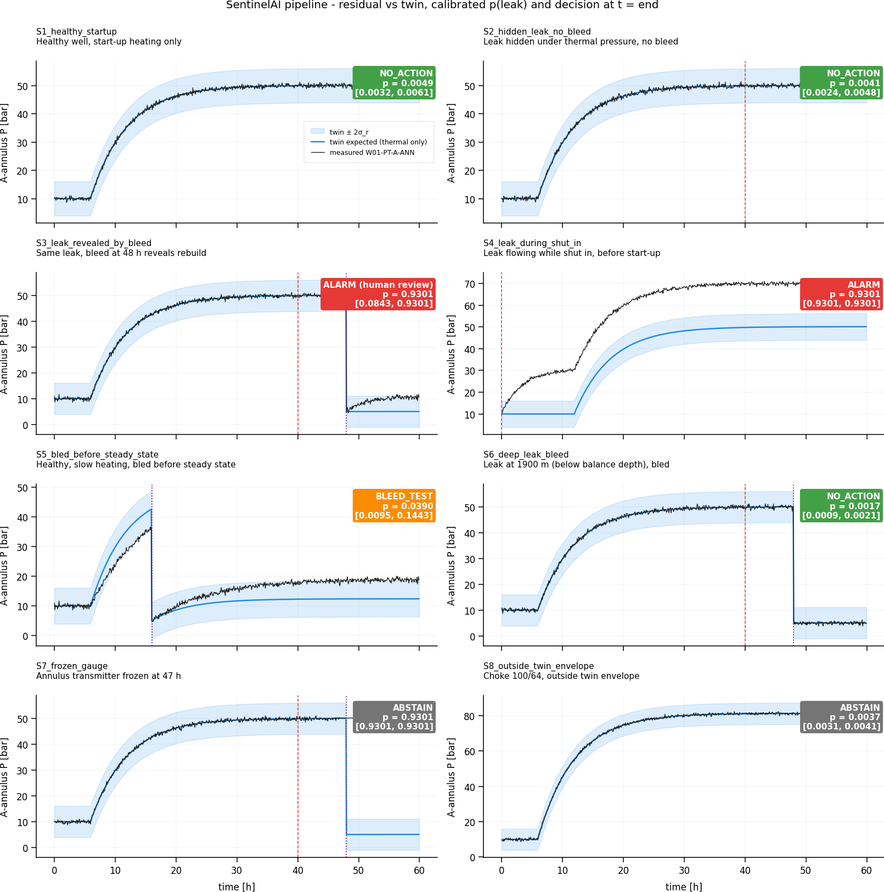
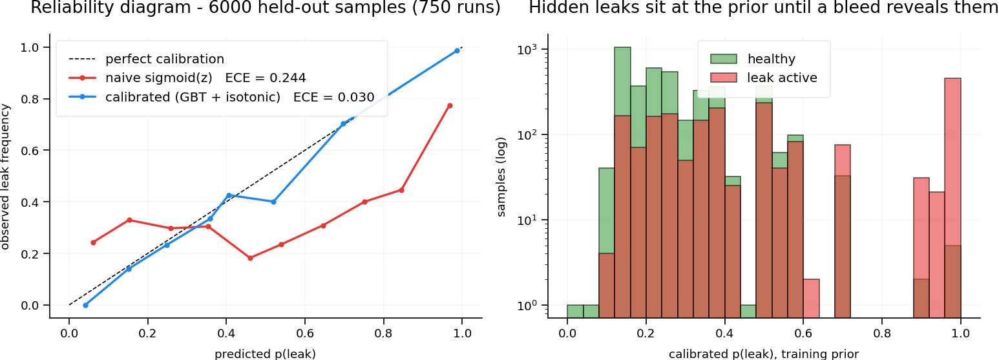

# pipeline — From Residual to Grounded Decision

### Uncertainty-aware alarm logic for A-annulus integrity on synthetic well W01

> **Synthetic and illustrative.** Every number comes from the physics simulator in `models/`, the
> frozen graph in `knowledge_graph/` (v1.0.0), or the explicit assumptions listed in
> [Section 9](#9-assumptions-you-must-be-able-to-defend). No operator or proprietary data is used.



---

## Contents

1. [What this module does](#1-what-this-module-does)
2. [Quick start](#2-quick-start)
3. [Step 1 — Residual (`residual.py`)](#3-step-1--residual-residualpy)
4. [Step 2 — Calibration (`calibrate.py`)](#4-step-2--calibration-calibratepy)
5. [Step 3 — Decision (`decide.py`)](#5-step-3--decision-decidepy)
6. [Step 4 — Grounded rationale (`rationale.py`)](#6-step-4--grounded-rationale-rationalepy)
7. [Results: eight scenarios](#7-results-eight-scenarios)
8. [How this answers the SentinelAI weak controls](#8-how-this-answers-the-sentinelai-weak-controls)
9. [Assumptions you must be able to defend](#9-assumptions-you-must-be-able-to-defend)
10. [Limitations and next steps](#10-limitations-and-next-steps)

---

## 1. What this module does

```
 W01-PT-A-ANN (measured)  ─┐
                           ├─► residual r ± σ_r ──► features ──► calibrated p(leak) [p_lo, p_hi]
 TWIN-W01-SURR (expected) ─┘        (1)                               (2)
                                                                       │
            gates: data quality · MAASP · twin validity · OOD           ▼
                                   NO_ACTION / BLEED_TEST / ALARM / ABSTAIN  (3)
                                                                       │
                                  rationale with [NODE_ID] citations ──► grounding gate (4)
                                                                       │
                                  RiskAssessment + Decision nodes ──► audit.jsonl
```

| Step | File | Question it answers | Main uncertainty handled |
|---|---|---|---|
| 1 | `residual.py` | How far is the measurement from what heating alone explains? | Sensor noise, twin error |
| 2 | `calibrate.py` | What is the probability of a leak, and how sure are we? | Miscalibration, epistemic, prior shift |
| 3 | `decide.py` | What should a human do, given the costs? | Asymmetric costs, value of information |
| 4 | `rationale.py` | Can every number in the explanation be traced to a source? | LLM-style hallucination, stale limits |

**Design rule:** the pipeline reads the frozen graph only through `knowledge_graph/queries.py`.
Every cost, limit, sigma, validity envelope and dwell time comes from a graph node, not a code constant.

---

## 2. Quick start

From the repository root `SentinelAI/`:

```bash
pip install numpy scipy matplotlib networkx pydantic pyyaml scikit-learn joblib

python -m pipeline.residual        # sanity check: residual for a healthy and a leaking well
python -m pipeline.calibrate       # ~2 min: 3,000 synthetic runs -> calibration_W01.joblib + reliability.png
python -m pipeline.decide          # prints the cost thresholds implied by the policy
python -m pipeline.run_pipeline    # 8 scenarios end to end -> out/, audit.jsonl, pipeline_scenarios.png
```

`calibration_W01.joblib` is included, but scikit-learn pickles are version-specific (built with
scikit-learn 1.5.1). If loading fails, re-run `python -m pipeline.calibrate`. The synthetic dataset
is cached in `dataset_W01.npz`; add it to `.gitignore`.

| File | Content |
|---|---|
| `residual.py` | Plant vs twin simulation, residual, features, data quality, twin validity |
| `calibrate.py` | Synthetic dataset, monotone GBT + isotonic calibration, bootstrap interval, prior shift, reliability check |
| `decide.py` | Expected-loss decision with pre-posterior value of information and four gates |
| `rationale.py` | Runtime graph nodes, cited explanation, grounding gate |
| `run_pipeline.py` | End-to-end demo of eight scenarios |
| `calibration_W01.json` | Readable summary of the calibration artifact |
| `reliability.png`, `pipeline_scenarios.png` | Figures |
| `out/` | One rationale and gate verdict per scenario, the hallucination demo, `audit.jsonl` |

---

## 3. Step 1 — Residual (`residual.py`)

### 3.1 Plant and twin

| | Plant ("the real well") | Twin (`TWIN-W01-SURR`) |
|---|---|---|
| Physics | `models/well_integrity_model.simulate` | Same |
| Annulus parameters | True values: c_eff and τ perturbed | Nominal values read from graph node `W01.ANN-A` |
| Leak | Possibly, with unknown size, depth and start | Never |
| Knows | — | Only operations: choke position (`W01-ZT-CHK`), bleed log, flowline pressure |
| Output | `W01-PT-A-ANN` plus noise with σ from the tag | `W01-VT-P-ANN-THERMAL` |

### 3.2 Residual and its uncertainty

$$r(t) = P_{meas}(t) - \hat P_{thermal}(t)$$

$$\sigma_r = \sqrt{\sigma_{tag}^2 + \sigma_{virtual\ tag}^2} = \sqrt{0.5^2 + 3.0^2} \approx 3.04\ \text{bar}$$

Both sigmas are read from the graph (`W01-PT-A-ANN.sigma`, `W01-VT-P-ANN-THERMAL.sigma`).
The residual removes the harmless, temperature-driven pressure. What is left is evidence of mass
entering the annulus, or evidence that the twin is wrong. Step 2 exists because the residual
cannot tell these apart on its own.

### 3.3 Features over the dwell window

Features are computed over the policy's `min_dwell_min` (30 min) window. A single spike cannot
trigger anything.

| Feature | Physical meaning |
|---|---|
| `z_dwell_mean`, `z_dwell_min` | Size and persistence of the residual, in units of σ_r |
| `z_slope_per_h` | Is the residual still growing? (rebuild in progress) |
| `post_bleed`, `post_bleed_z`, `hours_since_bleed` | Is this evidence from after a bleed, the most informative regime? |
| `thermal_transient_C` | Is the twin's annulus temperature still changing? (twin error largest there) |
| `pre_bleed_trend_bar_h` | Was the annulus still heating when it was bled? (see 4.4) |

### 3.4 Data quality and twin validity

- **Quality:** `W01-PT-A-ANN` over the last 2 h is `GOOD`, `FROZEN` (flat line: a healthy
  transmitter always shows noise) or `MISSING`.
- **Twin validity:** choke inside `valid_choke_64` and twin annulus temperature inside
  `valid_T_ann_C`. Both envelopes are properties of `TWIN-W01-SURR` in the graph.

*Implementation note:* `residual.py` caches the steady-state operating point (`wim.operating_point`)
for speed. The physics is unchanged. One plant + twin run takes about 0.03 s.

---

## 4. Step 2 — Calibration (`calibrate.py`)

### 4.1 Why a residual is not a probability

The SentinelAI case criticises treating a raw sigmoid score as a probability. The reliability
diagram shows why:



| On 6,000 held-out samples (750 runs) | ECE | Brier |
|---|---|---|
| Naive: sigmoid of `z_dwell_mean` | 0.244 | 0.263 |
| Calibrated: monotone GBT + isotonic | **0.030** | **0.168** |

The naive score is wrong in both directions. It is overconfident for large residuals that are
really twin error, and underconfident for small post-bleed rebuilds that are almost certainly leaks.

### 4.2 Synthetic labelled data

3,000 runs × 8 evaluation times = 24,000 samples. Labels are known because the simulator is the
ground truth.

| Randomised | Range |
|---|---|
| Leak | 50 % of runs; C_leak log-uniform 1e-7 to 1e-6; start 0–55 h; depth 800–2,000 m |
| Bleed | 60 % of runs, at 15–56 h |
| Start-up, choke | 2–12 h; 24, 32 or 48 /64" |
| Twin error | true c_eff = nominal × exp(N(0, 0.08)); true τ = nominal × exp(N(0, 0.20)) |

**Splits are by run**, not by sample: train 60 % · calibration 15 % · test 25 %. Samples from the
same run are correlated, so splitting by sample would leak information and overstate performance.

### 4.3 Model

1. **Score model:** gradient-boosted trees with **monotone constraints**. A more positive
   residual (`z_dwell_mean`, `z_dwell_min`, `z_slope_per_h`, `post_bleed_z`) can never *lower* the
   leak evidence. This is a physics prior that also prevents absurd extrapolation.
2. **Isotonic calibration** on the calibration runs. Output is clipped to
   $[\frac{1}{n+2}, 1-\frac{1}{n+2}]$, so the model never claims certainty a finite set cannot support.
   *(Platt scaling was tried first. A single slope flattened the confident tail: base 0.993 came out
   as 0.953, while every settled post-bleed rebuild in the data was a leak.)*
3. **Interval:** 40 bootstrap members, each refit on resampled training runs. The 5–95 % band
   (`interval_level` = 0.9) is the epistemic uncertainty.
4. **Out-of-distribution check:** features outside the training range are reported. Step 3 then
   refuses to use p.

### 4.4 Two physics findings the calibration exposed

**(a) Bleeding before thermal steady state creates false rebuilds.** If the true thermal time
constant is slower than the twin's, the annulus is still heating when it is bled. It then rebuilds
in a perfectly healthy well. The feature `pre_bleed_trend_bar_h` separates these cases: among
post-bleed rebuilds with a settled pre-bleed trend, every case in the data was a real leak. This
matches field practice: bleed tests are only meaningful at thermal steady state.

**(b) Leaks below the balance depth are invisible to a bleed test.** While producing, tubing
pressure falls with depth more slowly than the brine column in the annulus. Below a balance depth
(about 1,250–1,700 m here, depending on choke), the annulus is already at higher pressure than the
tubing at the leak point, so nothing flows in, even after a bleed. Median depth of missed leaks:
**about 1,630 m**.

### 4.5 Twin-predicted test performance

The bleed-rebuild test's operating characteristics are **estimated by the twin**, not assumed. A
test counts as positive when p > 0.9 at the training prior, at least 6 h after a bleed. Laplace
smoothing is applied (a finite test set cannot prove a perfect test).

| | Value |
|---|---|
| Sensitivity | **0.49** (misses deep leaks; see 4.4b) |
| Specificity | **0.998** |
| Samples | 1,538 |

### 4.6 Prior shift to operations

Training data is about 35 % leaky; operations are not. Bayes' rule moves the log-odds:

$$\text{logit}\, p_{op} = \text{logit}\, p_{train} + \text{logit}(\pi_{op}) - \text{logit}(\pi_{train}), \qquad \pi_{op} = 0.002$$

**Key insight for the interview:** at rare-event priors, the decision depends on likelihood ratios
in the extreme tail, which no finite calibration set resolves well. A training-prior p of 0.985 vs
0.9997 becomes an operational p of about 0.19 vs 0.93. The bootstrap interval shows this honestly,
and Step 3 has to handle it.

---

## 5. Step 3 — Decision (`decide.py`)

### 5.1 Costs come from the graph

| Symbol | Value (NOK) | Source |
|---|---|---|
| $C_{miss}$ | 20,000,000 | `POL.W01.ANN.v1.cost_missed_leak_nok` |
| $C_{FA}$ | 50,000 | `POL.W01.ANN.v1.cost_false_alarm_nok` |
| $C_B$ | 50,000 | `POL.W01.ANN.v1.cost_bleed_test_nok` (checked against `TEST.BLEED.cost_nok`) |
| $C_A$ | 2,000,000 | `TEST.PRESSURE.cost_nok`: alarm mandates the class-A confirmatory test |

### 5.2 Expected losses

$$L_{none}(p) = p\,C_{miss}$$

$$L_{alarm}(p) = C_A + (1-p)\,C_{FA}$$

$$L_{bleed}(p) = C_B + \sum_{o\in\{+,-\}} P(o)\,\min\big(L_{none}(p_o),\,L_{alarm}(p_o)\big)$$

$L_{bleed}$ is a **pre-posterior (value-of-information) analysis**. You pay for the test, see the
outcome, update p by Bayes with the twin-predicted sensitivity and specificity, then take the best
action. The test is worth buying only if it can change what you would do.

**Implied thresholds** (`python -m pipeline.decide`):

| Situation | No action | Bleed test | Alarm |
|---|---|---|---|
| Bleed available | p < 0.62 % | 0.62 % – 17.1 % | p > 17.1 % |
| Bleed done < 24 h ago (already in the evidence) | p < 10.2 % | — | p > 10.2 % |

These replace the fixed 0.5 threshold. If costs or the prior change (Part 3 of the case), the
thresholds move automatically. Nothing is retrained.

### 5.3 Gates

| Gate | Condition | Outcome | Why |
|---|---|---|---|
| G1 | `W01-PT-A-ANN` quality ≠ GOOD | **ABSTAIN**, verify the transmitter | A frozen gauge makes p meaningless (S7: the model alone says 0.93) |
| G2 | Measured P ≥ active MAASP | **ALARM** (`FM.MAASP`) | Hard limit; no probability needed |
| G3 | Twin outside envelope, or OOD features | **ABSTAIN**, recommend next test | The calibrator would extrapolate |
| G4 | Interval width > `abstain_interval_width` (0.4) **and** best action differs at p_lo vs p_hi | **Robust action**, `human_review = True` | See below |
| — | Otherwise | Minimum expected loss at p | |

**G4 explained.** When epistemic uncertainty is large enough to change the answer, the point
estimate is not used. The costs still say which mistake is cheaper, so the system picks the action
with the lowest **worst-case** expected loss over $[p_{lo}, p_{hi}]$ (minimax) and requires a human
to confirm. In S3 that is ALARM: wrongly doing nothing could cost 18.6 MNOK; wrongly alarming costs
2.05 MNOK.

**The pipeline never trips the well.** Every decision carries `advisory_only = True` and the
policy's `trip_authority = "SIS only"`.

---

## 6. Step 4 — Grounded rationale (`rationale.py`)

### 6.1 Runtime nodes (the audit trail)

`record()` writes two nodes into a **copy** of the frozen graph:

```
RA.W01.<run>  (RiskAssessment)  P_meas_bar, P_expected_bar, residual_bar, sigma_r_bar, z,
                                 p_leak, p_lo, p_hi, interval_level, prior_op, maasp_margin_bar, ...
   ├─ASSESSES──► W01.ANN-A, FM.SCP
   ├─BASED_ON──► W01-PT-A-ANN, W01-VT-P-ANN-THERMAL, TWIN-W01-SURR, TEST.RESIDUAL,
   │             LIM.W01.MAASP.C, POL.W01.ANN.v1
   └─RESULTS_IN► DEC.W01.<run>  (Decision)  action, gate, losses, thresholds,
                                             bleed sensitivity/specificity, human_review, trip_authority
```

Each run is appended to `out/audit.jsonl` with the ground truth, so decisions can be replayed and scored.

### 6.2 The grounding gate

| Rule | Rejects |
|---|---|
| R1 | A number with no `[NODE_ID]` citation in the same sentence |
| R2 | A citation to a node that does not exist |
| R3 | A citation to a superseded node (e.g. MAASP rev B) |
| R4 | A number that matches no property of any cited node, within its displayed precision (percent, thousands separators, dates and versions understood) |
| R5 | A text without an advisory statement citing the policy's trip authority |

The template in `draft()` passes the gate in all eight scenarios. An LLM could write the prose
instead; it would go through the same gate. The gate does not judge whether the prose is wise,
only whether every quantitative claim is traceable.

### 6.3 Hallucination demo (`out/S3_hallucinated_draft.txt`)

| Draft sentence | Verdict |
|---|---|
| "Leak confirmed with probability 0.99 [RA…]" | R4: assessment says 0.9301 |
| "MAASP is 140 bar [LIM.W01.MAASP.B]" | R3: superseded by rev C |
| "the limit is 140 bar [LIM.W01.MAASP.C]" | R4: rev C is 120 bar |
| "Similar wells leaked in 3 of 5 cases." | R1: uncited statistic |
| "See also [LIM.W01.MAASP.D]" | R2: node does not exist |
| "Recommend shutting in the well immediately." | R5: no advisory / authority statement |

---

## 7. Results: eight scenarios

`python -m pipeline.run_pipeline`. Decisions are evaluated at t ≈ 60 h.

| Scenario | Truth | Residual (bar) | p(leak) [90 % interval] | Decision | What it shows |
|---|---|---|---|---|---|
| S1 healthy start-up | healthy | −0.07 | 0.0049 [0.0032, 0.0061] | NO_ACTION | Start-up heating raises no alarm (a fixed 40 bar limit would have) |
| S2 hidden leak, no bleed | **leak** | −0.06 | 0.0041 [0.0024, 0.0048] | NO_ACTION | Honest limit: a leak masked by thermal pressure is invisible online |
| S3 same leak, bled at 48 h | **leak** | +5.53 | 0.9301 [0.0843, 0.9301] | **ALARM** (human review) | Bleed reveals the rebuild; G4 robust decision |
| S4 leak while shut in | **leak** | +20.16 | 0.9301 [0.9301, 0.9301] | **ALARM** | Large unexplained residual, confidently flagged |
| S5 bled before steady state | healthy | +6.34 | 0.0390 [0.0095, 0.1443] | BLEED_TEST | Ambiguous rebuild: repeat the bleed at steady state |
| S6 leak at 1,900 m, bled | **leak** | −0.03 | 0.0017 [0.0009, 0.0021] | NO_ACTION | Honest limit: below balance depth, a bleed cannot see it |
| S7 frozen transmitter | leak | +45.15 | (0.9301, not used) | ABSTAIN (G1) | The model would alarm; the quality gate stops it |
| S8 choke 100/64 | healthy | −0.08 | (0.0037, not used) | ABSTAIN (G3) | Twin outside its validity envelope |

All eight generated rationales pass the grounding gate; the hallucinated draft is rejected on six counts.

**S2 and S6 are deliberate.** They show what this monitoring *cannot* do. Hidden and deep leaks
need a periodic bleed programme and class-A tests (pressure test, temperature log) on a schedule.
They are not caught by smarter alarm logic.

---

## 8. How this answers the SentinelAI weak controls

| Weak control in the case | Answer in this pipeline |
|---|---|
| Raw sigmoid score treated as a probability | Calibration with a reliability diagram; ECE 0.244 → 0.030 |
| Fixed 0.5 threshold chosen on F1 | Cost-based thresholds from the policy node, with value of information for tests |
| Channels treated as independent | Twin removes the temperature-driven part of pressure; residual σ combines both tag sigmas |
| Confidence taken at face value | Bootstrap interval, OOD check, G4 robust decision with human confirmation |
| Retrieval index without revision tracking | Limits are versioned nodes; a rationale citing rev B is rejected (R3) |
| Rationale cites limits not in any source | Grounding gate R1–R4 |
| Automatic trip on alarm | Advisory only; trip authority stays with the SIS (R5 enforces the statement) |
| Labels inherit human error | Synthetic ground truth here; in production, labels from class-A tests, not dispositions |

---

## 9. Assumptions you must be able to defend

| Assumption | Value | Where | Why |
|---|---|---|---|
| Operational leak prior per evaluation | 0.002 | `calibrate.PRIOR_OP` | Policy input; the decision is sensitive to it (at 0.003 the healthy baseline sits on the bleed threshold) |
| Twin c_eff error (log-sd) | 0.08 | `calibrate.C_EFF_SD` | Twin calibrated on a bleed event (`calibrated_on`) |
| Twin τ error (log-sd) | 0.20 | `calibrate.TAU_SD` | Thermal time constant is poorly known |
| Bleed test positive cut | p > 0.9 at training prior | `calibrate.BLEED_POSITIVE_P` | High specificity by design |
| Re-bleed adds nothing within | 24 h | `decide.BLEED_REPEAT_H` | Evidence already in the features |
| Alarm mandates class-A test | — | `decide.L_alarm` | Escalation per integrity procedure |

These are code constants, not graph nodes. In production they belong in a versioned policy or
calibration node. That would be a schema v1.1 change, so the frozen v1.0 graph was left untouched.

---

## 10. Limitations and next steps

- **Synthetic world:** the calibrator is only as good as the simulator's coverage. Real data
  needs labels from class-A tests and monitoring for twin drift.
- **Gas leaks** (gas cap, rebuild toward tubing pressure) are not simulated, which is why deep
  leaks stay invisible. A gas-leak model would change the sensitivity a lot.
- **Single well, single annulus**, and evaluation at one time point; no sequential decisions.
- **Prior-shift fragility:** report the decision's sensitivity to `PRIOR_OP` alongside every alarm.
- **Next:** feed `audit.jsonl` back as outcome labels; move policy constants into graph v1.1;
  replace the template with an LLM behind the same grounding gate; add the G2 MAASP scenario
  (a stiff annulus with gas cap).
